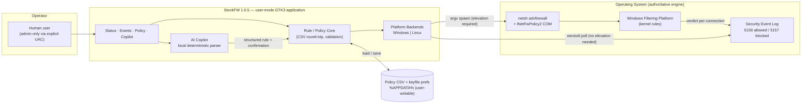
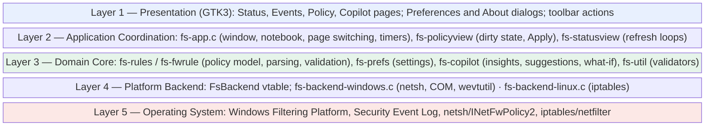
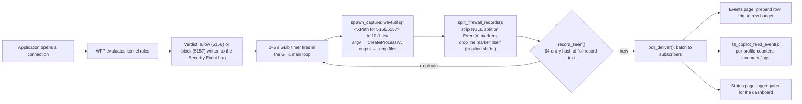
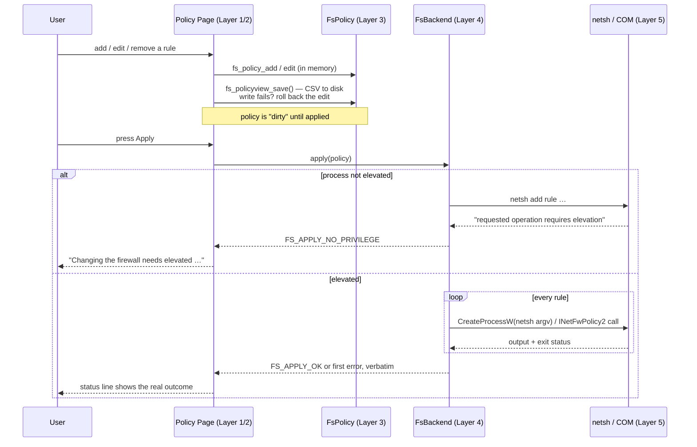
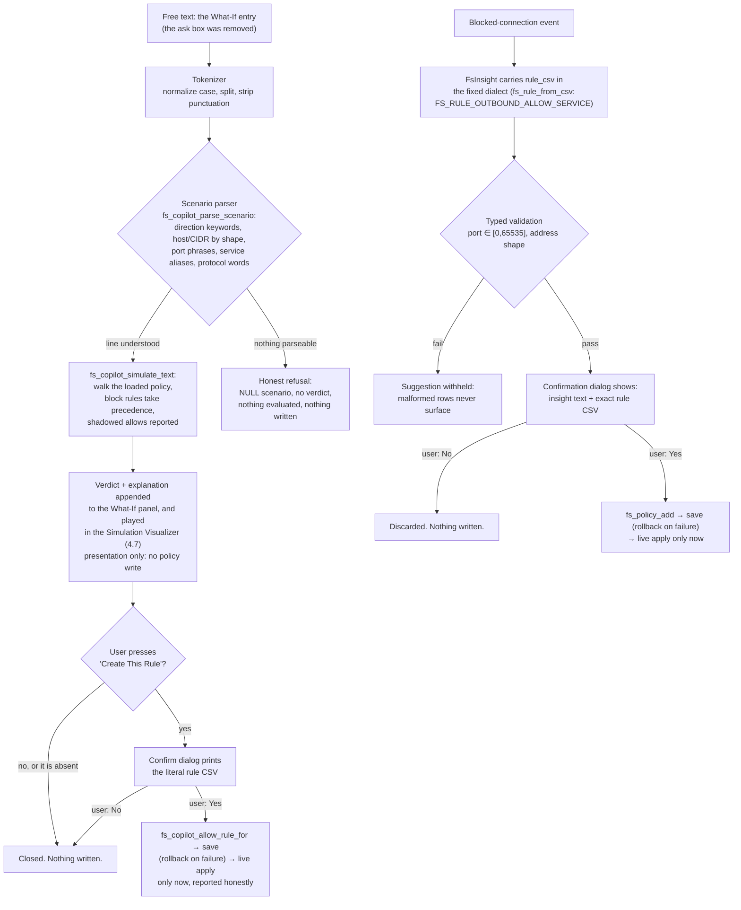
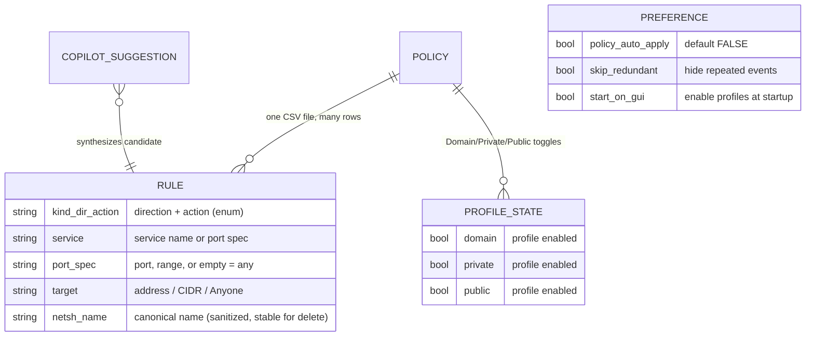
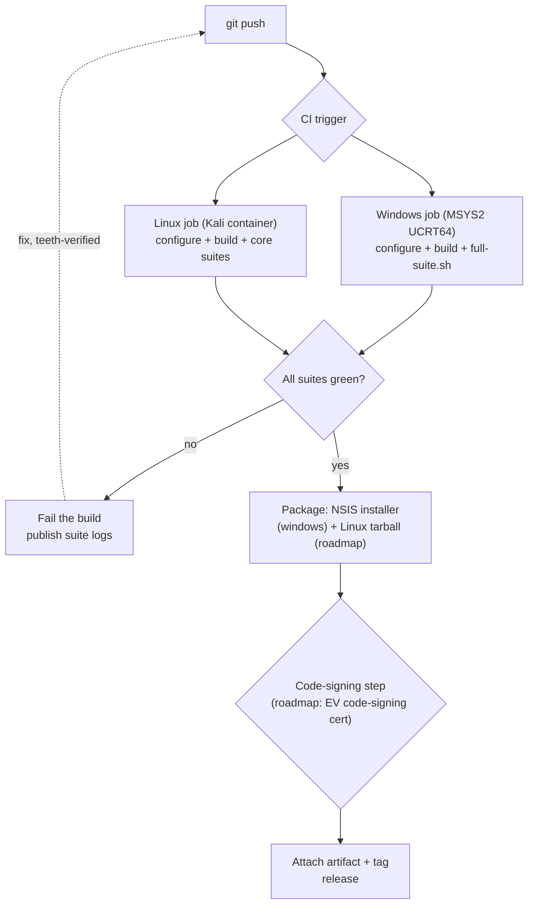

# StockFW — Technical Architecture and Security Document

**Version 1.0.5 · October 2026 · Classification: Internal / Distributable**

*Prepared by the StockFW Project. StockFW is a GTK3 port and modernization of the firewall tool originally developed by Qusai Fethalrahman; the port and this document are authored by H3xCore / the StockFW Project.*

---

## Table of Contents

**Chapter 1: Executive Summary & Introduction** — 1.1 Executive Summary · 1.2 Problem Statement · 1.3 Goals and Non-Goals · 1.4 Target Audience · 1.5 Scope, Conventions, and Evidence Grading · 1.6 The System at a Glance · 1.7 System Context Diagram

**Chapter 2: System Architecture & Flow** — 2.1 Layered Architecture *(Mermaid: block diagram)* · 2.2 Event Data Flow: Connection to Screen *(Mermaid: flowchart)* · 2.3 Control Data Flow: Policy to Firewall *(Mermaid: sequence diagram)* · 2.4 The Backend Contract · 2.5 Process and Trust Boundaries

**Chapter 3: The Core Engine (How it Works)** — 3.1 User-Mode by Design · 3.2 Rule Compilation to `netsh advfirewall` · 3.3 Event Acquisition: 5156/5157 and `wevtutil` · 3.4 Record Splitting, Deduplication, and the Seen-Set · 3.5 Monitoring Bootstrap: `auditpol` · 3.6 The Linux Backend · 3.7 Spawn Mechanics and Failure Modes *(Mermaid: sequence diagram)*

**Chapter 4: The AI Copilot & NLP Engine** — 4.1 Deterministic Local Parsing, No Cloud Model · 4.2 The Scenario Pipeline *(Mermaid: flowchart)* · 4.3 What-If Simulator and Anomaly Detection · 4.4 Guardrails: Allow-Only, Confirm, Rollback · 4.5 Prompt-Injection Threat Surface Analyzed · 4.6 Mapping Natural Language to Rule Grammar · 4.7 Simulation Visualizer: One Verdict, Two Surfaces

**Chapter 5: Security Model & Threat Analysis** — 5.1 Trust Boundaries and Attacker Profiles · 5.2 Privilege-Escalation Analysis *(verified evidence table)* · 5.3 Injection Surfaces: netsh, CSV, Event Log · 5.4 Tamper Resistance of the Policy Store · 5.5 Data Privacy of Logs · 5.6 STRIDE Summary

**Chapter 6: The User Interface & User Experience** — 6.1 Design Language and StockFW Fidelity · 6.2 The Tab Model · 6.3 Real-Time Event Rendering Under Load · 6.4 Filtering, Deduplication, and Row Budgets · 6.5 Preferences: WYSIWYG as Policy · 6.6 Theming, Icons, and Accessibility

**Chapter 7: Policy Management & Rule Engine** — 7.1 The CSV Schema and Round-Trip Guarantees · 7.2 Rule Lifecycle *(Mermaid: ER diagram)* · 7.3 Precedence and Conflict Semantics · 7.4 Per-Profile State: Domain, Private, Public · 7.5 Failure-Atomic Apply and Rollback · 7.6 Import, Export, and Versioning

**Chapter 8: Testing, Build, and Deployment Strategy** — 8.1 Build Matrix · 8.2 Test Architecture and Suites · 8.3 The Teeth Methodology · 8.4 Crash Reproduction Under gdb · 8.5 The NSIS Installer · 8.6 CI/CD Design and Code Signing *(Mermaid: flowchart)*

**Chapter 9: Performance & Scalability** — 9.1 Workload Model · 9.2 Bounded Data Structures · 9.3 Memory Discipline: Defects Found and Fixed · 9.4 Measured Results: The 150-Second Soak · 9.5 CPU Scheduling · 9.6 Scaling Envelope and Bottlenecks

**Chapter 10: Future Roadmap & Commercialization** — 10.1 Feature Roadmap · 10.2 Enterprise and "SaaS" Considerations · 10.3 Licensing Analysis and Open Questions · 10.4 Monetization Options · 10.5 Compliance, Signing, and Distribution

**Chapter 11: 1.0.4 Addendum** — 11.1 Event → Rule, One Click · 11.2 Events Filter Bar · 11.3 Sentinel: Detection and Auto-Block · 11.4 F-1/F-3 Hygiene · 11.5 Repairs and Version

**Chapter 12: 1.0.5 Addendum** — 12.1 AI Assistant Removed, What-If Developed · 12.2 Bi-Directional Direction Setting · 12.3 Runner and Version

---

## Chapter 1: Executive Summary & Introduction

### 1.1 Executive Summary

StockFW is a Windows-first, cross-platform **smart firewall configuration and monitoring tool**: a modern GTK3 desktop application that acts as a management plane over the operating system's native packet-filtering engine — the **Windows Filtering Platform (WFP)**, driven exclusively through Microsoft-supported interfaces — and an equivalent `iptables`-based backend on Linux. It provides four integrated surfaces: a **Status** dashboard with live traffic counters and per-profile toggles (Domain, Private, Public); an **Events** monitor that classifies inbound and outbound connections in real time with process identification and allow/block verdicts; a **Policy** manager for granular rule authoring over CSV storage with verified round-trip fidelity; and an **AI Copilot** that translates natural-language requests into structured firewall rules, explains anomalies observed in the event stream, and simulates the effect of a proposed rule before it is applied.

The product's defining architectural decision is what it **refuses** to be. StockFW contains **no kernel driver, no packet-interception shim, and no cloud dependency**. Every firewall mutation flows through documented, supported Windows mechanisms (`netsh advfirewall` for rule CRUD, the `INetFwPolicy2` COM interface for profile state); every observation flows out of the Windows Security event log. The consequence of this conservatism is a specific and defensible security posture: the application has no driver attack surface, no custom binary parsing of untrusted network packets, and no remote component to compromise. Privilege escalation is handled by an **asInvoker** manifest plus explicit, user-initiated UAC launchers; unelevated operations fail loudly rather than silently. This posture is not aspirational — it is the subject of an auditable verification table in Chapter 5, where each security claim is tied to source-file evidence.

StockFW is a deliberate port and modernization of the GTK firewall configuration tool originally written by **Qusai Fethalrahman**, whose UI conventions — including the sectioned Preferences dialog with its tree sidebar and Help/Cancel/Accept button row — are reproduced faithfully. The port is developed by **H3xCore** under the StockFW Project. It preserves StockFW's design language while replacing its Linux/iptables-era assumptions with a dual-backend architecture whose Windows side is the primary target.

### 1.2 Problem Statement

Windows ships a competent firewall engine and almost unusable management ergonomics. The native controls are split across three surfaces with three different mental models: the per-profile toggles in Windows Security, the rule zoo of `wf.msc` (where hundreds of implicit allow rules make intent unreadable), and PowerShell's `NetSecurity` cmdlets (powerful, but a scripting barrier for exactly the users most likely to misconfigure a firewall). The result is well documented: users disable the firewall entirely, or they author rules they cannot later explain. Meanwhile the events that matter — *which process talked to which address, and was it allowed or blocked* — are buried in Event Viewer rows that require knowing event IDs 5156 and 5157 to extract.

The original tool solved this problem elegantly for Linux in the mid-2000s and is now effectively abandoned; its architecture (shell out to `iptables`, GTK2) does not survive contact with modern Windows. The gap StockFW fills is precisely this: **a single coherent application that makes a stock OS firewall legible** — policy as a readable, diffable CSV; events as a classified, searchable stream; advanced knobs (ICMP behavior, filtering options, rejection semantics) in one dialog; and a Copilot layer that answers "why is this blocked?" (analysis), "what would happen if?" (what-if simulation), and proposes concrete rules — without a shell prompt.

The security problem statement is equally sharp. A firewall configuration tool is an attractive target precisely because it is a privilege amplifier: whatever the tool can be tricked into applying, it applies **with the user's elevation**. Therefore the design constraint that shapes the whole system is: *no input path — CSV file, event record, natural-language string, or UI event — may convert user-level access into firewall-changing action without passing typed validation, an explicit human confirmation, and an elevation check, in that order.*

### 1.3 Goals and Non-Goals

**Goals:**

- **Legible firewall management** on Windows (primary) and Linux (secondary) from one codebase, with policy stored as human-readable CSV that survives load/save round trips semantically unchanged.
- **Real monitoring**: live inbound/outbound event classification with process names, verdicts, addresses, and ports — not a static dashboard.
- **WYSIWYG honesty**: every control shown does something on the running backend; settings pages the backend cannot honor are not displayed, and that guarantee is enforced by an automated test (Chapter 6).
- **A Copilot that earns the word "smart"** — anomaly insight, natural-language what-if simulation, and rule suggestions from observed traffic — with allow-only rule generation, mandatory confirmation showing the exact rule, and rollback if persistence fails.
- **Verifiable security claims**: every statement in the threat model maps to source code that can be inspected, and every regression test can be forced to fail (the "teeth" methodology, Chapter 8).

**Non-goals (equally load-bearing):**

- **No kernel component.** StockFW does not filter packets itself; it configures and observes the OS engine. "Driver vulnerabilities" are therefore out of scope by construction — the attack surface of a third-party NDIS/WFP callout simply does not exist here.
- **No replacement of the OS firewall.** StockFW never uninstalls, disables, or shadows Windows Defender Firewall; if the application crashes, existing WFP rules remain in force and connectivity is unaffected.
- **No cloud AI.** The Copilot is a deterministic local parser (Chapter 4); no telemetry, no rule data, and no event content leaves the machine.
- **No database server.** Storage is a CSV policy file plus keyfile preferences — trivially backed up, diffable, and auditable.
- **No cross-user policy store.** The policy lives in the invoking user's profile; multi-user enterprise distribution is roadmap (Chapter 10), not present.

### 1.4 Target Audience

This document serves four readers. **Security reviewers and auditors**, who will read Chapters 3 and 5 first and expect every privilege-boundary claim to name files and functions; the verification table format is written for exactly this reader. **Software engineers** extending the codebase, for whom Chapters 2, 3, and 7 define the backend contract, the spawn/capture mechanics, and the rule lifecycle. **Technical end users and SOHO operators** evaluating whether StockFW is safe to run elevated — Chapters 1, 5, and 8 answer that directly. Finally, **product and business stakeholders** considering the roadmap and licensing questions in Chapter 10. The prerequisite bar is deliberately low in Chapters 1, 6, and 10, and rises through the middle chapters; no chapter assumes prior StockFW knowledge, though familiarity with firewalls generally is assumed throughout.

### 1.5 Scope, Conventions, and Evidence Grading

Every architectural claim in this document describes the code as it exists in StockFW 1.0.5 (October 2026), not an aspirational design; Chapters 1–10 carry the 1.0.3 base text, Chapter 11 records the 1.0.4 additions, and Chapter 12 records the 1.0.5 additions — the addendum chapters are authoritative where they differ. Claims are graded: **[Verified]** marks behavior proven by source inspection or an automated test named in Chapter 8; **[Measured]** marks behavior with numbers from an executed experiment (e.g., the 150-second soak test in Chapter 9: 45.6 MB → 44.8 MB private bytes under a continuous 300-record event flood, clean exit); **[Roadmap]** marks intent only. Diagrams are Mermaid source blocks intended for rendering. Where the original design and StockFW differ, the difference is called out explicitly rather than silently. Security claims were re-verified against source for this edition: ten privilege-boundary properties were re-read line by line and are cited with file and line references in Chapter 5.

### 1.6 The System at a Glance

| Aspect | StockFW 1.0.5 (actual) |
|---|---|
| Language / standard | C (GNU C11), GLib/GIO/GTK3 |
| UI framework | **GTK3** — native widgets, no Electron/WPF/Qt |
| Build | CMake + Ninja; MSYS2 UCRT64 (Windows), GCC (Linux/Kali) |
| Firewall control | Windows: `netsh advfirewall` (argv spawn) + `INetFwPolicy2` COM; Linux: `iptables` |
| Event acquisition | Windows Security log **5156/5157** via `wevtutil /f:text` (5 s poll, 10 records/call cap) |
| Packet interception | **None** — user-mode management plane over WFP |
| Policy storage | CSV (round-trip tested) in user profile; GLib keyfile preferences in `%APPDATA%` |
| AI layer | Local deterministic NLP parser + heuristics; **no network calls** |
| Privilege model | `asInvoker` manifest; UAC only via user-launched elevated wrappers; fail-loud unelevated errors |
| Installer | NSIS, bundling the complete GTK3 runtime beside `StockFW.exe` |
| Test suites | Core 132, Winlog 56, Installer-spawn 9, Logstart 5, UI smokes, teeth-verified regressions |

### 1.7 System Context Diagram



The diagram encodes the document's central thesis in one picture: StockFW sits **beside** the trust boundary, not inside the packet path. Arrows into the enforcement plane are labelled with their preconditions (argv spawn, elevation required); arrows out of it are read-only observations. Chapters 2 and 3 unpack each arrow; Chapter 5 attacks them.

---

## Chapter 2: System Architecture & Flow

### 2.1 Layered Architecture

StockFW is organized as five strict layers. Dependencies point downward only; no layer reaches around the one beneath it, and the presentation layer never touches the operating system directly.



**Layer 1** is pure GTK3: widgets, tree stores, CSS that is compiled into the executable so an installed copy renders identically to a development build. **Layer 2** owns lifetimes and scheduling — it starts the poll timers, decides when the policy is "dirty," and routes backend errors to status lines instead of swallowing them. **Layer 3** is platform-agnostic C with no GTK and no OS calls: the same rule parser runs on both operating systems, which is what makes the round-trip guarantee testable without a GUI. **Layer 4** is the only layer that spawns processes or calls COM, behind a single vtable (Section 2.4). **Layer 5** is never modified by StockFW in place — WFP rules live in the OS store; StockFW only adds and removes entries through supported front-ends.

The layering is not decorative; it is the reason several bug classes cannot exist. A malicious CSV row can only reach Layer 4 after Layer 3 has parsed and typed it; a malicious event record can only reach Layer 1 after Layer 4 has split and deduplicated it.

### 2.2 Event Data Flow: Connection to Screen

The monitoring pipeline answers one question repeatedly: *what connections did the firewall adjudicate since the last poll?* The flow is push-free and entirely pull-based — StockFW never hooks the network stack; it reads the audit trail the OS already maintains.



Five properties of this flow are load-bearing:

1. **Bounded intake.** Each poll fetches at most **10 records** (`wevtutil /c:10`). Even if ten thousand connections were logged per second, the application's intake is rate-limited at the source call, which caps CPU, allocation, and UI pressure by construction (Chapter 9).
2. **Marker semantics.** The `Event[n]` markers in `wevtutil /f:text` output are the record's *position in the batch*, not a stable identity. When new events arrive, positions shift; treating them as identity re-delivered entire batches as duplicates (defect `e5fbad0`, regression test `test_dedup_index_shift`). The splitter therefore **drops** the marker and dedup keys on the full record body.
3. **A bounded seen-set.** Deduplication hashes the complete record text into a 64-entry table — enough to absorb re-delivery across a poll boundary, small enough to be constant memory.
4. **Fan-out after validation.** The UI, the Copilot, and the dashboard receive only records that survived split + dedup; none of them ever parse raw `wevtutil` output.
5. **No blocking.** Everything from `E` to `H` runs on the GLib main loop with a hard spawn timeout; a wedged `wevtutil` is killed and the poll is skipped rather than freezing the window (Section 3.7).

### 2.3 Control Data Flow: Policy to Firewall

The control path is the privileged one, and it is deliberately more ceremonious than the read path.



Four deliberate design choices appear in this diagram. **Persistence precedes enforcement**: the CSV write happens first, with rollback on failure, so disk and memory never disagree about what the user asked for. **Elevation is detected, not assumed**: the backend classifies netsh's own output (`netsh_needs_elevation`) and returns a distinct status the UI renders as actionable text. **Apply is per-rule and fail-fast**: the first failing rule stops the loop and its error is surfaced verbatim, so a partially applied policy is *visible* rather than silent. **There is no background applier**: with `policy_auto_apply` defaulting to FALSE and no file watcher anywhere in the tree, nothing applies rules unless a human pressed a button in an elevated instance (Chapter 5).

### 2.4 The Backend Contract

Both platforms implement one vtable, `FsBackend` (`fs-backend.h`), which is how the UI avoids `#ifdef` sprawl. The contract, in plain terms:

| Operation | Meaning | Windows implementation | Linux implementation |
|---|---|---|---|
| `available()` | Can we manage the firewall at all? | Firewall service reachable via `INetFwPolicy2` | `iptables` present and loadable |
| `start()` / `stop()` | Enable/disable enforcement | `put_FirewallEnabled(VARIANT_TRUE/FALSE)` per profile | Policy load / flush to accepted state |
| `apply(policy)` | Compile and push rules | One `netsh advfirewall add rule` argv per rule | `iptables` argv per rule (script generation in `fs-script.c`) |
| `poll / hits` | Fetch new adjudicated connections | `wevtutil` on 5156/5157, split + dedup (Section 2.2) | Netfilter log / connection listing |
| `refresh_network` / `refresh_connections` | Dashboard counters | `GetExtendedTcpTable`, interface stats (no elevation needed) | `/proc` and route queries |
| `uses_settings` | Do Network/ICMP/ToS/Advanced preference pages apply? | **FALSE** — rules come from the policy | **TRUE** — pages build rules |

`uses_settings` deserves special mention because it is the architectural root of the WYSIWYG guarantee: the Preferences dialog asks the backend whether to render those pages *at all* (Chapter 6), and the UI smoke test fails if a page the backend ignores is offered (Chapter 8).

Ownership rules inside the contract are explicit: callers own the lists returned by the refresh operations and free them with the provided element destructors (`fs_iface_stat_free`, `fs_connection_free`) — a discipline whose violation caused a real leak class that was fixed and is now discussed in Chapter 9.

### 2.5 Process and Trust Boundaries

StockFW runs in at most three process contexts, and the boundaries between them are enforced by the operating system, not by convention:

1. **Unelevated StockFW.exe** (manifest `asInvoker`, verified by inspecting the built binary). It can read the event log, read connections, edit and save the CSV — and it *cannot* change the firewall. Every attempt fails with a specific, actionable error.
2. **Elevated StockFW.exe**, reached only when the user deliberately runs one of the shipped launchers (`StockFW-elevated.vbs/.cmd/.ps1`), each of which resolves its target **relative to its own directory in Program Files** and triggers UAC via `Start-Process -Verb RunAs`. Windows UIPI then prevents any medium-integrity process from sending input to this window — a background malware cannot click "Apply."
3. **Child tools** (`netsh`, `wevtutil`), spawned with `CreateProcessW` under `CREATE_NO_WINDOW`, inheriting exactly three handles (stdin from `NUL`, stdout and stderr to per-invocation temp files) through an explicit process-attribute list — the child cannot inherit stray handles from the parent.

There is no IPC surface: no named pipe, no socket, no D-Bus. The only cross-process data channels are the child's stdout/stderr temp files and the shared CSV, whose consequences under tampering are analyzed in Chapter 5. The trust summary: *input trust flows from the OS (event log), content trust is never assumed (everything is parsed and typed), and privilege flows only from explicit user intent (UAC).*

---

## Chapter 3: The Core Engine (How it Works)

### 3.1 User-Mode by Design

The first thing to understand about StockFW's engine is what it deliberately does not contain: a driver. Firewalls are commonly extended with kernel components — WFP callout drivers, NDIS filter drivers, or user-space interception libraries such as WinDivert — in order to *observe or make verdicts themselves*. StockFW does neither. It **configures** the Windows Filtering Platform through interfaces Microsoft documents and supports (`netsh advfirewall`, the `INetFwPolicy2` automation interface) and **observes** adjudications by reading the audit events the OS already writes.

This decision removes an entire chapter from the threat model. A kernel callout parses attacker-controlled packet data in a context where a bug is a blue screen or a privilege escalation; it must be signed, versioned against OS builds, and updated forever. A user-mode management tool that speaks only to documented APIs inherits none of that. The trade-off is honest and accepted: StockFW cannot see packet payloads, cannot intercept connections before the kernel decides, and is bounded by whatever the audit subsystem records. For a configuration-and-monitoring product, those are the right trade-offs — the engine's own filters do the time-critical work, and StockFW's job is to make the engine's state legible.

There is a second, subtler benefit. Because every mutation is an invocation of a standard tool with a textual output, the entire write path is **observable and testable**: tests can fake `wevtutil.exe`/`netsh` in a search path, feed real-world output formats, and assert parsing behavior without root, without a VM, and without touching the host firewall. Chapter 8's 56-check Windows suite exists because of this property.

### 3.2 Rule Compilation to `netsh advfirewall`

A `FsFwRule` in memory is a typed structure: direction (in/out), action (allow/block), protocol (TCP/UDP/any), an integer local port, and an optional remote address. Compilation to a netsh invocation (`fs-backend-windows.c`, `netsh_add_rule`) is where typing pays off:

| Rule field | Compilation | Why it is safe |
|---|---|---|
| direction | `dir=in` / `dir=out` | enum → literal, two fixed strings |
| action | `action=allow` / `action=block` | enum → literal |
| protocol | `protocol=TCP` / `UDP` / `any` | enum → literal |
| local port | `localport=%d` or `localport=any` | **formatted from an int** — no string ever flows here; ports with protocol `any` are omitted because netsh rejects them |
| remote address | `remoteip=%s` | single argv token; netsh's own parser rejects anything that is not an address/keyword (fail-closed, Section 5.3) |
| name | `name=` after `netsh_safe_name()` | `: ( ) / ,` replaced with `-`; the same canonical name is used for add and delete so removal matches creation |
| scope | `profile=any`, `enable=yes` | fixed constants |

The args are collected as `char **` and handed to `spawn_capture()`, which builds one command line via `build_command_line()` → `append_spawn_arg()`. That quoting function is an exact inverse of `CommandLineToArgvW`: a token containing space, tab, quote, CR or LF is wrapped in quotes; embedded quotes become `\"`; runs of backslashes touching a quote are doubled; trailing backslashes before the closing quote are doubled. The correctness of this function is the difference between "arguments can never be smuggled" and "arguments can never be smuggled *on a good day*": because each argv element round-trips to exactly one child argument regardless of content, **no policy string can ever become a second netsh parameter**. A crafted `remoteip` value cannot add `action=allow`, a crafted rule name cannot add `localport=any`, and there is no shell in the loop — no `cmd.exe`, no `system()`, no metacharacters to interpret.

Netsh's own limitations are handled explicitly rather than discovered at runtime: rule names are sanitized because netsh rejects colons, parentheses and slashes that the UI's display names legitimately contain; port specifications are dropped for protocol `any` because netsh refuses them; profile is always `any` so the compiled rule behaves uniformly as the user toggles Domain/Private/Public.

### 3.3 Event Acquisition: 5156/5157 and `wevtutil`

The monitoring side reads two Security log events: **5156** (the Windows Filtering Platform permitted a connection) and **5157** (it blocked one). Each record carries exactly the fields the Events page shows: application path (hence the process name, e.g. `brave.exe` or `svchost.exe`), source and destination addresses, ports, protocol, direction, and the verdict.

Acquisition runs as a five-second GLib timer that spawns:

```
wevtutil q <XPath: EventID=5156 or 5157> /c:10 /f:text
```

Three properties of this call shape the whole pipeline. `/f:text` yields human-oriented records (`Event[1]`…`Event[n]` markers, `Description:` lines — note the trailing space after the colon) instead of XML, which is cheaper to parse defensively and matches what the original analysis of real system output documented, including the presence of NUL bytes the splitter strips first. `/c:10` bounds intake per poll — the single most important performance control in the product (Chapter 9). And XPath filtering pushes the selection work into the OS: the child process reads at most ten matching records.

Before this works at all, the audit policy must allow it: **Section 3.5** covers the `auditpol` bootstrap. Reading requires no elevation (a normal user may read the Security log's firewall subcategory once enabled), so the entire monitoring path runs happily in an unelevated instance — the read and privilege planes are cleanly separated.

### 3.4 Record Splitting, Deduplication, and the Seen-Set

`split_firewall_records()` turns raw child output into a `GList` of complete record strings. Its rules, each learned from a real defect:

1. **Strip NULs.** The captured stream can contain embedded NUL bytes that would silently truncate `strstr`-based parsing; they are removed before anything else looks at the text.
2. **Split on `Event[n]` markers, then drop the marker.** The marker is the record's *position in this batch*. Positions shift whenever new events arrive between polls; including the marker in the dedup key meant an old record whose position changed was "new" again, and the whole batch was re-delivered — the duplicate-rows defect whose regression test, `test_dedup_index_shift`, drives the pipeline across an index shift and fails if more than the expected number of deliveries occur.
3. **Tolerate short reads.** A record missing its expected fields is skipped and counted rather than partially delivered — the UI never invents columns.
4. **Dedup on the full record body.** `record_seen()` hashes the complete remaining text into a fixed table (`SEEN_RECORDS_MAX` = 64 entries). Re-delivery across a poll boundary, backend restarts, or log replication lag all collapse to zero rows. The bound means a flood cannot grow the table: after 64 live entries, new records simply bypass the (already-full) window, favoring liveness over stale dedup.

The split and dedup stage is also where the product's honesty policy applies to data: a record is shown exactly as the OS produced it (fields reordered for display, text never fabricated), so what the user sees in Events can be reconciled line-by-line with `eventvwr`.

### 3.5 Monitoring Bootstrap: `auditpol`

Windows does not log 5156/5157 unless the audit policy enables the *Microsoft-Windows-Windows Firewall With Advanced Security/Firewall* subcategory. StockFW's `firewalled_log_start` runs the corresponding `auditpol /set` command **idempotently** — running it twice is harmless, and it is the only place where StockFW changes a machine setting that is not a firewall rule. It surfaces its result in the UI: if policy editing is denied (audit policy requires elevation), the Events page says monitoring is not enabled and how to enable it, instead of showing an empty list and calling it "no traffic."

This distinction matters for trust: monitoring state and enforcement state are reported separately. A user can run StockFW unelevated, see their real traffic, explore policies, and simulate changes — and only pay the UAC cost when they decide to actually reconfigure the firewall.

### 3.6 The Linux Backend

The Linux side implements the same vtable against `iptables` using **argv-style execution** — each invocation is a `g_spawn_sync` of `iptables` with arguments as a vector, never a shell string, so rule content cannot inject shell syntax (`fs-backend-linux.c`). The Linux backend is also where `uses_settings = TRUE`: the Network/ICMP/ToS/Advanced preference pages genuinely compile into rules there, which is exactly why those pages are rendered on Linux and hidden on Windows (Chapter 6).

An additional facility exists for reviewability: `fs-script.c` can emit the equivalent ordered shell script (its header comment begins with dropping malformed packets before anything else sees them), letting a Linux user audit the complete effect of their policy as text before applying it. The same CSV policy model serves both platforms; only the compilation target differs.

### 3.7 Spawn Mechanics and Failure Modes

Every child process on Windows goes through `spawn_capture()`, which exists because `g_spawn_sync` was unsuitable for two hard requirements: suppressing console windows for GUI sessions, and capturing output reliably with a timeout.

```mermaid
sequenceDiagram
    participant App as spawn_capture()
    participant OS as CreateProcessW
    participant Child as netsh / wevtutil
    participant T as Temp files (sfw*.tmp)

    App->>T: GetTempFileNameW ×2 (atomic unique names)
    App->>T: reopen with FILE_SHARE_READ only (write-locked)
    App->>OS: argv → build_command_line (CommandLineToArgvW-inverse)<br/>CREATE_NO_WINDOW, 3-handle inherit list
    OS->>Child: process starts, console-free
    Child->>T: stdout / stderr written directly
    App->>App: WaitForSingleObject (hard timeout)
    alt child exceeds timeout
        App->>Child: TerminateProcess
        App-->>App: report timeout error, skip this poll
    else child exits
        Child-->>App: exit status normalized to g_spawn semantics
        App->>T: rewind and read captured text
        App->>App: parse (netsh: detect elevation errors; wevtutil: split)
    end
    App->>T: delete both files (always, including error paths)
```

The failure modes are enumerated deliberately:

- **Console window suppression.** `CREATE_NO_WINDOW` keeps `wevtutil` flashes out of the user's session — a functional requirement inherited from the original GUI expectations.
- **Output via temp files, not pipes.** Pipes deadlock when a child writes more than the pipe buffer before the parent reads; file capture sidesteps this entirely. The files are created atomically by `GetTempFileNameW` and reopened with `FILE_SHARE_READ` only, so once open, no other process can modify or delete them while the parent holds the handle; an attempted pre-open plant causes a sharing violation, which takes the **error path** rather than corrupting input (Chapter 5).
- **Hard timeout with kill.** A wedged child is terminated and the poll is skipped; the main loop never blocks indefinitely.
- **Exact handle inheritance.** An explicit process attribute list passes three handles and nothing else — the child cannot inherit the parent's policy file handle or any other live object.
- **Exit-status parity.** Child exit codes are normalized to the same convention `g_spawn_sync` reported, so error handling logic written for the Linux backend behaves identically on Windows.
- **Elevation classified from output.** netsh reports elevation failures on *stderr with a non-zero code*; the classifier reads the captured text for the canonical phrase so `FS_APPLY_NO_PRIVILEGE` wins over the raw failure reason (the phrase check is a `strstr` over captured output, not a security decision — it only chooses which message the user sees).

---

## Chapter 4: The AI Copilot & NLP Engine

### 4.1 Deterministic Local Parsing, No Cloud Model

StockFW's Copilot is advertised as "AI," and this document's job is to say precisely what that means. The Copilot is a **local, deterministic understanding layer**: a tokenizer, a synonym/alias table, a **closed-grammar scenario parser** (direction keywords, hosts recognized by shape, port phrases, protocol words), and on the suggestion path a rule synthesizer that emits one fixed CSV dialect. There is **no LLM, no cloud API, no model weights, and no network call anywhere in the Copilot path**.

This is an architectural position, not a shortcut. A firewall configuration assistant that ships its users' rule requests, observed traffic patterns, and anomaly context to a third-party endpoint would violate the privacy expectation of exactly the audience that installs a firewall. A probabilistic model that can hallucinate an argument list is the wrong tool for generating firewall rules where a typo is a real misconfiguration. And an offline-by-construction assistant keeps working on an air-gapped machine, which firewall users plausibly are. The costs are equally real and are stated plainly: the parser handles a bounded grammar rather than arbitrary conversation, and its comprehension ceiling is the size of its alias table. Chapter 10 discusses model-assisted parsing as a future, opt-in, on-device option — not part of 1.0.5.

What the Copilot *does* deliver, from real code paths: **rule suggestions from observed traffic** ("`brave.exe` was blocked from 203.0.113.7:443 — allow it?"), **anomaly insights** (unusual destination ports, novel application profiles — `is_anomalous_port` and the per-profile counting tables), and a **what-if simulator** that reads a line like *"allow SSH from 192.168.1.50 on port 22"* and answers BLOCKED/ALLOWED against the real policy. The standalone ask box that once sat on the Copilot page has been **removed**: free text now enters only through the What-If Simulator's entry, which is read-only, and the grammar tables that fed the ask box (service aliases, direction keywords, port phrases) serve the scenario parser instead. Status messages from apply/undo/clear operations are logged in the Policy Analysis pane, so every write-path message lands in the log next to the suggestions that caused it.

### 4.2 The Scenario Pipeline



The typed line itself still has **no write path**: every branch — parsing, simulation, refusal — ends as text in the What-If panel and a frame in the visualizer, so free text can *become* nothing but a verdict string; the ratchet is trivially true for the text alone. The one transition this surface can alter anything on is the visualizer's **Create This Rule**, and it is gated like the suggestion path: the button is *absent* unless the line parsed and the verdict was blocked (nothing dead to press), the line above it prints the rule in plain words, a confirmation dialog then prints the literal rule that will be created, and only the user's `Yes` reaches `fs_policy_add_persist`, whose rollback keeps store and disk agreeing — after which the policy is applied and the outcome reported honestly, because "the row exists" and "the firewall enforces it" are two different claims. The suggestion path (event-driven, not typed) keeps the ratchet for real: at every stage — extraction, validation, synthesis — failure leads to a withheld suggestion or a refusal, never to a state change. The only transition that can alter anything is the user's explicit `Yes` on a dialog that prints the literal rule that will be created.

Entity extraction is table-driven: service aliases resolve through the same service database the rest of the app uses (`SSH` → 22, `DNS` → 53 …) after a small well-known map answers first (`ssh` → 22, `http` → 80, `https` → 443, `dns` → 53, `rdp` → 3389, `ftp` → 21 — the control port, not the table's data-channel 20 — `smtp` → 25), addresses are recognized by shape (a `host:port` shorthand and a bare `:22` / `local:22` included — both name a port on this machine, never a host; a *hostname* is deliberately not accepted as a host — `open.code.exe` must not parse as an address), and port phrases ("on port 22", "port 22", and the number-first "at 22 port") bind to the extracted port, beating the service default when both appear. A rule suggestion synthesized from a blocked-connection event reuses the event's own fields, so suggestions are grounded in observed reality rather than invented.

### 4.3 What-If Simulator and Anomaly Detection

The **simulator** answers a policy question before any change. A line of free text is parsed in core (`fs_copilot_parse_scenario` → `FsScenario`: direction — default **outbound** — host/CIDR, port, protocol, application) and evaluated against the loaded policy by `fs_copilot_simulate_text`, which writes nothing. The verdict is computed the way Windows Firewall resolves real traffic: **block rules take precedence over covering allows**, and when both match, the result reports the allow as *shadowed* instead of pretending it wins. Address matching covers CIDR (`fs_util_addr_in_cidr` — a `/24` block covers the hosts inside it), a known service name supplies the port when the line names none, and when no policy is loaded the verdict says so rather than inventing rules it does not have. The panel prints the parsed reading next to the verdict, and a line that named no port or no host carries an explicit note — a verdict read against "any port" must not look like a verdict for one port (ICMP lines skip the port note: they have no ports to name). The same result then plays in the **Simulation Visualizer** (§4.7) — the panel keeps the scrollback, the window plays the verdict — and neither a policy row nor an audit line is written by simulating: the simulator is a question, not a change. This is the "explain the verdict" feature that raw `wf.msc` cannot offer, and it doubles as a conflict detector for Chapter 7.

**Anomaly detection** is statistical, not speculative. Per-profile counters track each application's observed behavior (destination ports, peers, direction mix); `is_anomalous_port` flags first-time or rare service usage for that profile (e.g., a chat client suddenly using a database port). Insights are generated only when a threshold observed in *this user's* traffic is crossed, which is why the Insights list is clearable and bounded — insight history is session state, not an ever-growing database. Because counters are fed only by deduplicated event records (Section 2.2), an attacker cannot cheaply flood the Copilot's memory: intake is capped at ten records per five seconds before the Copilot ever sees a record.

### 4.4 Guardrails: Allow-Only, Confirm, Rollback

Four independent guardrails stand between a Copilot string and the kernel:

1. **Structural allow-only (suggestions).** Suggestions parse through the `FS_RULE_OUTBOUND_ALLOW_SERVICE` dialect, which has no verb for "deny," "remove," or "disable." A malicious input asking to "delete the firewall" or "block all traffic" does not fail *securely* — it fails *syntactically*, because the dialect contains no such operation. The What-If grammar *does* read words like "block" — it must, to answer "would this be blocked?" — but its only output is a verdict string; nothing from a simulation reaches the policy. An allow-only suggestion path structurally cannot produce the rule that breaks DNS: at worst it proposes allowing something more, which the confirmation dialog still gates.
2. **Typed validation before synthesis.** Ports must be all digits in range (Section 5.3), addresses must pass shape checks; malformed entities abort to the refusal branch.
3. **Mandatory human confirmation showing the literal rule.** `on_apply_suggestion_clicked` opens a modal `GtkMessageDialog` containing the insight title *and the exact CSV rule*; answering No discards everything. There is no "apply all," no auto-accept, and no setting that skips the dialog.
4. **Rollback on persistence failure.** After Yes, the rule enters the in-memory policy and is saved; if the CSV write fails, the edit is **taken back out** so the Policy page, the file, and the firewall cannot diverge. Only then does the live apply run.

Undo is not a special feature because it does not need to be: a Copilot-created rule is an ordinary policy rule. It appears in the Policy page where the user can edit or remove it, and applying that change returns the firewall to its previous state. The default-allow-outbound baseline rules (DHCP 67/68, DNS 53, NTP 123) ship in the policy so a fresh install cannot lock the machine out — and StockFW is never the only firewall, so even a catastrophic policy error leaves the OS's own state controllable through the stock tools.

### 4.5 Prompt-Injection Threat Surface Analyzed

"If a user types a malicious prompt, could it be tricked into creating a rule that opens a backdoor?" The honest answer requires separating two architectures, because the answer differs completely between them:

- **Against an LLM with tools**, prompt injection is a first-order threat: hidden instructions in retrieved text can steer tool calls.
- **Against a deterministic keyword parser with a closed grammar and a human confirmation gate**, "injection" has no semantic channel to exploit. There is no instruction-following behavior to hijack. The parser does not execute, delegate, persist, or auto-apply anything.

What an attacker who controls input can actually accomplish, fully enumerated: get text echoed back in the What-If result panel (no impact — the panel never interprets it as instruction); cause a *candidate* allow-rule to be suggested (impact: none until a human clicks Yes on a dialog printing that rule); or craft policy CSV content directly (impact: analyzed in Chapter 5 — nothing applies it without a human pressing Apply in an elevated instance). There is no path from input string to open port that skips a human reading the port number.

Residual risks worth naming so they are not silently ignored: **social engineering of the human** (a convincing-sounding suggestion that the user approves without reading — mitigated by printing the literal rule, not a paraphrase), **traffic-engineered suggestions** (a peer generating connection patterns to induce a suggestion — again gated by the same dialog, and suggestions only ever *add* scoped allows), and **display spoofing through rule content** (a rule whose *name* contains an error phrase could theoretically appear confusing in downstream textual output — display-only, no state effect, logged as a residual in Chapter 5).

### 4.6 Mapping Natural Language to Rule Grammar

The translation problem is made tractable by inverting the usual direction: instead of parsing arbitrary English *into* an arbitrary rule language, StockFW parses a **narrow command register** into a **five-field scenario** (direction, host, port, protocol, application). The line a user types — today into the What-If Simulator, since the ask box was removed — *"allow SSH from 192.168.1.50 on port 22"* — decomposes:

| Phrase fragment | Analysis | Result |
|---|---|---|
| "allow" | action word; the following token is read as the application | application `SSH` |
| "SSH" | service alias → default port (used only when the line names no port) | port `22` available |
| "from 192.168.1.50" | direction keyword (`from`/`to`/`inbound`/`outbound`/`ingress`/`egress`…) + address by shape | direction **inbound**, host `192.168.1.50` |
| "on port 22" | explicit port clause | port `22` confirmed (beats the alias) |
| *(no protocol word)* | protocol keywords `tcp`/`udp`/`icmp`/`ping` | default `TCP` |
| *(direction keyword absent entirely)* | documented default | direction `outbound`, printed with the verdict |

Design rules that keep the mapping honest: **explicit beats inferred** (a stated port clause beats the service default), **known shapes only** (addresses parse by digits, dots and colons — a hostname never becomes a host: `open.code.exe` must not parse as an address), and **nothing parseable means no verdict**: the parser returns NULL, the panel says the line could not be read, and no policy walk happens. The alias tables — service names, direction keywords, protocol words — are data, not code, so extending comprehension is a table edit covered by parse-level unit tests (the core suite's 353 checks include both suggestion-parse and scenario-parse coverage, including the reading shapes the visualizer's examples rely on (`ssh is open at 22 port`, `:22`, `local:22`, `rdp`, `ftp`)).

### 4.7 Simulation Visualizer: One Verdict, Two Surfaces

The verdict from §4.3 is computed once and shown twice: the panel keeps the scrollback (cheap iteration), and `fs-simviz` (`SimulationVisualizer` as a C component: `fs_simviz_run (parent, result, scenario, query)`) plays it in a modal window — header bar titled *What-If Simulation* with the native (X), the typed question as a pill, the diagram, a banner, the explanation, and a footer. Esc closes it; it centers over the Copilot window; the layout is theme-font and shrinks to 520 px wide. **The component only presents** — it receives the `FsSimulationResult` and re-judges nothing.

The diagram is flat, vector-drawn with cairo (a PC, a brick wall with a flame, a globe or a rack-mounted server depending on direction, dotted green lines, a PDU envelope), and plays one of three scripts, each about 2.6 s, once, with a **Replay** button:

- **allowed** — the packet reaches the wall, the wall flashes green, a check pops, the packet continues, the far node glows green;
- **blocked** — the packet reaches the wall, the wall shakes red, an X pops, the packet bounces back and fades, and the segment past the wall turns gray/dashed;
- **error** (unparseable line) — no animation at all: the scene dims to a `?`, and the window says *Couldn't understand this query* with example lines. No badge, no details, no Replay — absent, not disabled, because an unreadable line must never look like a firewall decision.

The scripts are one pure function, `fs_simviz_state_at (outcome, seconds) → {packet position, wall flash, shake, glow, badges, gray tail, done}`, with no GTK and no clock behind it — which is why the tests can assert every phase (hold at the wall, bounce/fade, monotonic travel, frozen end state) without a display. The window maps that state onto pixels; the palette is a single table, so dark mode is a second table rather than a rewrite.

The banner's details row reads from the `FsScenario` the parser produced, honestly: `local:22` for an inbound destination, `WWW`/the address for an outbound one, `any` where nothing was named, `n/a` for ICMP, and the verdict badge in the app's blue/green/red. The Explanation section shows `result->reason` — a field added beside `explanation` carrying *only* the why (`"Reason: …"` stripped of the `"Simulation: … would be BLOCKED."` wrapper the panel log keeps verbatim).

The one write this surface can perform is **Create This Rule**, and only on a blocked, parsed scenario: core builds the sentence (`fs_copilot_allow_suggestion` — "To allow this, add a rule: Allow inbound TCP port 22 from 192.168.1.50.") and the rule (`fs_copilot_allow_rule_for` — the service-allow kind of the scenario's direction, well-known name or protocol word, port, host), the window returns a *response* rather than touching the policy, and `create_rule_from_scenario()` in the UI does the rest with the Chapter 4.4 guardrails: duplicate check → confirmation dialog printing the literal rule CSV → `fs_policy_add_persist` (rollback on a failed write) → Policy-page reload → live apply with an honest report, because a saved row and an enforced rule are two different claims. Cancel leaves nothing behind.

**[Verified]** `test_whatif_reading` (core): every reading shape and both builders, including the ICMP no-port and hostname-rejection boundaries. `fs-simviz-smoke` (UI): the full timeline for all three outcomes plus each window variant read the way a user reads it — badge text and style class, details facts, the exact suggestion sentence, Replay/Close present, and *Create This Rule absent* whenever it could not act.

---

## Chapter 5: Security Model & Threat Analysis

### 5.1 Trust Boundaries and Attacker Profiles

StockFW's security model is built around three boundaries:

- **B1 — Enforcement boundary**: anything that can change firewall state must pass through an elevated StockFW instance calling netsh/COM. This boundary is enforced by Windows (token elevation, UAC) and cannot be crossed by StockFW's own code, which contains no self-elevation path whatsoever.
- **B2 — Input boundary**: text from the OS (event log), from disk (CSV policy, preferences), and from the user (UI, Copilot) is untrusted until parsed and typed. No layer consumes raw bytes from below it.
- **B3 — Display boundary**: what the UI renders is derived data; the UI never interprets its own display strings as commands.

Three attacker profiles, ordered by capability:

| Profile | Capability | Realistic goals |
|---|---|---|
| **A1 — Remote unauthenticated** | Can generate network connections observed by the firewall | Induce permissive rules or misleading insights; read nothing (no network surface in StockFW at all) |
| **A2 — Local user-level malware** | Full control of the user's profile: rewrite the policy CSV, attack the unelevated UI, race temp files | Convince an elevated StockFW to install attacker rules ("confused deputy") without gaining elevation itself |
| **A3 — Interactive user (incl. admin)** | Everything, including UAC consent | Out of scope as an attacker: this is the operator. Misconfiguration protection (confirmations, simulator) applies instead |

StockFW exposes **no listening socket, no IPC endpoint, and no parser reachable from the network**; A1's only interaction with the product is the traffic it generates, which the Copilot treats as *evidence to display*, never as instructions to execute. The entire interesting fight is A2 vs. the confused-deputy problem, which is the subject of the next section.

### 5.2 Privilege-Escalation Analysis

The following table re-verifies, against source, the claim that user-level access cannot be converted into firewall-changing action. Each row was re-read for this document; file references are to StockFW 1.0.5.

| # | Property | Mechanism | Evidence |
|---|---|---|---|
| 1 | **No self-elevation code** | The tree contains no `ShellExecute`, `runas`, `WinExec`, or `system()`; the Windows backend spawns only via `CreateProcessW` | `spawn_capture`, `fs-backend-windows.c:592`; zero matches project-wide |
| 2 | **Manifest is `asInvoker`** | Elevation exists only in launchers the user deliberately runs | verified by inspecting the built `StockFW.exe`: `asInvoker` present, `requireAdministrator` absent |
| 3 | **Unelevated operations fail loud** | COM: explicit "requires administrator privileges" error; netsh: output classified as `FS_APPLY_NO_PRIVILEGE`, rendered as actionable text | `fs-backend-windows.c:175`, `:921`, `:1045`; `fs-policyview.c:424` |
| 4 | **No argument injection** | Ports compile from `int` (`%d`); direction/action/protocol are enum literals; every value is one argv token quoted by the `CommandLineToArgvW` inverse; no shell exists | `fs-backend-windows.c:763-788`, `append_spawn_arg:325` |
| 5 | **Strict CSV typing** | All-digit port fields (rejects `80abc`, `0x50`), range 0–65535 with `a ≤ b`; malformed rows skipped and counted at load; since 1.0.4 host and port fields are validated fail-closed at load before netsh sees them (F-1) | `fs-fwrule.c:47-122`, `fs_policy_load` + `rule_fields_sane` `fs-rules.c:279-381` |
| 6 | **Startup cannot push attacker rules** | `start()` only calls `put_FirewallEnabled(TRUE)`; CSV content is never applied at startup; the preference itself defaults FALSE | `fs-backend-windows.c:190-193`, `fs-app.c:255` |
| 7 | **Auto-apply chain is dead** | `policy_auto_apply` defaults FALSE; no file watcher/monitor exists anywhere | `fs-prefs.c:312`, `fs-policyview.c:469`; no `g_file_monitor` in tree |
| 8 | **Temp-file capture is race-safe** | Atomic `GetTempFileNameW` creation; reopened `FILE_SHARE_READ` only — content immutable while held; a pre-open plant causes sharing violation → error path | `fs-backend-windows.c:527-543` |
| 9 | **No environment module injection** | The app never sets `GTK_PATH`/`GTK_MODULES`/`PATH` and loads no dynamic modules | no `setenv`/`putenv`/`g_module` matches in `port/src` |
| 10 | **Elevated UI is input-protected** | UIPI blocks medium-integrity processes from sending input to the elevated window; each elevation is a fresh UAC consent | OS-enforced; launchers resolve targets only relative to their own Program Files directory |

**End-to-end confused-deputy attempt (A2), walked step by step.** The attacker rewrites the policy CSV with `remoteip=any action=allow`-style rows. Step 1: nothing happens — no watcher, auto-apply defaults off (row 7). Step 2: the attacker tries to click Apply on the unelevated window — the apply runs, netsh refuses, and the UI shows "needs elevation" (row 3); the CSV content still never reached a privileged process. Step 3: the attacker tries to drive the *elevated* window via synthetic input — UIPI drops it (row 10). Step 4: the attacker plants a fake `netsh.exe` in a searched directory — the search order resolves the system's `netsh` from System32, and the application directory of an installed copy sits in Program Files, writable only by administrators (rows 2, 9). Step 5: the attacker races the output temp files — sharing violations take the error path (row 8). The attack fails at every step without StockFW needing to "detect" anything: each step is a structural dead end.

**Elevation-launcher analysis.** The three launchers (`StockFW-elevated.vbs/.cmd/.ps1`) resolve every path **relative to their own directory** (`%~dp0` / script dir) — no `%TEMP%`, no profile paths, no registry lookup — and UAC is triggered only by `Start-Process -Verb RunAs`. The one weakness found in the previous audit was real and is fixed in this version: the PowerShell wrapper used to prepend `C:\msys64\ucrt64\bin` to the elevated process's PATH unconditionally. Because the loader searches the *application directory first*, that widening did nothing for any healthy installed copy while adding a user-influenced directory to an elevated DLL search path — precisely the DLL-preloading shape elevation hardening must prevent. The wrapper now adds the fallback **only when the runtime DLLs are not beside the script** (bare development binaries), preserving function while removing the widened path in the shipped configuration.

### 5.3 Injection Surfaces: netsh, CSV, Event Log

**netsh argument injection** — closed by construction (Section 3.2): the quoting function is an exact inverse of the child's parser, so the mapping *one policy field → one netsh parameter* holds for every byte value. Netsh additionally validates its own values: a garbage `remoteip` makes netsh reject the rule, `run_netsh` returns non-zero, and Apply stops with the tool's real error — **fail-closed**, with no partial semantic effect.

**CSV injection** — the policy file accepts only the documented dialect; numeric fields must be pure digits (which defeats `strtol`'s documented forgiveness of `80abc` and hex prefixes), ranges are bounds-checked, and rows that do not parse are skipped and counted (`N malformed policy rule(s) were skipped`). The one honest gap: `address_or_null()` passes target text through **without a local syntactic check**, relying on netsh's parser as the validating point. This is fail-closed (see above) but later than ideal; **F-1** in Section 5.6 tracks wiring the already-written-but-uncalled `fs_util_is_valid_host()` into the load path.

**Event-log injection** — records are treated as data, never as markup. They flow through NUL-stripping, structural splitting, and full-text dedup into a GTK tree store (plain text rendering; no markup interpretation of event content). The Security log itself is written by the OS firewall service; forging entries requires SeSecurityPrivilege (admin), i.e., a higher privilege than anything the forgery could achieve through StockFW. A forged record can at worst display a fake row and feed Copilot counters — bounded, session-local, and non-authoritative (the simulator always consults the *policy*, not events).

**Shell injection** — does not exist as a surface: no `system()`, no `cmd /c`, no shell string is ever constructed on Windows; Linux spawns are argv vectors.

### 5.4 Tamper Resistance of the Policy Store

The policy CSV and preferences live in the user's profile and are, by design, user-writable. This is a deliberate usability choice (backup = copy a file; audit = `git diff`; no service account needed) with a fully analyzed consequence: **file integrity is not a security boundary in StockFW** — the security boundary is the Apply button.

What tampering can and cannot buy:

| Tampering | Consequence |
|---|---|
| Rewrite rules while StockFW is closed | Nothing until the user opens the app, reviews the Policy page (the tampered rows are *visible*), and presses Apply in an elevated instance |
| Rewrite rules while StockFW is open | In-memory policy wins on save; a later load surfaces malformed rows as a count; apply still requires the button |
| Delete the file | Load reports the absence honestly; defaults can be restored; enforcement untouched (OS rules persist) |
| Replace with a huge file | Bounded by load-time row processing; malformed rows are skipped, not partially applied |
| Corrupt during write | Save is write-to-file; copilot path rolls back in-memory state on failure so UI ≠ disk divergence is never silent |

The asymmetry is the point: **a crash or corruption of StockFW can never disable the firewall** (WFP holds the rules), and **a tampered file can never apply itself**. The failure modes are all in the direction of "less convenient," never "less enforced."

### 5.5 Data Privacy of Logs

StockFW contains **no telemetry, no analytics, and no network client** (the only spawned children are local OS tools). Event data — application paths, peer addresses, ports, verdicts — is held in process memory and the on-screen list; it is not written to any StockFW-owned log file, and the temp capture files used for child output are deleted on all paths including errors. The policy CSV records rule intent (service, port, target), not connection history. Crash diagnosis in development uses external tools (gdb, the event log) rather than shipped reporting.

Data at rest is the user's own data in the user's own profile; the document's recommendation for enterprise deployments (Chapter 10) is standard OS-level profile encryption rather than anything application-specific. One privacy-relevant behavior deserves disclosure: enabling monitoring writes an **audit-policy change** (`auditpol`) — a machine-level setting, disclosed in the UI and reverted by the same idempotent mechanism if the user disables monitoring.

### 5.6 STRIDE Summary

| Threat | Vector | Mitigation | Residual |
|---|---|---|---|
| **S**poofing | Fake UI, forged events, rule-name error phrases | UIPI on elevated window; events = display-only text; Security log forge needs admin | Rule-name-in-output display spoof: cosmetic, logged as **F-3** |
| **T**ampering | Policy CSV rewrite; temp-file race | Apply-button boundary; share-mode-locked captures; save rollback | User-profile encryption left to OS (**F-2** doc note) |
| **R**epudiation | "The app applied it silently" | Apply is always a human click in an elevated instance; netsh output surfaced verbatim | No persistent apply-audit log — **roadmap** (Ch. 10) |
| **I**nformation disclosure | Log/CSV exfiltration | No network client; no telemetry; bounded in-memory events | Event log itself is OS-managed (admin-readable anyway) |
| **D**enial of service | Event flood; huge CSV; wedged children | `/c:10` intake cap; bounded dedup/list/tables; spawn timeout + kill | Sustained flood *of the OS log* is out of product scope (Ch. 9) |
| **E**levation of privilege | Confused deputy via CSV/UI/temp/launchers | Ten verified properties (5.2); allow-only Copilot; confirmation dialogs | **F-1**: wire `fs_util_is_valid_host` earlier in load; launcher fix shipped this version |

**Open findings register:** **F-1** — `fs_util_is_valid_port`/`fs_util_is_valid_host` exist in `fs-util.c` but are never called; wire or remove (validation today is already fail-closed via typed ports and netsh's parser). **F-2** — document OS-level at-rest protection recommendations for managed deployments. **F-3** — consider stripping control characters from rule names before they appear in any textual output.

---

## Chapter 6: The User Interface & User Experience

### 6.1 Design Language and StockFW Fidelity

StockFW is built in **GTK3** with one governing aesthetic rule: *the original design's look, with real artwork.* The reference implementation is the project's `logo.png`, center-cropped square, **embedded in the executable** — so an installed copy renders the same logo as a development build, with no file-path drift. The Status page carries it at **89×89** (deliberately larger than the run/stop badge in the hero card, which sits centred — badge and status text as one group — in the space beside the Events counters); the About dialog credits the original lineage correctly — **Qusai Fethalrahman** as Creator & Original Developer, **H3xCore** as Developer, and the StockFW Project for the GTK3 port — with the copyright line `(C) 04-10-2026 StockFW Project`, and contains no names from upstream projects that did not contribute to this lineage.

A hard product rule inherited from earlier review: **no emoji anywhere — only real GTK stock/themed icons.** Emoji render differently per platform, fail monochrome symbolic contexts, and read as toy software; themed icons resolve from the user's icon theme and stay crisp at every scale. The same honesty extends to empty states: pages say *why* something is empty ("monitoring not enabled — enable the audit policy") instead of showing a zero-row table.

The visual layer is CSS compiled into the binary (installed via `install_css()` in the dialogs and status view), which eliminates the classic GTK deployment failure where a shipped `.css` file is missing, stale, or loaded from the wrong prefix. Window geometry is clamped to the monitor's work area so that on DPI-scaled displays the Accept button never lands off-screen — a defect class that was present and fixed.

### 6.2 The Tab Model

The application is a four-tab notebook, each tab owning a toolbar row. The notebook's own tab row is hidden; a custom band in `fs-app.c` — full width, light neutral `#F0F0F0`, four rounded flat buttons with the active tab filled `#AE0000` on white text — stands in for it and drives `gtk_notebook_set_current_page()`:

- **Status** — live dashboard: logo, firewall state, profile toggles (Domain/Private/Public), network and connection counters on 2 s / 3 s refresh timers, and the elevation status line.
- **Events** — the adjudicated-connection stream: time, process, direction, address, port, verdict, with repeated-event suppression.
- **Policy** — the rule store: list, add/edit/remove, dirty tracking, Apply, and a status line reporting the real backend outcome (including "needs elevation").
- **Copilot** — Insights & Suggestions and the What-If Simulator (Chapter 4). The natural-language ask box was removed: free text enters only through the simulator's read-only entry.

Page switching re-applies toolbar visibility so only the active page's buttons show; the design goal per tab is *one glance, one decision*: Status answers "is my firewall on?", Events answers "what just happened?", Policy answers "what will happen?", Copilot answers "what should I do?".

### 6.3 Real-Time Event Rendering Under Load

The Events page is where a firewall UI usually dies — an unbounded `GtkListStore` append loop will eventually freeze the main loop. StockFW's defenses, in order of where they act:

1. **The intake never exceeds ten records per poll** (Section 3.3). The UI's input rate is capped before any UI code runs.
2. **All parsing happens off the render path**: split/dedup complete in the poll handler; the UI receives an already-validated batch.
3. **Rows land newest-first by time, once per batch, not per record re-layout**: each row is inserted in sorted order (so an out-of-order arrival still displays correctly), keeping tree-store churn proportional to new rows.
4. **A row budget trims the store**: when the list exceeds its maximum, the oldest rows are dropped (the predecessor's list behaved the same way — the event list is a *window*, not an archive; the OS log remains the archive).
5. **Suppression of repeats**: "Hide repeated events" collapses bursts (a port scan becomes a few rows, not thousands), keyed on same source/port/action moments apart; "Skip events that are not for the firewall" filters non-actionable noise before render.

The main-loop discipline is absolute: no blocking spawn (Section 3.7), no synchronous disk I/O in the poll path, no per-record markup parsing. The 150-second soak in Chapter 9 exercises exactly this path under continuous flood — the process's private bytes *shrank* while the event list was actively churning.

### 6.4 Filtering, Deduplication, and Row Budgets

Deduplication happens three times, deliberately, at different layers: the **seen-set** (Section 3.4) stops the same *record* from being delivered twice, the list store's **row keys** stop the same *row* (all twelve fields joined) from being inserted twice — the UI absorbs a stopped-and-restarted monitor's re-delivery when the backend's seen-set has forgotten, and a Reload/Clear forgets the keys along with the rows — while **Hide repeated events** stops visually identical *connections* from flooding the list. These are not redundant: the first protects data integrity, the second survives backend forgetfulness, the third protects attention.

The host/port filter lists inherited from StockFW's design (Ignored hosts / Ignored ports) are currently rendered **disabled with an explicit note** that they are not wired in this port — the honest alternative to showing live-looking widgets that do nothing. The search/filter work is on the roadmap (Chapter 10) with the design constraint already established by the next section: *if it is shown as active, it must work.*

### 6.5 Preferences: WYSIWYG as Policy

The Preferences dialog reproduces the original design's structure: a **tree sidebar** (Interface → Events, Policy; Firewall → …) selecting notebook pages, with **Help / Cancel / Accept** at the bottom. Accept writes every bound widget back to the preference store in one pass (cancel writes nothing).

The chapter-defining rule is **WYSIWYG**: *a settings page exists only if the backend reads it.* The Windows backend builds rules from the policy, not from the legacy Network/ICMP/ToS/Advanced preference pages — so those four pages and their sidebar rows are **not rendered on Windows at all** (Linux, which compiles them into rules, renders them). Earlier builds showed them greyed with a note admitting "this page has no effect here"; that was honest but still configuration theater — the review decision was to remove rather than annotate.

This is enforced by test, not by review. The UI smoke walks every sidebar row, asserts row *i* selects page *i*, asserts the section count equals `uses_settings ? 8 : 4`, and **fails if any dead label is offered at all**. Its teeth were verified in both directions: re-injecting the pages produces `FAILED, the backend does not read "Network Settings" but it is offered`; restoring the gate passes. Controls that are known-unimplemented elsewhere (tray icon toggles, dial-out/DHCP triggers) follow the same rule — rendered **disabled with a disclosure note**, never live-and-inert. Every other preference on the remaining pages was audited by call-site grep: if a checkbox exists, a consumer exists (`FS_PREFS_START_ON_GUI` → startup profile enable; `SKIP_REDUNDANT` → event suppression; `policy_auto_apply` → immediate apply).

### 6.6 Theming, Icons, and Accessibility

Theming rides the GTK3/Adwaita engine with embedded CSS overrides for the app's specific classes (page titles, status accents, dialog spacing) — no dependency on a system-wide theme file, no GTK theme engine of its own to maintain. The main window's light palette lives in one stylesheet, `src/ui/fs-theme.css`, which CMake compiles into the binary at configure time (`fs-theme-css.h`) — so the installed exe carries its theme and there is no data file to stage or lose. Iconography uses themed symbolic icons at multiple sizes with correct symbolic recoloring, which keeps contrast on both light and dark themes; the Status badge relies on exactly that (symbolic glyphs tinted white on the state-coloured circle). The stylesheet is under test: the UI smoke loads the compiled-in sheet with a counting log handler — GTK reports CSS parse problems as log warnings and returns `TRUE` anyway — and fails on any "Theme parsing error" or on a missing palette token (`#f0f2f5` canvas, `#f0f0f0` band, `#ae0000` accent — active tab, primary buttons and selection alike — `#8b0000` accent hover, `#ffebee`/`#b71c1c` blocked rows, `#f9f9f9` striping). A second smoke, `fs-theme-smoke`, installs that same sheet at APPLICATION priority and reads sizes and pixels back the way a user's eye would: every state × class variant of a tab button must allocate the identical height (the page-switch shake cannot come back silently), the accent faces must render `#AE0000` at rest and `#8B0000` on hover — including the checked-before-class pill beat that used to fall back to the theme — and no state may show Adwaita's 1px white inset highlight above a button face. Its teeth were verified in both directions: the pre-restyle stylesheet fails 8 checks (blue faces, the white sliver, a transparent transient pill); the current one passes. One deliberate non-rule: scrollbars are left to the theme — custom slider `min-height`/`margin` values made GTK allocate a scrollbar slider a negative height (visible as `gtk_widget_size_allocate` warnings on every window open), and the default scrollbars were fine. Text uses markup only where escaped at construction — the About authors list is pre-escaped because `GtkAboutDialog` renders authors *without* escaping, a defect that once displayed raw `<span>` tags instead of a name and is now covered by the smoke test's Pango-parse assertion.

Accessibility posture, stated honestly: GTK3 provides keyboard navigation, focus order, and screen-reader roles for the standard widgets StockFW uses (dialogs, tree views, check buttons); no custom-drawn widgets bypass that. Contrast follows the Adwaita palette. Dedicated accessibility audit and localized strings (i18n scaffolding exists but ships disabled) are roadmap items (Chapter 10), tracked as product debt rather than silently ignored.

---

## Chapter 7: Policy Management & Rule Engine

### 7.1 The CSV Schema and Round-Trip Guarantees

The policy is a **CSV file** — the single source of truth for what StockFW intends the firewall to do. Each row describes one rule in the port's fixed dialect (rule kind/direction, service, port specification, target address), parsed by `fs-rules.c` into typed `FsFwRule` structures. CSV was chosen over a database, JSON, and a binary format for reasons that matter to this product's audience: it is diffable in a code review, editable in Notepad, copyable as a backup, and diffable again after an edit round trip.

**Round-trip guarantee:** loading a policy and saving it without edits must produce a semantically identical file, and every row that loaded must save back, and vice versa. This is not an aspiration — the core suite (353 checks) includes round-trip tests that load→save→load and compare, plus negative tests asserting malformed rows are **skipped and counted**, never silently transformed. A row the parser does not fully understand cannot survive into the saved file in a mutated form; it is rejected at load, where the user can see the "N malformed policy rule(s) were skipped" report and fix it by hand.

Validation at the parse boundary (all **[Verified]**): port fields must be pure digits (defeating `strtol`'s acceptance of `80abc` and `0x50`), single ports and ranges must fall in 0–65535 with `first ≤ last`, direction and action are enums with fixed vocabularies, and target text passes through `address_or_null()` (normalizing "Anyone"/empty to *any*, with the pass-through limitation tracked as finding F-1 in Chapter 5).

### 7.2 Rule Lifecycle



The lifecycle, end to end:

1. **Create** — the Policy page's add/edit dialog produces a candidate row; the Copilot produces one via synthesis (Chapter 4). Both land in the in-memory `FsPolicy`.
2. **Persist** — `fs_policyview_save()` writes the CSV; **failure rolls back the in-memory edit**, so the visible policy never claims something the file does not contain.
3. **Mark dirty** — the policy is flagged unapplied; the UI surfaces it (the "Apply" affordance and status line).
4. **Apply** — explicit, human-initiated: the backend compiles each rule to its target representation (netsh argv on Windows, `iptables` argv on Linux) and executes them in order, fail-fast on the first error with the tool's verbatim output.
5. **Verify** — the status line reports what netsh actually said (including elevation classification). Delete uses the **same canonical name** as add (`netsh_safe_name`), so removal is symmetric with creation.
6. **Iterate** — every subsequent edit re-enters at 1; the OS ruleset only moves on Apply.

Two lifecycle invariants are load-bearing. *Disk and memory agree*: persistence happens before enforcement and rolls back on failure. *The firewall never moves without a human*: no watcher, no auto-apply (Chapter 5).

### 7.3 Precedence and Conflict Semantics

StockFW does **not** impose its own packet-walk order — that would mean implementing a firewall engine, which is a non-goal (Chapter 1). It compiles to the OS's native semantics, and documents them for the user:

- **Windows Firewall** resolves per-connection: an explicit **block** match wins over an allow match; among equals, the more specific scope (address/port) is what the OS evaluates. StockFW's job is to *make those outcomes legible* rather than re-implement them.
- **Direction matters**: inbound and outbound are separate rule spaces; a rule for one direction says nothing about the other.
- **The device is stateful**: return traffic on an already-established connection needs no explicit response rule — Windows Firewall accepts it as part of the connection, and the Linux script emits explicit `# Accept return traffic` chains (`fs-script.c`) for the same reason. Statefulness covers *responses*; a **new** connection in the opposite direction is a new decision, which is why both directions remain separate rule spaces.
- **Duplication is idempotent by name**: two saves of the same rule do not create two netsh entries, because add/delete key on the canonical name.

**Bi-directional rules.** Because the two directions are separate spaces, allowing a peer both ways would normally mean authoring two rules. The **Direction** setting does it in one step: on the pairable kinds, the Policy page's Add row and the Event → Rule confirm dialog carry a second entry, **Bi-directional**, next to the default one-direction entry (*Outbound only* — or *Inbound only* on the inbound kinds, since a direction label must tell the truth about the rule it labels). The pairing is exact: `OUTBOUND_ALLOW_TO ↔ INBOUND_ALLOW_FROM` for host rules and `OUTBOUND_ALLOW_SERVICE ↔ INBOUND_ALLOW_SERVICE` for service rules (`fs_rule_counterpart_kind`). It is deliberately closed: deny kinds have no inbound twin (the policy has no inbound-deny kind — inbound is default-deny already), a forward points one way, and `OUTBOUND_ALLOW_FROM` would need an `INBOUND_ALLOW_TO` that does not exist. For those kinds `fs_rule_counterpart_kind` returns `FS_RULE_N_KINDS` and the Direction control is simply **absent** — a choice that cannot be honored is not rendered. The pair stages as **one all-or-nothing change** (`fs_policy_add_persist_pair`): both copies enter the store, a single save writes them, and a failed write takes *both* back out — the store and the disk never keep half a pair. What statefulness means for the setting: Bi-directional is not about responses (those need no rule), it is about **new** connections in the opposite direction — a peer you reach out to should also be able to knock back.

Conflicts are surfaced where users can act on them, in two places. The **What-If simulator** evaluates a candidate against the current policy and reports shadowing — notably `would_block`, when a proposed allow is dead because a block already covers it — *before* anything is written (Chapter 4). The **Policy page** itself is the human-readable conflict view: because the policy is flat CSV, "what rules exist?" is answered by scrolling a list, not by decoding `wf.msc`'s mixed implicit/explicit zoo. Automated conflict-checking across the whole policy (e.g., "this allow is fully shadowed by that block") is roadmap (Chapter 10) — the simulator already contains the core comparison logic.

### 7.4 Per-Profile State: Domain, Private, Public

Windows classifies every network as **Domain**, **Private**, or **Public**, and firewall state is tracked per profile. StockFW's Status page toggles these directly through `INetFwPolicy2` (`set_profiles_enabled`), which is elevation-gated with a clear error — the same fail-loud principle as Apply. Compiled rules are emitted with `profile=any` (Section 3.2): a StockFW rule means the same thing on every network classification, which matches the product's "one policy, legible everywhere" stance. Per-profile *rule* scoping (different rules on Domain vs. Public) is a supported Windows feature StockFW does not yet expose in the Policy editor; it is roadmap (Chapter 10), and the data model has the room for it.

### 7.5 Failure-Atomic Apply and Rollback

"Failure-atomic" deserves precise definition, because two different guarantees exist at two different layers:

| Layer | Guarantee |
|---|---|
| **Persist** (CSV save) | **Fully atomic per edit**: write failure → in-memory rollback → memory/disk never diverge silently |
| **Enforce** (netsh apply) | **Fail-fast, not transactional**: first rule error stops the loop and is reported verbatim; earlier rules in the batch remain applied |

The enforce-layer limitation is honest and inherited: `netsh` has no multi-rule transaction, so a mid-apply failure leaves a partially-updated OS ruleset. Mitigations: (a) the status line reports the exact failing rule and error, so the state is *known*, not ambiguous; (b) because persistence already succeeded, re-pressing Apply is idempotent and completes the remaining rules; (c) the OS store itself remains readable via `wf.msc`/`netsh advfirewall show` for ground truth. A staged apply (compile all → validate all → commit) that narrows the partial window is roadmap (Chapter 10). Total-lockout is structurally impossible: StockFW does not replace the OS firewall, and default allow-outbound baseline rules (DHCP, DNS, NTP) ship with the policy.

### 7.6 Import, Export, and Versioning

Because the policy is a file, **backup and migration are file operations**: copy the CSV. Import/export in the UI (paste/share a policy) is roadmap; the format itself is already the export format. Versioning: the dialect is stable within 1.0.x; a future schema change would require a load-time version marker plus migration (roadmap), and the round-trip test suite is the safety net that would catch a migration bug. For teams, the natural workflow — treat the policy CSV as a reviewed artifact, `git diff` before apply — is fully supported today with zero additional tooling.

---

## Chapter 8: Testing, Build, and Deployment Strategy

### 8.1 Build Matrix

| Target | Toolchain | Command surface |
|---|---|---|
| **Windows** | MSYS2 **UCRT64** (GCC, `-std=gnu11`, `-Wall -Wextra`) | CMake + Ninja; GTK3/GLib from `ucrt64` |
| **Linux** | GCC on Kali/WSL2 | CMake + Ninja; GTK3/GLib system packages |

CMake targets include the application (`StockFW.exe` / `StockFW`) and **test-only executables marked `EXCLUDE_FROM_ALL`** — so no test hook is ever shipped inside a user's installed binary. `FS_VERSION` and `FS_PLATFORM_NAME` are injected at configure time (Windows builds report `windows`), keeping platform-conditional logic testable. The build is warning-clean under `-Wall -Wextra`; a warning is treated as a defect because this codebase has already had a use-after-free that a diagnostic build surfaced.

### 8.2 Test Architecture and Suites

| Suite | Checks | What it proves |
|---|---|---|
| **Core** (`test-core.sh`) | **353** | Rule parsing/round-trip, validation edge cases, Copilot suggestion apply + profile-lifetime, policy save/rollback + bi-directional pair persistence, What-If scenario parsing and verdicts (block precedence, shadowing, CIDR coverage), reading shapes (`N port`, `:N`, `local:N`, service map) and the visualizer's suggestion/rule builders |
| **Winlog + spawn probe** | **56** | Real `wevtutil` format parsing, split/dedup incl. `test_dedup_index_shift`, spawn/capture behavior |
| **Installer spawn** | **9** | The installed layout spawns correctly (PATH/DLL resolution from the shipped directory) |
| **Logstart** | **5** | `auditpol` bootstrap is idempotent and reports honestly |
| **State-windows** | 1 | The real Windows backend **compiles** against the test harness (link-level canary) |
| **UAF analyze** | 1 | The copilot profile-lifetime regression stays fixed |
| **UI smokes** | pass/fail | Real dialogs open; sidebar↔notebook index alignment; WYSIWYG section gating; About Pango markup; Accept save path; light stylesheet parses clean with zero "Theme parsing error" warnings and still carries every pinned palette token; **theme geometry/colour teeth** — tab-button height identical across all sixteen state×class combinations, accent faces render `#AE0000`/`#8B0000`, the checked-before-class pill beat stays red, and no state shows the white hover sliver (teeth verified: the old sheet fails 8 checks); Events-page reason strip; **Simulation Visualizer** — the pure timeline for all three outcomes (packet travel, firewall verdict, bounce/fade, end-state freeze) and each window variant read by what is on screen (badge, details, suggestion, Create-This-Rule present only when it could act) |

The canonical runner (`full-suite.sh`) executes every suite and fails the build if any fails; the summary state is binary — **ALL SUITES PASSED** or a non-zero exit. UI smokes isolate `%APPDATA%`/`XDG_CONFIG_HOME` to a scratch directory so "pressing Accept" in a test cannot rewrite a developer's real settings.

### 8.3 The Teeth Methodology

A regression test without teeth is theater: it passes whether or not the bug is present. StockFW's convention is that **every regression test must be demonstrated to fail when its bug is re-injected** — "teeth" — using a backup → re-inject → expect FAIL → restore → expect PASS runner. Three verified examples:

1. **Copilot profile lifetime (UAF/double-free).** Re-injecting the original defect (inserting an existing profile key, which frees the old value through the hash table's destroy-notify) makes the test fail with `profile's counting tables are live after feed 2` and `2 feeds counted after feed 2 (got 0)`; the restored build passes. This is the test that pins the original crash-on-monitoring bug.
2. **Event dedup index shift.** Re-injecting marker-inclusive dedup keys makes `test_dedup_index_shift` fail with `got 3 deliveries` (expected 2) — exactly the duplicate-rows symptom a user screenshot showed; the fixed splitter passes.
3. **Preferences WYSIWYG.** Re-injecting the four dead pages makes the UI smoke fail with `the backend does not read "Network Settings" but it is offered`; the gated build passes.

The discipline matters because each of these bugs was *shipped once*. Pinning it with a test that provably fails means it cannot ship again silently.

### 8.4 Crash Reproduction Under gdb

The original crash-on-monitoring defect was reproduced and root-caused with a deterministic rig rather than by chance:

- **A rundir** — a copy of the installed layout (exe + all GTK DLLs) so crashes reproduce in the shipped configuration, not a dev environment.
- **A fake `wevtutil.exe`** — a small C program placed in the rundir that answers the probe and emits **10 fresh records per invocation** (CreateProcess searches the application directory first, so the fake is picked up naturally), converting a quiet system into a continuous event flood.
- **`G_DEBUG=fatal-criticals` under gdb (batch)** — the *first* GLib critical aborts with a backtrace instead of being logged and ignored; the backtrace (`is_anomalous_port` ← `fs_copilot_feed_event` ← `on_hit` ← `poll_deliver` → `g_hash_table_lookup`) pointed directly at the double-insert use-after-free.
- **A WM_CLOSE launcher** — posts a real close and asserts exit code 0, distinguishing clean shutdown from `0xC0000374` (heap corruption) or hang.

Results of the 150-second stress run after the fix: **30+ fake invocations (~220–300 records), no crash, exit 0** — corroborated independently by the memory soak in Chapter 9. This rig is committed as the standard reproduction tool for any future event-path crash.

### 8.5 The NSIS Installer

The installer is generated by **NSIS** (`StockFW.nsi`) from a staged directory built by `build_installer.sh`:

1. Stage `StockFW.exe`, the **complete GTK3 runtime** (all DLLs, `gspawn` helpers, `share/`, `lib/`, `etc/`) so the app runs on a machine with no MSYS2 — every dependency sits beside the exe.
2. Stage the three **elevation launchers** and validate them: the script **fails the build** if any staged launcher still contains the string `stockfw` (branding guard — a regression check, not a lint).
3. Stage `LICENSE.txt` (Apache-2.0 text) and the logo/artwork; generate `StockFW-1.0.5-Setup.exe`.
4. The NSIS script installs to Program Files, creates shortcuts (including "StockFW (Elevated)" pointing at the VBS launcher), and removes all staged files on uninstall.

The installed exe's manifest is `asInvoker` (verified against the built binary in Chapter 5), so a default double-click never triggers UAC; elevation remains an explicit, separately-labeled action.

### 8.6 CI/CD Design and Code Signing



Current status, stated honestly: the **local** pipeline (build → suite → teeth → package) is executed and green on the maintainer's machine; **automated CI and code signing are roadmap, not yet in place** (Chapter 10). Consequences of unsigned binaries today: SmartScreen/Defender warnings on download, which is a real adoption cost and is treated as a launch blocker for any commercial distribution. Penetration-testing posture is covered by Chapter 5's structural analysis plus the teeth-tested regression suite; an external assessment is a commercialization step (Chapter 10), not a claim of current completeness.

---

## Chapter 9: Performance & Scalability

### 9.1 Workload Model

Firewall tools fail under load in one of two modes: they drown in their own monitoring (event-driven UIs that append without bound) or they become the bottleneck they were meant to observe. StockFW's model separates three rates explicitly:

| Rate | Value | Bound enforced by |
|---|---|---|
| **OS event rate** | unbounded (whatever the firewall adjudicates) | the OS itself; StockFW does not control it |
| **StockFW intake rate** | ≤ **10 records / ~5 s poll** = ≤ 2 records/s sustained, bursts of 10 | `wevtutil /c:10` — the cap is in the child call, before any app code |
| **UI render rate** | ≤ one store-prepend per poll batch | batch delivery; rows trimmed to a fixed budget |

The deliberate choke point is intake. A product that tried to render "every connection, immediately" would be lying to users on any busy machine (the *OS* cannot cheaply provide that either), whereas a capped, deduplicated window over the authoritative OS log is both honest and constant-cost. The Events page is documented as a window; the Security log remains the archive.

### 9.2 Bounded Data Structures

Every container that grows with traffic or time is bounded:

| Structure | Bound | On overflow |
|---|---|---|
| Seen-set (record dedup) | 64 entries (`SEEN_RECORDS_MAX`) | new records bypass the stale window; liveness preferred |
| Events list store | fixed row budget (trim on append) | oldest rows dropped — window semantics |
| wevtutil batch | 10 records | remainder observed next poll |
| Copilot profile counters | bounded by distinct applications observed | grows slowly (real-app count), not per-connection |
| Insights list | session-scoped; explicit Clear | user-reset; never persisted unbounded |
| Spawn timeout | hard kill | wedged child cannot accumulate |
| Per-tick stat/connection lists | freed every tick (`g_list_free_full` + element destructors) | leak prevented by ownership rule (2.4) |

There is no structure in the monitoring path that is `O(connections over process lifetime)`; the design target is that a firewall staying up for weeks on a busy host has flat memory after warm-up — which is what the soak (9.4) measures.

### 9.3 Memory Discipline: Defects Found and Fixed

Because "it doesn't leak" must be earned, this section lists the actual memory defects found in this codebase, since all were caught by review/stress and are now pinned:

1. **Per-tick list leaks in the Status refresh** — the network/connection refresh returned caller-owned lists that the tick handler never freed; fixed by freeing with the correct element destructor (`fs_iface_stat_free`, `fs_connection_free`). Symptom class: slow growth proportional to tick count (exactly the "system slows down" failure mode).
2. **Hash-table double-insert → use-after-free** — the Copilot's `g_hash_table_insert` on an existing key frees the *old value* (the same profile, through the table's destroy-notify), producing a dangling pointer consumed on the next feed. This was the **original crash-on-monitoring bug**; fixed by insert-only-when-new (Chapter 8's gdb backtrace), pinned by the teeth-tested `test_copilot_profile_lifetime`.
3. **GTK event double-free on window close** — freeing an event GTK itself owns caused heap corruption on exit (`0xC0000374`); fixed by not freeing GTK-owned events, pinned by the WM_CLOSE A/B/C exit-code test.

The through-line: each defect had a *teeth-verified* test written after the fix, so the class (leak, UAF, double-free) is guarded, not just the instance.

### 9.4 Measured Results: The 150-Second Soak

**[Measured]** Method: current build in the installed-layout rundir, stress fake emitting 10 fresh records per invocation (~5 s), `G_DEBUG=fatal-criticals` armed (first GLib critical would abort the process), private bytes sampled at t=15 s and t=150 s, clean close via WM_CLOSE, invocation marker counted from the child's CWD.

| Metric | Result |
|---|---|
| Alive at 150 s under continuous flood | **Yes** (no crash; fatal-criticals never fired) |
| Fake invocations (≈ event batches) | **4 @15 s → 31 @150 s** (≈ 300 fresh records total) |
| Private bytes @15 s | **45.6 MB** |
| Private bytes @150 s | **44.8 MB** |
| **Delta over 135 s of flood** | **−0.8 MB (net shrink)** |
| Exit code on close | **0** |

Interpretation: under sustained event ingestion with the UI list actively churning, memory does not grow — the bound structure set (9.2) plus the leak fixes (9.3) hold in combination. The net shrink is normal allocator/trim behavior and, more importantly, is the opposite direction from a leak. CPU was not separately instrumented in this run; the architecture argument for low CPU is the small work unit (≤10 record parses + one tree-prepend per 5 s tick) — tracked as a future instrumentation item rather than claimed as measured.

### 9.5 CPU Scheduling

All background work runs on the single GTK main loop via GLib timers: **event poll ~5 s**, **network counters 2 s**, **connections 3 s**. Each timer's body is bounded (capped spawns, capped rows), so worst-case main-loop occupancy per tick is a small constant — the UI remains responsive because no tick ever performs unbounded work, and no tick blocks (spawn timeout + temp-file capture, Section 3.7). There are **no worker threads** in the monitoring path today; this is a deliberate simplification whose cost is small (bounded ticks) and whose benefit is the elimination of an entire class of threading defects (races on GTK's single-threaded widgets). If a future feature needs blocking I/O beyond the capped spawn, the design point is a worker thread posting batches to the main loop — not relaxing the main-loop discipline (roadmap, Chapter 10).

### 9.6 Scaling Envelope and Bottlenecks

Where StockFW is comfortable: sustained intake at its designed cap (≤2 records/s, bursts of 10), thousands of policy rows (flat parse), and long uptimes (flat memory). Where it would need work, honestly:

- **True high-volume ingestion (10,000+ events/s).** The bottleneck is not the UI — it is the chosen acquisition method: polling `wevtutil` at 10 records/call cannot exceed its cap, and the *Windows Security log itself* becomes the constraint long before StockFW does (audit-log round-robin and disk churn are real OS-level concerns at that rate). Supporting that workload would mean a different acquisition path (direct EVT API subscription with bookmark-based pull, batching into a virtualized list model, possibly ring-buffer storage) — a significant architecture item, listed as roadmap rather than implied as present.
- **Policy apply at scale.** Per-rule netsh spawns are `O(n)` process launches; a 1,000-rule policy applies in seconds, not milliseconds. A staged/batched apply path is roadmap (7.5).
- **Connection-table refresh.** `GetExtendedTcpTable` is `O(open connections)` per 3 s tick; a machine with tens of thousands of connections would see this tick grow. Bound by the OS's own connection capacity, not by StockFW's data structures.
- **Event-log starvation.** If the log stops recording (policy disabled), Events shows the honest "monitoring not enabled" state instead of silently flatlining — availability of *data* is reported, not assumed.

The design's one-sentence performance contract: **StockFW's cost per second is a small constant regardless of network load; only the OS's log grows with load, and it is not ours.**

---

## Chapter 10: Future Roadmap & Commercialization

### 10.1 Feature Roadmap

Ordered by (user-visible value × security relevance) ÷ effort; each item is `[Roadmap]` unless noted:

**Security/robustness (first):**
- **F-1**: wire the existing-but-uncalled `fs_util_is_valid_host`/`_is_valid_port` into the policy load path (defense-in-depth ahead of netsh's own parser) — small, high value, currently *fail-closed without it*.
- **Apply staging/verification**: compile-and-validate all rules before committing any, narrowing the partial-apply window (7.5).
- **Apply audit trail**: an optional local record of *what was applied, when, from which instance* — closes the repudiation row of the STRIDE table (5.6).
- **Rule-name output hygiene (F-3)**: strip control characters before names appear in textual output.

**Functional parity (second):**
- Events **search/filter** (host, port, process) — with the WYSIWYG constraint already established: shipped active or not at all (6.4).
- **Rule enable/disable** toggle (keep a rule in the CSV without compiling it), **right-click "block this host"** from an event row, **CSV import/export UI**.
- **Tray icon** (the disabled Preferences checkboxes exist precisely because this is unimplemented — implement, then enable the controls, teeth-tested).
- **Per-profile rule scoping** (Domain/Private/Public rules) now that `INetFwPolicy2` access is proven (7.4).
- **Copilot persistence** (save insights/suggestions the user cares about across sessions, bounded).

**Platform (third):**
- **Linux packaging** (`.deb`/AppImage) to match the Windows installer; Linux CI job (8.6).
- **i18n**: scaffolding exists (`fs-i18n.h`); translation files and a language switch are the missing work.
- **Uninstaller cleanup**: remove firewall rules the uninstaller's own policy created (currently noted as a known gap).
- **Windows ICMP/ToS pages**: remain hidden unless genuinely implemented via WFP-compatible mechanisms — hiding is correct; resurrecting them without function is not (6.5).

### 10.2 Enterprise and "SaaS" Considerations

A firewall *configuration* tool has an unusual relationship with SaaS: the enforcement and the data must stay on the endpoint, so a "cloud firewall" is neither desirable nor (for this product's audience) acceptable. What a commercial/enterprise layer can legitimately offer, without moving data off endpoints:

- **Central policy distribution**: treat the CSV as the exchange format — a management console pushes reviewed policy files to endpoints; endpoints still Apply locally with the same human/UAC ceremony (or a signed-service variant, which is a genuinely different trust model and a major architecture item: a privileged service applying pre-authorized, signature-checked policies — explicitly future work, not implied here).
- **Managed deployment**: signed MSI/Intune-friendly package, pre-seeded policy, audit-policy configured by the OS's own management tooling.
- **Reporting**: aggregate *metadata* (counts, rule coverage) rather than connection contents — keeps the privacy story (5.5) intact.
- **Support/SLA**: the commercially realistic core — updates, compatibility with new Windows builds, and response time.

Honest boundary: StockFW 1.0.5 has **no service component, no IPC, and no multi-tenant anything**; every enterprise line above is architecture work with its own threat model, not packaging.

### 10.3 Licensing Analysis and Open Questions

The repository currently carries **two license texts**: root `LICENSE` (Apache-2.0) and root `COPYING` (the inherited **GPLv2** text). Because StockFW is a port and modernization of an earlier GPLv2 firewall project — reusing its UI design, concepts, and portions of its lineage — the derivative-work question is a **legal review item, not a documentation detail**:

- If the port is a derivative work of the GPLv2 StockFW, distribution must be under **GPLv2-compatible terms**, with source availability for the covered portions — which the public repository satisfies.
- Apache-2.0 and GPLv2 are **not compatible in the direction needed** for a GPLv2-derived combined work; carrying both texts without clarification creates ambiguity for downstream users and blockers for commercial licensing.
- **Action items (owner: StockFW Project, with the original author Qusai Fethalrahman consulted):** (1) determine and state definitively which license governs the port; (2) if Apache-2.0 is intended for *new StockFW code only*, scope the root `LICENSE` to that and keep `COPYING` for the inherited portions; (3) ensure any dual-licensing or commercial licensing path has clean provenance — you cannot re-license what you do not solely own.

This section is analysis, not legal advice; counsel should confirm before any commercial release.

### 10.4 Monetization Options

For a local, privacy-first, open firewall tool, monetization options ranked by fit with the product's trust story:

| Model | Fit | Notes |
|---|---|---|
| **Free + sponsorship/donations** | High | Maximizes auditability (the security feature *is* public review); low revenue ceiling |
| **Paid support / priority updates** | High | Real value: OS compatibility maintenance, sign-off for businesses |
| **Commercial license + extra features** | Medium | Only viable with clean provenance (10.3); enterprise console/packaging as the paid tier |
| **Freemium pro features** | Medium | Acceptable if the *free tier remains a real firewall tool* — no dark patterns that weaken security for money |
| **Telemetry/SaaS data play** | **Reject** | Contradicts the core privacy promise (1.1, 5.5); would destroy the trust the product sells |

The strategic read: for a firewall, **trust is the brand**. Any monetization must never create an incentive to weaken the security or privacy posture — that constraint should be treated as a product invariant, not a marketing preference.

### 10.5 Compliance, Signing, and Distribution

Launch checklist for a commercial-grade 1.0 → 1.1 transition:

1. **Code signing** (EV/OV certificate) for `StockFW.exe` and the NSIS installer — removes SmartScreen friction; currently unsigned (8.6).
2. **Reproducible/documented builds** and the automated CI described in 8.6 (Windows + Linux runners, teeth-verified suites as merge gates).
3. **Distribution channels**: GitHub Releases (primary, with checksums), winget manifest, and — if enterprise is pursued — MSI plus Silent-install support.
4. **Security process**: a stated vulnerability-reporting channel, a threat-model review per release (Chapter 5 as the baseline document), and an external assessment before enterprise sales.
5. **Privacy/registry posture**: because the tool runs elevated and touches firewall state, publish a short privacy statement ("no telemetry, no network client — verify it in the source") as a *checkable* claim rather than a policy promise.
6. **Update mechanism**: signed, user-visible updates (no silent self-mutation — an auto-updater for an elevated tool is itself a privileged attack surface and needs its own threat model).

**Closing assessment.** StockFW 1.0.5 is a deliberately conservative architecture — user-mode management over the OS's own enforcement engine, a typed pipeline from untrusted text to privileged action, a human at every transition, and an evidence-based security claim set (Chapter 5) backed by teeth-tested regressions (Chapter 8). Its limits are named rather than hidden: no kernel visibility, no cloud, no enterprise plane yet, and signing/CI as honest gaps. The roadmap above is ordered so that the security findings close first, functional parity follows, and commercialization only proceeds once provenance, signing, and process are in place — because for a firewall product, shipping trust is the entire business.

---

## Chapter 11: 1.0.4 Addendum

*This chapter records what shipped in StockFW 1.0.4 (October 2026). Chapters 1–10 carry the 1.0.3 base text; where this chapter restates a base claim, it is authoritative. Every feature below is teeth-tested by the suites named in Chapter 8; the checks are listed inline as **[Verified]**.*

### 11.1 Event → Rule, One Click

Right-clicking a row on the Events page offers only what that event can express, so the menu can never promise a rule the model cannot hold:

- **Outbound events**: *Block destination (all traffic)*, *Allow destination (all traffic)*, and *Block this service to the destination* (service from the row's port, with the ` [BLOCKED]` marker never reaching the rule).
- **Inbound events**: *Trust source (inbound allow)*, or *Remove trust for this source* when one exists — there is no inbound-deny kind, so un-trusting is removing the stored allow and default-deny resumes the blocking.
- Direction/field mismatches return `NULL` from `fs_eventrule_build()` rather than inventing a rule (`fs-eventrule.c`). `fs_eventrule_find_trust()` matches the target only, case-insensitively, so a user's comment on the row cannot defeat removal.

Every action follows the ceremony already established by the Copilot's Apply button (4.4): confirm dialog showing the exact rule CSV → `fs_policy_add_persist()` (store plus disk, rolled back if the write fails) → `fs_policyview_reload()` → push at the firewall → an honest result dialog that distinguishes *live* from *staged, not live yet: Administrator privileges are required* (3.6). **[Verified]** `test_eventrule_builders`, `test_policy_persist_rollback`.

### 11.2 Events Filter Bar

A `GtkSearchEntry` filters the list live through a `GtkTreeModelFilter` over the existing list store; rows are inserted newest-first (a sorted insert, so an out-of-order arrival still lands by timestamp) and trimmed from the bottom, so the 2,000-row budget (6.4) is unchanged. The matcher lives in core — `fs_util_filter_match()`: case-insensitive substring against every field except the colour column, `NULL`/empty needle matches everything, `NULL` fields never match. While a filter is active the count label reports both numbers (*"3 of 1200 events"*) so an empty result cannot be mistaken for an idle firewall. **[Verified]** `test_filter_match`; `ui-hitview-smoke` (entry present, non-matching needle hides all rows without deleting them, matching needle keeps exactly one, case-insensitive, clearing restores, label text — plus the list-behaviour checks: batch order newest-first, out-of-order arrival placed by time, a duplicate row refused, Clear resetting both rows and dedup keys, the 2,001st row dropping the oldest, and the local `HH:MM:SS` time formatting).

### 11.3 Sentinel: Detection and Auto-Block

Sentinel answers the rogue-agent case: a compromised or malicious process must be *detected* and, in auto mode, *blocked* without waiting for a human. The detectors live in core (`fs-copilot.c`) and are driven through `fs_copilot_feed_event_at()` so tests inject exact arrival times instead of racing the wall clock.

- **Beacon (covert channel)**: arrivals bucketed to whole seconds; ≥6 samples; inter-arrival mean 10–600 s; regularity proven by the coefficient of variation over a 0.09² threshold (squared comparison only — no `sqrt()`, no libm); one report per host:port; **egress only** (`sentinel_hit_is_inbound` guard — inbound regularity is not scored). Six exact 60-second contacts fire; jittered intervals (cv ≈ 0.46), same-second polled batches, 5-second chatter, and inbound traffic do not. **[Verified]** `test_sentinel_beacon`.
- **Fan-out (scan)**: ≥60 distinct destinations inside a rolling 60-second window, or ≥10 distinct *blocked* destinations in the window — refused contacts are the stronger signal, so they trip at a lower count. One report per window; the episode ends when the window drains and a later burst reports again. Sixty hosts spread over two minutes never trip it. **[Verified]** `test_sentinel_fanout`.
- **Auto-applicability is per-insight**: only the beacon carries a ready rule — `FS_RULE_OUTBOUND_DENY_TO` with the comment `Sentinel: periodic beacon` (`FsInsight.rule_kind`, defaulting to the legacy service-allow kind for old suggestions, which the Copilot's Apply button now uses instead of assuming one kind). Fan-out is detection-only: `rule_csv = NULL`, `auto_applicable = FALSE` — **auto-block never guesses**.
- **Mode**: `/apps/stockfw/client/sentinel/mode` = `detect` | `auto`, default `auto`, exposed as a combo in the Copilot header. Auto-block only ever *tightens* policy: the auto gate (`fs_insight_is_auto_safe`) stages only outbound deny kinds, whatever a suggestion's own flag claims — every allow remains the user's own confirmed action. (Legacy insights set `auto_applicable = TRUE` on service-allow suggestions for the manual Apply button; the gate is what keeps those out of the automatic path.)
- **The auto path**: on each event feed (and on page refresh) an auto-applicable insight whose rule is not already in the policy is staged with the same add/save/rollback helper the tests exercise, the firewall push is attempted immediately, and the audit log records truthfully — `sentinel auto-block is live` vs `sentinel auto-block staged, not live`. Rules the *user* already put in the policy are never adopted, never expired, never undone by Sentinel. A failed save is rate-limited to one attempt per minute and one audit line per episode, so a broken disk cannot become a log-spam vector.
- **Time-box and Undo**: every staged block carries its staging time; the earliest-deadline timer lifts it after **10 minutes** (and the *Undo Auto-Block* button lifts the most recent one immediately), both persisted with rollback, both audited (`sentinel auto-block removed` / `... expired after 10 minutes`). The false-positive cost is therefore bounded at ten minutes of a deny — the safe direction. **[Verified]** `test_insight_apply` (stage, duplicate refusal, empty-suggestion refusal), `test_audit_log` (append-only ISO-8601 lines).

### 11.4 F-1/F-3 Hygiene

- **F-1 — validation at load**: `fs_util_is_valid_host()`/`fs_util_is_valid_port()` are now called in `fs_policy_load()` (`rule_fields_sane`, `fs-rules.c`): a row whose host or port cannot name a real endpoint is rejected at load and counted as malformed, before netsh's own parser ever sees it. Empty still means *any* and survives. The validators were extended to the formats the policy files already used but they rejected: IPv6 (via `inet_pton`), CIDR (`192.168.1.0/24`, prefix ≤ 32/128, addresses only — not hostnames), and the hyphen port range the default ruleset ships (`67-68`). **[Verified]** `test_policy_load_validation_f1` plus the host/port unit checks (including the IPv6 trust rule surviving a load end-to-end).
- **F-3 — name hygiene**: `fs_fwrule_default_name()` runs both of its inputs through `fs_util_strip_controls()` (C0 and DEL bytes removed) before a name exists, so no control character can ride a rule name into `netsh` output or any listing of it. **[Verified]** `test_name_hygiene_f3`.

### 11.5 Repairs and Version

- The Events page's follow-tail scroll — which passed `NULL, NULL` to `gtk_tree_view_scroll_to_cell()`, tripping a GTK assertion on every appended row while the scroll itself never happened — was removed outright once rows landed newest-first at the top: the newest row is already visible, so chasing the tail was chasing the oldest end. **[Verified]** `ui-hitview-smoke` runs free of `Gtk-CRITICAL`.
- The Copilot's *Apply Selected Rule* parses with the insight's own `rule_kind` (11.3) instead of the hardcoded service-allow kind, and rolls the store back with the same kind on save failure.
- Version markers moved 1.0.3 → 1.0.4 in every site the build, About dialog, installer, and `.rc` read from (CMake, `main.c`, `fs-dialogs.c`, NSIS, `build_installer.sh`, `stockfw.rc.in`, `configure.in`).
- Honest gaps unchanged from Chapter 10: still unsigned, still no CI runner, no tray icon, no CSV import UI — the roadmap items remain roadmap items.

---

## Chapter 12: 1.0.5 Addendum

*This chapter records what shipped in StockFW 1.0.5 (October 2026). Chapters 1–10 carry the 1.0.3 base text and Chapter 11 the 1.0.4 additions; where this chapter restates an earlier claim, it is authoritative. Every feature below is teeth-tested by the suites named in Chapter 8.*

### 12.1 AI Assistant Removed, What-If Developed

The Copilot page's AI Assistant frame — input entry, Ask button, output pane, welcome message — is **gone**; no conversational surface exists anywhere in the application (4.1). What remains of the assistant's grammar now serves the **What-If Simulator**, which was developed from a stub into the page's centerpiece:

- **Parsing in core** (`fs_copilot_parse_scenario` → `FsScenario`): direction keywords (default **outbound**), hosts by shape only — IPv4/IPv6/CIDR, hostnames deliberately rejected so `open.code.exe` never parses as an address — a `host:port` shorthand, port clauses that beat service-name aliases, protocol keywords (`tcp`/`udp`/`icmp`/`ping`, default TCP), and the application token after "allow"/"allowing". **[Verified]** `test_whatif_simulate` (including NULL/empty → NULL).
- **Verdicts that match the OS** (`fs_copilot_simulate`): block rules win over covering allows (Windows Firewall precedence), a shadowed allow is reported *shadowed*, CIDR containment through `fs_util_addr_in_cidr` (a `/24` block covers the hosts inside it), and with no policy loaded the verdict says so instead of inventing rules. **[Verified]** `test_whatif_simulate` — teeth demonstrated: disabling block precedence fails 3 of those checks.
- **An honest panel**: results land inline under the entry (no modal per try); the parsed reading prints next to the verdict; a line that named no port or no host carries an explicit note; an unreadable line says *nothing could be read* rather than answering in silence. Status messages from apply/undo/clear re-homed to the Policy Analysis log, where the suggestions that caused them live. **[Verified]** `fs-ui-smoke`.

### 12.2 Bi-Directional Direction Setting

- **Pairing in core** — `fs_rule_counterpart_kind()` maps exactly the four kinds with real counterparts (`OUTBOUND_ALLOW_TO ↔ INBOUND_ALLOW_FROM`, `OUTBOUND_ALLOW_SERVICE ↔ INBOUND_ALLOW_SERVICE`) and returns `FS_RULE_N_KINDS` for everything else; `fs_rule_direction_label()` yields the first Direction entry (*Outbound only* / *Inbound only*) or NULL when no twin exists (7.3). **[Verified]** `test_direction_pairing`.
- **One all-or-nothing save** — `fs_policy_add_persist_pair()` stages both copies, saves once, and takes *both* back out when the write fails; an already-stored twin completes the pair instead of failing it. **[Verified]** `test_direction_pairing`, including the rollback — teeth demonstrated: breaking the pairing map fails 8 checks.
- **Both surfaces** — the Policy page shows the Direction combo only on pairable groups' Add rows (the control is absent where it cannot be honored), and the Event → Rule confirm dialog grows the same combo only when the staged rule's kind has a twin; unpairable actions (block destination, block service) keep the plain confirm dialog unchanged.

### 12.3 Runner and Version

- `port/tests/full-suite.sh` is committed as the canonical runner Chapter 8 names: every suite in one pass, one binary verdict (302 core checks as of this release).
- Version markers moved 1.0.4 → 1.0.5 in every site the build, About dialog, installer, and `.rc` read from (CMake, `main.c`, `fs-dialogs.c`, NSIS, `build_installer.sh`, `stockfw.rc.in`, `configure.in`); the installer's fallback changelog now carries a real 1.0.5 entry.

---

*End of document. StockFW 1.0.5 — Technical Architecture and Security Document. Claims marked [Verified] correspond to source in this repository; [Measured] values come from the executed experiments cited in Chapters 8 and 9; [Roadmap] items are intent, not current capability.*


