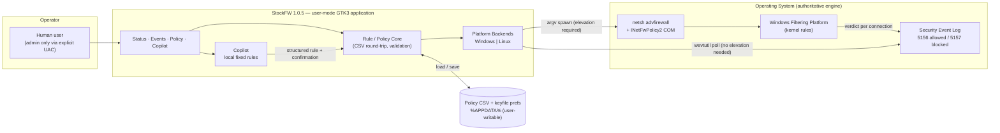
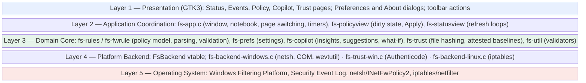
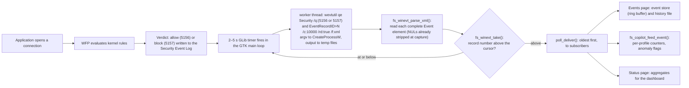
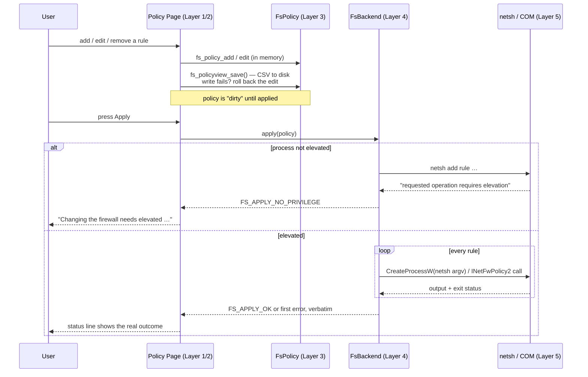
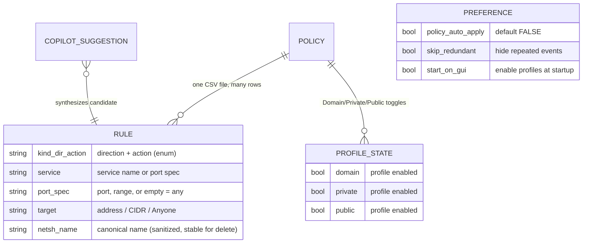
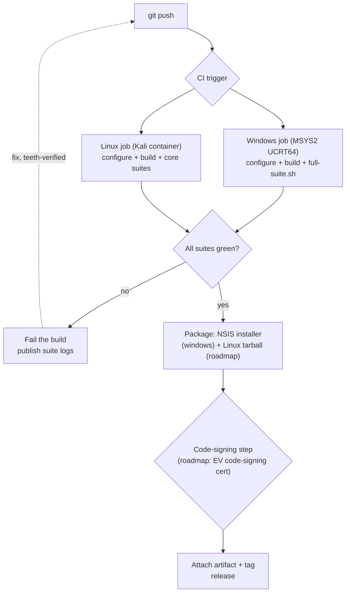

# StockFW — Technical Architecture and Security Document

**Version 1.0.6 · November 2026 · Classification: Internal / Distributable**

*Prepared by the StockFW Project. StockFW is a GTK3 port and modernization of the firewall tool originally developed by Stock Team & Qusai; the port and this document are authored by H3xCore / the Stock Team.*

---

## Table of Contents

**Chapter 1: Executive Summary & Introduction** — 1.1 Executive Summary · 1.2 Problem Statement · 1.3 Goals and Non-Goals · 1.4 Target Audience · 1.5 Scope, Conventions, and Evidence Grading · 1.6 The System at a Glance · 1.7 System Context Diagram

**Chapter 2: System Architecture & Flow** — 2.1 Layered Architecture *(Mermaid: block diagram)* · 2.2 Event Data Flow: Connection to Screen *(Mermaid: flowchart)* · 2.3 Control Data Flow: Policy to Firewall *(Mermaid: sequence diagram)* · 2.4 The Backend Contract · 2.5 Process and Trust Boundaries

**Chapter 3: The Core Engine (How it Works)** — 3.1 User-Mode by Design · 3.2 Rule Compilation to `netsh advfirewall` · 3.3 Event Acquisition: 5156/5157 and `wevtutil` · 3.4 The Record Cursor: No Duplicates, Counted Skips · 3.5 Monitoring Bootstrap: `auditpol` · 3.6 The Linux Backend · 3.7 Spawn Mechanics and Failure Modes *(Mermaid: sequence diagram)*

**Chapter 4: The Copilot and the What-If Engine**: 4.1 What the Copilot Is · 4.2 How Events Reach It, in the Window and in the Background · 4.3 The Detections · 4.4 Sentinel: the Automatic Block and Its Gates · 4.5 The Policy Health Check · 4.6 What It Can and Cannot See: Linux and Windows · 4.7 Writes: Confirmed, Verified, Undoable

**Chapter 5: Security Model & Threat Analysis** — 5.1 Trust Boundaries and Attacker Profiles · 5.2 Privilege-Escalation Analysis *(verified evidence table)* · 5.3 Injection Surfaces: netsh, CSV, Event Log · 5.4 Tamper Resistance of the Policy Store · 5.5 Data Privacy of Logs · 5.6 STRIDE Summary

**Chapter 6: The User Interface & User Experience** — 6.1 Design Language and StockFW Fidelity · 6.2 The Tab Model · 6.3 Real-Time Event Rendering Under Load · 6.4 Filtering, Deduplication, and Row Budgets · 6.5 Preferences: WYSIWYG as Policy · 6.6 Theming, Icons, and Accessibility

**Chapter 7: Policy Management & Rule Engine** — 7.1 The CSV Schema and Round-Trip Guarantees · 7.2 Rule Lifecycle *(Mermaid: ER diagram)* · 7.3 Precedence and Conflict Semantics · 7.4 Per-Profile State: Domain, Private, Public · 7.5 Failure-Atomic Apply and Rollback · 7.6 Import, Export, and Versioning

**Chapter 8: Testing, Build, and Deployment Strategy** — 8.1 Build Matrix · 8.2 Test Architecture and Suites · 8.3 The Teeth Methodology · 8.4 Crash Reproduction Under gdb · 8.5 The NSIS Installer · 8.6 CI/CD Design and Code Signing *(Mermaid: flowchart)*

**Chapter 9: Performance & Scalability** — 9.1 Workload Model · 9.2 Bounded Data Structures · 9.3 Memory Discipline: Defects Found and Fixed · 9.4 Measured Results: The 150-Second Soak · 9.5 CPU Scheduling · 9.6 Scaling Envelope and Bottlenecks

**Chapter 10: Future Roadmap & Commercialization** — 10.1 Feature Roadmap · 10.2 Enterprise and "SaaS" Considerations · 10.3 Licensing Analysis and Open Questions · 10.4 Monetization Options · 10.5 Compliance, Signing, and Distribution

**Chapter 11: 1.0.4 Addendum** — 11.1 Event → Rule, One Click · 11.2 Events Filter Bar · 11.3 Sentinel: Detection and Auto-Block · 11.4 F-1/F-3 Hygiene · 11.5 Repairs and Version

**Chapter 12: 1.0.5 Addendum** — 12.1 Assistant Removed, What-If Developed · 12.2 Bi-Directional Direction Setting · 12.3 Runner and Version · 12.4 Application Trust Engine (Priority 1) · 12.5 Explainable Behavior Analysis (Priority 2) · 12.6 Safe Policy Enforcement (Priority 3) · 12.7 System Tray and Background Operation · 12.8 Preferences Settings Made Real on Windows · 12.9 Sentinel "No False Outages": the 2026-10-10 Incident and the P6 Hardening · 12.10 Detection Validation: the P4 Adversarial Suite · 12.11 Linux First-Run Defects: sudo's Search Path, a Leaking Probe, and a Ghost Profile Box

**Chapter 13: 1.0.6 Addendum** — 13.1 The Linux Event Pipeline Made Truthful · 13.2 Real Network and Connection Panels on Linux · 13.3 Activity Time Series · 13.4 The Activity Page · 13.5 The `stockfw` Command-Line Tool · 13.6 The Local Dashboard: Threat Model and Controls · 13.7 Desktop UI Defects Fixed · 13.8 Tests and Version · 13.9 Open Observations

**Chapter 14: 1.0.7 Addendum** · 14.1 IPv6 on Linux: One Policy, Two Families, One Rollback · 14.2 Windows Rule Translation: Protocols, Port Specs and Sides · 14.3 The What-If Engine: Two Models, Every Case, Verified Fixes · 14.4 Help, About, and the Preferences Redesign · 14.5 The Copilot: Fixed Rules, Shown Evidence, Verified Fixes · 14.6 Threat-Intel Blocklists on Linux and Windows, and Country and Network Blocking on Linux · 14.7 Events at Volume: Event Store, History on Disk, Windows Burst Capture

---

## Chapter 1: Executive Summary & Introduction

### 1.1 Executive Summary

StockFW is a Windows-first, cross-platform **smart firewall configuration and monitoring tool**: a modern GTK3 desktop application that acts as a management plane over the operating system's native packet-filtering engine — the **Windows Filtering Platform (WFP)**, driven exclusively through Microsoft-supported interfaces — and an equivalent `iptables`-based backend on Linux. It provides four integrated surfaces: a **Status** dashboard with live traffic counters and per-profile toggles (Domain, Private, Public); an **Events** monitor that classifies inbound and outbound connections in real time with process identification and allow/block verdicts; a **Policy** manager for granular rule authoring over CSV storage with verified round-trip fidelity; and a rule-based **Copilot** that checks the event stream and the policy with fixed rules, shows the evidence for each finding, and simulates the effect of a proposed rule before it is applied.

The product's defining architectural decision is what it **refuses** to be. StockFW contains **no kernel driver, no packet-interception shim, and no cloud dependency**. Every firewall mutation flows through documented, supported Windows mechanisms (`netsh advfirewall` for rule CRUD, the `INetFwPolicy2` COM interface for profile state); every observation flows out of the Windows Security event log. The consequence of this conservatism is a specific and defensible security posture: the application has no driver attack surface, no custom binary parsing of untrusted network packets, and no remote component to compromise. Privilege escalation is handled by an **asInvoker** manifest plus explicit, user-initiated UAC launchers; unelevated operations fail loudly rather than silently. This posture is not aspirational — it is the subject of an auditable verification table in Chapter 5, where each security claim is tied to source-file evidence.

StockFW is a deliberate port and modernization of the GTK firewall configuration tool originally written by **Stock Team & Qusai**, whose UI conventions — including the sectioned Preferences dialog with its tree sidebar and Help/Cancel/Accept button row — are reproduced faithfully. The port is developed by **H3xCore** under the StockFW Project. It preserves StockFW's design language while replacing its Linux/iptables-era assumptions with a dual-backend architecture whose Windows side is the primary target.

### 1.2 Problem Statement

Windows ships a competent firewall engine and almost unusable management ergonomics. The native controls are split across three surfaces with three different mental models: the per-profile toggles in Windows Security, the rule zoo of `wf.msc` (where hundreds of implicit allow rules make intent unreadable), and PowerShell's `NetSecurity` cmdlets (powerful, but a scripting barrier for exactly the users most likely to misconfigure a firewall). The result is well documented: users disable the firewall entirely, or they author rules they cannot later explain. Meanwhile the events that matter — *which process talked to which address, and was it allowed or blocked* — are buried in Event Viewer rows that require knowing event IDs 5156 and 5157 to extract.

The original tool solved this problem elegantly for Linux in the mid-2000s and is now effectively abandoned; its architecture (shell out to `iptables`, GTK2) does not survive contact with modern Windows. The gap StockFW fills is precisely this: **a single coherent application that makes a stock OS firewall legible** — policy as a readable, diffable CSV; events as a classified, searchable stream; advanced knobs (ICMP behavior, filtering options, rejection semantics) in one dialog; and a Copilot layer that answers "why is this blocked?" (analysis), "what would happen if?" (what-if simulation), and proposes concrete rules — without a shell prompt.

The security problem statement is equally sharp. A firewall configuration tool is an attractive target precisely because it is a privilege amplifier: whatever the tool can be tricked into applying, it applies **with the user's elevation**. Therefore the design constraint that shapes the whole system is: *no input path — CSV file, event record, natural-language string, or UI event — may convert user-level access into firewall-changing action without passing typed validation, an explicit human confirmation, and an elevation check, in that order.*

### 1.3 Goals and Non-Goals

**Goals:**

- **Legible firewall management** on Windows (primary) and Linux (secondary) from one codebase, with policy stored as human-readable CSV that survives load/save round trips semantically unchanged.
- **Real monitoring**: live inbound/outbound event classification with process names, verdicts, addresses, and ports — not a static dashboard.
- **WYSIWYG honesty**: every control shown does something on the running backend; settings pages the backend cannot honor are not displayed, and that guarantee is enforced by an automated test (Chapter 6).
- **A Copilot that earns the word "smart"** — anomaly insight, natural-language what-if simulation, and rule suggestions from observed traffic — with allow-only rule generation, mandatory confirmation showing the exact rule, and rollback if persistence fails.
- **Verifiable security claims**: every statement in the threat model maps to source code that can be inspected, and every regression test can be forced to fail (the "teeth" methodology, Chapter 8).

**Non-goals (equally load-bearing):**

- **No kernel component.** StockFW does not filter packets itself; it configures and observes the OS engine. "Driver vulnerabilities" are therefore out of scope by construction — the attack surface of a third-party NDIS/WFP callout simply does not exist here.
- **No replacement of the OS firewall.** StockFW never uninstalls, disables, or shadows Windows Defender Firewall; if the application crashes, existing WFP rules remain in force and connectivity is unaffected.
- **No cloud model.** There is no AI model in StockFW: the Copilot is a set of fixed rules and a closed-grammar What-If parser that run on this computer (Chapter 4, 14.5); no telemetry, no rule data, and no event content leaves the machine.
- **No database server.** Storage is a CSV policy file plus keyfile preferences — trivially backed up, diffable, and auditable.
- **No cross-user policy store.** The policy lives in the invoking user's profile; multi-user enterprise distribution is roadmap (Chapter 10), not present.

### 1.4 Target Audience

This document serves four readers. **Security reviewers and auditors**, who will read Chapters 3 and 5 first and expect every privilege-boundary claim to name files and functions; the verification table format is written for exactly this reader. **Software engineers** extending the codebase, for whom Chapters 2, 3, and 7 define the backend contract, the spawn/capture mechanics, and the rule lifecycle. **Technical end users and SOHO operators** evaluating whether StockFW is safe to run elevated — Chapters 1, 5, and 8 answer that directly. Finally, **product and business stakeholders** considering the roadmap and licensing questions in Chapter 10. The prerequisite bar is deliberately low in Chapters 1, 6, and 10, and rises through the middle chapters; no chapter assumes prior StockFW knowledge, though familiarity with firewalls generally is assumed throughout.

### 1.5 Scope, Conventions, and Evidence Grading

Every architectural claim in this document describes the code as it exists in StockFW 1.0.6 (November 2026), not an aspirational design; Chapters 1–10 carry the 1.0.3 base text, Chapter 11 records the 1.0.4 additions, Chapter 12 the 1.0.5 additions, and Chapter 13 the 1.0.6 additions — the addendum chapters are authoritative where they differ. Claims are graded: **[Verified]** marks behavior proven by source inspection or an automated test named in Chapter 8; **[Measured]** marks behavior with numbers from an executed experiment (e.g., the 150-second soak test in Chapter 9: 45.6 MB → 44.8 MB private bytes under a continuous 300-record event flood, clean exit); **[Roadmap]** marks intent only. Diagrams are Mermaid source blocks intended for rendering. Where the original design and StockFW differ, the difference is called out explicitly rather than silently. Security claims were re-verified against source for this edition: ten privilege-boundary properties were re-read line by line and are cited with file and line references in Chapter 5.

### 1.6 The System at a Glance

| Aspect | StockFW 1.0.5 (actual) |
|---|---|
| Language / standard | C (GNU C11), GLib/GIO/GTK3 |
| UI framework | **GTK3** — native widgets, no Electron/WPF/Qt |
| Build | CMake + Ninja; MSYS2 UCRT64 (Windows), GCC (Linux/Kali) |
| Firewall control | Windows: `netsh advfirewall` (argv spawn) + `INetFwPolicy2` COM; Linux: `iptables` |
| Event acquisition | Windows Security log **5156/5157** via `wevtutil /f:xml`, every record after the last one read (5 s poll, up to 10,000 per poll; 1.0.7, Section 3.3) |
| Packet interception | **None** — user-mode management plane over WFP |
| Policy storage | CSV (round-trip tested) in user profile; GLib keyfile preferences in `%APPDATA%` |
| Copilot layer | Local deterministic parser and fixed rules; **no network calls** |
| Privilege model | `asInvoker` manifest; UAC only via user-launched elevated wrappers; fail-loud unelevated errors |
| Installer | NSIS, bundling the complete GTK3 runtime beside `StockFW.exe` |
| Test suites | Core 653, P4 adversarial 49, Winlog 56, Installer-spawn 9, Logstart 5, UI smokes, teeth-verified regressions |

### 1.7 System Context Diagram



The diagram encodes the document's central thesis in one picture: StockFW sits **beside** the trust boundary, not inside the packet path. Arrows into the enforcement plane are labelled with their preconditions (argv spawn, elevation required); arrows out of it are read-only observations. Chapters 2 and 3 unpack each arrow; Chapter 5 attacks them.

---

## Chapter 2: System Architecture & Flow

### 2.1 Layered Architecture

StockFW is organized as five strict layers. Dependencies point downward only; no layer reaches around the one beneath it, and the presentation layer never touches the operating system directly.



**Layer 1** is pure GTK3: widgets, tree stores, CSS that is compiled into the executable so an installed copy renders identically to a development build. **Layer 2** owns lifetimes and scheduling — it starts the poll timers, decides when the policy is "dirty," and routes backend errors to status lines instead of swallowing them. **Layer 3** is platform-agnostic C with no GTK and no OS calls: the same rule parser runs on both operating systems, which is what makes the round-trip guarantee testable without a GUI. **Layer 4** is the only layer that spawns processes or calls COM, behind a single vtable (Section 2.4). **Layer 5** is never modified by StockFW in place — WFP rules live in the OS store; StockFW only adds and removes entries through supported front-ends.

The layering is not decorative; it is the reason several bug classes cannot exist. A malicious CSV row can only reach Layer 4 after Layer 3 has parsed and typed it; a malicious event record can only reach Layer 1 after Layer 4 has split and deduplicated it.

### 2.2 Event Data Flow: Connection to Screen

The monitoring pipeline answers one question repeatedly: *what connections did the firewall adjudicate since the last poll?* The flow is push-free and entirely pull-based — StockFW never hooks the network stack; it reads the audit trail the OS already maintains.



Five properties of this flow are load-bearing:

1. **Bounded intake, sized for bursts.** Each poll reads every 5156/5157 record after the last one it delivered, up to **10,000** (`/c:10000`), so a burst of 4,000 connections in five seconds reaches the list whole. Until 1.0.7 each poll read the newest ten (`/c:10`) and a burst arrived as ten rows. Past 10,000 in one poll the newest 10,000 are read and the rest are counted and shown as skipped (Section 3.4). The cap still sits in the child call, before any app code.
2. **Identity by record number.** Every Security log record carries an `EventRecordID` that only grows. The reader keeps the highest one it has delivered (the cursor) and the query asks only for records above it, so there is nothing to deduplicate by text. The text form's `Event[n]` markers, which were positions and not identities (defect `e5fbad0`), are gone with the text form.
3. **Constant state.** The cursor is a few numbers. The 64-entry seen-set of earlier versions is gone.
4. **Fan-out after validation.** The UI, the Copilot, and the dashboard receive only records that survived split + dedup; none of them ever parse raw `wevtutil` output.
5. **No blocking.** The `wevtutil` spawn (`E`) runs on a worker thread with a hard timeout, and the worker strips the NUL bytes from the output as it reads it. Only the parsing, the cursor and the delivery (`F` to `H`) run on the GLib main loop. A wedged `wevtutil` is killed and the poll is skipped rather than freezing the window (Section 3.7).

### 2.3 Control Data Flow: Policy to Firewall

The control path is the privileged one, and it is deliberately more ceremonious than the read path.



Four deliberate design choices appear in this diagram. **Persistence precedes enforcement**: the CSV write happens first, with rollback on failure, so disk and memory never disagree about what the user asked for. **Elevation is detected, not assumed**: the backend classifies netsh's own output (`netsh_needs_elevation`) and returns a distinct status the UI renders as actionable text. **Apply is per-rule and fail-fast**: the first failing rule stops the loop and its error is surfaced verbatim, so a partially applied policy is *visible* rather than silent. **There is no background applier**: with `policy_auto_apply` defaulting to FALSE and no file watcher anywhere in the tree, nothing applies rules unless a human pressed a button in an elevated instance (Chapter 5).

### 2.4 The Backend Contract

Both platforms implement one vtable, `FsBackend` (`fs-backend.h`), which is how the UI avoids `#ifdef` sprawl. The contract, in plain terms:

| Operation | Meaning | Windows implementation | Linux implementation |
|---|---|---|---|
| `available()` | Can we manage the firewall at all? | Firewall service reachable via `INetFwPolicy2` | `iptables` present and loadable |
| `start()` / `stop()` | Enable/disable enforcement | `put_FirewallEnabled(VARIANT_TRUE/FALSE)` per profile | Policy load / flush to accepted state |
| `apply(policy)` | Compile and push rules | One `netsh advfirewall add rule` argv per rule | `iptables` argv per rule (script generation in `fs-script.c`) |
| `poll / hits` | Fetch new adjudicated connections | `wevtutil` on 5156/5157 after the last record number read, XML (Section 2.2); `log_skipped` reports what a full poll could not read | Netfilter log / connection listing |
| `refresh_network` / `refresh_connections` | Dashboard counters | `GetExtendedTcpTable`, interface stats (no elevation needed) | `/proc` and route queries |
| `trust_signature` | Authenticode verdict + signer for one executable (trust engine, 12.4) | `WinVerifyTrust` + `CryptQueryObject`, offline (`fs-trust-win.c`) | Slot NULL — verdict stays *not checked* |
| `fw_sections` / `fw_honors` | Which Firewall preference pages apply, and which per-control effects? | **ICMP + Advanced Options** — executed through the settings plan (12.8); Network/ToS not offered | **All four pages** — the generator compiles them; REJECT method and ICMP rate limits live |

`fw_sections` deserves special mention because it is the architectural root of the WYSIWYG guarantee: the Preferences dialog asks the backend *which* pages to render, one `FS_FWSEC_*` bit at a time (Chapter 6), so a page exists exactly when its backend reads it — and the UI smoke both fails if an unoffered page appears and pins the shipped capability set so no bit can drift unnoticed (Chapter 8). The companion `fw_honors` bits cover the finer case: a page the backend reads, with one control it still cannot reproduce (Windows has no per-rule reject — 12.8), which stays disabled with an admission instead.

Ownership rules inside the contract are explicit: callers own the lists returned by the refresh operations and free them with the provided element destructors (`fs_iface_stat_free`, `fs_connection_free`) — a discipline whose violation caused a real leak class that was fixed and is now discussed in Chapter 9.

### 2.5 Process and Trust Boundaries

StockFW runs in at most three process contexts, and the boundaries between them are enforced by the operating system, not by convention:

1. **Unelevated StockFW.exe** (manifest `asInvoker`, verified by inspecting the built binary). It can read the event log, read connections, edit and save the CSV — and it *cannot* change the firewall. Every attempt fails with a specific, actionable error.
2. **Elevated StockFW.exe**, reached only when the user deliberately runs one of the shipped launchers (`StockFW-elevated.vbs/.cmd/.ps1`), each of which resolves its target **relative to its own directory in Program Files** and triggers UAC via `Start-Process -Verb RunAs`. Windows UIPI then prevents any medium-integrity process from sending input to this window — a background malware cannot click "Apply."
3. **Child tools** (`netsh`, `wevtutil`), spawned with `CreateProcessW` under `CREATE_NO_WINDOW`, inheriting exactly three handles (stdin from `NUL`, stdout and stderr to per-invocation temp files) through an explicit process-attribute list — the child cannot inherit stray handles from the parent.

There is no IPC surface: no named pipe, no socket, no D-Bus. The only cross-process data channels are the child's stdout/stderr temp files and the shared CSV, whose consequences under tampering are analyzed in Chapter 5. The trust summary: *input trust flows from the OS (event log), content trust is never assumed (everything is parsed and typed), and privilege flows only from explicit user intent (UAC).*

---

## Chapter 3: The Core Engine (How it Works)

### 3.1 User-Mode by Design

The first thing to understand about StockFW's engine is what it deliberately does not contain: a driver. Firewalls are commonly extended with kernel components — WFP callout drivers, NDIS filter drivers, or user-space interception libraries such as WinDivert — in order to *observe or make verdicts themselves*. StockFW does neither. It **configures** the Windows Filtering Platform through interfaces Microsoft documents and supports (`netsh advfirewall`, the `INetFwPolicy2` automation interface) and **observes** adjudications by reading the audit events the OS already writes.

This decision removes an entire chapter from the threat model. A kernel callout parses attacker-controlled packet data in a context where a bug is a blue screen or a privilege escalation; it must be signed, versioned against OS builds, and updated forever. A user-mode management tool that speaks only to documented APIs inherits none of that. The trade-off is honest and accepted: StockFW cannot see packet payloads, cannot intercept connections before the kernel decides, and is bounded by whatever the audit subsystem records. For a configuration-and-monitoring product, those are the right trade-offs — the engine's own filters do the time-critical work, and StockFW's job is to make the engine's state legible.

There is a second, subtler benefit. Because every mutation is an invocation of a standard tool with a textual output, the entire write path is **observable and testable**: tests can fake `wevtutil.exe`/`netsh` in a search path, feed real-world output formats, and assert parsing behavior without root, without a VM, and without touching the host firewall. Chapter 8's 56-check Windows suite exists because of this property.

### 3.2 Rule Compilation to `netsh advfirewall`

A `FsFwRule` in memory is a typed structure: direction (in/out), action (allow/block), protocol (TCP/UDP/any), an integer local port, and an optional remote address. Compilation to a netsh invocation (`fs-backend-windows.c`, `netsh_add_rule`) is where typing pays off:

| Rule field | Compilation | Why it is safe |
|---|---|---|
| direction | `dir=in` / `dir=out` | enum → literal, two fixed strings |
| action | `action=allow` / `action=block` | enum → literal |
| protocol | `protocol=TCP` / `UDP` / `any` | enum → literal |
| local port | `localport=%d` or `localport=any` | **formatted from an int** — no string ever flows here; ports with protocol `any` are omitted because netsh rejects them |
| remote address | `remoteip=%s` | single argv token; netsh's own parser rejects anything that is not an address/keyword (fail-closed, Section 5.3) |
| name | `name=` after `netsh_safe_name()` | `: ( ) / ,` replaced with `-`; the same canonical name is used for add and delete so removal matches creation |
| scope | `profile=any`, `enable=yes` | fixed constants |

The args are collected as `char **` and handed to `spawn_capture()`, which builds one command line via `build_command_line()` → `append_spawn_arg()`. That quoting function is an exact inverse of `CommandLineToArgvW`: a token containing space, tab, quote, CR or LF is wrapped in quotes; embedded quotes become `\"`; runs of backslashes touching a quote are doubled; trailing backslashes before the closing quote are doubled. The correctness of this function is the difference between "arguments can never be smuggled" and "arguments can never be smuggled *on a good day*": because each argv element round-trips to exactly one child argument regardless of content, **no policy string can ever become a second netsh parameter**. A crafted `remoteip` value cannot add `action=allow`, a crafted rule name cannot add `localport=any`, and there is no shell in the loop — no `cmd.exe`, no `system()`, no metacharacters to interpret.

Netsh's own limitations are handled explicitly rather than discovered at runtime: rule names are sanitized because netsh rejects colons, parentheses and slashes that the UI's display names legitimately contain; port specifications are dropped for protocol `any` because netsh refuses them; profile is always `any` so the compiled rule behaves uniformly as the user toggles Domain/Private/Public.

**1.0.7:** dropping the port for protocol `any` was a security defect, not a safe limitation: most services compiled to `any`, so their rules matched all traffic in their direction. Ports are now netsh port specs, a ported rule is always TCP or UDP, and the argv is built in core by `fs_fwrule_netsh_args()`. See 14.2.

### 3.3 Event Acquisition: 5156/5157 and `wevtutil`

The monitoring side reads two Security log events: **5156** (the Windows Filtering Platform permitted a connection) and **5157** (it blocked one). Each record carries exactly the fields the Events page shows: application path (hence the process name, e.g. `brave.exe` or `svchost.exe`), source and destination addresses, ports, protocol, direction, and the verdict.

Acquisition runs as a five-second GLib timer. Each tick hands one query to a worker thread, which spawns (argv only, through `spawn_capture_max`, no console window):

```
wevtutil.exe qe Security
  /q:*[System[(EventID=5156 or EventID=5157) and EventRecordID>N]]
  /c:10000 /rd:true /f:xml
```

N is the record number of the newest event already delivered. The worker looks at the output only for its record numbers, to decide whether the clear check of Section 3.4 rule 4 is needed, and posts it back to the main loop with `g_idle_add`; only the main loop parses it and calls the Events page. Three properties of this call shape the pipeline (1.0.7):

- **XML, not text.** `/f:text` has no record number, so it cannot say which events are new. `/f:xml` carries `EventRecordID`, `EventID`, `TimeCreated SystemTime` and the event's named `Data` fields (`Application`, `Direction` as `%%14592` inbound or `%%14593` outbound, `SourceAddress`, `DestAddress`, `DestPort`, `Protocol`). `core/fs-winevt.c` reads them into the same rows the text reader made: the port is the destination port, In and Out are the local and the remote side by direction, the service is the program's file name, and a 5157 is marked `[BLOCKED]`. XML entities and numeric references are decoded and the result is made valid UTF-8. Only complete `<Event>` elements are read; one cut off at the end of the output is left out and counted.
- **Newest first, up to 10,000.** `/rd:true /c:10000` returns the newest 10,000 records above the cursor. The reader puts them in record order and delivers them oldest first. A poll of 10,000 events is about 15 MB of XML; captured output is now allowed up to 64 MB for this call (16 MB for every other child), and a longer output is cut there and counted as skipped.
- **The OS does the selection.** The XPath filter runs inside the event log service, so the child reads only 5156/5157 records newer than the cursor.

`core/fs-winevt.c` holds the parsing, the query and the cursor and is plain GLib, so `tests/test-winevt.sh` runs it on every platform against canned wevtutil output (Chapter 8). The backend keeps only the spawn and the worker thread.

Before this works at all, the audit policy must allow it: **Section 3.5** covers the `auditpol` bootstrap. Reading the Security log needs Administrator rights; without them the probe at start fails and the Events page says why, instead of showing an empty list.

### 3.4 The Record Cursor: No Duplicates, Counted Skips

`fs_winevt_take()` turns one poll's parsed events into the rows to deliver. Its rules:

1. **Start after now.** `log_start` first runs `wevtutil qe Security /c:1 /rd:true /f:xml` (no query): the newest record of any kind. The cursor starts there, so events from before this start are not delivered again on top of the history the app already saved (Section 14.7). The same probe is the Administrator check.
2. **Each record once.** Only records above the cursor are taken, sorted by record number, and a number seen twice in one batch is taken once. The cursor then moves to the highest number read, whether or not that record became a row. A record without a number is never delivered, because it could not be told apart from itself on the next poll.
3. **Skips are counted, not hidden.** When a poll comes back full (as many records as it asked for: up to 10,000, fewer after a slow read under rule 5 or in the fallback under rule 6) or cut short, the records between the cursor and the oldest one read were not read. Record numbers count every Security event, not only 5156/5157, so the gap is an upper bound. It is added to `log_skipped`, and the Events page shows it beside its count, for example "4,000 events (up to 20,020 skipped)", with a tooltip saying why.
4. **A cleared log is noticed.** A poll that finds no record above the cursor also runs the probe (`fs_winevt_needs_probe`). With the record condition that is a poll that finds nothing. In the fallback of rule 6 it is also a batch of only old records, which is what a log cleared and filled again answers there: until this was fixed, the probe ran only on an output without any `<Event`, so in the fallback a cleared log that had firewall records was never noticed and nothing was delivered until the record numbers climbed back past the old cursor. If the newest record in the log is below the cursor, the log was cleared (record numbers start again at 1), so the cursor goes back to 0 before the batch is taken. The batch in hand, all of it after the clear, is then delivered in the same poll, and with the record condition (an empty batch) the next poll reads everything since the clear. A log that rolls over keeps numbering, so rollover needs nothing. One case is not noticed: a clear followed, before the next poll, by more records than the cursor's number. With a five-second poll and a cursor in the thousands or more this needs thousands of new records in seconds after a clear.
5. **Slow reads back off.** A query killed at its 30-second budget delivers nothing and does not move the cursor. The next poll asks for half as many (never fewer than 500), and each poll that works doubles the request back towards 10,000. The halved request still reads the newest records first, so when the backlog is larger than it, the older part is skipped and counted under rule 3. For example, after one slow read a backlog of 8,000 delivers the newest 5,000 and counts up to 2,995 as skipped.
6. **A log that refuses the record condition still works.** If wevtutil rejects the query with `EventRecordID>N` (an error other than access denied or the timeout) while the cursor is above 0, the worker runs the same query once more without the record condition, for the newest 2,000 at most, still as one argv element built from numbers only. Rule 2 drops what the cursor has already seen, and rule 4 notices a cleared log from the same batch. Such a batch is often full, so a full batch counts a skip only when it did not reach back to the cursor: if any record read is at or below the cursor, nothing between was missed and nothing is counted.

The honesty rule still applies to data: a record is shown as the OS produced it (fields mapped for display, nothing invented), so what Events shows can be reconciled with `eventvwr` by record number.

### 3.5 Monitoring Bootstrap: `auditpol`

Windows does not log 5156/5157 unless the audit policy enables the *Microsoft-Windows-Windows Firewall With Advanced Security/Firewall* subcategory. StockFW's `firewalled_log_start` runs the corresponding `auditpol /set` command **idempotently** — running it twice is harmless, and it is the only place where StockFW changes a machine setting that is not a firewall rule. It surfaces its result in the UI: if policy editing is denied (audit policy requires elevation), the Events page says monitoring is not enabled and how to enable it, instead of showing an empty list and calling it "no traffic."

This distinction matters for trust: monitoring state and enforcement state are reported separately. A user can run StockFW unelevated, see their real traffic, explore policies, and simulate changes — and only pay the UAC cost when they decide to actually reconfigure the firewall.

### 3.6 The Linux Backend

The Linux side implements the same vtable against `iptables` using **argv-style execution** — each invocation is a `g_spawn_sync` of `iptables` with arguments as a vector, never a shell string, so rule content cannot inject shell syntax (`fs-backend-linux.c`). The Linux backend sets all four `FS_FWSEC_*` bits: the Network/ICMP/ToS/Advanced preference pages genuinely compile into rules there. Windows reads the same preferences through the settings plan (12.8) for the two pages it can reproduce — ICMP Filtering and Advanced Options — and leaves Network Settings (would need Internet Connection Sharing) and ToS (no marking field exists) unoffered, which is exactly the per-page rendering split Chapter 6 describes.

An additional facility exists for reviewability: `fs-script.c` can emit the equivalent ordered shell script (its header comment begins with dropping malformed packets before anything else sees them), letting a Linux user audit the complete effect of their policy as text before applying it. The same CSV policy model serves both platforms; only the compilation target differs.

**The event monitor** is the Linux twin of Chapter 3.3's Windows event acquisition. `linux_log_start()` forks a child that `dup2()`s the write end of a pipe onto its stdout and `execlp()`s a log follower; the parent keeps the read end, sets it non-blocking, and drains it from a 250 ms `G_TIMEOUT` poll rather than a blocking `GIOChannel` watch (a blocking watch and a buffered reader contend over the same data and can stall the UI). The child picks its source in order: the `STOCKFW_LOG_FILE` override, then `/var/log/kern.log` if rsyslog is present, then `journalctl -k -f` — the override being what makes the monitor testable without a live kernel log, and the journal fallback being what keeps it working on a systemd system where rsyslog is no longer the default.

Only lines the backend's own rules logged are reported: `parse_log_line()` requires a bare `STOCKFW-DROP` marker and then lifts `SRC=`/`DST=`/`PROTO=`/`SPT=`/`DPT=`/`IN=`/`OUT=` as key=value tokens. A line without the marker is dropped silently, which is what keeps unrelated kernel noise off the Events page. Fields the log does not carry are filled honestly — the raw line as the time, `in` as the direction, `Dropped` as the service, overridden by the well-known name when the source port resolves.

`log_start()` refuses (returning FALSE with an explanatory error) rather than pretending, when the process is not root: the kernel log is unreadable without privilege, and returning TRUE while reading nothing is precisely the silent-empty-list failure this backend must not have. `log_stop()` reaps the child and releases the read end.

**[Verified]** `tests/test-logstart-events.sh` drives a real rsyslog-format drop line through the whole path — fork, `tail -F`, pipe, poll, parse, callback — and asserts every field arrives correctly, that a marker-less line is not reported, and that the stop path really stops. It needs root and a POSIX `ifaddrs.h`, so it self-SKIPs elsewhere.

**The defect this test caught.** The monitor's parent side once had the pipe ends transposed: it closed `log_pipe[0]` (the read end) and then read `log_pipe[1]` (the write end). Two failures compounded. Reading a write-only descriptor returns `EBADF` on every poll, so the drain loop never executed — and because no process then held the read end open, the child's `tail` received `SIGPIPE` and died the first time it emitted a line. `log_start()` still returned TRUE and `log_active()` still read TRUE throughout: a monitor that claimed to be running while not one byte could ever reach it. It had been green under `tests/test-logstart.sh`, which asserts only that a start either succeeds or explains itself — it never asserts that a started monitor *delivers*. The fix restores POSIX ordering (parent reads `[0]`, closes its copy of `[1]`; `log_stop()` releases `[0]`), and the event test now pins delivery itself so the transposition cannot return unnoticed.

### 3.7 Spawn Mechanics and Failure Modes

Every child process on Windows goes through `spawn_capture()`, which exists because `g_spawn_sync` was unsuitable for two hard requirements: suppressing console windows for GUI sessions, and capturing output reliably with a timeout.

```mermaid
sequenceDiagram
    participant App as spawn_capture()
    participant OS as CreateProcessW
    participant Child as netsh / wevtutil
    participant T as Temp files (sfw*.tmp)

    App->>T: GetTempFileNameW ×2 (atomic unique names)
    App->>T: reopen with FILE_SHARE_READ only (write-locked)
    App->>OS: argv → build_command_line (CommandLineToArgvW-inverse)<br/>CREATE_NO_WINDOW, 3-handle inherit list
    OS->>Child: process starts, console-free
    Child->>T: stdout / stderr written directly
    App->>App: WaitForSingleObject (hard timeout)
    alt child exceeds timeout
        App->>Child: TerminateProcess
        App-->>App: report timeout error, skip this poll
    else child exits
        Child-->>App: exit status normalized to g_spawn semantics
        App->>T: rewind and read captured text
        App->>App: parse (netsh: detect elevation errors; wevtutil: split)
    end
    App->>T: delete both files (always, including error paths)
```

The failure modes are enumerated deliberately:

- **Console window suppression.** `CREATE_NO_WINDOW` keeps `wevtutil` flashes out of the user's session — a functional requirement inherited from the original GUI expectations.
- **Output via temp files, not pipes.** Pipes deadlock when a child writes more than the pipe buffer before the parent reads; file capture sidesteps this entirely. The files are created atomically by `GetTempFileNameW` and reopened with `FILE_SHARE_READ` only, so once open, no other process can modify or delete them while the parent holds the handle; an attempted pre-open plant causes a sharing violation, which takes the **error path** rather than corrupting input (Chapter 5).
- **Hard timeout with kill.** A wedged child is terminated and the poll is skipped; the main loop never blocks indefinitely.
- **Exact handle inheritance.** An explicit process attribute list passes three handles and nothing else — the child cannot inherit the parent's policy file handle or any other live object.
- **Exit-status parity.** Child exit codes are normalized to the same convention `g_spawn_sync` reported, so error handling logic written for the Linux backend behaves identically on Windows.
- **Elevation classified from output.** netsh reports elevation failures on *stderr with a non-zero code*; the classifier reads the captured text for the canonical phrase so `FS_APPLY_NO_PRIVILEGE` wins over the raw failure reason (the phrase check is a `strstr` over captured output, not a security decision — it only chooses which message the user sees).

---

## Chapter 4: The Copilot and the What-If Engine

This chapter describes the Copilot as the 1.0.7 code builds it: `core/fs-copilot.c` (the detections and the learned baseline), `core/fs-health.c` (the policy health check), `core/fs-whatif.c` (the What-If engine), and `ui/fs-copilot.c` (the page, Sentinel's automatic blocks and their expiry). Section 14.5 records why it was reworked in 1.0.7 and how the page looks; the numbers below are the ones in the code.

### 4.1 What the Copilot Is

The Copilot is a fixed set of rules that runs on this computer. Each rule is a count compared with a written limit (the `FS_SENTINEL_*`, `FS_SCAN_*`, `FS_BRUTE_*`, `FS_NEWDEST_*` and `FS_BEHAVIOR_*` constants at the top of `core/fs-copilot.c`), so the same events always give the same findings. It does not learn a model, it has no network code, and nothing it reads or finds leaves the computer. Integer arithmetic decides the rate check and a plain mean and variance decide the timing check; there is nothing random anywhere in it.

What it reads:

- **The firewall's own event log**, one event at a time, as the Events page receives it (4.2).
- **The saved policy**, for the health check (4.5), for the What-If engine (4.7), and to know which login ports the policy opens (4.3).
- **This computer's DNS servers and default gateways** (`fs_hostnet_read`: `resolv.conf`, systemd-resolved's and NetworkManager's upstream lists behind a `127.0.0.53` stub, `/proc/net/route`; on Windows every adapter's DNS servers and gateways from `GetAdaptersAddresses`). They are read when the Copilot is made and again at most once a minute. They exist only to keep those addresses out of the timing check and out of every automatic block.
- **Its own baseline** (`behavior.csv` in the per-user config directory; `STOCKFW_BEHAVIOR_FILE` overrides it for tests): per program on Windows, per port's service name on Linux, the ports, destinations, hours of activity, the connection rate and the times of recent first contacts.

What it writes: findings in memory (at most 200), the baseline file, and, only through the paths in 4.4 and 4.7, rows in the policy.

The one free-text input is the What-If card's entry. A line typed there is parsed by a closed grammar (directions, protocols, ports and service names, addresses by their shape) and answered as a verdict. A typed line has no write path of its own: it can become a verdict and nothing else. The only rule it can lead to is the one the Details window offers as Create This Rule, which is printed in full and confirmed first (4.7).

### 4.2 How Events Reach It, in the Window and in the Background

The backend delivers each event to one callback, `on_hit` in `ui/fs-hitview.c`, on the main loop. That callback hands the event to the Copilot (`fs_copilot_feed_event`) **before** the Events page's display filters run, so "skip repeats" and "skip events not for this firewall" change what the list shows and never what the checks count: ten identical login attempts are ten attempts to the brute-force check. In the same callback Sentinel's automatic pass runs (4.4), and the page's counters are told an event arrived (the page redraws at most once a second, and only rows whose content changed).

None of this depends on the window. The Events page is built when the app starts and starts monitoring then, whether the window is shown, hidden behind the tray icon by "Minimize to the tray", or never shown at all because StockFW started with `--background` at sign-in. Hiding the window hides widgets; the monitor, the callback and the timers keep running. In particular:

- **Events still reach the Copilot**, and Sentinel still stages blocks from them.
- **Sentinel's ten-minute expiry still runs.** It is a main-loop timer re-armed for the earliest block still inside its window, not something the page does when it is drawn.
- **The baseline is still saved.** Every event marks the baseline as changed (`fs_app_note_learning`), and the app's periodic save (`ui/fs-app.c`, every five minutes; `STOCKFW_AUTOSAVE_S` shortens it for tests) writes it when it changed, together with the settings and a retry of a staged-list write that had failed. The session manager's query-end, Windows' `WM_QUERYENDSESSION`, the tray's Quit and SIGTERM, SIGINT and SIGHUP write it at once. A crash loses at most five minutes of learning.
- **The tray controls Sentinel.** The tray menu's "Pause Sentinel auto-block for 1 hour" works with the window hidden; while paused the item reads "Resume Sentinel auto-block (paused, N min left)". It is greyed, with the reason as its tooltip, when this copy may not change the firewall, when it is not watching events, or when Sentinel is in detect-only mode. The pause is not saved: a restart resumes auto-block. The tray has no findings item in 1.0.7; findings are read on the Copilot page.
- **Nothing pops up.** No detection and no automatic block opens a dialog. Questions are asked only when the user presses a button on the page.

`fs-session-smoke` (scenario `background`) proves each of these points with the window hidden; `port/tests/README.md` lists its checks and the bugs they catch.

### 4.3 The Detections

Every finding carries: a title, what was seen, a "why flagged" sentence with the measured numbers next to the limits, a "could be harmless" sentence, up to 12 evidence rows (time, direction, remote address, port, protocol, refused or not, and the rule text when the log gave one), a line for the What-If card where one makes sense, a filter for the Events page, and what Sentinel did or why it did not. A finding has a key (`type|app|subject`); a new event for an open finding updates its count and evidence instead of adding a row.

Counting is per program on Windows, where the log names the program (`Application Name`, reduced to its file name, for example `brave.exe`). On Linux the kernel log names no program, so the key is the port's service name (`https`, `ssh`) or `Unknown`; several programs on one port share one key, and the page's tile says "Services learned" instead of "Apps learned". The " [BLOCKED]" marker the backends add to refused events is removed from the key so a program's allowed and refused events build one history.

**The checks that run on every event** (no baseline needed):

| Detection | Trigger | Severity | Sentinel |
|---|---|---|---|
| Contacts at a near-fixed interval (beacon) | Outbound only. One series per program (service on Linux), destination, port and protocol (TCP and UDP are separate series). Arrival times are counted in whole seconds, so a batch of records read at once is one contact; the last 32 are kept. Judged from 6 contacts: mean interval 10 to 600 s and a standard deviation of at most 0.30 of the mean. Port 123 (time sync) is never timed, nor port 53 or 853 to one of this computer's DNS servers. Each evidence row is that contact's own time and verdict. | Warning; Critical when the event's rule text says a block list or country rule matched it | the only detection that can block automatically; see 4.4 |
| Fan-out | Outbound, per program: 60 distinct hosts, or 10 distinct refused hosts, in 60 s. When the key is a service name (Linux, or a Windows event with no program), only the 10 refused hosts count, because a busy page in any browser reaches 60 hosts. One report per episode; the episode ends when the 60-second window empties. At most 256 keys are tracked. | Warning | never: there is no single host to block |
| Inbound port scan | One source reaching 12 distinct local ports in 60 s, or 25 in 10 minutes (the last 512 events per source are kept). The addresses of one IPv6 /64 are also counted together, as a second finding that names them, when 2 or more addresses take part. ICMP, loopback, link-local, multicast, the protected ranges and this computer's own addresses are ignored. One new report per source per hour; later probes update the open finding. At most 1024 sources; past that the stalest is dropped. | Info when every probe was refused, Warning when any reached an allowed port | never: there is no inbound deny kind, and refused probes were already dropped |
| Repeated attempts on a login port | One source, 10 inbound attempts in 5 minutes across TCP 21, 22, 23, 445, 3389 and 5900 and the ports the policy's inbound allow and forward rows give to SSH, RDP, VNC, Telnet, FTP or SMB (rows of 16 ports or fewer). Attempts on different login ports add up. At most 1024 sources. | With refused attempts: Critical when the policy lets that source in on one of those ports (Warning when the source is on the LAN); Warning for a public source when some attempts were allowed and some refused; otherwise Info. With no attempt refused: Warning for a public source the policy lets in, otherwise Info. "Lets in" is a What-If ALLOWED, or a DEPENDS when the log shows connections this computer let in: the check asks What-If without the network in use, and on Windows an inbound from a private address depends on it (StockFW blocks reserved sources on Public networks), while an allowed connection in the log answers it for the network the computer was on. | never; the finding links the health check's "narrow to the local network" fix |
| Block list or country rule hit | An event whose rule text starts with `Threat intel:`: a threat-intel list's block or a country or network rule's block, which carry the same marker and are named `Threat intel: <list or rule name>` (14.6). | Warning for outbound (a program tried to reach a listed host); inbound drops roll up into one Info finding per list per hour | not needed: the list already blocks it |

**The baseline checks** run once a key has 10 recorded events, and never for a key whose stored ports or destinations hit their caps (256 ports, 1024 destinations; such a profile is marked partial and can no longer say "never seen before"):

| Signal | Trigger |
|---|---|
| First use of a port | outbound only; the first event on that port for this key |
| New destination | outbound only; a public address never seen for this key, once the key has at least 50 connections over at least 7 days, and not for a key with 20 or more first contacts in the last 7 days (a browser meets new hosts all the time). The first-contact times are saved in `behavior.csv`, so a restart does not report the same hosts again. One finding per key per hour lists the new hosts. |
| New hour | the first activity in an hour of the day, once 4 hours are known |
| Connection rate spike | the open 10-minute bucket holds at least 10 connections and more than 3 times the usual rate plus 5; the usual rate is an average over closed buckets (weight 0.25) and is judged only after 8 buckets; one report per bucket |

The signals of one event form one finding: Info for one signal, Warning for two or more. A baseline finding never carries a rule. An unusual connection is not answered with an allow, and a block is the user's decision (Ask What-If shows what one would do).

**Across checks.** Two different checks on the same subject within an hour make both findings Critical, and each says so (the four baseline signals count as one check). The list holds at most 200 findings; when it is full the oldest baseline finding goes first, and a beacon, scan, login or block-list finding goes only when nothing else is left.

**What a finding is not.** No finding means none of these checks matched; the page says "This is not a guarantee that nothing is wrong." Findings are kept in memory for the session; dismissals are not saved.

### 4.4 Sentinel: the Automatic Block and Its Gates

Sentinel has two modes, Detect only and Detect + auto-block (the default). In auto mode, after each event, `fs_copilot_sentinel_auto_pass` walks the findings and stages a block only when **every** gate below passes:

1. **The finding is a beacon with at least 8 contacts.** No other detection ever sets `auto_applicable`.
2. **The beacon's own withholds** (each shown in the finding's drawer as the reason when it applies): the destination is not loopback, link-local, multicast, broadcast, reserved, "this network" (0/8), the private ranges (10/8, 172.16/12, 192.168/16), the shared range 100.64/10, IPv6 ULA or site-local, an IPv4-mapped form of any of those, or anything that is not a literal address; it is not one of this computer's DNS servers or default gateways (on any port); for port 53 or 853, the DNS upstream is known (behind a local stub whose upstream servers could not be read, no DNS destination is blocked); the user's policy has no outbound "allow to host" row for it (the same address, or a network or range around it; an Anyone row does not count), because on Windows a block outranks an allow and a Sentinel block would silently overrule the user's own Allow; the program's own history held fewer than 3 connections to it before this run; and no other program has 3 or more recorded connections to it (the block applies to every program and every port). On Linux the key is a port's service, not a program, and these texts say so ("traffic on this port", "traffic on the https port (any program)"); the checks list on the page does the same.
   Gate 2 is judged twice: when the finding is made, and again by the pass at the moment it stages (`fs_copilot_beacon_recheck`), with the baseline, network and policy of that moment. A pass can run long after the finding: when a tray pause ends, when the mode is switched from Detect only, and on the retry after a failed write. By then another program may use the host, or the user may have allowed it on the Policy page or in an earlier session. When a gate now withholds, nothing is staged and the finding's drawer gives the new reason.
3. **`fs_insight_is_auto_safe`** checks the rule itself once more: an outbound deny kind only (the Sentinel row is "deny outbound to host"), and a target outside the classes in gate 2 and outside the resolvers and gateways. An allow is never staged, whatever a finding claims.
4. **Not paused** from the tray, **not already staged**, **not already in the policy** (a row the user added is the user's and is never expired), and **not staged and taken down before in this session** (expiry, Undo, an allow for that host, or a switch to detect mode put the rule on a session cooldown; this is the guard against the drop and re-stage loop of the 2026-10-10 incident, 12.9). The cooldown is kept in memory only, so a restart decides afresh.
5. **The write succeeds.** The row is added and saved with rollback on a failed write. A failure is audited once and retried at most once a minute.

A staged block is audited, written to the staged list (`autoblocks` next to `behavior.csv`; rows `S,<epoch>,<kind>,<rule csv>`), and pushed through `fs_policy_apply_safe`, the same gate as every apply: audit-only mode and the Policy Lock hold it, and the audit says whether it went live.

**Every automatic block lifts ten minutes after it was staged** (`FS_AUTOBLOCK_TTL_S`, 600 s). The expiry timer runs whether or not the window is shown (4.2). At start the app reads the staged list: blocks whose time ran out while StockFW was not running are taken out of the policy before the firewall starts, and the rest are re-armed with their original clock. `stockfw start` at boot does the same without the app (`core/fs-autoblock.c`), so an expired block is never installed again. Switching to Detect only lifts every staged block. Allowing that host from the Events page or from What-If lifts the blocks on it. Each block has Undo in its finding's drawer and in "Changes made by the Copilot"; an expired or undone block stays in that list, marked with how and when it ended.

What Sentinel never does: block inbound traffic, block a network rather than one address, change or remove a rule it did not stage, ask a question while nobody is looking, or keep a block past ten minutes.

### 4.5 The Policy Health Check

`core/fs-health.c` reads the saved policy and reports duplicates, shadowed rows, allows covered by a deny, outbound allows that have no effect in permissive mode, inbound allows over more than 100 ports, risky services open to anyone, and rows that reach no address family. Coverage is exact (ports through `fs_fwrule_port_spec`, addresses through `fs_range_parse`, protocols compared). A removal or a narrowing to the local network is offered only when the What-If engine, run on probes before and after the change, shows that nothing else changes. Fix asks first, writes through `fs_policy_apply_safe`, and can be undone from the Changes list. `stockfw copilot health [--json]` runs the same check from the command line and writes nothing. The full table of checks, severities and fixes is in 14.5.

### 4.6 What It Can and Cannot See: Linux and Windows

The Copilot sees only what the firewall logs, as the backend reads it. Both platforms need the rights to read that log: on Linux root, or a kernel log the user may read (`/dev/kmsg` directly, otherwise a `journalctl` or `tail` child); on Windows an elevated StockFW, which reads the Security log. Without them monitoring does not start, the Events page says why, and the Copilot sees nothing.

| | Linux (iptables and ip6tables, kernel log) | Windows (Windows Firewall, Security log) |
|---|---|---|
| Events | `STOCKFW-DROP` / `STOCKFW-REJECT` for inbound packets that reach the default rule (each is logged); `STOCKFW-DROP` for outbound packets that reach the default deny in restrictive mode (at most 20 a second, bursts of 40); `STOCKFW-ALLOW` for the first packet of each accepted new connection when "Log allowed connections" is on (the default; at most 10 a second, bursts of 20) | events 5156 (allowed) and 5157 (blocked), after StockFW turns on auditing of "Filtering Platform Connection"; read with `wevtutil` every 5 seconds |
| Who | no program: the key is the port's service name or `Unknown` | the program's file name from `Application Name` |
| Timing | the time the record is read, close to real time | the time the batch is read: a 5-second poll is one moment, so beacon intervals are known to within about 5 seconds |
| Rows that deny by rule | an explicit deny row (including a Sentinel block) drops without a log line, so contacts it blocks are no longer seen | 5157 records name no StockFW rule |
| Block-list rule text | the kernel log parser turns a `STOCKFW-TI <id>` line into the rule text `Threat intel: <name>` for a list or a country or network rule StockFW applied (14.6), and the check reads it | no event names its rule, so the check is silent |

Consequences, stated plainly:

- On Linux, two programs on one port are one key. Fan-out counts only refused hosts there, and the beacon and baseline checks follow the service, not the program.
- Without "Log allowed connections" (Linux) or with auditing turned off by policy (Windows), only refused traffic is seen: the beacon check sees only refused contacts, and the login check sees only refused attempts.
- A slow pattern, or one below the log rate limits, can stay under every limit. A beacon slower than one contact every 10 minutes is not judged.
- The scan and login tables keep at most 1024 sources each; an attacker with more addresses than that (easy with IPv6) can push out an earlier source's count. The /64 aggregate catches many addresses from one IPv6 network, not addresses spread over many networks, and IPv4 sources are not grouped.
- The DNS servers and gateways are read at most once a minute; a change in between is seen at the next read.
- No byte counts are read: the rate check counts connections.

### 4.7 Writes: Confirmed, Verified, Undoable

Apart from Sentinel (4.4), the Copilot changes the policy only when the user presses a button, and each path checks first:

- **Block outbound to this address** (a finding's drawer). Offered only when What-If says the finding's line is ALLOWED now and BLOCKED with the row; checked again just before writing, because the policy may have changed; then a dialog prints the literal row and the What-If check, and No writes nothing. The row is saved with rollback on failure, pushed through `fs_policy_apply_safe`, audited, and listed under Changes with Undo.
- **Fix** (policy health). Verified as in 4.5, asked with the before and after rows, applied through the same gate, undone from Changes by content, not by position.
- **Create This Rule** (What-If Details window). Offered only for a parsed line whose verdict is BLOCKED; re-checked against the policy as it is now; the confirmation prints the literal row; the question is asked again after the write so the window shows whether the verdict really changed.

The What-If engine itself (`core/fs-whatif.c`, 14.3) answers a line with the platform's own model (Linux first match per chain, Windows block wins), every case the line leaves open, and the firewall's state; it writes nothing.

**Input threat surface.** Free text enters only through the What-If entry and can only become a verdict. Log content (addresses, ports, service and program names, rule text) enters findings as data: it is shown in labels and evidence cells and never parsed as a command. A remote host can make findings appear (a scan, login attempts, timed contacts it answers), and through a beacon it can at most cause a ten-minute outbound block on one public address that no program on this computer has a history with and the user's policy does not allow, judged when the block is staged, never a LAN, infrastructure or resolver address, and never an allow. Every rule the Copilot writes is an ordinary policy row the Policy page shows and the user can remove.

---

## Chapter 5: Security Model & Threat Analysis

### 5.1 Trust Boundaries and Attacker Profiles

StockFW's security model is built around three boundaries:

- **B1 — Enforcement boundary**: anything that can change firewall state must pass through an elevated StockFW instance calling netsh/COM. This boundary is enforced by Windows (token elevation, UAC) and cannot be crossed by StockFW's own code, which contains no self-elevation path whatsoever.
- **B2 — Input boundary**: text from the OS (event log), from disk (CSV policy, preferences), and from the user (UI, Copilot) is untrusted until parsed and typed. No layer consumes raw bytes from below it.
- **B3 — Display boundary**: what the UI renders is derived data; the UI never interprets its own display strings as commands.

Three attacker profiles, ordered by capability:

| Profile | Capability | Realistic goals |
|---|---|---|
| **A1 — Remote unauthenticated** | Can generate network connections observed by the firewall | Induce permissive rules or misleading insights; read nothing (no network surface in StockFW at all) |
| **A2 — Local user-level malware** | Full control of the user's profile: rewrite the policy CSV, attack the unelevated UI, race temp files | Convince an elevated StockFW to install attacker rules ("confused deputy") without gaining elevation itself |
| **A3 — Interactive user (incl. admin)** | Everything, including UAC consent | Out of scope as an attacker: this is the operator. Misconfiguration protection (confirmations, simulator) applies instead |

StockFW exposes **no listening socket, no IPC endpoint, and no parser reachable from the network**; A1's only interaction with the product is the traffic it generates, which the Copilot treats as *evidence to display*, never as instructions to execute. The entire interesting fight is A2 vs. the confused-deputy problem, which is the subject of the next section.

### 5.2 Privilege-Escalation Analysis

The following table re-verifies, against source, the claim that user-level access cannot be converted into firewall-changing action. Each row was re-read for this document; file references are to StockFW 1.0.5.

| # | Property | Mechanism | Evidence |
|---|---|---|---|
| 1 | **No self-elevation code** | The tree contains no `ShellExecute`, `runas`, `WinExec`, or `system()`; the Windows backend spawns only via `CreateProcessW` | `spawn_capture`, `fs-backend-windows.c:592`; zero matches project-wide |
| 2 | **Manifest is `asInvoker`** | Elevation exists only in launchers the user deliberately runs | verified by inspecting the built `StockFW.exe`: `asInvoker` present, `requireAdministrator` absent |
| 3 | **Unelevated operations fail loud** | COM: explicit "requires administrator privileges" error; netsh: output classified as `FS_APPLY_NO_PRIVILEGE`, rendered as actionable text | `fs-backend-windows.c:175`, `:921`, `:1045`; `fs-policyview.c:424` |
| 4 | **No argument injection** | Ports compile from `int` (`%d`); direction/action/protocol are enum literals; every value is one argv token quoted by the `CommandLineToArgvW` inverse; no shell exists | `fs-backend-windows.c:763-788`, `append_spawn_arg:325` |
| 5 | **Strict CSV typing** | All-digit port fields (rejects `80abc`, `0x50`), range 0–65535 with `a ≤ b`; malformed rows skipped and counted at load; since 1.0.4 host and port fields are validated fail-closed at load before netsh sees them (F-1) | `fs-fwrule.c:47-122`, `fs_policy_load` + `rule_fields_sane` `fs-rules.c:279-381` |
| 6 | **Startup cannot push attacker rules** | `start()` only calls `put_FirewallEnabled(TRUE)`; CSV content is never applied at startup; the preference itself defaults FALSE | `fs-backend-windows.c:190-193`, `fs-app.c:255` |
| 7 | **Auto-apply chain is dead** | `policy_auto_apply` defaults FALSE; no file watcher/monitor exists anywhere | `fs-prefs.c:312`, `fs-policyview.c:469`; no `g_file_monitor` in tree |
| 8 | **Temp-file capture is race-safe** | Atomic `GetTempFileNameW` creation; reopened `FILE_SHARE_READ` only — content immutable while held; a pre-open plant causes sharing violation → error path | `fs-backend-windows.c:527-543` |
| 9 | **No environment module injection** | The app never sets `GTK_PATH`/`GTK_MODULES`/`PATH` and loads no dynamic modules | no `setenv`/`putenv`/`g_module` matches in `port/src` |
| 10 | **Elevated UI is input-protected** | UIPI blocks medium-integrity processes from sending input to the elevated window; each elevation is a fresh UAC consent | OS-enforced; launchers resolve targets only relative to their own Program Files directory |

**End-to-end confused-deputy attempt (A2), walked step by step.** The attacker rewrites the policy CSV with `remoteip=any action=allow`-style rows. Step 1: nothing happens — no watcher, auto-apply defaults off (row 7). Step 2: the attacker tries to click Apply on the unelevated window — the apply runs, netsh refuses, and the UI shows "needs elevation" (row 3); the CSV content still never reached a privileged process. Step 3: the attacker tries to drive the *elevated* window via synthetic input — UIPI drops it (row 10). Step 4: the attacker plants a fake `netsh.exe` in a searched directory — since 1.0.7 (Section 14.8) every tool is run as `<System32>\<name>` by its full path, so no search happens at all. (This step used to say the search order resolved `netsh` from System32. It did not: `CreateProcessW` looks in the program's own folder and the current folder first, which a portable copy unpacked in Downloads or an elevated shell in a user folder would have reached; the 1.0.7 release review found it.) Step 5: the attacker races the output temp files — sharing violations take the error path (row 8). The attack fails at every step without StockFW needing to "detect" anything: each step is a structural dead end.

**Elevation-launcher analysis.** The three launchers (`StockFW-elevated.vbs/.cmd/.ps1`) resolve every path **relative to their own directory** (`%~dp0` / script dir) — no `%TEMP%`, no profile paths, no registry lookup — and UAC is triggered only by `Start-Process -Verb RunAs`. The launcher's PATH handling has been hardened twice. The first fix removed an *unconditional* prepend of `C:\msys64\ucrt64\bin`; this audit found the *conditional* form still live — the wrapper added that directory to the elevated process's PATH whenever the runtime DLLs were not beside the script. A gated path widening is still a path widening: that directory is user-writable, so a planted DLL there would load into an administrator process. **[Fixed]** The launcher no longer prepends anything. It requires `libglib-2.0-0.dll` beside the resolved binary and, if absent, exits 1 with an explanation rather than falling back. The runtime is resolved against the directory actually holding `StockFW.exe`, not the script's directory, because those differ in the dev tree (binary in `build\`) and checking the script directory would refuse a healthy dev copy. **[Verified]** three layouts: installed copy proceeds, dev copy proceeds, broken copy stops without reaching `Start-Process`; teeth — deleting the guard makes the broken copy launch, so the check is pinned, and neither wrapper retains any reference to `msysBin`, `ucrt64`, or a PATH assignment.

### 5.3 Injection Surfaces: netsh, CSV, Event Log

**netsh argument injection** — closed by construction (Section 3.2): the quoting function is an exact inverse of the child's parser, so the mapping *one policy field → one netsh parameter* holds for every byte value. Netsh additionally validates its own values: a garbage `remoteip` makes netsh reject the rule, `run_netsh` returns non-zero, and Apply stops with the tool's real error — **fail-closed**, with no partial semantic effect.

**CSV injection** — the policy file accepts only the documented dialect; numeric fields must be pure digits (which defeats `strtol`'s documented forgiveness of `80abc` and hex prefixes), ranges are bounds-checked, and rows that do not parse are skipped and counted (`N malformed policy rule(s) were skipped`). The one honest gap: `address_or_null()` passes target text through **without a local syntactic check**, relying on netsh's parser as the validating point. This is fail-closed (see above) but later than ideal; **F-1** in Section 5.6 tracks wiring the already-written-but-uncalled `fs_util_is_valid_host()` into the load path.

**Event-log injection** — records are treated as data, never as markup. They flow through NUL-stripping and a bounded XML reader that takes only the named fields it needs (no DTDs, no external entities, only the five predefined entities and numeric references, output forced to valid UTF-8), then into the event store and a virtual tree model (plain text rendering; no markup interpretation of event content). The Security log itself is written by the OS firewall service; forging entries requires SeSecurityPrivilege (admin), i.e., a higher privilege than anything the forgery could achieve through StockFW. A forged record can at worst display a fake row and feed Copilot counters — bounded, session-local, and non-authoritative (the simulator always consults the *policy*, not events).

**Shell injection** — does not exist as a surface: no `system()`, no `cmd /c`, no shell string is ever constructed on Windows; Linux spawns are argv vectors.

### 5.4 Tamper Resistance of the Policy Store

The policy CSV and preferences live in the user's profile and are, by design, user-writable. This is a deliberate usability choice (backup = copy a file; audit = `git diff`; no service account needed) with a fully analyzed consequence: **file integrity is not a security boundary in StockFW** — the security boundary is the Apply button.

What tampering can and cannot buy:

| Tampering | Consequence |
|---|---|
| Rewrite rules while StockFW is closed | Nothing until the user opens the app, reviews the Policy page (the tampered rows are *visible*), and presses Apply in an elevated instance |
| Rewrite rules while StockFW is open | In-memory policy wins on save; a later load surfaces malformed rows as a count; apply still requires the button |
| Delete the file | Load reports the absence honestly; defaults can be restored; enforcement untouched (OS rules persist) |
| Replace with a huge file | Bounded by load-time row processing; malformed rows are skipped, not partially applied |
| Corrupt during write | Save is write-to-file; copilot path rolls back in-memory state on failure so UI ≠ disk divergence is never silent |

The asymmetry is the point: **a crash or corruption of StockFW can never disable the firewall** (WFP holds the rules), and **a tampered file can never apply itself**. The failure modes are all in the direction of "less convenient," never "less enforced."

### 5.5 Data Privacy of Logs

StockFW contains **no telemetry, no analytics, and no network client** (the only spawned children are local OS tools). Event data (application paths, peer addresses, ports, verdicts) is held in process memory and the on-screen list. Since 1.0.7 it is also written to disk when the user switches on Preferences > Events > Keep event history, which is off until then (Section 14.7): one file per UTC day under the account's own data folder, the folder 0700 and each file 0600 on Linux, under `%LOCALAPPDATA%` with an owner-only DACL on the folder and each file on Windows, kept 30 days or 200 MB by default and deleted from Preferences at any time. The temp capture files used for child output are deleted on all paths including errors. The policy CSV records rule intent (service, port, target), not connection history. Crash diagnosis in development uses external tools (gdb, the event log) rather than shipped reporting.

Data at rest is the user's own data in the user's own profile; the document's recommendation for enterprise deployments (Chapter 10) is standard OS-level profile encryption rather than anything application-specific. One privacy-relevant behavior deserves disclosure: enabling monitoring writes an **audit-policy change** (`auditpol`) — a machine-level setting, disclosed in the UI and reverted by the same idempotent mechanism if the user disables monitoring.

### 5.6 STRIDE Summary

| Threat | Vector | Mitigation | Residual |
|---|---|---|---|
| **S**poofing | Fake UI, forged events, rule-name error phrases | UIPI on elevated window; events = display-only text; Security log forge needs admin | Rule-name-in-output display spoof: cosmetic, logged as **F-3** |
| **T**ampering | Policy CSV rewrite; temp-file race | Apply-button boundary; share-mode-locked captures; save rollback | User-profile encryption left to OS (**F-2** doc note) |
| **R**epudiation | "The app applied it silently" | Apply is always a human click in an elevated instance; netsh output surfaced verbatim | No persistent apply-audit log — **roadmap** (Ch. 10) |
| **I**nformation disclosure | Log/CSV exfiltration | No network client; no telemetry; bounded in-memory events | Event log itself is OS-managed (admin-readable anyway) |
| **D**enial of service | Event flood; huge CSV; wedged children | `/c:10000` intake cap per poll with counted skips; 64 MB output cap; bounded event store and history; spawn timeout + kill | Sustained flood *of the OS log* is out of product scope (Ch. 9) |
| **E**levation of privilege | Confused deputy via CSV/UI/temp/launchers | Ten verified properties (5.2); allow-only Copilot; confirmation dialogs | **F-1**: wire `fs_util_is_valid_host` earlier in load; launcher fix shipped this version |

**Open findings register:** **F-1** — `fs_util_is_valid_port`/`fs_util_is_valid_host` exist in `fs-util.c` but are never called; wire or remove (validation today is already fail-closed via typed ports and netsh's parser). **F-2** — document OS-level at-rest protection recommendations for managed deployments. **F-3** — consider stripping control characters from rule names before they appear in any textual output.

---

## Chapter 6: The User Interface & User Experience

### 6.1 Design Language and StockFW Fidelity

StockFW is built in **GTK3** with one governing aesthetic rule: *the original design's look, with real artwork.* The artwork is the project's `logo.png` (since 1.0.7: the flame, gear and SF shield). Its square, transparent master is `port/resources/stockfw-logo.png`, and `port/tools/make-logo-assets.sh` regenerates every size from it: the copies **embedded in the executable** (window, task bar and tray icon at 32/64/128, the Status page, About, and the CLI dashboard's header and favicon) — so an installed copy renders the same logo as a development build, with no file-path drift — plus the Windows `.ico` (16–256, used by `StockFW.exe` and the installer) and the Linux menu icons (hicolor 48, 128 and 256). The Status page carries it at **89×89** (deliberately larger than the run/stop badge in the hero card, which sits centred — badge and status text as one group — in the space beside the Events counters); the About dialog credits the original lineage correctly — "Stock Team & Qusai - Creator & Original Developer" first, **H3xCore** as Developer, and the Stock Team for the GTK3 port, with no full name and no e-mail address — with the copyright line `(C) 04-10-2026 StockFW Project`, and contains no names from upstream projects that did not contribute to this lineage.

A hard product rule inherited from earlier review: **no emoji anywhere — only real GTK stock/themed icons.** Emoji render differently per platform, fail monochrome symbolic contexts, and read as toy software; themed icons resolve from the user's icon theme and stay crisp at every scale. The same honesty extends to empty states: pages say *why* something is empty ("monitoring not enabled — enable the audit policy") instead of showing a zero-row table.

The visual layer is CSS compiled into the binary (installed via `install_css()` in the dialogs and status view), which eliminates the classic GTK deployment failure where a shipped `.css` file is missing, stale, or loaded from the wrong prefix. Window geometry is clamped to the monitor's work area so that on DPI-scaled displays the Accept button never lands off-screen — a defect class that was present and fixed.

### 6.2 The Tab Model

The application is a five-tab notebook, each tab owning a toolbar row. The notebook's own tab row is hidden; a custom band in `fs-app.c` — full width, light neutral `#F0F0F0`, five rounded flat buttons with the active tab filled `#AE0000` on white text — stands in for it and drives `gtk_notebook_set_current_page()`:

- **Status** — live dashboard: logo, firewall state, profile toggles (Domain/Private/Public), network and connection counters on 2 s / 3 s refresh timers, and the elevation status line.
- **Events** — the adjudicated-connection stream: time, process, direction, address, port, verdict, with repeated-event suppression.
- **Policy** — the rule store: list, add/edit/remove, dirty tracking, Apply, and a status line reporting the real backend outcome (including "needs elevation").
- **Copilot**: Sentinel, the findings from the event log, the policy health check, the What-If card and the list of changes the Copilot made (Chapter 4). Free text enters only through the What-If entry, which can only produce a verdict.
- **Trust** — the application trust engine's surface (12.4): inspect a file (streamed SHA-256, signature verdict, publisher), attest or forget it behind a confirmation with an audit line, a baseline list with live per-row status, and a scan of the running processes. Hashing runs on a worker thread, one task at a time, so a two-hundred-megabyte installer never freezes the window.

Page switching re-applies toolbar visibility so only the active page's buttons show; the design goal per tab is *one glance, one decision*: Status answers "is my firewall on?", Events answers "what just happened?", Policy answers "what will happen?", Copilot answers "what should I do?", Trust answers "can I trust this file?".

### 6.3 Real-Time Event Rendering Under Load

The Events page is where a firewall UI usually dies — an unbounded `GtkListStore` append loop will eventually freeze the main loop. StockFW's defenses, in order of where they act:

1. **The intake never exceeds 10,000 records per poll** (Section 3.3). The UI's input rate is capped before any UI code runs, and what the cap leaves out is counted on the page.
2. **All parsing happens off the render path**: split/dedup complete in the poll handler; the UI receives an already-validated batch.
3. **Rows land newest-first by time, once per batch, not per record re-layout**: each row is inserted in sorted order (so an out-of-order arrival still displays correctly), keeping tree-store churn proportional to new rows.
4. **A ring buffer holds the list** (1.0.7, Section 14.7): 100,000 events by default and up to 1,000,000, the oldest dropped first. The view reads it through a virtual tree model that copies no rows. With Keep event history on, the saved history is the archive; the OS log remains one too.
5. **Suppression of repeats**: "Hide repeated events" collapses bursts (a port scan becomes a few rows, not thousands), keyed on same source/port/action moments apart; "Skip events that are not for the firewall" filters non-actionable noise before render.

The main-loop discipline is absolute: no blocking spawn (Section 3.7), no synchronous disk I/O in the poll path, no per-record markup parsing. The 150-second soak in Chapter 9 exercises exactly this path under continuous flood — the process's private bytes *shrank* while the event list was actively churning.

### 6.4 Filtering, Deduplication, and Row Budgets

Deduplication happens three times, deliberately, at different layers: the **record cursor** (Section 3.4) stops the same *record* from being delivered twice, the list store's **row keys** stop the same *row* (all twelve fields joined) from being inserted twice — the UI absorbs a re-delivery after the monitor is stopped and restarted, and a Reload/Clear forgets the keys along with the rows — while **Hide repeated events** stops visually identical *connections* from flooding the list. These are not redundant: the first protects data integrity, the second survives backend forgetfulness, the third protects attention.

The host/port filter lists inherited from StockFW's design (Ignored hosts / Ignored ports) are currently rendered **disabled with an explicit note** that they are not wired in this port — the honest alternative to showing live-looking widgets that do nothing. The search/filter work is on the roadmap (Chapter 10) with the design constraint already established by the next section: *if it is shown as active, it must work.*

### 6.5 Preferences: WYSIWYG as Policy

The Preferences dialog reproduces the original design's structure: a **tree sidebar** (Interface → Events, Policy; Firewall → …) selecting notebook pages, with **Help / Cancel / Accept** at the bottom. Accept writes every bound widget back to the preference store in one pass (cancel writes nothing).

The chapter-defining rule is **WYSIWYG**: *a settings page exists only if the backend reads it.* Whether that holds is decided per page by the backend's `FS_FWSEC_*` bits. Linux compiles all four Firewall sub-pages into rules and renders all four (ToS honestly, as an admitted-dead page matching the original's layout). Windows reads two of them — **ICMP Filtering** and **Advanced Options** — through the settings plan since 1.0.5 (12.8), and renders exactly those two; **Network Settings** (its Windows equivalent would be Internet Connection Sharing, which the port does not carry) and **ToS Filtering** (Windows Firewall has no marking field at all) stay unrendered there. Earlier builds showed all four greyed on Windows with a note admitting "this page has no effect here"; that was honest but still configuration theater — the review decision was to remove rather than annotate, and later work shrank the gap by making the two pages Windows *can* honor real instead of leaving them hidden.

This is enforced by test, not by review. The UI smoke walks every sidebar row, asserts row *i* selects page *i* (through the page-index column the model now carries — per-page gating makes the offered Section enums deliberately non-contiguous, so the enum itself can no longer double as the page number), asserts the section count equals four plus one per `fw_sections` bit (8 on Linux, 6 on Windows), **pins the shipped capability set to the backend's identity** so flipping a bit cannot stay self-consistently green, and **fails if any page is offered without the bit that says the backend reads it**. Inside the offered pages it checks the honesty states directly: the ICMP master switch live with the rate-limit disclosure present exactly when the backend lacks `FS_FWHON_RATE_LIMIT`; the rejection-method radio sensitive exactly when the backend sets `FS_FWHON_REJECT_METHOD`, and disabled *with* its admission note where it is not; the reserved-source block live on both platforms. The two broadcast switches are live on Linux and absent on Windows, where since 1.0.7 the settings plan has no broadcast rule (14.4), and the smoke checks both. Controls that are known-unimplemented elsewhere (dial-out/DHCP triggers) follow the same rule — rendered **disabled with a disclosure note**, never live-and-inert. The tray switches were such controls until 1.0.5, when the tray module made them real (12.7): they are now sensitive, and the UI smoke fails if either goes insensitive again or the "not implemented" note comes back. Every other preference on the remaining pages was audited by call-site grep: if a checkbox exists, a consumer exists (`FS_PREFS_START_ON_GUI` → startup profile enable; `SKIP_REDUNDANT` → event suppression; `policy_auto_apply` → immediate apply).

### 6.6 Theming, Icons, and Accessibility

Theming rides the GTK3/Adwaita engine with embedded CSS overrides for the app's specific classes (page titles, status accents, dialog spacing) — no dependency on a system-wide theme file, no GTK theme engine of its own to maintain. The main window's light palette lives in one stylesheet, `src/ui/fs-theme.css`, which CMake compiles into the binary at configure time (`fs-theme-css.h`) — so the installed exe carries its theme and there is no data file to stage or lose. Iconography uses themed symbolic icons at multiple sizes with correct symbolic recoloring, which keeps contrast on both light and dark themes; the Status badge relies on exactly that (symbolic glyphs tinted white on the state-coloured circle). The stylesheet is under test: the UI smoke loads the compiled-in sheet with a counting log handler — GTK reports CSS parse problems as log warnings and returns `TRUE` anyway — and fails on any "Theme parsing error" or on a missing palette token (`#f0f2f5` canvas, `#f0f0f0` band, `#ae0000` accent — active tab, primary buttons and selection alike — `#8b0000` accent hover, `#ffebee`/`#b71c1c` blocked rows, `#f9f9f9` striping). A second smoke, `fs-theme-smoke`, installs that same sheet at APPLICATION priority and reads sizes and pixels back the way a user's eye would: every state × class variant of a tab button must allocate the identical height (the page-switch shake cannot come back silently), the accent faces must render `#AE0000` at rest and `#8B0000` on hover — including the checked-before-class pill beat that used to fall back to the theme — and no state may show Adwaita's 1px white inset highlight above a button face. Its teeth were verified in both directions: the pre-restyle stylesheet fails 8 checks (blue faces, the white sliver, a transparent transient pill); the current one passes. One deliberate non-rule: scrollbars are left to the theme — custom slider `min-height`/`margin` values made GTK allocate a scrollbar slider a negative height (visible as `gtk_widget_size_allocate` warnings on every window open), and the default scrollbars were fine. Text uses markup only where escaped at construction — the About authors list is pre-escaped because `GtkAboutDialog` renders authors *without* escaping, a defect that once displayed raw `<span>` tags instead of a name and is now covered by the smoke test's Pango-parse assertion.

Accessibility posture, stated honestly: GTK3 provides keyboard navigation, focus order, and screen-reader roles for the standard widgets StockFW uses (dialogs, tree views, check buttons); no custom-drawn widgets bypass that. Contrast follows the Adwaita palette. Dedicated accessibility audit and localized strings (i18n scaffolding exists but ships disabled) are roadmap items (Chapter 10), tracked as product debt rather than silently ignored.

---

## Chapter 7: Policy Management & Rule Engine

### 7.1 The CSV Schema and Round-Trip Guarantees

The policy is a **CSV file** — the single source of truth for what StockFW intends the firewall to do. Each row describes one rule in the port's fixed dialect (rule kind/direction, service, port specification, target address), parsed by `fs-rules.c` into typed `FsFwRule` structures. CSV was chosen over a database, JSON, and a binary format for reasons that matter to this product's audience: it is diffable in a code review, editable in Notepad, copyable as a backup, and diffable again after an edit round trip.

**Round-trip guarantee:** loading a policy and saving it without edits must produce a semantically identical file, and every row that loaded must save back, and vice versa. This is not an aspiration — the core suite (353 checks) includes round-trip tests that load→save→load and compare, plus negative tests asserting malformed rows are **skipped and counted**, never silently transformed. A row the parser does not fully understand cannot survive into the saved file in a mutated form; it is rejected at load, where the user can see the "N malformed policy rule(s) were skipped" report and fix it by hand.

Validation at the parse boundary (all **[Verified]**): port fields must be pure digits (defeating `strtol`'s acceptance of `80abc` and `0x50`), single ports and ranges must fall in 0–65535 with `first ≤ last`, direction and action are enums with fixed vocabularies, and target text passes through `address_or_null()` (normalizing "Anyone"/empty to *any*, with the pass-through limitation tracked as finding F-1 in Chapter 5).

### 7.2 Rule Lifecycle



The lifecycle, end to end:

1. **Create**: the Policy page's add/edit dialog produces a candidate row; the Copilot produces one from a finding's Block button, a health fix or What-If's Create This Rule, each confirmed first (Chapter 4.7). Both land in the in-memory `FsPolicy`.
2. **Persist** — `fs_policyview_save()` writes the CSV; **failure rolls back the in-memory edit**, so the visible policy never claims something the file does not contain.
3. **Mark dirty** — the policy is flagged unapplied; the UI surfaces it (the "Apply" affordance and status line).
4. **Apply** — explicit, human-initiated: the backend compiles each rule to its target representation (netsh argv on Windows, `iptables` argv on Linux) and executes them in order, fail-fast on the first error with the tool's verbatim output.
5. **Verify** — the status line reports what netsh actually said (including elevation classification). Delete uses the **same canonical name** as add (`netsh_safe_name`), so removal is symmetric with creation.
6. **Iterate** — every subsequent edit re-enters at 1; the OS ruleset only moves on Apply.

Two lifecycle invariants are load-bearing. *Disk and memory agree*: persistence happens before enforcement and rolls back on failure. *The firewall never moves without a human*: no watcher, no auto-apply (Chapter 5).

### 7.3 Precedence and Conflict Semantics

StockFW does **not** impose its own packet-walk order — that would mean implementing a firewall engine, which is a non-goal (Chapter 1). It compiles to the OS's native semantics, and documents them for the user:

- **Windows Firewall** resolves per-connection: an explicit **block** match wins over an allow match; among equals, the more specific scope (address/port) is what the OS evaluates. StockFW's job is to *make those outcomes legible* rather than re-implement them.
- **Direction matters**: inbound and outbound are separate rule spaces; a rule for one direction says nothing about the other.
- **The device is stateful**: return traffic on an already-established connection needs no explicit response rule — Windows Firewall accepts it as part of the connection, and the Linux script emits explicit `# Accept return traffic` chains (`fs-script.c`) for the same reason. Statefulness covers *responses*; a **new** connection in the opposite direction is a new decision, which is why both directions remain separate rule spaces.
- **Duplication is idempotent by name**: two saves of the same rule do not create two netsh entries, because add/delete key on the canonical name.

**Bi-directional rules.** Because the two directions are separate spaces, allowing a peer both ways would normally mean authoring two rules. The **Direction** setting does it in one step: on the pairable kinds, the Policy page's Add row and the Event → Rule confirm dialog carry a second entry, **Bi-directional**, next to the default one-direction entry (*Outbound only* — or *Inbound only* on the inbound kinds, since a direction label must tell the truth about the rule it labels). The pairing is exact: `OUTBOUND_ALLOW_TO ↔ INBOUND_ALLOW_FROM` for host rules and `OUTBOUND_ALLOW_SERVICE ↔ INBOUND_ALLOW_SERVICE` for service rules (`fs_rule_counterpart_kind`). It is deliberately closed: deny kinds have no inbound twin (the policy has no inbound-deny kind — inbound is default-deny already), a forward points one way, and `OUTBOUND_ALLOW_FROM` would need an `INBOUND_ALLOW_TO` that does not exist. For those kinds `fs_rule_counterpart_kind` returns `FS_RULE_N_KINDS` and the Direction control is simply **absent** — a choice that cannot be honored is not rendered. The pair stages as **one all-or-nothing change** (`fs_policy_add_persist_pair`): both copies enter the store, a single save writes them, and a failed write takes *both* back out — the store and the disk never keep half a pair. What statefulness means for the setting: Bi-directional is not about responses (those need no rule), it is about **new** connections in the opposite direction — a peer you reach out to should also be able to knock back.

Conflicts are surfaced where users can act on them, in two places. The **What-If simulator** evaluates a candidate against the current policy and reports shadowing — notably `would_block`, when a proposed allow is dead because a block already covers it — *before* anything is written (Chapter 4). The **Policy page** itself is the human-readable conflict view: because the policy is flat CSV, "what rules exist?" is answered by scrolling a list, not by decoding `wf.msc`'s mixed implicit/explicit zoo. Automated conflict-checking across the whole policy (e.g., "this allow is fully shadowed by that block") is roadmap (Chapter 10) — the simulator already contains the core comparison logic.

### 7.4 Per-Profile State: Domain, Private, Public

Windows classifies every network as **Domain**, **Private**, or **Public**, and firewall state is tracked per profile. StockFW's Status page toggles these directly through `INetFwPolicy2` (`set_profiles_enabled`), which is elevation-gated with a clear error — the same fail-loud principle as Apply. Compiled rules are emitted with `profile=any` (Section 3.2): a StockFW rule means the same thing on every network classification, which matches the product's "one policy, legible everywhere" stance. Per-profile *rule* scoping (different rules on Domain vs. Public) is a supported Windows feature StockFW does not yet expose in the Policy editor; it is roadmap (Chapter 10), and the data model has the room for it.

### 7.5 Failure-Atomic Apply and Rollback

"Failure-atomic" deserves precise definition, because two different guarantees exist at two different layers:

| Layer | Guarantee |
|---|---|
| **Persist** (CSV save) | **Fully atomic per edit**: write failure → in-memory rollback → memory/disk never diverge silently |
| **Enforce** (netsh apply) | **Fail-fast, not transactional**: first rule error stops the loop and is reported verbatim; earlier rules in the batch remain applied |

The enforce-layer limitation is honest and inherited: `netsh` has no multi-rule transaction, so a mid-apply failure leaves a partially-updated OS ruleset. Mitigations: (a) the status line reports the exact failing rule and error, so the state is *known*, not ambiguous; (b) because persistence already succeeded, re-pressing Apply is idempotent and completes the remaining rules; (c) the OS store itself remains readable via `wf.msc`/`netsh advfirewall show` for ground truth. A staged apply (compile all → validate all → commit) that narrows the partial window is roadmap (Chapter 10). Total-lockout is structurally impossible: StockFW does not replace the OS firewall, and default allow-outbound baseline rules (DHCP, DNS, NTP) ship with the policy.

### 7.6 Import, Export, and Versioning

Because the policy is a file, **backup and migration are file operations**: copy the CSV. Import/export in the UI (paste/share a policy) is roadmap; the format itself is already the export format. Versioning: the dialect is stable within 1.0.x; a future schema change would require a load-time version marker plus migration (roadmap), and the round-trip test suite is the safety net that would catch a migration bug. For teams, the natural workflow — treat the policy CSV as a reviewed artifact, `git diff` before apply — is fully supported today with zero additional tooling.

---

## Chapter 8: Testing, Build, and Deployment Strategy

### 8.1 Build Matrix

| Target | Toolchain | Command surface |
|---|---|---|
| **Windows** | MSYS2 **UCRT64** (GCC, `-std=gnu11`, `-Wall -Wextra`) | CMake + Ninja; GTK3/GLib from `ucrt64` |
| **Linux** | GCC on Kali/WSL2 | CMake + Ninja; GTK3/GLib system packages |

CMake targets include the application (`StockFW.exe` / `StockFW`) and **test-only executables marked `EXCLUDE_FROM_ALL`** — so no test hook is ever shipped inside a user's installed binary. `FS_VERSION` and `FS_PLATFORM_NAME` are injected at configure time (Windows builds report `windows`), keeping platform-conditional logic testable. The build is warning-clean under `-Wall -Wextra`; a warning is treated as a defect because this codebase has already had a use-after-free that a diagnostic build surfaced.

### 8.2 Test Architecture and Suites

| Suite | Checks | What it proves |
|---|---|---|
| **Core** (`test-core.sh`) | **653** | Rule parsing/round-trip, validation edge cases, Copilot suggestion apply + profile-lifetime, policy save/rollback + bi-directional pair persistence, What-If scenario parsing and verdicts (block precedence, shadowing, CIDR coverage, port/wildcard symmetry, ICMP-vs-ports, best-match naming, forward disclosure), reading shapes (`N port`, `:N`, `local:N`, service map) and the visualizer's suggestion/rule builders, the trust engine (known-digest inspect, provider verdict states, baseline NEW/UNCHANGED/CHANGED/GONE, CSV quoting round-trip **including a two-row store**, audit lines, row enumeration for the page's list), the P2 behavior analysis (direction-aware remote-host derivation, blocked-marker stripping, one correlated finding per event, established-hours guard, rate spikes against the learned rate, bounded insight list, baseline save/load round-trip with garbage-line tolerance, partial-baseline suppression, bounded profile table), the P3 apply gate (concrete-rule full-field identity with the shared-name/different-port collision, strict journal round-trip with no half-load and the save-failure error domain, impact measurement and its journal-backed preview, delta work lists including the name-collision repair, and the gate itself: hold, first apply, no-change fast path, narrow delta, failure with verified rollback, failure with failed rollback, failure with nothing to restore, missing backend, no-delta-slot fallback, preference-driven hold), and the P6 Sentinel false-outage gates (the never-auto-block destination classes — RFC1918/loopback/link-local/multicast/reserved, IPv6 loopback/ULA/link-local/site-local, the `::ffff:` unwrap, and unclassifiable strings withheld — the established-baseline thresholds, the three beacon verdicts: public stranger auto vs LAN/multicast/established report-only, the `is_auto_safe` destination choke point, and the netsh text/bare/CSV rule-name parser with its our-names-only prefix gate) |
| **P4 adversarial** (`test-adversarial.sh`) | **49** | Seven named detection scenarios on exact clocks (`feed_event_full`, no wall clock): the blocked port scan (one CRITICAL report, no rule, egress-only), the single-host port sweep (allow-shaped findings, never auto-safe, never fan-out), the C2 beacon that must still stage (the gates do not blind Sentinel), the 2026-10-10 incident replay that must stage nothing (LLMNR/SSDP/LAN/loopback + the established CDN's fresh ticking port), benign devtools (git's jitter, the npm 59/60 fan-out boundary), the exfil volume burst (6 → 60 against the EMA), and the failed-apply rollback (wire at the baseline, journal untouched, one audit trail) — every scenario asserted through the auto-pass's exact would-stage gate order (teeth verified: 8 sabotages, all biting) |
| **Winlog + spawn probe** | pass/fail | Windows only: spawn/capture behavior (no console window, timeout), the worker thread, and the Security-log reader end to end through a fake `wevtutil.exe` answering for a log of thousands of records (1.0.7) |
| **Windows event log reader** (`test-winevt.sh`) | pass/fail | Any platform: wevtutil XML parsing, the poll's argv, the cursor through bursts of 4,000 and 30,000, cut-short reads, a cleared log, rollover and slow reads (1.0.7) |
| **Installer spawn** | **9** | The installed layout spawns correctly (PATH/DLL resolution from the shipped directory) |
| **Logstart** | **5** | `auditpol` bootstrap is idempotent and reports honestly |
| **State-windows** | 1 | The real Windows backend **compiles** against the test harness (link-level canary) |
| **UAF analyze** | 1 | The copilot profile-lifetime regression stays fixed |
| **UI smokes** | pass/fail | Real dialogs open; sidebar↔notebook index alignment (row *i* → page *i* through the stored page index); WYSIWYG section gating per `FS_FWSEC_*` bit with the shipped capability set pinned (6 sections on Windows: Interface, Events, Policy, Firewall, ICMP Filtering, Advanced Options); the settings pages read back as the backend declares them — ICMP live with its rate-limit disclosure, rejection method honestly disabled-with-note on Windows and live on Linux, the reserved-source block live on both, the broadcast switches live on Linux and absent on Windows (1.0.7); About Pango markup; Accept save path; light stylesheet parses clean with zero "Theme parsing error" warnings and still carries every pinned palette token; **theme geometry/colour teeth** — tab-button height identical across all sixteen state×class combinations, accent faces render `#AE0000`/`#8B0000`, the checked-before-class pill beat stays red, and no state shows the white hover sliver (teeth verified: the old sheet fails 8 checks); Events-page reason strip; **Simulation Visualizer** — the pure timeline for all three outcomes (packet travel, firewall verdict, bounce/fade, end-state freeze) and each window variant read by what is on screen (badge, details, suggestion, Create-This-Rule present only when it could act); **Trust page** — inspect a scratch file by clicking Inspect (digest read back through the page seam), attest behind a self-answering confirm dialog (row reaches the list, audit line lands), edit the file and re-inspect (**CHANGED** on the page with the attested hash remembered), refresh, forget behind its own confirm (row gone, audit line), missing-file honesty, and a running-process scan (teeth verified: a mute attest fails 8 checks); **Tray/background** — the preference gates (icon off ⇒ nothing installed ⇒ close quits even with minimize-on; icon on ⇒ installed **and embedded** by the real shell), the hide gate's three-way truth table, a live preference flip down and back, the firewall-state tooltip read back through the shell-side getter, the Open/Quit menu contents, hide→show restore, teardown, and the Quit item routing into `fs_app_quit` (prefs save observed in a scratch dir); the Interface page's two tray switches present, sensitive, and free of the old "not implemented" note (teeth verified: ten sabotages, each fails exactly the checks that pin it); **Copilot/Sentinel state machine (P6, `fs-copilot-smoke`)** — boot restore against scratch state (stale row out of the policy with its audit line, fresh row re-armed on its *original* clock, state file rewritten to match), the session cooldown refusing a restored rule even with a live beacon asking for it again, staging a metronomic public stranger with its truthful push verdict, the dest lift (persisted Sentinel row out, staged block out of policy *and* state file, the user's own rule untouched, no-change reporting, no straight-back restage), lift-all followed by cooldown, and detect mode staging nothing (teeth verified: six sabotages plus three static wiring pins) |

The canonical runner (`full-suite.sh`) executes every suite and fails the build if any fails; the summary state is binary — **ALL SUITES PASSED** or a non-zero exit. UI smokes isolate `%APPDATA%`/`XDG_CONFIG_HOME` to a scratch directory so "pressing Accept" in a test cannot rewrite a developer's real settings.

The core program of `test-core.sh` points its temp dir (and with it `XDG_CONFIG_HOME` or `%APPDATA%` and every fixed-name test directory) at a fresh directory that only that run owns, and removes it at the end. A shared `/tmp` that a root run or another session left with root-owned copies can therefore no longer fail a later normal-user run, which is how CI runs it.

### 8.3 The Teeth Methodology

A regression test without teeth is theater: it passes whether or not the bug is present. StockFW's convention is that **every regression test must be demonstrated to fail when its bug is re-injected** — "teeth" — using a backup → re-inject → expect FAIL → restore → expect PASS runner. Verified examples:

1. **Copilot profile lifetime (UAF/double-free).** Re-injecting the original defect (inserting an existing profile key, which frees the old value through the hash table's destroy-notify) makes the test fail with `profile's counting tables are live after feed 2` and `2 feeds counted after feed 2 (got 0)`; the restored build passes. This is the test that pins the original crash-on-monitoring bug.
2. **Event dedup index shift.** Re-injecting marker-inclusive dedup keys makes `test_dedup_index_shift` fail with `got 3 deliveries` (expected 2) — exactly the duplicate-rows symptom a user screenshot showed; the fixed splitter passes.
3. **Preferences WYSIWYG.** Forcing the Network Settings row open on a backend whose bit does not set it makes the UI smoke fail with `offered but the backend does not read it` (and the section count fails beside it); the gated build passes. The 1.0.5 settings work added the mirror direction: hardcoding the rejection radio live trips `the rejection method is live but FS_FWHON_REJECT_METHOD says disabled`, and drifting the Windows capability set trips the pin (`capability set drifted`).
4. **Trust engine.** Faking the SHA-256 (a constant instead of the file's digest) and muting the change-detector (never reporting *changed*) makes the core suite fail exactly 6 checks — the digest constant, the baseline's remembered hash, both change proofs, the gone-row's hash, and the audit line; the real engine passes.
5. **Settings-plan mappings (12.8).** Swapping echo request/reply's type codes, dropping the two unconditional ICMP types, narrowing MS Traceroute to the `3,1` subset, losing the `127/8` range, emitting traceroute as ICMP, or replacing the filter-off allow-all rule each fails exactly the core checks that pin that mapping; the restored plan passed 28/28 in 1.0.5. That battery also scoped external broadcasts to the private profile. The 1.0.7 Windows plan has no broadcast rule (ACC-2, 14.4), so that sabotage can no longer be made and was retired. Its replacement puts the `remoteip=255.255.255.255` block rule back into `fs_settings_plan_new`, and the core check "broadcast switches plan no rule" fails.
6. **Sentinel false-outage hardening (12.9).** Nineteen sabotages: ten core (the multicast, LAN and loopback classes opened, the `::ffff:` unwrap removed, an unclassifiable destination allowed, the `is_auto_safe` destination defense flattened, the baseline veto flattened, the beacon's run gate skipped, the netsh label parser removed — the incident's own bug — and the our-names-only prefix gate weakened) each fail exactly the destination/parser checks that pin them; six smoke sabotages (cooldown emptied, stale rows never expired at restore, the `Sentinel:` comment match refused, the staged half of a dest lift skipped, the state save on staging removed, retirement without cooldown) each fail exactly the copilot smoke's phase that pins them; and three static pins for the wiring the smoke cannot observe (the hitview Allow hook, the mode-switch lift, the `fs-app.c` boot restore). The battery also earned its keep by exposing its own defect: the first run's single backup slot held two files named `fs-copilot.c`, so every restore wrote the core file over the UI one and six "caught" teeth were build failures rather than assertions — the collision is now a comment in the script, distinct backup names, and a hard exit on backup failure.
7. **P4 adversarial suite (12.10).** Eight sabotages, one per production behavior the scenarios pin: the fan-out host line 60 → 100 (the npm boundary fails), the blocked-host line 10 → 15 (the scan report fails), the egress-only guard (the inbound check fails), the beacon regularity gate 0.30 → 1.00 (git's jitter gets beaconned), both destination gates removed together (five incident-corpus would-stage verdicts appear), the beacon's episode-aware baseline veto (the browser's CDN becomes stageable), fan-out carrying a rule, and a failed apply journaling its failed state. The battery's first run was 7/8 — the miss was the tooth's wrong pattern (the behavior-side wrapper instead of the inline beacon veto), not a suite gap; retargeted, **8/8**.

The discipline matters because each of these bugs was *shipped once*. Pinning it with a test that provably fails means it cannot ship again silently.

### 8.4 Crash Reproduction Under gdb

The original crash-on-monitoring defect was reproduced and root-caused with a deterministic rig rather than by chance:

- **A rundir** — a copy of the installed layout (exe + all GTK DLLs) so crashes reproduce in the shipped configuration, not a dev environment.
- **A fake `wevtutil.exe`** — a small C program placed in the rundir that answers the probe and emits **10 fresh records per invocation** (CreateProcess searches the application directory first, so the fake is picked up naturally), converting a quiet system into a continuous event flood.
- **`G_DEBUG=fatal-criticals` under gdb (batch)** — the *first* GLib critical aborts with a backtrace instead of being logged and ignored; the backtrace (`is_anomalous_port` ← `fs_copilot_feed_event` ← `on_hit` ← `poll_deliver` → `g_hash_table_lookup`) pointed directly at the double-insert use-after-free.
- **A WM_CLOSE launcher** — posts a real close and asserts exit code 0, distinguishing clean shutdown from `0xC0000374` (heap corruption) or hang.

Since 1.0.7 the fake (`tests/fake-wevtutil.c`) answers in XML for a log of any size and honours the query's record number, count and order, so the same rig can feed bursts of thousands. Results of the 150-second stress run after the original fix: **30+ fake invocations (~220–300 records), no crash, exit 0** — corroborated independently by the memory soak in Chapter 9. This rig is committed as the standard reproduction tool for any future event-path crash.

### 8.5 The NSIS Installer

The installer is generated by **NSIS** (`StockFW.nsi`) from a staged directory built by `build_installer.sh`:

1. Stage `StockFW.exe`, the **complete GTK3 runtime** (all DLLs, `gspawn` helpers, `share/`, `lib/`, `etc/`) so the app runs on a machine with no MSYS2 — every dependency sits beside the exe.
2. Stage the three **elevation launchers** and validate them: the script **fails the build** if any staged launcher still contains the string `stockfw` (branding guard — a regression check, not a lint).
3. Stage `LICENSE.txt` (Apache-2.0 text) and the logo/artwork; generate `StockFW-1.0.5-Setup.exe`.
4. The NSIS script installs to Program Files, creates shortcuts (including "StockFW (Elevated)" pointing at the VBS launcher), and removes all staged files on uninstall.

The installed exe's manifest is `asInvoker` (verified against the built binary in Chapter 5), so a default double-click never triggers UAC; elevation remains an explicit, separately-labeled action.

### 8.6 CI/CD Design and Code Signing



Current status, stated honestly: the **local** pipeline (build → suite → teeth → package) is executed and green on the maintainer's machine; **automated CI and code signing are roadmap, not yet in place** (Chapter 10). Consequences of unsigned binaries today: SmartScreen/Defender warnings on download, which is a real adoption cost and is treated as a launch blocker for any commercial distribution. Penetration-testing posture is covered by Chapter 5's structural analysis plus the teeth-tested regression suite; an external assessment is a commercialization step (Chapter 10), not a claim of current completeness.

---

## Chapter 9: Performance & Scalability

### 9.1 Workload Model

Firewall tools fail under load in one of two modes: they drown in their own monitoring (event-driven UIs that append without bound) or they become the bottleneck they were meant to observe. StockFW's model separates three rates explicitly:

| Rate | Value | Bound enforced by |
|---|---|---|
| **OS event rate** | unbounded (whatever the firewall adjudicates) | the OS itself; StockFW does not control it |
| **StockFW intake rate** | ≤ **10,000 records / ~5 s poll** = 2,000 records/s sustained, bursts of 10,000 (1.0.7; 10 per poll before) | `wevtutil /c:10000`: the cap is in the child call, before any app code; the excess is counted as skipped |
| **UI render rate** | ≤ one store-prepend per poll batch | batch delivery; rows trimmed to a fixed budget |

The deliberate choke point is intake. A product that tried to render "every connection, immediately" would be lying to users on any busy machine (the *OS* cannot cheaply provide that either), whereas a capped, deduplicated window over the authoritative OS log is both honest and constant-cost. The Events page is documented as a window; the Security log remains the archive.

### 9.2 Bounded Data Structures

Every container that grows with traffic or time is bounded:

| Structure | Bound | On overflow |
|---|---|---|
| Record cursor (dedup) | a few numbers (1.0.7) | none: identity is the record number |
| Event store (Events list) | 100,000 events by default, 1,000,000 at most | oldest events dropped; window semantics |
| wevtutil batch | 10,000 records, 64 MB of output | the newest are read, the rest counted as skipped |
| History on disk | 30 days and 200 MB by default (1 to 3,650 days, 1 to 10,000 MB) | oldest files deleted |
| Copilot profile counters | bounded by distinct applications observed | grows slowly (real-app count), not per-connection |
| Insights list | session-scoped; explicit Clear | user-reset; never persisted unbounded |
| Spawn timeout | hard kill | wedged child cannot accumulate |
| Per-tick stat/connection lists | freed every tick (`g_list_free_full` + element destructors) | leak prevented by ownership rule (2.4) |

There is no structure in the monitoring path that is `O(connections over process lifetime)`; the design target is that a firewall staying up for weeks on a busy host has flat memory after warm-up — which is what the soak (9.4) measures.

### 9.3 Memory Discipline: Defects Found and Fixed

Because "it doesn't leak" must be earned, this section lists the actual memory defects found in this codebase, since all were caught by review/stress and are now pinned:

1. **Per-tick list leaks in the Status refresh** — the network/connection refresh returned caller-owned lists that the tick handler never freed; fixed by freeing with the correct element destructor (`fs_iface_stat_free`, `fs_connection_free`). Symptom class: slow growth proportional to tick count (exactly the "system slows down" failure mode).
2. **Hash-table double-insert → use-after-free** — the Copilot's `g_hash_table_insert` on an existing key frees the *old value* (the same profile, through the table's destroy-notify), producing a dangling pointer consumed on the next feed. This was the **original crash-on-monitoring bug**; fixed by insert-only-when-new (Chapter 8's gdb backtrace), pinned by the teeth-tested `test_copilot_profile_lifetime`.
3. **GTK event double-free on window close** — freeing an event GTK itself owns caused heap corruption on exit (`0xC0000374`); fixed by not freeing GTK-owned events, pinned by the WM_CLOSE A/B/C exit-code test.

The through-line: each defect had a *teeth-verified* test written after the fix, so the class (leak, UAF, double-free) is guarded, not just the instance.

### 9.4 Measured Results: The 150-Second Soak

**[Measured]** Method: current build in the installed-layout rundir, stress fake emitting 10 fresh records per invocation (~5 s), `G_DEBUG=fatal-criticals` armed (first GLib critical would abort the process), private bytes sampled at t=15 s and t=150 s, clean close via WM_CLOSE, invocation marker counted from the child's CWD.

| Metric | Result |
|---|---|
| Alive at 150 s under continuous flood | **Yes** (no crash; fatal-criticals never fired) |
| Fake invocations (≈ event batches) | **4 @15 s → 31 @150 s** (≈ 300 fresh records total) |
| Private bytes @15 s | **45.6 MB** |
| Private bytes @150 s | **44.8 MB** |
| **Delta over 135 s of flood** | **−0.8 MB (net shrink)** |
| Exit code on close | **0** |

Interpretation: under sustained event ingestion with the UI list actively churning, memory does not grow — the bound structure set (9.2) plus the leak fixes (9.3) hold in combination. The net shrink is normal allocator/trim behavior and, more importantly, is the opposite direction from a leak. CPU was not separately instrumented in this run; the architecture argument for low CPU is the small work unit (≤10 record parses + one tree-prepend per 5 s tick) — tracked as a future instrumentation item rather than claimed as measured.

### 9.5 CPU Scheduling

All background work runs on the single GTK main loop via GLib timers: **event poll ~5 s**, **network counters 2 s**, **connections 3 s**. Each timer's body is bounded (capped spawns, capped rows), so worst-case main-loop occupancy per tick is a small constant — the UI remains responsive because no tick ever performs unbounded work, and no tick blocks (spawn timeout + temp-file capture, Section 3.7). There are **no worker threads** in the monitoring path today; this is a deliberate simplification whose cost is small (bounded ticks) and whose benefit is the elimination of an entire class of threading defects (races on GTK's single-threaded widgets). If a future feature needs blocking I/O beyond the capped spawn, the design point is a worker thread posting batches to the main loop — not relaxing the main-loop discipline (roadmap, Chapter 10).

### 9.6 Scaling Envelope and Bottlenecks

Where StockFW is comfortable: sustained intake at its designed cap (≤2 records/s, bursts of 10), thousands of policy rows (flat parse), and long uptimes (flat memory). Where it would need work, honestly:

- **True high-volume ingestion (10,000+ events/s).** The bottleneck is not the UI; it is the chosen acquisition method. Polling `wevtutil` at up to 10,000 records per five seconds (1.0.7) cannot exceed 2,000 a second, and what it leaves out is counted on the page, and the *Windows Security log itself* becomes the constraint long before StockFW does (audit-log round-robin and disk churn are real OS-level concerns at that rate). Supporting that workload would mean a different acquisition path (direct EVT API subscription with bookmark-based pull, batching into a virtualized list model, possibly ring-buffer storage) — a significant architecture item, listed as roadmap rather than implied as present.
- **Policy apply at scale.** Per-rule netsh spawns are `O(n)` process launches; a 1,000-rule policy applies in seconds, not milliseconds. A staged/batched apply path is roadmap (7.5).
- **Connection-table refresh.** `GetExtendedTcpTable` is `O(open connections)` per 3 s tick; a machine with tens of thousands of connections would see this tick grow. Bound by the OS's own connection capacity, not by StockFW's data structures.
- **Event-log starvation.** If the log stops recording (policy disabled), Events shows the honest "monitoring not enabled" state instead of silently flatlining — availability of *data* is reported, not assumed.

The design's one-sentence performance contract: **StockFW's cost per second is a small constant regardless of network load; only the OS's log grows with load, and it is not ours.**

---

## Chapter 10: Future Roadmap & Commercialization

### 10.1 Feature Roadmap

Ordered by (user-visible value × security relevance) ÷ effort; each item is `[Roadmap]` unless noted:

**The copilot program (strategic direction):**
- **P1 — Application trust engine**: signed/unsigned identification, SHA-256, publisher identity, attested baselines that notice unexpected changes. **Shipped** (12.4): core engine, Authenticode provider, and the Trust page with process scans.
- **P2 — Explainable behavior analysis**: historical baselines per application; correlate process, destination, port, timing, and connection frequency into explainable findings. **Shipped** (12.5): persisted per-application baselines and correlated, sentence-level findings on the Copilot page.
- **P3 — Safe policy enforcement**: rule-impact previews (the What-If engine is the seed), audit-only testing mode, narrowly scoped apply, verified rollback. **Shipped** (12.6): the apply gate with its applied-policy journal, the narrow delta path, and holds that keep the firewall untouched while recording the change.
- **P4 — Detection validation**: a repeatable adversarial suite — port scans, suspicious outbound patterns, benign developer tools, false positives, rule rollback — run against the engine. **Shipped** (12.10): `tests/test-adversarial.sh` — seven named scenarios, 49 checks on exact clocks, the incident corpus pinned to stage nothing and the C2 beacon pinned to still stage, teeth-verified 8/8.

**Security/robustness (first):**
- **F-1**: wire the existing-but-uncalled `fs_util_is_valid_host`/`_is_valid_port` into the policy load path (defense-in-depth ahead of netsh's own parser) — small, high value, currently *fail-closed without it*.
- **Apply staging/verification**: compile-and-validate all rules before committing any, narrowing the partial-apply window (7.5). *Partially addressed by P3* (12.6): the narrow delta path touches only what changed, shrinking the window from the whole policy to the delta, and a failed apply rolls back to the journal; full pre-validation of every rule before any commit is still open.
- **Sentinel false-outage hardening**: auto-block must never lock the user out of legitimate sites — any platform, any destination class. **Shipped** (12.9) after the 2026-10-10 incident: destination gates (never-auto-block classes + the application's established baseline) at insight creation and at the `is_auto_safe` choke point, a session cooldown that ends the expiry→re-stage loop, persisted staging reconciled at boot, the event-view Allow lifting Sentinel's own blocks, a text-form netsh parser with verified clearing, and detect mode lifting everything staged.
- **Apply audit trail**: an optional local record of *what was applied, when, from which instance* — closes the repudiation row of the STRIDE table (5.6). **Shipped** by P3 (12.6): the applied-policy journal records what is live, and every apply attempt is one append-only audit line carrying the source, mode and measured impact.
- **Rule-name output hygiene (F-3)**: strip control characters before names appear in textual output.

**Functional parity (second):**
- Events **search/filter** (host, port, process) — with the WYSIWYG constraint already established: shipped active or not at all (6.4).
- **Rule enable/disable** toggle (keep a rule in the CSV without compiling it), **right-click "block this host"** from an event row, **CSV import/export UI**.
- **Tray icon** — **Shipped** (12.7): the notification-area icon with an Open/Quit menu, close/minimize-to-tray behind a gate that fails closed, and the two Preferences switches enabled and teeth-tested.
- **Per-profile rule scoping** (Domain/Private/Public rules) now that `INetFwPolicy2` access is proven (7.4).
- **Copilot persistence** (save insights/suggestions the user cares about across sessions, bounded).

**Platform (third):**
- **Linux packaging** (`.deb`/AppImage) to match the Windows installer; Linux CI job (8.6).
- **i18n**: scaffolding exists (`fs-i18n.h`); translation files and a language switch are the missing work.
- **Uninstaller cleanup**: remove firewall rules the uninstaller's own policy created (currently noted as a known gap).
- **Windows Preferences settings** — **Shipped** (12.8) for everything Windows can honestly carry: ICMP Filtering and Advanced Options are real pages on Windows now (a portable settings plan executed as profile-scoped firewall rules), with the rejection method disabled-with-note because Windows drops silently. What Windows still cannot do stays hidden rather than inert: **Network Settings** (needs Internet Connection Sharing — `hnetcfg.h` is not in the toolchain, so the COM wiring is future work) and **ToS Filtering** (no marking field exists); both remain live pages on Linux. Hiding is correct; resurrecting them without function is not (6.5).

### 10.2 Enterprise and "SaaS" Considerations

A firewall *configuration* tool has an unusual relationship with SaaS: the enforcement and the data must stay on the endpoint, so a "cloud firewall" is neither desirable nor (for this product's audience) acceptable. What a commercial/enterprise layer can legitimately offer, without moving data off endpoints:

- **Central policy distribution**: treat the CSV as the exchange format — a management console pushes reviewed policy files to endpoints; endpoints still Apply locally with the same human/UAC ceremony (or a signed-service variant, which is a genuinely different trust model and a major architecture item: a privileged service applying pre-authorized, signature-checked policies — explicitly future work, not implied here).
- **Managed deployment**: signed MSI/Intune-friendly package, pre-seeded policy, audit-policy configured by the OS's own management tooling.
- **Reporting**: aggregate *metadata* (counts, rule coverage) rather than connection contents — keeps the privacy story (5.5) intact.
- **Support/SLA**: the commercially realistic core — updates, compatibility with new Windows builds, and response time.

Honest boundary: StockFW 1.0.5 has **no service component, no IPC, and no multi-tenant anything**; every enterprise line above is architecture work with its own threat model, not packaging.

### 10.3 Licensing Analysis and Open Questions

The repository currently carries **two license texts**: root `LICENSE` (Apache-2.0) and root `COPYING` (the inherited **GPLv2** text). Because StockFW is a port and modernization of an earlier GPLv2 firewall project — reusing its UI design, concepts, and portions of its lineage — the derivative-work question is a **legal review item, not a documentation detail**:

- If the port is a derivative work of the GPLv2 StockFW, distribution must be under **GPLv2-compatible terms**, with source availability for the covered portions — which the public repository satisfies.
- Apache-2.0 and GPLv2 are **not compatible in the direction needed** for a GPLv2-derived combined work; carrying both texts without clarification creates ambiguity for downstream users and blockers for commercial licensing.
- **Action items (owner: StockFW Project, with the original author, Qusai, consulted):** (1) determine and state definitively which license governs the port; (2) if Apache-2.0 is intended for *new StockFW code only*, scope the root `LICENSE` to that and keep `COPYING` for the inherited portions; (3) ensure any dual-licensing or commercial licensing path has clean provenance — you cannot re-license what you do not solely own.

This section is analysis, not legal advice; counsel should confirm before any commercial release.

### 10.4 Monetization Options

For a local, privacy-first, open firewall tool, monetization options ranked by fit with the product's trust story:

| Model | Fit | Notes |
|---|---|---|
| **Free + sponsorship/donations** | High | Maximizes auditability (the security feature *is* public review); low revenue ceiling |
| **Paid support / priority updates** | High | Real value: OS compatibility maintenance, sign-off for businesses |
| **Commercial license + extra features** | Medium | Only viable with clean provenance (10.3); enterprise console/packaging as the paid tier |
| **Freemium pro features** | Medium | Acceptable if the *free tier remains a real firewall tool* — no dark patterns that weaken security for money |
| **Telemetry/SaaS data play** | **Reject** | Contradicts the core privacy promise (1.1, 5.5); would destroy the trust the product sells |

The strategic read: for a firewall, **trust is the brand**. Any monetization must never create an incentive to weaken the security or privacy posture — that constraint should be treated as a product invariant, not a marketing preference.

### 10.5 Compliance, Signing, and Distribution

Launch checklist for a commercial-grade 1.0 → 1.1 transition:

1. **Code signing** (EV/OV certificate) for `StockFW.exe` and the NSIS installer — removes SmartScreen friction; currently unsigned (8.6).
2. **Reproducible/documented builds** and the automated CI described in 8.6 (Windows + Linux runners, teeth-verified suites as merge gates).
3. **Distribution channels**: GitHub Releases (primary, with checksums), winget manifest, and — if enterprise is pursued — MSI plus Silent-install support.
4. **Security process**: a stated vulnerability-reporting channel, a threat-model review per release (Chapter 5 as the baseline document), and an external assessment before enterprise sales.
5. **Privacy/registry posture**: because the tool runs elevated and touches firewall state, publish a short privacy statement ("no telemetry, no network client — verify it in the source") as a *checkable* claim rather than a policy promise.
6. **Update mechanism**: signed, user-visible updates (no silent self-mutation — an auto-updater for an elevated tool is itself a privileged attack surface and needs its own threat model).

**Closing assessment.** StockFW 1.0.5 is a deliberately conservative architecture — user-mode management over the OS's own enforcement engine, a typed pipeline from untrusted text to privileged action, a human at every transition, and an evidence-based security claim set (Chapter 5) backed by teeth-tested regressions (Chapter 8). Its limits are named rather than hidden: no kernel visibility, no cloud, no enterprise plane yet, and signing/CI as honest gaps. The roadmap above is ordered so that the security findings close first, functional parity follows, and commercialization only proceeds once provenance, signing, and process are in place — because for a firewall product, shipping trust is the entire business.

---

## Chapter 11: 1.0.4 Addendum

*This chapter records what shipped in StockFW 1.0.4 (October 2026). Chapters 1–10 carry the 1.0.3 base text; where this chapter restates a base claim, it is authoritative. Every feature below is teeth-tested by the suites named in Chapter 8; the checks are listed inline as **[Verified]**.*

### 11.1 Event → Rule, One Click

Right-clicking a row on the Events page offers only what that event can express, so the menu can never promise a rule the model cannot hold:

- **Outbound events**: *Block destination (all traffic)*, *Allow destination (all traffic)*, and *Block this service to the destination* (service from the row's port, with the ` [BLOCKED]` marker never reaching the rule).
- **Inbound events**: *Trust source (inbound allow)*, or *Remove trust for this source* when one exists — there is no inbound-deny kind, so un-trusting is removing the stored allow and default-deny resumes the blocking.
- Direction/field mismatches return `NULL` from `fs_eventrule_build()` rather than inventing a rule (`fs-eventrule.c`). `fs_eventrule_find_trust()` matches the target only, case-insensitively, so a user's comment on the row cannot defeat removal.

Every action follows the ceremony already established by the Copilot's Apply button (4.7): confirm dialog showing the exact rule CSV → `fs_policy_add_persist()` (store plus disk, rolled back if the write fails) → `fs_policyview_reload()` → push at the firewall → an honest result dialog that distinguishes *live* from *staged, not live yet: Administrator privileges are required* (3.6). **[Verified]** `test_eventrule_builders`, `test_policy_persist_rollback`.

### 11.2 Events Filter Bar

A `GtkSearchEntry` filters the list live through a `GtkTreeModelFilter` over the existing list store; rows are inserted newest-first (a sorted insert, so an out-of-order arrival still lands by timestamp) and trimmed from the bottom, so the 2,000-row budget (6.4) is unchanged. (1.0.7 replaced the list store and its budget with the event store and a virtual model; see 14.7.) The matcher lives in core — `fs_util_filter_match()`: case-insensitive substring against every field except the colour column, `NULL`/empty needle matches everything, `NULL` fields never match. While a filter is active the count label reports both numbers (*"3 of 1200 events"*) so an empty result cannot be mistaken for an idle firewall. **[Verified]** `test_filter_match`; `ui-hitview-smoke` (entry present, non-matching needle hides all rows without deleting them, matching needle keeps exactly one, case-insensitive, clearing restores, label text — plus the list-behaviour checks: batch order newest-first, out-of-order arrival placed by time, a duplicate row refused, Clear resetting both rows and dedup keys, the 2,001st row dropping the oldest, and the local `HH:MM:SS` time formatting).

### 11.3 Sentinel: Detection and Auto-Block

Sentinel answers the rogue-agent case: a compromised or malicious process must be *detected* and, in auto mode, *blocked* without waiting for a human. The detectors live in core (`fs-copilot.c`) and are driven through `fs_copilot_feed_event_at()` so tests inject exact arrival times instead of racing the wall clock.

- **Beacon (covert channel)**: arrivals bucketed to whole seconds; ≥6 samples; inter-arrival mean 10–600 s; regularity proven by the coefficient of variation over a 0.09² threshold (squared comparison only — no `sqrt()`, no libm); one report per host:port; **egress only** (`sentinel_hit_is_inbound` guard — inbound regularity is not scored). Six exact 60-second contacts fire; jittered intervals (cv ≈ 0.46), same-second polled batches, 5-second chatter, and inbound traffic do not. **[Verified]** `test_sentinel_beacon`.
- **Fan-out (scan)**: ≥60 distinct destinations inside a rolling 60-second window, or ≥10 distinct *blocked* destinations in the window — refused contacts are the stronger signal, so they trip at a lower count. One report per window; the episode ends when the window drains and a later burst reports again. Sixty hosts spread over two minutes never trip it. **[Verified]** `test_sentinel_fanout`.
- **Auto-applicability is per-insight**: only the beacon carries a ready rule — `FS_RULE_OUTBOUND_DENY_TO` with the comment `Sentinel: periodic beacon` (`FsInsight.rule_kind`, defaulting to the legacy service-allow kind for old suggestions, which the Copilot's Apply button now uses instead of assuming one kind). Fan-out is detection-only: `rule_csv = NULL`, `auto_applicable = FALSE` — **auto-block never guesses**. Since P6 (12.9), `auto_applicable` means *a rule is ready*, never *block now*: two destination gates — the never-auto-block classes (protocol infrastructure, the user's own address space, anything unclassifiable) and the application's established baseline — are checked both where the insight is created and again in `fs_insight_is_auto_safe()`, the single choke point every staging path crosses.
- **Mode**: `/apps/stockfw/client/sentinel/mode` = `detect` | `auto`, default `auto`, exposed as a combo in the Copilot header. Auto-block only ever *tightens* policy: the auto gate (`fs_insight_is_auto_safe`) stages only outbound deny kinds, whatever a suggestion's own flag claims — every allow remains the user's own confirmed action. (Legacy insights set `auto_applicable = TRUE` on service-allow suggestions for the manual Apply button; the gate is what keeps those out of the automatic path.)
- **The auto path**: on each event feed (and on page refresh) an auto-applicable insight whose rule is not already in the policy is staged with the same add/save/rollback helper the tests exercise, the firewall push is attempted immediately, and the audit log records truthfully — `sentinel auto-block is live` vs `sentinel auto-block staged, not live`. Rules the *user* already put in the policy are never adopted, never expired, never undone by Sentinel. A failed save is rate-limited to one attempt per minute and one audit line per episode, so a broken disk cannot become a log-spam vector. P6 (12.9) added the session cooldown — a rule retired by expiry, Undo, user allow or mode switch is never re-staged while this session runs — and the two hooks that take blocks down: the Events page's Allow lifts Sentinel's rows for that destination before its push, and leaving auto mode lifts everything staged.
- **Time-box and Undo**: every staged block carries its staging time; the earliest-deadline timer lifts it after **10 minutes** (and the *Undo Auto-Block* button lifts the most recent one immediately), both persisted with rollback, both audited (`sentinel auto-block removed` / `... expired after 10 minutes`). The false-positive cost is therefore bounded at ten minutes of a deny — the safe direction. P6 (12.9) made the bound real: the staged list is persisted (`%APPDATA%\StockFW\autoblocks`) and reconciled at boot, expiry *retires* into the session cooldown instead of inviting an immediate re-stage, and a restart re-arms only the **remaining** TTL — never a fresh ten minutes. **[Verified]** `test_insight_apply` (stage, duplicate refusal, empty-suggestion refusal), `test_audit_log` (append-only ISO-8601 lines), `fs-copilot-smoke` (restore, cooldown, lifts).

### 11.4 F-1/F-3 Hygiene

- **F-1 — validation at load**: `fs_util_is_valid_host()`/`fs_util_is_valid_port()` are now called in `fs_policy_load()` (`rule_fields_sane`, `fs-rules.c`): a row whose host or port cannot name a real endpoint is rejected at load and counted as malformed, before netsh's own parser ever sees it. Empty still means *any* and survives. The validators were extended to the formats the policy files already used but they rejected: IPv6 (via `inet_pton`), CIDR (`192.168.1.0/24`, prefix ≤ 32/128, addresses only — not hostnames), and the hyphen port range the default ruleset ships (`67-68`). **[Verified]** `test_policy_load_validation_f1` plus the host/port unit checks (including the IPv6 trust rule surviving a load end-to-end).
- **F-3 — name hygiene**: `fs_fwrule_default_name()` runs both of its inputs through `fs_util_strip_controls()` (C0 and DEL bytes removed) before a name exists, so no control character can ride a rule name into `netsh` output or any listing of it. **[Verified]** `test_name_hygiene_f3`.

### 11.5 Repairs and Version

- The Events page's follow-tail scroll — which passed `NULL, NULL` to `gtk_tree_view_scroll_to_cell()`, tripping a GTK assertion on every appended row while the scroll itself never happened — was removed outright once rows landed newest-first at the top: the newest row is already visible, so chasing the tail was chasing the oldest end. **[Verified]** `ui-hitview-smoke` runs free of `Gtk-CRITICAL`.
- The Copilot's *Apply Selected Rule* parses with the insight's own `rule_kind` (11.3) instead of the hardcoded service-allow kind, and rolls the store back with the same kind on save failure.
- Version markers moved 1.0.3 → 1.0.4 in every site the build, About dialog, installer, and `.rc` read from (CMake, `main.c`, `fs-dialogs.c`, NSIS, `build_installer.sh`, `stockfw.rc.in`, `configure.in`).
- Honest gaps unchanged from Chapter 10: still unsigned, still no CI runner, no CSV import UI — the roadmap items remain roadmap items (the tray icon shipped later, in 1.0.5, 12.7).

---

## Chapter 12: 1.0.5 Addendum

*This chapter records what shipped in StockFW 1.0.5 (October 2026). Chapters 1–10 carry the 1.0.3 base text and Chapter 11 the 1.0.4 additions; where this chapter restates an earlier claim, it is authoritative. Every feature below is teeth-tested by the suites named in Chapter 8.*

### 12.1 Assistant Removed, What-If Developed

The Copilot page's assistant frame — input entry, Ask button, output pane, welcome message — is **gone**; no conversational surface exists anywhere in the application (4.1). What remains of the assistant's grammar now serves the **What-If Simulator**, which was developed from a stub into the page's centerpiece:

- **Parsing in core** (`fs_copilot_parse_scenario` → `FsScenario`): direction keywords (default **outbound**), hosts by shape only — IPv4/IPv6/CIDR, hostnames deliberately rejected so `open.code.exe` never parses as an address — a `host:port` shorthand, port clauses that beat service-name aliases, protocol keywords (`tcp`/`udp`/`icmp`/`ping`, default TCP), and the application token after "allow"/"allowing". **[Verified]** `test_whatif_simulate` (including NULL/empty → NULL).
- **Verdicts that match the OS** (`fs_copilot_simulate`): block rules win over covering allows (Windows Firewall precedence), a shadowed allow is reported *shadowed*, CIDR containment through `fs_util_addr_in_cidr` (a `/24` block covers the hosts inside it), ports mirror addresses (either side unnamed = unconstrained — a no-port line meets the rule that opens one; ICMP never meets a ported rule), the best-scoring rule is named (exact port beats any-port, policy order breaks ties), the reason carries the deciding port and a forward's destination, and with no policy loaded the verdict says so instead of inventing rules. **[Verified]** `test_whatif_simulate` (653-check suite) — teeth demonstrated: disabling block precedence fails 3 of those checks; reverting the precision round fails 7 of them (portless line missing the ported rule, ICMP joined to a port, any-port rule named instead of the exact-port one, forward hiding its destination).
- **An honest panel**: results land inline under the entry (no modal per try); the parsed reading prints next to the verdict; a line that named no port or no host carries an explicit note; an unreadable line says *nothing could be read* rather than answering in silence. Status messages from apply/undo/clear re-homed to the Policy Analysis log, where the suggestions that caused them live. **[Verified]** `fs-ui-smoke`.

### 12.2 Bi-Directional Direction Setting

- **Pairing in core** — `fs_rule_counterpart_kind()` maps exactly the four kinds with real counterparts (`OUTBOUND_ALLOW_TO ↔ INBOUND_ALLOW_FROM`, `OUTBOUND_ALLOW_SERVICE ↔ INBOUND_ALLOW_SERVICE`) and returns `FS_RULE_N_KINDS` for everything else; `fs_rule_direction_label()` yields the first Direction entry (*Outbound only* / *Inbound only*) or NULL when no twin exists (7.3). **[Verified]** `test_direction_pairing`.
- **One all-or-nothing save** — `fs_policy_add_persist_pair()` stages both copies, saves once, and takes *both* back out when the write fails; an already-stored twin completes the pair instead of failing it. **[Verified]** `test_direction_pairing`, including the rollback — teeth demonstrated: breaking the pairing map fails 8 checks.
- **Both surfaces** — the Policy page shows the Direction combo only on pairable groups' Add rows (the control is absent where it cannot be honored), and the Event → Rule confirm dialog grows the same combo only when the staged rule's kind has a twin; unpairable actions (block destination, block service) keep the plain confirm dialog unchanged.

### 12.3 Runner and Version

- `port/tests/full-suite.sh` is committed as the canonical runner Chapter 8 names: every suite in one pass, one binary verdict (653 core checks as of this writing).
- Version markers moved 1.0.4 → 1.0.5 in every site the build, About dialog, installer, and `.rc` read from (CMake, `main.c`, `fs-dialogs.c`, NSIS, `build_installer.sh`, `stockfw.rc.in`, `configure.in`); the installer's fallback changelog now carries a real 1.0.5 entry.

### 12.4 Application Trust Engine (Priority 1)

Priority 1 of the copilot program (10.1) — *identify signed versus unsigned executables, file hashes, publisher identity, and unexpected changes to previously trusted applications* — ships as a new module split along the same seam as everything else:

- **Portable core** (`fs-trust.c/h`, Layer 3): `fs_trust_inspect()` makes one pass over the file — size, mtime, a streamed **SHA-256** (GLib `GChecksum`; a hash it could not finish is an error, never a half-report), and executability from the `MZ` header. Signature verdicts arrive through a **provider callback** the app installs, so the core keeps its no-OS-headers rule and the tests decide the states themselves. **[Verified]** `test_trust_engine` — the digest constant was computed by `sha256sum` from the same bytes, not by the code under test.
- **The baseline store**: `trust.csv` beside the preferences (`$STOCKFW_TRUST_FILE` for tests), quote-aware CSV so paths and publisher names may hold commas and quotes, ASCII-case-insensitive lookup (Windows path semantics), and five honest outcomes per assessment — **new**, **unchanged**, **changed** (same path, different attested bytes: the row this engine exists for), **gone** (attested before, now missing), **unreadable**. Attest and forget both append to the append-only audit log (5.4). **[Verified]** `test_trust_engine`, teeth demonstrated: a fake digest plus a mute change-detector fail exactly 6 checks. **[Fixed with P2]**: the store writer originally prefixed every row after the first with a comma — nine fields against the parser's exact eight — so every attestation but the first was silently dropped on the next load; the writer now closes every row correctly and the suite round-trips a two-row store as a standing regression guard (teeth: restoring the old separator fails that check).
- **Platform half** (`fs-trust-win.c`, Layer 4): `WinVerifyTrust` — offline by construction (`WTD_UI_NONE`, `WTD_REVOKE_NONE`, no URL retrieval: no network, no hangs) — classifies *verified / unsigned / signed-but-invalid* (a bad digest means somebody edited the bytes under the signature), and `CryptQueryObject` names the signer. Any verdict the platform cannot reach stays *not checked*, never guessed. Exposed as `FsBackend.trust_signature`; backends without the engine (Linux) leave the slot NULL. **[Verified]** every backend-linking suite (winlog, logstart, state-windows, ui-smoke) compiles and links against the vtable on each run.
- **The Trust page** (Layer 1, fifth tab, 6.2): path entry with **Inspect** (Enter works too), the report grid — file, publisher, signature, full SHA-256 (selectable), size, mtime, baseline verdict — and gated **Attest** / **Forget** buttons that confirm first and append to the audit log through the engine. **Refresh** re-lists every baseline row with live status; **Scan processes** runs the running executables through `FsBackend.list_processes` (Toolhelp snapshot, `PROCESS_QUERY_LIMITED_INFORMATION`, case-insensitive dedup; protected processes simply do not appear, which the scan reports honestly). All hashing runs on GTask workers, one task at a time — while a task flies the write buttons are disabled, so the store is never mutated under the reader. **[Verified]** `fs-trustview-smoke` — drives the real buttons end to end (confirm dialogs answer themselves from a timeout responder, deliberately not an idle source, which spins a pump loop forever); teeth demonstrated: muting the attest write fails 8 checks.

Not yet in this priority: correlating trust verdicts with live behavior. P2 (12.5) shipped the behavior half — per-application baselines keyed by executable name — while the trust store is keyed by full path, so joining a deviation finding to a publisher's verdict is still open work.

---

### 12.5 Explainable Behavior Analysis (Priority 2)

Priority 2 of the copilot program (10.1) — *historical baselines per application; correlate process, destination, port, timing, and connection frequency into explainable findings* — ships as a deepening of the copilot engine along its existing seam. No new tab: findings surface on the Copilot page's insight list, and a double-click opens the full multi-line explanation.

- **Honest inputs first**: the per-application profile key strips the Windows backend's ` [BLOCKED]` marker — a blocked connection used to open a *second* profile for the same program, splitting the very history the baseline compares. The remote host is derived **direction-aware** (an outbound packet carries *our* address as the source; the old code took `source` unconditionally, so every outbound event taught the baseline that our own IP was a destination), the direction test is case-insensitive to match the backend's `in`/`out` spelling, and port 0 is never stored as a port. **[Verified]** `test_behavior_derivation`; teeth: forcing one direction constant fails the destination checks.
- **Correlated findings**: one event can raise new-port, new-destination, new-hour and rate signals at once; all of them are collected into **one** finding whose description lists every signal with its numbers (`- first use of port 8443 -- before this, the baseline knew 443, 80`). Two or more signals on one event escalate to CRITICAL; a lone timing finding stays informational. A correlated finding carries **no suggested rule** — a single port or destination signal keeps the legacy allow suggestion (shaped as an outbound service allow, never auto-safe, so the Sentinel auto path cannot stage it). Novelty means *count == 1 after the event was recorded* — the honest first sighting — replacing the old `< 3` check that reported the same port two or three times while its message claimed "never used before". **[Verified]** `test_behavior_signals`; teeth: else-if chaining (one signal only) fails the two-signal check.
- **Timing and rate on an injectable clock**: `fs_copilot_feed_event_full()` carries the wall-clock arrival alongside the monotonic one, so hour buckets and rate windows are deterministic under test (production passes `time(NULL)`). A timing finding fires only once the application has **established hours** — four distinct hour buckets — because a young profile has no "usual hours" to be outside of. The frequency signal compares the open 10-minute bucket against an integer EWMA of closed buckets (x1000, alpha 0.25, seeded by the first close), requires at least eight closed buckets and a floor of ten events, and is reported **at most once per bucket**. **[Verified]** `test_behavior_hour_guard`, `test_behavior_rate`; teeth: threshold sabotage fails the burst check, once-per-bucket sabotage fails the repeat check.
- **Historical baselines**: `behavior.csv` beside the trust store (`$STOCKFW_BEHAVIOR_FILE` overrides, tests), written in the trust CSV dialect through the shared `fs_util_csv_append_field`/`_split_line` pair (moved out of fs-trust.c so both stores pin one parser). One row per learned fact: totals and first/last seen, rate state, the port, destination and hour sets. The app loads it at startup and saves it on quit — a missing file is a fresh start, not an error; unknown row kinds are skipped forward-compatibly and invent no profiles. After a restart a known port is silent and a genuinely new one still fires. **[Verified]** `test_behavior_persistence`; teeth: dropping port rows on load fails the reload checks, breaking the row separator fails the profile-returns check.
- **Bounds (Chapter 9)**: 256 application profiles (least-recently-seen evicts), 256 ports and 1024 destinations per application, 200 insights in the list (oldest falls off), one rate report per bucket. Hitting a port or destination cap marks that profile **partial**: a truncated baseline never claims "never seen before", so novelty signals stay quiet for it rather than fire false alarms on everything it forgot. **[Verified]** `test_behavior_partial`, `test_behavior_app_cap`, `test_behavior_insight_cap`; teeth: removing each cap fails its check.
- **The trust store's multi-row bug, found on the way**: reusing the trust CSV helpers for the behavior baseline exposed that the trust writer prefixed rows after the first with a comma — nine fields against the parser's exact eight — so all but the first attestation vanished on reload (fixed in 12.4, with a two-row regression guard).
- **Teeth battery**: fifteen sabotages across derivation, marker stripping, correlation, baseline load, rate, all four caps (the insight list, the profile table, and both partial-suppression guards), the established-hours guard, novelty's `count == 1`, once-per-bucket rate reporting, and both stores' row separators — each fails exactly the checks that pin it, and a sabotage that fails to even apply is reported as such, never counted as weak teeth.

---

### 12.6 Safe Policy Enforcement (Priority 3)

Priority 3 of the copilot program (10.1) — *rule-impact previews, audit-only testing mode, narrowly scoped apply, verified rollback* — ships as a new core module standing between the policy and the firewall. Every path that used to call the backend's `apply_rules` directly (the Policy page's Apply button and instant-apply, the Event page's push-to-policy, the Copilot's auto-block and suggestion apply, and the What-If simulator's *Create This Rule*) now routes through one gate.

- **One gate, backend as a parameter** (`fs-apply.c/h`, Layer 3): `fs_policy_apply_safe()` takes the backend as a parameter rather than calling `fs_backend()`, so the tests drive a scripted fake through every branch — hold, first apply, no-change, narrow delta, verified rollback, failed rollback, nothing to restore, missing backend, no-delta-slot fallback — with no firewall anywhere. Nothing in the module calls `fs_backend()`. **[Verified]** `test_apply_gate` (the fake records whole-set calls, delta calls, and the work lists it was handed).
- **The applied-policy journal**: `applied.csv` beside the rules (`$STOCKFW_APPLIED_FILE` for tests) is the last policy the backend called successful — the pivot artifact that answers both *what would this change?* (impact) and *what do we restore if this fails?* (rollback). The loader is strict by design: one malformed row refuses the **whole** journal (`FS_APPLY_ERR_MALFORMED`) and leaves the policy empty, never half-loaded — an honest "nothing to restore" beats a half-truth pushed at a firewall in an emergency. The same F-1 host/port sanity gate the policy loader uses now guards the journal, and a save failure is normalised onto one `FS_APPLY_ERROR` quark so callers match one domain. A missing journal is `FS_APPLY_ERR_NO_JOURNAL`, distinct from unreadable. **[Verified]** `test_apply_journal` — round-trip with a comma-free comment, refusal of an invalid host and of an unknown kind with no half-load, the missing-file code, and the save-failure domain.
- **Impact measured against what is live** (`fs_policy_impact`, `fs_policy_impact_describe`, `fs_policy_impact_preview`): policy-row level (what the user sees on the Policy page), counting added/removed/unchanged with an allow/block split. `before == NULL` (no record of what is live) counts everything as added — nothing is claimed live that is not known to be. The English description is untranslated on purpose: it feeds audit lines, which are evidence, not UI. The preview loads the journal for you, so the Policy page's confirmation dialog shows real numbers rather than a guess. **[Verified]** `test_apply_impact`.
- **The narrow delta path** (`fs_policy_delta`, `fs_fwrule_equal`): concrete-rule work lists — *remove* (unique names going away), *add* (rules to create), *repair* (unchanged rules whose name collides with a deletion, so the backend re-creates them right after the delete instead of losing them by name). Identity is the full resolved field set, not the name: SSH on 22 and SSH on 2222 share one default name but are different rules, and telling them apart is what the repair list exists for. An empty delta means zero backend calls — a comment-only edit changes policy rows without touching the firewall — with the journal synced anyway so it never goes stale. A backend without the `apply_delta` slot falls back to whole-set `apply_rules`, which is still the honest contract. **[Verified]** `test_fwrule_equal`, `test_apply_delta`, and the gate's narrow/no-change/fallback stages.
- **Holds keep the firewall untouched**: audit-only testing mode (a core preference, toggled from the Policy page's toolbar) and the Status page's Lock both produce a hold reason; a held apply becomes `FS_APPLY_DRY_RUN` — never a success, never a failure — with the change measured, the policy file already recording it, and an audit line reading `policy held, firewall untouched`. The Policy page's Lock gate was *declared but never called* before P3: the documented "Policy page refuses to apply" behavior did not exist, and `fs_policyview_hold_reason()` now enforces it at all four apply sites. **[Verified]** `test_apply_gate`'s hold and preference-driven-hold stages; teeth: disabling the hold check fails the dry-run checks.
- **Verified rollback**: a failed apply rolls back with a **full** `apply_rules(before)` restore of the journal — the one operation whose semantics (clear-then-recreate) match a whole-policy restore — and the rollback's own verdict is *checked, never assumed*: `rollback_verified` reflects the backend's actual answer, and a failed rollback says `rollback FAILED` in the outcome and in the audit line. With no journal there is nothing to restore and the detail says so (`rollback skipped: no applied-policy journal (...)`) instead of implying a rollback happened. **[Verified]** `test_apply_gate`'s three failure stages.
- **Every attempt is one audit line**: `policy held, firewall untouched`, `policy applied`, `policy applied, journal NOT saved`, `policy apply: no change`, `policy apply failed` (with the rollback's verdict in the same line), `policy apply refused` — each carrying source, mode (`full`/`narrow`/`held`) and the measured impact. English on purpose: audit lines are evidence.
- **Quiet lies removed on the way**: (1) the Lock gate above — declared, documented, never called; (2) the Windows backend's `netsh_needs_elevation()` did not match StockFW's *own* rewritten error messages (`... requires administrator privileges`), so elevation failures were silently reported as plain FAILED instead of telling the user to run as Administrator — the matcher now includes that phrase. **[Verified]** by the teeth harness, which compiles the real Windows backend and classifies five netsh outputs.
- **Teeth battery (fourteen)**: hold ignored, journal not written, rollback verdict assumed, empty-delta bypass, repair dropped, the journal's F-1 gate skipped, impact miscount, narrow path disabled, backend-availability check removed, hold audit line removed, refusal audit line removed, save-error domain unnormalised, the elevation matcher losing our phrase, and the Lock wiring (static pin — no smoke clicks Apply, and that limit is reported rather than hidden). Each sabotage fails exactly the checks that pin it.
- **Honest limits**: the Windows delta path (`firewalled_apply_delta`: delete by name, repair the collisions, create the adds) is compile-verified and linked by every backend-linking suite, but not exercised against a live firewall here — no test in this environment holds Administrator rights over Windows Firewall. The Linux backend leaves the `apply_delta` slot NULL and takes the whole-set fallback. The Lock's hold reason is UI state; its enforcement is covered by the gate tests, the wiring by a static pin.

---

### 12.7 System Tray and Background Operation

The roadmap's *Tray icon* item (10.1) — and the requirement that StockFW keep working in the background the way a tray application does — ships as a small new UI module plus the two Preferences switches that used to be disabled with an admission note.

- **The surface** (`fs-tray.c/h`, Layer 1): GTK3's `GtkStatusIcon` — deprecated since 3.14, but the only tray API the toolkit ships, and on MSYS2 it is fully wired: the toolkit calls `Shell_NotifyIconW`. (Through 1.0.6 this section said the toolkit reports the result honestly through `gtk_status_icon_is_embedded()`; on Win32 that call answers TRUE whatever the shell did, so since 1.0.7 Windows checks for Explorer's taskbar instead — see 1.0.7 below.) The file compiles inside `G_GNUC_BEGIN_IGNORE_DEPRECATIONS` on purpose rather than hand-rolling a Win32 shim no test could trust. The icon reuses the window's logo, its tooltip carries the firewall state sentence fed from `fs_statusview_set_state()` — a glance at the tray answers the question a background firewall exists for — a left click restores the window, and the right-click menu held **Open StockFW** and **Quit StockFW** (1.0.7 extends it: see below).
- **Close/minimize to the tray, gate failing closed**: `on_delete_event` is now a `gboolean` handler (it used to be `void` on a boolean-returning signal, leaving the result as whatever a register held) and hides the window — instead of quitting — only when `fs_tray_hide_on_close()` says so: the *Minimize to the tray* preference **and** an icon object **and** an icon the shell really embedded. No icon, no hiding: a shell that rejected the icon, or a user who turned the tray off, gets the old quit behavior — the program can never end up running invisibly with no way back. The minimize button takes the same gate through `window-state-event`.
- **The switches are live**: *Show a tray icon* and *Minimize to the tray* render enabled with a note describing what they actually do, and accepting Preferences re-syncs the icon in both directions while the program runs. The old disclosure note ("Tray icon support is not implemented in this port") is gone, and the UI smoke fails if either switch goes insensitive again or that note comes back.
- **Quit paths stay real**: the tray menu's Quit and File → Quit both run `fs_app_quit()`, whose first act is `fs_tray_uninstall()` — a tray icon that outlived the process would be a dead icon that still looks clickable.
- **[Verified]** `fs-tray-smoke` (23 checks) against the **real Windows shell**: preference off ⇒ nothing installed and close quits even with minimize-on; preference on ⇒ installed **and embedded** (a real `NIM_ADD` — the integration a unit test cannot fake); the minimize switch gates independently of the icon; a live preference flip takes the icon down and brings it back; the tooltip read back through the shell-side getter, not the module's own bookkeeping; the menu's exact contents; hide→show restore; teardown; and activating the real Quit item runs `fs_app_quit` — observed as the prefs save in a scratch dir, with the smoke still standing afterwards. `ui-prefs-smoke` additionally asserts both switches are present and sensitive on the Interface page. **Runtime evidence for the app wiring** (no smoke runs `fs_app_activate`): manual `WM_CLOSE` runs against the built executable — with the tray preference on, the process survives hidden; with it off, the process quits cleanly. **Teeth battery (fifteen)**: ten sabotages — install ignoring the preference, the hide gate losing the icon or losing the preference, sync never uninstalling, the Quit item dropped, the Quit handler neutered, `set_window` ignored, uninstall a no-op, the checkbox going insensitive again, the old admission note restored — each fails exactly the checks that pin it, plus five static pins for the `fs-app.c`/`fs-statusview.c` wiring, labelled STATIC because no smoke exercises it (the manual runs are its runtime counterpart).
- **Honest limits**: the menu's interactive feel (left click, right-click positioning) rests on `GtkStatusIcon`'s documented signal contract and was not clicked through by a human here; the close-button hide was proven by posting `WM_CLOSE` to the built executable, not by clicking the title-bar X; a new tray icon may land in Windows' overflow flyout until the user drags it out — normal shell behavior.


**1.0.7: running in the background.**

- **One copy per user** (`core/fs-instance.c`; on Windows per sign-in session): a second launch asks the first to bring its window forward and exits; `StockFW --quit` asks it to quit cleanly (the uninstallers use it before any `taskkill`). On Linux the name carries the uid, not the display, so a launch on a second display of the same user raises the first copy where it is. Linux: an abstract Unix socket per desktop user, the peer checked with `SO_PEERCRED` the moment it connects — before anything is read — so another account gets "denied" and is closed at once; a trusted peer gets its own watch and a one-second deadline (at most eight at a time), so a silent connection never freezes the main loop ("quit" only from root or the instance's own user, so an unprivileged user cannot make the root copy quit). Windows: a `Local\` mutex plus two named events; the mutex's owner is read back (`GetSecurityInfo`): objects someone else created first are treated as squatted, and StockFW runs unguarded rather than obeying them or exiting; an elevated copy takes "quit" from administrators and SYSTEM only. **Takeover**: a launch with more rights than the running copy (root over the user's sign-in copy, an elevated copy over the unelevated one) asks it to quit, waits for it, and takes the lock, because the copy without rights can neither watch events nor change the firewall. A failed takeover runs unguarded rather than exiting silently. GApplication's D-Bus uniqueness was not used: `sudo` strips the session bus address, and the Windows build would need gdbus autolaunch, which the installer does not ship.
- **Hidden start**: `--background` (`--minimized`) keeps the window hidden only once the shell has really embedded the icon; with no icon after five seconds the window is shown and stderr says why. The same rule covers an icon the shell drops later. On Windows GTK's `gtk_status_icon_is_embedded()` answers TRUE whatever `Shell_NotifyIconW` did and never notifies, so there the check is whether Explorer's taskbar (`Shell_TrayWnd`) exists, on a three-second watch while the window is hidden; `TaskbarCreated` is let through UIPI (`ChangeWindowMessageFilter`) so an elevated copy gets its icon back after Explorer restarts.
- **Starting the firewall** (Start, Resume, start on program startup, the boot unit): on Linux a start installs the last policy that was actually **applied** (the journal), less Sentinel blocks that expired meanwhile; saved changes nobody applied stay off the firewall until Apply, and the Overview says so. With nothing ever applied, only an explicit start installs the policy file, and never a missing or malformed one. At launch, expired Sentinel blocks are taken out by applying the journal less those rules, never by pushing the policy file.
- **State read again**: the tray's menu and its slow timer ask the backend again, so a firewall stopped from a terminal or the system's own settings shows as Off at once.
- **Start at sign-in** (`core/fs-autostart.c`): Windows registers a per-user Task Scheduler task (logon trigger for the account that owns the desktop's shell, `InteractiveToken`, `LeastPrivilege`, not startable on demand) through the COM API. It deliberately does **not** run elevated: a prompt-free elevated GTK program loads modules, settings and pixbuf loaders named by the user's environment and profile, and DLLs from the install directory, so any unelevated process of that user could reach administrator rights at the next sign-in (a silent UAC bypass). The sign-in copy shows the state; StockFW (Elevated) takes over from it for monitoring and changes. Linux writes an XDG autostart entry, which starts the app without root; that copy cannot read iptables and shows the state as unknown, never as Off. Linux rules are put back at boot by `stockfw.service`, not by the GUI. Preferences > General carries the same setting as a switch in its Background card, saved only with Save like every other row (a failure saves nothing and keeps the window open with the reason), greyed with the reason where this copy cannot change it, and kept in step with the tray's tick both ways; the note under it reads the boot unit's state on Linux (enabled, installed but not enabled, missing).
- **The menu** shows "Firewall: On - Private network" and "Blocked today: N" as greyed information rows, the last five blocks (each opens the Events page), every page, Pause/Resume protection through the Overview's own confirmed start and stop (Cancel is the default), Pause Sentinel auto-block for an hour, Start at sign-in, Preferences, Help (1.0.7 Help window: it opens the "Running in the background" topic on its own, without bringing the hidden main window back; see 14.4), About and "Quit (firewall stays on)". A row that cannot act is greyed with the reason as its tooltip. The tooltip reads "StockFW - Firewall on, N blocked today", or says that events are not being watched rather than showing a zero.
- **Session safety** (`ui/fs-app.c`): a copy that lives in the tray is ended by a sign-out, a shutdown or a signal far more often than by its Quit item, so nothing it holds depends on that item. Every five minutes the settings and the Copilot baseline are written if they changed, and a Sentinel staged-list write that failed is retried (that list is otherwise written on every stage and retire; a run of failures is audited once, the recovery once). The session manager's `query-end` (GtkApplication `register-session`) and Windows' `WM_QUERYENDSESSION` write everything at once; neither inhibits the logout. SIGTERM, SIGINT and SIGHUP quit the way the tray's Quit does. None of these paths touches the firewall. A quit that arrives while a dialog runs its own loop writes everything and takes the icon down at once, closes the dialogs as their close buttons would, and frees the policy only once the loop has unwound; freeing it under the dialog handed its caller freed memory.
- **The Copilot in the background**: hiding the window to the tray, or starting hidden, stops nothing the Copilot does. Events still reach it through the Events page's callback, Sentinel still stages blocks and lifts them after ten minutes, the baseline is still written by the periodic save, and the tray's Pause Sentinel item works (4.2). Nothing the Copilot does opens a window or a dialog.
- **[Verified on Linux]** `fs-traymenu-smoke` drives every row against the real app with a fake backend, including a blocked event fed through the app's own monitor callback; `fs-tray-smoke` pins the layout; `fs-session-smoke` covers the periodic save, `query-end`, a quit under a running dialog, and (scenario `background`) the Copilot with the window hidden: a Sentinel block expiring, an event staging a block, the baseline written and the tray pausing Sentinel; `tests/test-instance.sh` (including the three signals), `tests/test-autostart.sh` and `tests/test-boot-start.sh` drive the real binaries. `test-instance.sh` also covers the root takeover, connections that never speak (from another account and from root), and `nohup`. The Windows halves (named objects and their owner check, the elevated takeover, Task Scheduler, the shell's tray and its taskbar check, `WM_QUERYENDSESSION`) are compile- and link-checked only.
---

### 12.8 Preferences Settings Made Real on Windows

The roadmap's Preferences item ships as two halves: the half Windows can honor became real, and the half it cannot stayed hidden — the WYSIWYG rule (6.5) applied in both directions.

**The mechanism: a portable settings plan.** `core/fs-settings-plan.{h,c}` turns the `FsSettings` the Preferences dialog edits into a platform-neutral rule plan — the same decision tree `fs-script.c` performs for the iptables generator, re-expressed as data instead of shell text. The Windows backend executes it inside `firewalled_apply_rules()` (see *Gate position* below); Linux keeps its shipped, tested script generator and simply does not call the plan. The mappings, each pinned by core tests:

| Preference | Windows rule |
|---|---|
| ICMP filtering **off** | one allow-all `protocol=icmpv4` rule (the script's rate-limited accept, without the rate limit — disclosed on the page) |
| filtering **on** | unconditional allows for time-exceeded (`11,any`) and parameter-problem (`12,any`) — path-MTU and traceroute reports — plus one `icmpv4:type,any` allow per ticked checkbox |
| Echo request / reply | `8,any` / `0,any` |
| Traceroute | **UDP 33434** — the original's quirk kept: this checkbox was never ICMP |
| MS Traceroute | destination-unreachable `3,any`; the narrower `3,1` (Unreachable) is emitted only when the broader rule is not, since it is a subset |
| Timestamping / masking | `13,any`+`14,any` / `17,any`+`18,any` |
| Redirection / source quench | `5,any` / `4,any` |
| Block external broadcasts | nothing (1.0.7): a `remoteip=255.255.255.255` block matches the sender, and no packet is sent from that address, so it blocked nothing; the switch is not offered on Windows |
| Block internal broadcasts | nothing (1.0.7), for the same reason |
| Block reserved sources | block from `10.0.0.0/8,172.16.0.0/12,192.168.0.0/16,127.0.0.0/8`, `profile=public` |

The profile scoping is the honest translation of the iptables rules' `-i ext_device`/`-i int_device` interface scoping: `ext ≈ public profile`, `int ≈ private profile`. The domain profile is covered by neither, and nothing pretends otherwise. The netsh grammar itself was verified unelevally by probe before a line was written — `icmpv4:8,any` parses (the wildcard is the literal `any`, not `*`, which netsh rejects with "A specified protocol value is not valid"), and the multi-range `remoteip` list and profile-scoped broadcast blocks parse as well; an unelevated attempt can only fail with "requires elevation", which is what distinguishes a parse failure from a policy one.

**Gate position.** The plan executes only inside `firewalled_apply_rules()`, after `firewalled_clear_rules()` has retired the previous copies — settings rules carry the `StockFW ` prefix the rule lifecycle owns, while policy rules are always `StockFW-` after `netsh_safe_name`, so the two sets cannot collide and no new lifecycle path exists. Because the apply gate (12.6) is the only way into that function, **settings reach the firewall through the same preview/audit/journal path as policy**, and a settings rule that fails to add counts exactly like a policy rule: partial is partial.

**Capability bits replace the old all-or-nothing flag.** `uses_settings` (one boolean for four pages) became `fw_sections` (one `FS_FWSEC_*` bit per page) plus `fw_honors` for per-control effects. Windows sets ICMP + Advanced only; Linux sets all four plus `REJECT_METHOD` and `RATE_LIMIT`; the null backend sets none. Two controls on offered pages follow `fw_honors`: the rejection-method radio is disabled on Windows **with an admission note** (Windows Firewall drops silently; there is no per-rule reject) and live on Linux; the ICMP page carries its rate-limit disclosure exactly when the backend lacks the rate-limit bit. Building pages only when offered exposed a latent assumption — the sidebar used the `Section` enum directly as the notebook index, which only worked while offered pages were contiguous (0–3 or 0–7); the model now stores the real page index in a third column, and the smoke asserts through it.

**What stayed hidden, and why.** Network Settings' Windows equivalent is Internet Connection Sharing, whose COM API (`hnetcfg.h`/`HNetShare`) is absent from the MSYS2 toolchain — hand-declaring that interface surface was rejected as fragile and untestable, so the page is not offered on Windows rather than showing switches nothing reads (its ICS wiring remains the documented next step). ToS Filtering has no marking field in Windows Firewall at all, so it stays unoffered on Windows while remaining the admitted-dead original-layout page on Linux. `deny_packets` is outside the plan for the same reason — there is nothing to plan when the platform has one behavior.

**Verification.** Core suite 561 → **589 checks**, the 28 new ones pinning every mapping above including the naming contract (`StockFW ` space spelling, no `:`/`,`/`"` in any planned name). The UI smoke grew the capability pin, the page-honesty assertions, and the page-index alignment check, and passes at 6 sections. The **teeth battery (thirteen)**: seven core sabotages (echo codes swapped, unconditional pair dropped, `3,any` narrowed, broadcast scope flipped, `127/8` lost, traceroute as ICMP, allow-all replaced) — each fails exactly the checks that pin it (in 1.0.7 the broadcast-scope sabotage was retired, because the Windows plan no longer has a broadcast rule to scope; its replacement puts the `255.255.255.255` rule back and the check "broadcast switches plan no rule" fails, see 8.3); four UI sabotages (Network row forced open, rejection radio hardcoded live, sidebar selecting by enum, Windows capability set drifting); and two static pins for the backend's settings pass and context store, labelled STATIC because running a `netsh` pass needs elevation these tests do not have (13/13 caught, suite green after restore). UAF analysis clean on `fs-dialogs.c`, `fs-settings-plan.c`, and the Windows backend; full suite **ALL SUITES PASSED**.

**Honest limits**: the plan's rules are all inbound (the ICMP page governs what may arrive; outbound posture on Windows is the firewall's own default); broadcast blocking cannot be interface-scoped below the profile level through `netsh` (`interfacetype=` is wired/RAS categories, not per-adapter); ICS/NAT is unimplemented, not disabled — the Network page is hidden, not greyed.

---

### 12.9 Sentinel "No False Outages": the 2026-10-10 Incident and the P6 Hardening

From 2026-10-08 to 2026-10-10 StockFW locked this machine out of legitimate sites — DeepSeek among them. The demand after the incident was explicit: *it must not happen for any platform, not just DeepSeek*. The defect never was "DeepSeek"; it was Sentinel auto-blocking destinations that are not blockable in principle, wrapped in loops that kept every mistake alive. This section records the full chain, the live repair, and the six-part hardening that closes each link.

**Root cause, five links.** Each was reproduced from evidence (firewall state, policy rows, audit lines, event-view history), not inferred:

1. **No destination gate.** The beacon detector scores *timing*, and its ready rule was staged whenever the insight said so — with no question asked about the destination. Shared CDN hosts (`3.173.21.63`), Cloudflare, Windows' own LLMNR multicast (`224.0.0.252`), SSDP discovery (`239.255.255.250`), the user's own LAN (`192.168.1.21`, `192.168.50.2`) and loopback (`127.0.0.1`) all produced metronomic traffic in normal operation, and every one of them earned a deny.
2. **The ten-minute bound was not a bound.** Expiry dropped the staged block; the very next event feed re-staged the identical rule because nothing remembered it had just been taken down. Drop after ten minutes, block again the next second — an endless block wearing the label of a ten-minute one.
3. **Staging state lived in memory only.** The staged list (what Sentinel created, *when*) died with the process while the policy rows it created persist on disk. A restart therefore produced **orphaned blocks**: live denies with no record, no expiry, and no owner.
4. **The user's Allow lost silently.** On Windows a WFP block rule outranks an allow rule. When the user pressed Allow on an event row, the allow was saved — and the staged Sentinel block for the same destination was never lifted, so the Allow changed nothing on the wire while appearing to succeed.
5. **The clear never cleared.** `firewalled_clear_rules()` parsed `netsh ... show rule name=all` **text** output as CSV. The comma-split matched zero names, so every "clear before apply" deleted nothing while every full apply stacked another copy of each rule: the incident peaked at **479 firewall rules, with 28 copies of a single name**.

**Live remediation (2026-10-10, one UAC).** The app was stopped, 12 sentinel deny-to rows were dropped from the policy (the user's own `fe80` event-view row kept), **253 firewall rules were removed (479 → 226)**, the applied-policy journal was reset so the next apply reconciles against reality, an audit line recorded the whole episode, and the app relaunched elevated. `curl` to DeepSeek returned HTTP 200/202 and the user confirmed browsing worked. Sentinel was left in `detect` mode while the hardening below was built.

**A — The destination gates, at creation *and* at the choke point.** `fs_sentinel_dest_never_auto_block()` (`core/fs-copilot.c`) refuses whole classes: `0/8`, `100.64/10`, `127/8`, `169.254/16`, `172.16/12`, `192.168/16`, `224/4`, `240/4`; IPv6 `::1`, `::`, `fe80::/10`, `ff00::/8`, `fc00::/7`, site-local; `::ffff:a.b.c.d` is unwrapped and judged as the IPv4 it stands for (the mapping cannot launder a LAN address into "public"); and anything unparseable — hostname, empty, NULL — is withheld, because a destination that cannot be classified cannot be blocked. `fs_copilot_baseline_dest_established()` is the second gate: three or more recorded connections from *this application* to *this destination* (beyond the current metronomic run — the run's own samples are the suspicion, not the history) make the destination established, and established traffic is reported, never blocked; that is the browser-to-CDN case, which had 27 recorded connections to the "beacon" host. Both gates apply where the insight is created (beacon and behavior-analyze) *and* in `fs_insight_is_auto_safe()`, the single choke point every staging path crosses. **[Verified]** `test_sentinel_auto_gates`.

**B — The session cooldown.** Every retirement — expiry, Undo, dest lift, mode switch — enters the rule (`kind|csv`) into a session cooldown table, and the auto pass refuses to stage anything cooled. The re-stage loop is structurally gone: staging the same rule again *is* the incident, replayed. The cooldown is deliberately memory-only: it protects the session from a loop and never outlives the process, so a restart makes a fresh, gated decision instead of inheriting a grudge.

**C — Persisted staging and boot restore.** Staged blocks are persisted to `%APPDATA%\StockFW\autoblocks` (`S,<epoch>,<kind>,<csv>` — CSV last, so its commas survive the split; `STOCKFW_AUTOBLOCK_FILE` overrides for tests), rewritten on every stage and every retire. `fs_copilot_autoblocks_restore()` runs from `fs-app.c` right after the Copilot page owns the shared policy, before any apply can push a stale row: rows older than the ten-minute TTL come out of the policy **with an audit line** (`expired while StockFW was not running`), fresh rows are re-staged with their **original wall-clock time** so the remaining TTL is honored — a restart grants no fresh ten minutes — a Sentinel mode that is not `auto` takes the lot down, and a row whose removal failed stays tracked so the expiry timer retries it instead of leaving a block nobody manages. **[Verified]** `fs-copilot-smoke`.

**D — The user's Allow is the last word.** `fs_copilot_lift_auto_blocks_for_dest()` retires staged blocks for the destination (cooldown included, so the next pass cannot stage them straight back) and removes Sentinel's own persisted deny rows for it — matched by destination plus the `Sentinel:` comment prefix — while the user's own rules are never touched. The Events page calls it on the success path of staging an outbound allow, before the push, so the Allow and the block's removal reach the firewall together. The refusal paths come first: if the allow cannot be saved, the message says *Nothing changed* and the lift never happened either.

**E — The netsh parser and verified clearing.** `fs_netsh_rule_names_extract()` (`core/fs-util.c`) reads what netsh actually prints: each line yields one candidate — the rest of a `Rule Name:` label (names contain spaces) or the line up to its first comma (bare name / CSV first field; names never contain commas) — and only candidates carrying the `StockFW-`/`StockFW ` prefix are kept, so a foreign rule cannot match by looking helpful. `firewalled_clear_rules()` now runs a **verified loop**: clear, re-enumerate, retry up to five passes, and report `PARTIAL` honestly if copies survive; the delta path re-verifies its removes the same way (re-enumerate, retry once, failure counts as failure). A delete of a name that does not exist remains a clean no-op. **[Verified]** `test_sentinel_auto_gates` (text/bare/CSV fixture, foreign and near-miss names excluded).

**F — Detect means detect.** Switching Sentinel out of `auto` calls `fs_copilot_lift_all_auto_blocks()` — every staged block is retired (policy, state file, cooldown, push), because detect mode means *report only*, not *whatever is still lingering*.

**Verification.** Core suite **653 checks** (the new `test_sentinel_auto_gates`: the never-block matrix including `::ffff:` mapping and unclassifiable strings, the baseline thresholds, the three beacon verdicts — public stranger auto, LAN/multicast/established report-only — the choke point, and the parser fixture; plus the auto-safe test's corrected kind/csv pairing and its new unclassifiable-destination check). The new **`fs-copilot-smoke`** drives the real Copilot page against a scratch tree in six phases: boot restore (stale out, fresh re-armed with its original clock, state file rewritten, both audited), cooldown refusal, staging with its truthful push verdict, dest lift (persisted Sentinel row out, staged block out, *user rule untouched*, no-change reporting, no straight-back restage), lift-all followed by cooldown, and the detect-mode gate. The **teeth battery (nineteen)** — ten core (multicast, LAN, loopback, `::ffff:` unwrap, unclassifiable destination, choke point, baseline, run gate, parser label, parser prefix gate), six UI (cooldown emptied, stale restore, Sentinel-comment match, staged-lift, state save on staging, retire without cooldown), three static pins for the wiring the smoke cannot observe (hitview Allow hook, mode-switch lift, `fs-app.c` boot call) — each fails exactly the checks that pin it, suite green after restore.

**Honest limits.** The netsh label match assumes English `netsh` output (the same caveat the elevation matcher carries); a deleted state file loses the tracking of what was staged — the policy rows themselves are then governed by the destination gates and the next clear, not by a phantom record; the cooldown is session-scoped by design (see B), so a restart with a still-gated, still-uncooled insight may stage again — which is now a fresh decision under gates A/C rather than a loop; hostname destinations can never auto-block (Sentinel hits carry literal IPs, so this costs nothing); and Windows' block-beats-allow precedence is platform behavior — the fix lifts the block, it does not pretend the precedence changed.

---

### 12.10 Detection Validation: the P4 Adversarial Suite

The roadmap's P4 asks for "a repeatable adversarial suite — port scans, suspicious outbound patterns, benign developer tools, false positives, rule rollback — run against the engine". `tests/test-adversarial.sh` is that suite: **49 checks** over seven named scenarios, pure core (no display, no firewall, no wall clock — every event enters through `fs_copilot_feed_event_full()` with an exact monotonic *and* unix time), registered in `tests/full-suite.sh` as **P4 ADVERSARIAL**.

| Scenario | Plays | Must |
|---|---|---|
| Blocked port scan | 12 refused hosts inside the window | one CRITICAL fan-out report that carries **no rule**; more of the same in-window changes nothing; the identical pattern inbound raises nothing (egress-only) |
| Single-host port sweep | 40 novel ports of one host after a jittered baseline | surface as first-use-of-port findings that **suggest an allow** — no deny is invented, an allow is never auto-safe — and never as fan-out (fan-out counts distinct hosts) |
| C2 beacon — the case that must fire | 6 metronomic contacts to a public stranger | one CRITICAL beacon that **stages**: auto-applicable, auto-safe, and the deny lands in the policy — the P6 gates must not blind Sentinel to the real thing |
| 2026-10-10 incident replay | the exact corpus — LLMNR, SSDP, two LAN hosts, loopback — plus the shared CDN's 27 jittered connections and a fresh ticking port | every metronome still **reported**, every one with a zero "would stage" verdict; the established CDN vetoed at creation |
| Benign developer tools | git's jittered cadence; an npm CDN fan-in of 59 → 60 distinct hosts | no beacon from jitter; 59 hosts report nothing and the 60th reports **without a rule** — a line, not a judgment |
| Exfil volume burst | 9 quiet buckets of 6 connections, then 60 in one | an UNUSUAL_VOLUME finding that carries no rule and stages nothing |
| Rule rollback | the detection stages its deny, the narrow apply fails | one failed delta + one whole-set restore, the wire ends at the baseline (the deny never live), the journal still holds only the verified baseline, one audit trail |

**"Would stage" is the suite's spine**: a helper that mirrors the UI auto-pass's exact gate order (`auto_applicable && fs_insight_is_auto_safe`), so every scenario asserts the question the product itself asks — *would anything here reach the wire unattended?* The answer must be zero everywhere except the C2 beacon.

**The suite caught itself first.** Its first two failures were the suite's own fault, honestly: the learning cadences written for the sweep and exfil scenarios (exact 10-second spacing, exact 20-second spacing) are — precisely — a beacon pattern, and the engine said so. The corpora were fixed to jitter, not the detector: metronomic contact *is* the suspicion, and that is the entire thesis of `sentinel_beacon_check`.

**Teeth (8, all biting).** Each tooth sabotages one production behavior and demands the suite go red: the fan-out host line 60 → 100 (the npm boundary), the blocked-host line 10 → 15 (the scan), the egress-only guard, the beacon regularity gate 0.30 → 1.00 (git's jitter), both destination gates removed together (the incident corpus — redundant *in pair*, which is the point of defense in depth), the beacon's episode-aware baseline veto (the browser's CDN), fan-out carrying a rule after all, and a failed apply journaling its failed state. The first run was 7/8, and the miss was a tooth defect rather than a suite hole: the sabotaged pattern sat in the behavior-side `fs_copilot_baseline_dest_established` wrapper, while the beacon's veto compares `baseline_dest_count` inline in `sentinel_dest_auto_ok_before_run` — and the wrapper's own baseline check hides behind the deny-kind gate, so a solo sabotage there is invisible by double coverage doing its job. Retargeted to the inline veto: **8 caught, 0 missed**, suite green after restore. **[Verified]** `p4-teeth` battery, `tests/full-suite.sh`.

**Honest limits.** The scenarios are synthetic corpora at exact clocks, not captures from a live wire; fan-out counts distinct hosts, so a one-host sweep is a behavior-layer finding rather than a fan-out — pinned as such, not hidden; there is no inbound scan detector — egress is Sentinel's charter by design and scenario 1 pins that inbound traffic raises nothing; and the rate-spike scenario pins one threshold shape (6 → 60 against an EMA of 6), not every cadence a real exfil could take.

### 12.11 Linux First-Run Defects: sudo's Search Path, a Leaking Probe, and a Ghost Profile Box

Running the freshly built Linux installer on real hardware surfaced three defects in one launch, plus one diagnostic that is *not* ours. All four are recorded because three are load-bearing and the fourth will otherwise cost someone a day.

**1. `sudo StockFW` reported "command not found" — and the installer's own summary printed that command.** The binary sits in `/usr/local/bin`, which is FHS-correct for locally-installed software, and the login shell finds it there. `sudo` does not search the caller's PATH: it uses `Defaults secure_path` from sudoers, which on this Kali is `/usr/sbin:/usr/bin:/sbin:/bin` — no `/usr/local/bin`. So the bare name fails for `sudo` while working everywhere else, and the app's own printed instructions were wrong.

The fix deliberately does **not** touch sudoers. Adding `/usr/local/bin` to `secure_path` would widen the search path for *every* command run under sudo on that machine — the same escalation primitive this document records being removed from the Windows launcher's elevated wrapper (5.2), relocated rather than eliminated. Instead the installer prints the absolute path, which is correct under any sudoers, and *detects* the trap: it parses `secure_path` from `/etc/sudoers` and `/etc/sudoers.d/*` (readable there because the installer already runs as root) and, when the install prefix is absent, warns in the summary that the short form will fail and why. The README carries the same explanation. **[Verified]** installer battery: the printed path is confirmed executable, the warning appears on a system that lacks the prefix, and the bare broken form is no longer advertised.

**2. iptables' stderr leaked into the user's terminal on every status refresh.** `chain_exists()` — the read-only probe behind `linux_get_state()`, which runs on each refresh — used `run_command()`, which silences stdout only. Running the app as a non-root user therefore printed `iptables v1.8.13 (nf_tables): Could not fetch rule set generation id: Permission denied (you must be root)` to the terminal, repeatedly. The probe's failure *is* the expected answer when unprivileged, so that stderr is noise, not a diagnostic; it now uses `run_command_quiet()`, whose documented rationale already covers exactly this case. The apply path is untouched: there `require_root()` guards first and each operation emits its own `g_printerr` summary, where iptables' own output is either unreachable or useful. **[Verified]** teeth: with the fix, zero leak lines on a non-root run; with the fix reverted, the line returns.

**3. Linux was offered Domain / Private / Public profile switches that could only ever answer "Linux has a single firewall state".** The `Firewall profiles` frame is built unconditionally and then hidden with `gtk_widget_hide()` — but `fs-app.c` calls `gtk_widget_show_all()` on the window *after* the page is built, and that walk re-shown the frame. A control that can only produce an error dialog is worse than no control: it invites the click, then punishes it. The frame is now marked `no_show_all` before hiding, the same remedy already used for the Events page's monitor strip (`fs-hitview.c`). **[Verified]** `tests/ui-statusview-profiles.sh` / `fs-statusview-smoke` builds the real page, calls `show_all` as `fs-app.c` does, and asserts the frame is genuinely unreachable — no visible ancestor re-showing it. Teeth: reverting the fix produces 3 failures (`frame shown -> yes`); the same test on Windows asserts the opposite — a profile-capable backend must still show the frame — so the platform split is pinned from both sides. Registered in `full-suite.sh`.

**4. Not ours: `gtk_widget_get_scale_factor: assertion 'GTK_IS_WIDGET (widget)' failed` at startup.** A gdb breakpoint on the call with a NULL argument gave a backtrace ending in `create_icon()` → `fs_tray_sync()`, which pointed at our tray code. A minimal reproducer — pure GTK, two `gtk_status_icon_new_from_*` calls, no StockFW code — reproduces the identical CRITICAL *and still creates the icon successfully*. It is a defect inside GTK 3.24.52's long-deprecated `GtkStatusIcon` on this display, reached from `g_object_new`. Our arguments are valid; "fixing" `create_icon()` would be cargo-culting. Recorded here so the next reader does not re-derive it. The remaining `Gdk-CRITICAL gdk_seat_get_keyboard` flood in the same log is likewise environmental: WSLg exposes no real keyboard seat.

**Also recorded: a self-inflicted test-suite failure.** Running suites as root (`wsl -u root`) left root-owned scratch directories under `/tmp` (`/tmp/stockfw-*`, all fixed-name paths the core suite reuses). Subsequent non-root runs then failed 75 checks with `Permission denied` on those paths — file-I/O failures that had nothing to do with the code under test. Removed, and worth remembering: privilege changes between test runs pollute shared scratch space, and the resulting failures look like regressions.

---

## Chapter 13: 1.0.6 Addendum

1.0.6 delivers the graphs scoped in `docs/1.0.6-graph-research.md`, makes the Linux backend report what actually happened, and adds a second front end on Linux: a command-line tool with a local, read-only web dashboard. Where the research note proposed pktmon/ETW for throughput, the shipped design uses the adapters' own byte counters (`GetIfTable2` on Windows, `/proc/net/dev` on Linux): they need no elevation and no trace session, and they answer the question the graph asks — how much traffic crossed each adapter — without a kernel hook.

### 13.1 The Linux Event Pipeline Made Truthful

The Linux backend parsed `STOCKFW-DROP` kernel lines into rows whose fields were wrong in ways that compounded: the service was looked up from the wrong field (an HTTPS drop rendered as a trojan's name), dropped packets never carried the `[BLOCKED]` marker that every consumer keys on — red rows, the *Serious* counters, Sentinel's blocked fan-out and now the graphs — and the time column held the arrival time rather than the kernel's stamp. Parsing moved into a GTK-free core unit, `fs-netparse.c`, which reads `DPT`, `IN`/`OUT`, the first `LEN`, `TOS` and the direction, converts RFC 3339 and syslog stamps to ISO UTC, accepts `STOCKFW-DROP` and `STOCKFW-REJECT`, and ignores any field that appears before the marker (so a hostile hostname or message prefix cannot inject `SRC=`). `fs_netparse_name_blocked` names a drop the way the Windows backend does and appends the marker. Lines split across `read()` calls are carried over (bounded at 8 KB) instead of being parsed as two halves. **[Verified]** `test-core.sh` and `test-logstart-events.sh`; teeth: the old backend fails three of the new checks, including the HTTPS-as-trojan case.

### 13.2 Real Network and Connection Panels on Linux

The Status page's *Network* and *Active connections* panels were empty on Linux. They now read `/proc/net/dev` with adapter kind, link state and address from sysfs, and `/proc/net/tcp`/`tcp6` with each socket's owning program found through `/proc/<pid>/fd` (the executable's name, else `comm`; `?` when unreadable — never a guess). Direction was guessed from port numbers alone, the Windows backend's heuristic, which is wrong whenever both ends are high ports (a local web app, a database, the dashboard itself). It now comes first from the LISTEN rows in the same table: a connection on a port something here listens on was accepted, so it is **Inbound** and named by our port; only the rest fall back to the guess. **[Verified]** two checks fail on the old code (a client on our port 22 read "51000 Unknown"; the accepted end of a listener on 8765 read "Outbound 33262").

### 13.3 Activity Time Series

`fs-activity.c` keeps named counters in 10-second slots, 8,640 per series (24 hours), at most 24 series (about 1.6 MB at the cap), so a week in the tray costs the same memory as an hour. Two rules make a graph built on it honest. A point before the series could have observed anything reports `covered = 0` — *no data* — and readers shade it rather than drawing a zero that reads as an idle firewall. The newest point is partial, and `covered` says how many of its seconds have elapsed, so a rate divides by time that has happened. `fs_activity_new_at` lets a reader that backfills from an archive (the CLI dashboard, from the kernel log) claim coverage exactly as far back as that archive is complete. A sampler turns cumulative adapter counters into deltas; a counter that goes backwards (driver reload) is a new baseline, never negative traffic. The clock is injectable, and the core suite drives a day of traffic through it in microseconds. **[Verified]** `test-core.sh` (series, coverage, ring wrap, the cap, the sampler, backfill clamping).

### 13.4 The Activity Page

A sixth tab beside Events: a range picker (15 min, 1 h, 6 h, 24 h), an adapter picker, headline tiles, and two cairo graphs — **Policy activity** (events per minute) and **Network I/O** (bytes per second). It counts exactly what the Events list shows: the hook sits after the list's filters and its duplicate check. Each event counts at its own time, because the Windows reader delivers a batch of recent history at start; events older than the app are dropped into the shaded no-data stretch rather than piled into the current minute. On Linux the allowed series is not drawn at all — the kernel log carries drops and rejects, never accepts, so a flat allowed line would claim nothing was allowed — and the card says so. Drawing follows the validated dataviz rules shared with the dashboard: 2 px lines, one y axis per graph with round gridlines, time ticks spaced for their labels, legend plus direct end labels, one crosshair and tooltip (mouse, or focus and arrow keys), and a table view of every interval; colours pass the palette validator in light mode (allowed/received `#2a78d6`, blocked `#e34948`, sent `#eb6834`). **[Verified]** `fs-activity-smoke` (12 checks; reverting event-time counting to "now" fails two).

### 13.5 The `stockfw` Command-Line Tool

A second front end over the same engine — fs-core and the platform backend, linked without GTK — so a rule added in a terminal is the rule the Policy page shows, a what-if answered there is the Copilot page's verdict, and every apply passes the same gate (`fs_policy_apply_safe`, impact preview, journal, rollback) with the same audit line, tagged `cli`. Commands: `status`, `policy list|add|remove`, `apply [--dry-run]`, `start`, `stop`, `simulate`, `events [-n N] [-f] [--blocked]`, `connections`, `interfaces [--watch]`, `dashboard`. The output contract is fixed: results on stdout, diagnostics on stderr, `--json` on every command (NDJSON for `events -f`), colour only on a terminal and never with `NO_COLOR`, and stable exit codes — 0 success, 1 failure, 2 usage, 3 needs root, 5 *simulate: blocked* — so scripts can branch on a verdict. Edits fail closed: a comma or line break inside a field is refused (the policy files are unquoted CSV, where it would silently become a field boundary), a mistyped `--option` is an error rather than an extra field, and hosts and ports are validated by the same `fs_rule_fields_sane` as the UI. Kernel-log history comes from `$STOCKFW_LOG_FILE`, `/var/log/kern.log` or `journalctl -k` (argv, no shell). Linux only: on Windows the desktop app remains the front end.

### 13.6 The Local Dashboard: Threat Model and Controls

`stockfw dashboard` serves a single page and a read-only JSON API from the binary itself. A web server on a firewall host is attack surface, so the design starts from who can reach it and what they could do.

| Threat | Control | Evidence |
|---|---|---|
| Another machine on the network | Binds `127.0.0.1` only; there is no option to bind elsewhere | `test-cli.sh`: listener is loopback-only |
| Another local user or process | 128-bit token from `/dev/urandom` per run, required as the `X-StockFW-Token` header and compared in constant time; never accepted in the query string; the page itself carries no token and no data | 401 without, with a wrong, and with a query-string token |
| A web page in the user's browser (CSRF) | Custom header requirement (a cross-origin page cannot set it without a CORS preflight, which is never granted); GET/HEAD only; the API changes nothing | 405 on POST |
| DNS rebinding | `Host` must be `127.0.0.1:PORT` or `localhost:PORT` | 403 for a foreign Host even with the token |
| Token leakage | Token travels in the URL **fragment**, which browsers never send to servers or put in `Referer`; the page moves it to `sessionStorage` and strips it from the address bar; `Referrer-Policy: no-referrer`. Since 1.0.7 (14.8) the token is in no argument list: `xdg-open` gets a 0600 redirect page under `$XDG_RUNTIME_DIR`, so another account cannot read it from `/proc/<pid>/cmdline` | page HTML contains no token; `test-cli.sh`: xdg-open's command line holds no token, the page is 0600 in a 0700 folder and goes once the token is used |
| Script injection via log content | Every DOM node built with `textContent`; JSON escapes `<`, `>`, `&`; CSP `default-src 'none'` with a per-run nonce for the one script and style block; `frame-ancestors 'none'` | CSP and nonce checked |
| Resource exhaustion | 16 KB request-head cap however the bytes are split (a bug where a head ending in the read that crossed the limit slipped through was found and fixed), 10 s socket timeout, 32 connections at most, simulator input capped at 300 characters | 431 test fails with the fix reverted |
| Running a browser as root | Under `sudo` the dashboard prints the address instead of launching a browser | by construction |

Changes are deliberately not possible from the browser: `stockfw policy` and `stockfw apply` remain the write path. The dashboard leaves its own sockets out of the connection list, since they exist only because someone is looking (**[Verified]** fails with the filter removed). **[Verified]** `test-cli.sh`, 52 checks, run against scratch rule and config directories and a fixture log; `apply` only ever runs with `--dry-run`.

### 13.7 Desktop UI Defects Fixed

A screenshot pass over every page fixed what read as broken: every Policy group's buttons printed their mnemonics literally (`_Add`, `_Remove`); the Trust page suggested `C:\Path\To\program.exe` on Linux; frame titles sat on their borders like struck-through text; an empty Events list was a blank box (it now says whether it is waiting, off, or filtered to nothing); and the window opened at 620×480, which clipped the new cards. All existing UI smokes still pass.

### 13.8 Tests and Version

Version 1.0.6 everywhere it is set (CMake, the fallback defines, the resource script, NSIS, the Linux installer). New and extended suites: `test-core.sh` 720 checks; `test-cli.sh` 52; `fs-activity-smoke` 12; `test-logstart-events.sh` extended. `tools/build-linux.sh`, the CMake-free Linux build, gained the new core units, and the Linux installer now ships and installs the CLI (staged as `cli/stockfw` so it cannot collide with `StockFW` on a case-insensitive filesystem) and removes it on uninstall.

### 13.9 Open Observations

Recorded, not fixed in 1.0.6:

- The what-if parser treats `inbound rdp` (no source) as matched by a host-specific allow rule ("Allow inbound (10.0.0.5)") and answers ALLOWED. The verdict should be conditional on the source; this belongs to the Copilot's matching and needs its own tests.
- The service table has no entry for 3389 (RDP), so those events and connections read *Unknown*.
- **Linux does not filter IPv6.** Every rule, flush and hook in `fs-backend-linux.c` is an `iptables` argv; there is no `ip6tables` call and no nftables `inet` table, so IPv6 traffic bypasses the policy while `/proc/net/tcp6` connections are still listed. This is a WYSIWYG gap (Chapter 1.3) and is the first item for 1.0.7: mirror rules to `ip6tables` with ICMPv6 neighbour discovery always allowed, and show the IPv6 state on the Firewall page and in `stockfw status`. [Verified] gap. **Fixed in 1.0.7, see 14.1.**
- Linux rule application drives `iptables`; on current distributions that is the `iptables-nft` shim, so rules land in nftables, but a native `nft` backend (atomic rule-set replacement, sets for large block lists) is [Roadmap].

---

*End of document. StockFW 1.0.6 — Technical Architecture and Security Document. Claims marked [Verified] correspond to source in this repository; [Measured] values come from the executed experiments cited in Chapters 8 and 9; [Roadmap] items are intent, not current capability.*

---

## Chapter 14: 1.0.7 Addendum

1.0.7 closes the IPv6 gap on Linux (13.9), replaces the What-If simulator with an engine that models Linux and Windows separately (14.3), adds threat-intel blocking on Linux and Windows, and country and network-owner blocking on Linux (14.6), and lets the Events list and its saved history take events at volume (14.7). This chapter is written as each part lands.

### 14.1 IPv6 on Linux: One Policy, Two Families, One Rollback

**Shape.** `fs_script_restore_plan()` (`core/fs-script.c`) renders the whole policy before the kernel is touched: an `iptables-restore` payload and an `ip6tables-restore` payload, each with a filter part and, in router mode, a nat part. The backend (`linux_apply_rules`) snapshots StockFW's chains in both families (`<tool>-save -t <table>`), loads IPv4, then IPv6, and on any failure puts back every table it changed. Each payload is applied with `-w --noflush`: only chains declared in it (`:INBOUND - [0:0]` and so on) are flushed and refilled, in one transaction, so Docker, libvirt and ufw rules in the same tables are never seen, and the `INPUT -j INBOUND` hook is never removed during a re-apply. There is no shell anywhere: every tool is an argv through `GSubprocess` or `g_spawn_sync`. [Verified] `tests/test-apply-dual.sh` (private network namespace): the nft rule handles of both INPUT hooks are identical before and after a re-apply.

**Rollback.** A refused restore is atomic and changes nothing, so a table counts as *touched* only once its restore has been accepted; rollback restores touched tables only, re-hooks restored chains, and puts the FORWARD hook back the way it was. Both families are always rolled back: the first version wrote `roll_back(v6) && roll_back(v4)`, which skipped IPv4 whenever the IPv6 side failed to restore, leaving IPv4 on the new policy while the error said nothing changed. [Verified] four teeth runs: removing the IPv4 rollback, short-circuiting it, dropping the FORWARD restore, or dropping the nat re-hook each turns specific checks red.

**Families.** `fs_util_target_families()` decides per target: an address or range goes to its own family only; *Anyone* and empty go to both; a host name is looked up once per apply (`FsScriptResolveFunc`, `GResolver` by default) and written as each family's addresses, so no name is left for iptables to resolve while it loads. Resolver answers are re-parsed and canonicalised before use; a resolver is an input like any other. A name with no address in one family gets a note; an *allow* whose name cannot be looked up is left out and reported (fails closed); a *block* whose name cannot be looked up fails the apply and changes nothing (it must not fail open). [Verified] `test_restore_plan`, `test_target_families`.

**What IPv6 needs.** Neighbour discovery is ICMPv6, not ARP, so it passes through the filter. Always on, never rate-limited, ahead of every preference: packet-too-big, time-exceeded, parameter-problem; router adverts from `fe80::/10`, neighbour solicitations and adverts, all with `--hl-eq 255`; MLD 130/131/132/143 with `--hl-eq 1`; DHCPv6 replies from link-local. OUTBOUND lets the host's own NS/NA/RS, MLD reports, packet-too-big and DHCPv6 requests out, ahead of restrictive mode's default drop. The ICMP preferences map to ICMPv6 where a counterpart exists (unreachable → `address-unreachable`, redirect → link-local, hop limit 255); timestamps, address masks and source quench stay IPv4-only. ip6tables silently accepts `-p icmp` as protocol 1, which never matches IPv6, so a test asserts no `-p icmp ` line reaches the IPv6 payload. IPv6 FORWARD is hooked only in router mode: container and VM runtimes that accept in their own nft tables would otherwise be cut by INBOUND's default drop.

**Router mode.** Port forwards and masquerading moved out of the built-in chains into `STOCKFW-DNAT` and `STOCKFW-SNAT`, which are replaced like the filter chains; 1.0.6 appended to PREROUTING and POSTROUTING on every apply and never removed anything. `legacy_cleanup()` drains exactly what earlier versions wrote. An IPv6 forward is written `[2001:db8::5]:80` (without brackets ip6tables reads the port as part of the address and exits 0); masquerading stays IPv4-only. A forward's destination must be an address, never a name. What a forward lets in is accepted after DNAT with `--ctstate DNAT`.

**Pre-existing generator bugs fixed on the way.** Outbound host rules lacked `-A OUTBOUND`, so they were never rules at all; hyphen port ranges (`67-68`), which iptables refuses; `-i lo` in OUTBOUND, which never matches; the router-mode `-o ext -j ACCEPT` placed before the deny rules, so denies were bypassed; forwards dropped after DNAT. [Verified] each by a core check.

**Defence in depth.** Interface names are validated (`fs_util_is_valid_ifname`: 1-15 of `[A-Za-z0-9._@-]`, no leading `-`), a host label may not start with `-`, and every generated line passes a character whitelist (`line_is_safe`) before it reaches a restore payload; a double quote is allowed only in `--log-prefix "STOCKFW-..."`. [Verified] hostile interface names, ports, targets and resolver answers never become rules (`test_restore_plan`).

**Unresolvable blocks depend on what is loaded.** While StockFW's rules are loaded, a block whose name cannot be looked up refuses the apply and the rules in force stay; they hold that host's addresses from the last good lookup (`FS_PLAN_STRICT_BLOCKS`). With nothing loaded (Start, or `stockfw apply` on a stopped firewall), refusing would leave every host unfiltered over one name, so the block is left out and the apply's notes start with `NOT BLOCKED:` (`FS_PLAN_LENIENT_BLOCKS`). A screenshot run in a namespace without DNS found this: the first version refused to start at all. [Verified] `test_restore_plan`; `test-apply-dual.sh` both ways; teeth: forcing either mode turns the other's checks red.

**Notes are not a partial apply.** On Windows `FS_APPLY_PARTIAL` means some netsh rules failed, and the apply gate rolls back. The first Linux version returned PARTIAL for warnings ("ip6tables is not installed", an allow left out), so on a host without ip6tables every apply would have been undone. Linux now returns OK and hands the warnings over through `FsBackend.apply_notes`; the gate stores them in `FsApplyOutcome.notes` and writes "policy applied, with notes". The Policy page's success dialog, the Start button and `stockfw apply`/`start` show them. `fs_audit_log` now flattens line breaks, so a multi-line detail can no longer read as a second, forged entry. [Verified] `test_apply_gate` (notes case) and `test-apply-dual.sh` (teeth: returning PARTIAL fails four checks).

**IPv6 forwarding.** IPv6 port forwards need `net.ipv6.conf.all.forwarding=1`, and a forwarding host ignores router advertisements, which would drop its own IPv6 default route. Before turning forwarding on, the backend sets `accept_ra=2` on the external interface, and only if it was 1: 0 means someone turned adverts off on purpose. This happens only in router mode with an IPv6 forward.

**What each rule covers, shown.** `fs_rule_coverage()` (`core/fs-rules.c`) answers per rule, following the generator: an address or range covers its own family; *Anyone* covers both; a name covers both where the backend looks names up (`FS_FWHON_HOST_NAMES`, Linux) and nothing on Windows, whose firewall takes addresses only; a forward covers its destination's family, and nothing for a name or a range, which the generator leaves out. The Policy page has a read-only **Covers** column with the reason as each row's tooltip; `stockfw policy list` prints `[IPv4 only]` and friends, and its JSON carries `covers` and `covers_why`. The Status page has a line under the state ("IPv4 and IPv6 are filtered by the same policy", or amber "IPv6 is not filtered" with the reason); `stockfw status` has an IPv6 line and an `ipv6` object; the dashboard's Firewall tile says "In force for IPv4 and IPv6" or warns "IPv4 only". The ICMP page marks Address Masking, Timestamping and Source Quenching "(IPv4 only)" and says what IPv6 always allows. [Verified] a core cross-check that, for each target, "Covers" names a family exactly when that family's payload contains the rule.

**State.** `ipv6_state` (backend vtable) answers *filtered*, *not filtered* (with the reason: tool missing, rules not loaded, loaded but unhooked, firewall stopped), *absent* (no IPv6 stack) or *unknown* (not root). The kernel in the test container has no IPv6 stack, so `STOCKFW_ASSUME_IPV6=1` makes the backend load IPv6 anyway; rule loading is real, packet behaviour is checked as rule text.

### 14.2 Windows Rule Translation: Protocols, Port Specs and Sides

**The defect.** On Windows every policy row is compiled by `core/fs-fwrule.c` into `FsFwRule`s, and `netsh_add_rule` turns each into a `netsh advfirewall firewall add rule` call. Up to 1.0.6 that translation was wrong in four ways, each reproduced by compiling policies through `fs_fwrule_from_policy`:

1. Every service not on a short TCP list (DHCP, DNS, Samba, NFS, any user-defined name, and the "TCP"/"UDP" pseudo-services the What-If Simulator's "Create This Rule" writes) compiled to protocol `any`. netsh refuses ports with `protocol=any`, so the port was dropped and the rule matched **all traffic in its direction**: "Allow DNS (inbound)" allowed every inbound connection, and an outbound block on such a service blocked all outbound traffic.
2. Port text with `-` ranges (`67-68`, the default policy's DHCP row) or lists (`137-139 445`) did not parse and silently became "any port". `:` ranges were expanded into one rule per port.
3. Outbound service rows put the service port in `localport=`. An outbound connection's service port is the remote one, so outbound service allows and blocks never matched real traffic ("Block SMTP (outbound)" blocked nothing).
4. NTP was listed as TCP; it is UDP 123.

The Linux backend never used this path (it writes iptables from the rows, `fs-script.c`, a tcp and a udp rule on `--dport` for each service row) and was not affected.

**The fix.**

- *One source of truth for protocols.* `FsService` (`core/fs-service.c`) carries `tcp_ports` and `udp_ports` per service: DHCP UDP 67-68; DNS TCP+UDP 53; NTP UDP 123; Samba UDP 137-138 and TCP 139,445; NFS TCP+UDP 111,2049; SSDP UDP 1900; HTTPS TCP+UDP 443 (HTTP/3); BitTorrent TCP+UDP; the other well-known services TCP. Names are found by `fs_service_find()` the way rows store them (case-insensitive, and the translated name). Any other name, user-defined or a back door, gets a TCP and a UDP rule on the row's ports (the Linux pair); the pseudo-services "TCP" and "UDP" mean exactly that protocol, on the row's ports. A row whose ports differ from the service's default (SSH on 2222) applies them to the service's protocols; a row with no port uses the service's own.
- *Port specs.* `FsFwRule` carries `local_ports` / `remote_ports` as netsh specs (`22`, `67-68`, `137-139,445`; NULL is any). `fs_fwrule_port_spec()` accepts `-` and `:` ranges and lists separated by commas or spaces, checks every element (1-65535, low <= high, digits only) and normalises. A rule with a port is TCP or UDP, never `any` (`fs_fwrule_is_sound()`); host rules stay `any` with no port.
- *Sides.* Inbound service rows use the local port, outbound rows the remote port, port forwards the exposed local port.
- *Refusal, not widening.* Port text that does not parse, an unknown name with no port, or a bare "TCP"/"UDP" with no port is refused: no rule, and a sentence saying why. On Windows a refused allow counts as a failed rule, so the apply is `FS_APPLY_PARTIAL` (or `FAILED`) with the refusal in the error the dialog shows, and the apply gate rolls back; it never reports success for a row it dropped. A refused *block* stops the whole-set apply before anything is cleared (`fs_fwrule_block_refusals()`): the firewall is left as it was and the verdict is `FAILED` with the reason, because clearing first would delete the block in force and put nothing in its place, the way the Linux generator refuses a whole script for a deny it cannot write. The gate also never takes the narrow path or the "no change" shortcut while a row is refused (`FsPolicyDelta.refused`).
- *The argv in core.* `fs_fwrule_netsh_args()` builds the exact argv (`name=`, `profile=any`, `dir=`, `action=`, `protocol=`, `enable=yes`, `localport=`, `remoteport=`, `remoteip=`, no quote characters) and returns NULL for an unsound rule; `netsh_add_rule` only runs it. `fs_fwrule_netsh_name()` is the one spelling of rule names for add, list and delete.
- *Names.* A row that yields both protocols names its rules "... (TCP)" and "... (UDP)", so delete-by-name removes one rule and the narrow apply's repair logic stays exact; the "StockFW" prefix the clear relies on is unchanged. The delta keys its deletes and repairs on what netsh deletes: the netsh spelling, with case folded too (a wider key only re-creates a rule that did not need it). "a/b" and "a-b", or "SSH" and "ssh", are one name to netsh, so removing one re-creates the other and the shared name is deleted once. A double quote in a name is spelled `'`, so it cannot end the name on netsh's command line. The narrow apply's delete verification now looks up the netsh spelling of each removed name; it compared the display spelling before and never found a survivor.

**Upgraded machines.** A 1.0.6 machine carries the old rules and a journal whose rows equal the policy, so a delta computed from it would find nothing to change and leave allow-everything rules in force. The journal now records the translation that wrote the live rules (`# rules translation 2`, `FS_FWRULE_TRANSLATION`); a journal without that line, or with another number, makes `fs_policy_apply_safe` take the full apply (audit mode "full (rule translation upgrade)"), which deletes every StockFW rule and writes the new set. Every path into the firewall goes through that gate (the Policy page, the What-If and Events pages, the command line), so the first apply after upgrading, whatever starts it, replaces every old rule. Until that apply the 1.0.6 rules stay in force exactly as they were, so the upgrade notes should tell Windows users to apply the policy once. The journal's rows remain the rollback target.

**What-If Simulator.** It reads the same rules: a spec covers a port inside one of its ranges, and the probe's port is matched on the side its direction makes the service port (local inbound, remote outbound). "Allow DHCP (outbound)" no longer matches outbound TCP 22, and an outbound SMTP block matches remote port 25.

**Second review.** An adversarial pass found and fixed: a bare "TCP"/"UDP" with no port (what the What-If writes for a portless probe) opened every port of that protocol, where Linux writes no rule; a refused block row let the whole-set apply clear the live block first; Samba's default ports in another order lost the TCP/UDP split; a quote in a service name reached netsh; the delta compared display names where netsh deletes by its own spelling; and the port-list parser deduplicated in quadratic time. Its sanitizer run also fixed a leak of every behaviour profile's counters in `fs-copilot.c` and several test-only faults.

**Tests.** The core suite (`tests/test-core.sh`) has golden tests for every known service, custom names, the pseudo-services, ranges and lists in both notations, refused port texts, the default policy, the netsh argv of representative rules and the upgrade path through the apply gate, with nine teeth; see "Windows rule translation" in `port/tests/README.md`. The second review's hostile inputs, block refusals, netsh-name collisions and simulator ranges are in `test_fwrule_review`, with eight more teeth; see "Windows rule translation, second review" there.

### 14.3 The What-If Engine: Two Models, Every Case, Verified Fixes

**Why it was rebuilt.** The 1.0.5 simulator answered every line with one model, Windows' block-wins, on both platforms, and only one probe per line. Measured against what the firewalls do, it was wrong in ways that all pointed the dangerous way:

- Linux is first match, in the order `fs-script.c` writes the chains. Outbound ICMP is accepted before any deny row, reserved-source and broadcast drops sit after the allows, and restrictive mode is the chain's tail. The old model knew none of this.
- A line with no port met any rule that opened one port and came back ALLOWED, called b1 here. "Can 192.168.1.50 reach me?" against an SSH-only rule said yes, for every port.
- A line with no direction was silently treated as outbound.
- The answer ignored the Firewall preferences, whether the firewall was running, which Windows profile was in use, and Sentinel's automatic blocks.
- "Create This Rule" wrote a portless "TCP" row for a portless probe, and never checked that the row it wrote did what the button said.

**Shape.** `core/fs-whatif.[ch]` is pure GLib. It does no I/O and answers the same way every time.

- `FsWhatIfQuery` is the line as read.
- `FsWhatIfContext` holds everything the answer depends on:
  - the platform model: `LINUX_FIRST_MATCH` or `WINDOWS_BLOCK_WINS`;
  - the policy and the `FsSettings`;
  - whether the firewall is running, stopped or unknown;
  - on Windows, the profiles in use, which are on, and each one's default inbound and outbound action;
  - whether the saved policy is the one in force (yes, held, failed, changed since, unknown);
  - Sentinel's automatic blocks with their expiry;
  - this computer's addresses and the clock.
- `FsWhatIfResult` holds an overall verdict (ALLOWED, BLOCKED, DEPENDS or ERROR), one answer per direction asked, notes on everything that was assumed, and a one-line summary.

The engine never reads the machine. Two helpers in `core/fs-copilot.c` fill the context:

- `fs_copilot_whatif_observe()` reads the backend.
  - Firewall state: on Linux without root every chain reads as missing, so a "stopped" reading is only trusted as root. Otherwise the state stays unknown, because "allowed, the firewall is off" for a firewall that runs would be wrong in the dangerous direction.
  - Addresses.
  - On Windows, the network profiles and, through a new optional backend slot `get_profile_defaults`, each profile's default actions. When a slot is missing or fails, Windows' own defaults (block inbound, allow outbound) are assumed, and the answer says so.
- `fs_copilot_whatif_live()` sets whether the saved policy is in force. A hold reason means held (audit-only mode, the Policy Lock). Otherwise it compares the apply journal row by row. With no journal it is unknown.

The Copilot page, `stockfw simulate` and the dashboard build the full context. The older `fs_copilot_simulate[_text]` wrappers still answer, with the native model and fresh-install preferences.

**Reading a line.** `fs_whatif_parse()` tokenises the line and records every piece it recognised with what it took it to mean, plus a confidence. The panel prints "Read as: service SSH: TCP port 22; host 192.168.1.50; inbound (confidence 90%)". It recognises:

- verbs (allow, block, deny, open, close);
- direction words, with "from X" meaning inbound and "to X" meaning outbound;
- protocol words;
- service names from the service table, with FTP read as port 21;
- ports, written as `port N`, `N port`, `:N`, `host:N`, `[v6]:N` or `local:N`;
- IPv4 and IPv6 addresses and blocks, which are canonicalised;
- ICMP words (ping, echo).

It refuses rather than guesses. A line with nothing recognisable, port 0, a port above 65535 or an address that is not one is an ERROR with the reason ("0 is not a port: ports run from 1 to 65535"), never an answer for "any". A name such as `example.com` is not a host. A line that names no direction is answered both ways.

**Two models, one pinned to the generator.**

The Linux model builds the INBOUND and OUTBOUND chains the way `fs-script.c` writes them, rule for rule, in each family:

- ICMP preference rules, conntrack and loopback;
- the reserved-source and broadcast drops on the external device;
- policy rows, including the generator's quirks listed below;
- forwards, which are reached only through the external device's DNAT;
- the default LOG plus DROP or REJECT, and restrictive outbound.

`fs_whatif_linux_chain_text()` renders that model as iptables lines. The golden test requires it to equal the generator's chains line for line. It checks both the `$IPT` text and the `iptables-restore` form the backend loads, in both families, for 5 policies × 13 settings combinations: 520 comparisons. If the model ever drifts from what is enforced, that test fails.

The Windows model is the rules `fs_fwrule_from_policy` compiles plus the rules `fs-settings-plan.c` adds, judged block-wins, per profile:

- A profile that is switched off answers "Windows Firewall is off for the Public profile".
- A rule netsh would refuse, such as a host name, is shown in the trace as "not in force" with the reason.
- The answer always notes that rules from Windows itself and from other programs are not known.

**Answering every case.** A question usually leaves dimensions open: protocol, port, ICMP type, host, a host name a rule matches through DNS, local address, interface, or Windows profile. For each open dimension the engine takes one value no rule names plus one value inside every region some rule draws. Region edges count too: a block's first and last address, a range's first port and the port after it. It then evaluates every combination of those values, up to a cap of 40,000; past the cap it says so.

If every combination agrees, that is the answer. Otherwise the answer is DEPENDS, and the combinations that differ from the common case are grouped by the rule that decided them and described in words: "Blocked for most hosts; allowed from 10.0.0.0/8 by rule 'StockFW: Allow SSH (inbound, 10.0.0.0/8) (TCP)'." b1 is now DEPENDS with the port that is open and the rest that is not. A rule naming a host name gives "allowed if the host is an address of host.example (that depends on DNS)".

Every answer also carries a trace, which records:

- each rule checked, and why it did or did not match;
- the deciding step's index;
- the deciding rule's display name, policy kind and row index;
- under block-wins, the allow that matched but lost.

The reason is one plain sentence.

If the firewall is stopped, the answer is ALLOWED ("nothing is filtered"), and a note leads with what it would be once the firewall runs. If applies are on hold, the last apply failed, or the policy changed after it was last applied, the answer still describes the saved policy, and a note says the rules in force may differ.

**Fixes, each verified by re-simulation.** Each answer offers only the actions that change it:

- CREATE_ALLOW and CREATE_BLOCK add a policy row.
- OPEN_RULE opens the policy row that decided.
- LIFT_SENTINEL lifts Sentinel's block, and says when the block would lift by itself ("at 14:05 (in 7 minutes)").
- OPEN_ICMP_SETTINGS and OPEN_SETTINGS name the preference and the value it needs.
- START_FIREWALL turns the firewall on.
- APPLY_POLICY applies the saved policy when it is not in force.

The rules, all of them enforced in core:

- **An allow is offered only where the default decided.** On Linux the drops at the chain's tail also count. An allow is never offered when a block rule, a Sentinel block, a setting or a built-in rule decided, because there a new allow either changes nothing (block-wins) or would hide a block someone put there. The fix offered then is the rule or the block itself.
- **The row is the narrowest that answers the question.** It is a service row naming exactly one protocol (TCP or UDP) and one port, from or to the asked host, or from or to anyone if the line named no host. It is never portless, never a range or a list, never a named service that opens both protocols, never "any protocol", and never a host name. A question with no port or no protocol gets no row, and a note says why. `fs_whatif_row_is_safe()` states the rule and is called again by the Create button.
- **b6 is refused.** On Linux an outbound service row's host is matched as the source address (b6, below), so an outbound row to one host is not offered there, and the note says why.
- **Every row is checked by re-simulation.** The engine adds the row and re-asks. It re-asks the question's own cases, then a fixed set of probes in both directions: the representatives of every rule, common ports, the ports either side of the asked one, private and public hosts in both families, and the addresses just outside the asked block. Every case of the question must get the verdict promised. Every probe the row does not name must keep its answer. A row that fails either check is not offered.
- **A partial fix promises DEPENDS.** Where the row works except where a setting still blocks it (Windows' reserved-source block on Public), the action promises DEPENDS and its explanation says what still blocks it.
- **Setting changes are checked the same way.** The setting is flipped, or the firewall started, and the question re-asked.
- **Unconfirmed actions are labelled.** Actions that cannot be checked in core, such as applying the saved policy, carry `verified = FALSE` and say so.

**"Create" in the UI, hardened.** The Copilot page and the Simulation window act only on the result's primary action, and `create_rule_from_whatif()` takes these steps before anything is written:

1. Checks the action is a verified CREATE whose row passes `fs_whatif_row_is_safe()`.
2. Re-verifies it against a fresh context, because the policy may have changed since the answer.
3. Checks for a duplicate.
4. Shows the confirmation dialog with the label, the literal CSV row and the explanation, and cancels on No.
5. Adds the row with `fs_policy_add_persist`, which rolls back if the write fails, and writes the audit line.
6. Reloads the Policy page.
7. Applies through `fs_policy_apply_safe`.
8. Asks the question again and reports the new answer. If that differs from what was promised, the report says so. If the apply journal does not show the firewall running the saved policy (held, failed, or no record), the report says the new answer is not in force yet, instead of a green line.

Lift Sentinel's Block confirms, lifts, applies and asks again in the same way. The visualizer gained a DEPENDS state (an amber "?" at the wall, the packet holding there), lists every offered fix, and shows the action button only for a verified primary action.

**Command line and dashboard.** `stockfw simulate "LINE"` prints the description with its first line coloured. It exits 0 for ALLOWED, 5 for BLOCKED, 6 for DEPENDS and 2 for a line it could not read. `--json` carries the reading, every answer's trace, cases and actions, and the notes. `--assume-running` answers as if the firewall ran. The dashboard's `/api/simulate` returns the same JSON; a line it cannot read gets a 400 with the parser's message.

**What the models found about the generator** (left as they are, reported):

- **b6.** On Linux an outbound service row with a host is written with `-s host`: the host is matched as the source, not the destination.
- Outbound "allow/deny from" rows likewise match this computer's own address.
- An inbound "allow from Anyone" row accepts everything on Linux and writes no rule on Windows.
- Linux opens a named service's port for TCP and UDP both, while Windows uses the service's own protocols.
- Linux leaves out rows with a port list or no port, which Windows accepts.
- Forwards are TCP only on Linux.
- Linux accepts outbound ICMP ahead of every deny row, so a deny-to row on Linux still lets ping through. The engine does not offer such a block there.

**Verified.**

- `tests/test-whatif.c`, built and run by `tests/test-core.sh` and as `ninja fs-whatif-test`, runs 325 checks:
  - the reading table (25 lines, including every refusal);
  - a 92-row golden table over both models. Each row checks the verdict, its words, the actions that must and must not be offered, that a DEPENDS answer has an allowed and a blocked case, and that every answer's trace marks its deciding step;
  - the pin to the generator (520 comparisons);
  - the fixes, including re-verification against a changed policy and the refusal table for unsafe rows;
  - a brute-force sweep. Every row offered for 35 lines × 6 policies × 3 settings × 2 platforms (542 rows) must be one TCP or UDP port, both in the rules Windows compiles for it and in each line it adds to the Linux script.
- `test-core.sh` checks the wrappers, b1 inverted, and the Windows-model checks of §14.2 run against the engine with the platform named.
- `tests/test-whatif-live.sh` is a differential test against the kernel. In a private network namespace it loads three policy and settings rounds through the real Linux backend. It sends 36 real TCP, UDP and ICMP probes from a peer namespace, which plays every remote host, and from this side. The engine's verdict must equal what the kernel did for every one. Each probe is first shown to get through with no firewall loaded.
- `tests/test-cli.sh` checks the exit codes, the JSON, the dashboard API, and a stopped firewall in a private namespace.
- `fs-simviz-smoke` checks the visualizer, using real engine results.

**Teeth.** Each bug was re-injected into `fs-whatif.c`, seen failing, and the file restored with `cmp`:

| Bug re-injected | Caught by |
|---|---|
| Windows lets a matching allow win over a block | 14 golden and detail checks |
| a portless line meeting a one-port rule answers ALLOWED (b1) | 11 golden checks and the core b1 check |
| the safety check removed and a portless allow widened to 1-65535 | the sweep (108 offered rows named), the portless and safe-row checks |
| the Create path's re-check skipped | "re-checked after a block for the host was added, it is refused" |
| created rows not re-simulated | the re-check, the Linux ICMP block, the Windows partial fix |
| the model reads b6 as a destination | 53 pin checks and the live round 2 DNS probe |
| the matcher ignores an outbound row's source address (the pin cannot see this) | the live round 2 DNS probe and the golden local-address row |

**Not verified here.**

- The Windows model has not been checked against a running Windows Firewall. It is built from the same compiled rules netsh receives, but Windows' own and other programs' rules are unknown to it, and the answer says so.
- IPv6 is pinned as rule text but not probed live, because the test kernel has no IPv6 stack.
- Threat-intel sets are not probed live, and the blocklists and country/network rules of 14.6 are not part of either model: an address on an enabled list or in a blocked country or network is answered by the policy alone (`stockfw intel lookup` answers for the lists and the rules). Forwards are probed live, since the second review (below).

#### 14.3.1 The Second Review

A second review measured the engine against the kernel and the window against a keyboard and a dark theme, and found answers that were wrong in the dangerous direction, and offered rows that opened more than the line asked for. What changed:

**The model.**

- *Interfaces.* A Linux answer now depends on the interface a packet uses: router mode accepts everything arriving on the internal interface, and a forward's DNAT happens only on the external one. The cases say so ("when it arrives on eth1").
- *Connection state.* ICMP replies and errors (echo-reply, unreachable, time-exceeded and the rest) are answers to an open connection or are unsolicited. Linux's connection tracker drops an unsolicited one as invalid, whatever the ICMP settings say; the ESTABLISHED rule lets an answer in. Both are cases of the answer now, and the live test sends an echo reply nobody asked for.
- *IP forwarding.* StockFW turns IP forwarding on only in router mode and never turns it off. A forward to another computer outside router mode reaches it only if another program turned forwarding on, so the answer depends on that, and a note names the Preferences switch. No allow row is offered for it, since a row cannot fix it.
- *Ports.* iptables reads a TCP or UDP port with base 0, so a policy port typed as `022` was enforced as port 18 while the engine said 22. The generator now writes every port in plain decimal (`fs_script_port_text`), and the engine uses the same text.
- *Windows.* StockFW sets up no forwarding on Windows, so a forward row lets traffic in to this computer and the answer says it goes no further. Traffic to this computer's own addresses goes over loopback, which Windows Firewall does not filter, and answers to open connections are let through. The "Block all incoming connections" switch of a profile is read through a new optional backend slot (`get_profile_block_all_inbound`, `INetFwPolicy2::get_BlockAllInboundTraffic`); when it is on, every inbound allow is ignored and no allow row is offered.
- *Notes.* Linux answers say that rules other programs put ahead of StockFW's are not seen. Until 1.0.7 the note also said that Sentinel's threat lists were not checked. Threat intel is not in this build and Sentinel has no lists, so that clause was removed, and `fs-whatif-test` checks that no note on either platform mentions threat lists or blocklists. A block of a host says ICMP answers to open connections still pass.

**The reading.** A line is refused, not answered for part of it, when it names a port range or list, a second port or a second host, a pattern (`192.168.1.*`), an address with a zone (`%eth0`), a bad block length or a non-ASCII host. A request with a negation in it ("don't allow", "let nobody in", "except", "but") is refused rather than guessed; a question with "not" in it is still answered. Host names ("server.example.com", "nas01") are read as the far end of the connection, so the direction is right, but are not looked up: the answer is for every host and says so. A service's name inside a host name is no longer read as the service. Numbers that are durations or counts ("for 10 minutes", "3 times") are not ports. "Expose ... to the internet", "my SSH", "the local network" and "let's" are read.

**What is offered.** An allow row never opens more than the line named:

- no row when the line names no host, unless it said "from anyone" or "to anywhere"; then the label says *every address, the internet included*, the explanation begins its warning with *Careful*, and the window's button is not the primary one;
- no row for a host the line named but that could not be read, even with "anyone" in the same line;
- no row where IP forwarding, "Block all incoming", or an ICMP reply's connection state decides;
- a settings change says how far it reaches ("from every host, not only the one asked about");
- on Linux, an inbound allow's explanation says it also applies to traffic this computer forwards;
- with the firewall off, the plain answer is ALLOWED, but what to change is judged by what the saved policy does once it runs. The result carries both (`stopped_decides`, `verdict_running`), the summary says "With the firewall off it is ALLOWED", and Start the firewall is offered with what it gives;
- applying the policy is offered when the last apply failed or the policy changed since, not when applies are on hold: a hold is the user's choice, and the Copilot page refuses to apply over one.

**The window and the card.** With the firewall off the header and the card's line say "Firewall off: ALLOWED ... With the saved policy, once it runs: BLOCKED", never that the answer describes the saved policy. Recent marks such an answer. The card's answer row keeps its own ink on its light surface in a dark theme, and the window takes its palette from the window it opens over. Folded runs of rules hide their rows, so Tab does not walk through what cannot be seen. The chips and examples wrap in a container whose narrowest is its widest chip, so the row can shrink again, and a chip takes no Tab stop. A new answer starts at the top of the window, and a status line is scrolled into view. Open rule hides the window and raises the Policy page. The Sentinel button names the clock time its block ends.

**Verified.** `test-whatif.c` runs 450 checks: 54 reading lines (refusals included), 112 golden rows, and a review section for each change above. `test-core.sh` checks the generator's plain-decimal ports. `test-whatif-live.sh` adds three rounds and a third namespace behind the computer: round 4 loads `022` and `025` and sends an echo reply nobody asked for; round 5 is router mode, with a forward reaching the machine behind; round 6 is the same forward outside router mode, with forwarding off and then turned on by hand. 46 probes, each the engine's verdict equal to the kernel's. The smokes check the folded rows, the button for everyone, a hostless allow, the stopped header and the chips. The test program runs clean under AddressSanitizer and UBSan.

**Teeth (second review).**

| Bug re-injected | Caught by |
|---|---|
| a hostless allow offered for every host | golden "allow inbound ssh" (offers no Create) |
| an unread host name allowed as "anyone" | "an unread name is never widened to anyone" |
| ports written as typed | test-core "a zero-padded port is written in plain decimal"; live round 4 (the kernel enforced port 18) |
| IP forwarding not modelled | goldens for the forward outside router mode; live round 6 |
| the ESTABLISHED rule matching unsolicited replies | live round 4's unasked echo reply |
| "Block all incoming" ignored | the Windows shields goldens and their note |
| an ICMP answer to an open connection counted against a block row | "on Windows a whole host is blocked with a deny-to row", the "still pass" note |
| folded rows left in the focus chain | "a run of non-matching rules is folded, its rows hidden" |
| the allow-for-everyone button primary | "an allow for everyone is offered, not as the primary button" |
| the stopped header saying "describes the saved policy" | "a stopped firewall and a held policy are said up front" |

**Not verified.** "Block all incoming" and the Windows loopback and return-traffic rules are compiled and linked for Windows but not run against a Windows Firewall. Rules that other programs put in INPUT or OUTPUT ahead of StockFW's jump are named in a note, not detected.

- Forwards and threat-intel sets are not probed live.

### 14.4 Help, About, and the Preferences Redesign

**The Help window** (`ui/fs-helpwindow.c`, topics in `ui/fs-helpcontent.c`). StockFW 1.0.7 has a real Help window instead of a link. It shares the Preferences window's dark sidebar (one width, `FS_SIDE_WIDTH`), with a search field and the topics grouped by section, and a light page with headings, short paragraphs, numbered steps, callouts ("Good to know", "Before you do this", "Not in this build"), key caps, commands and related-topic chips. Every string is `N_()` Pango markup rendered on GtkLabels: there is no web view and nothing is fetched, so the help works offline and has no script surface. `help:` links move between topics, Back and Forward (Alt+Left and Alt+Right) keep a history, and every other link in the topics is an `https:` link (the help smoke checks that), which GTK opens in the system browser. It opens with F1 (`app.help`) at the topic for the page shown, from the sidebar's Help item, from the Help button and F1 in the Preferences footer (the topic for the Preferences page shown), and from the tray menu's Help item (the "Running in the background" topic). There is one Help window. It is not modal and not transient for any window, and it sits in its own `GtkWindowGroup`, so it takes input while the modal Preferences window is open and stays open when Preferences closes; from the tray it opens on its own and the hidden main window stays hidden.

**What the help may say.** The rule in `fs-helpcontent.c` is that the help describes the build in front of the reader. A feature that is not in the build gets one "Not in this build" callout and no sentence that reads as present. In this build there is none: no topic keeps a callout, and `fs-help-smoke` H8 requires zero. Blocking by country or network owner (14.6) is described in the present tense on the threat-intel topic, under "Countries and networks": the switch and its consent dialog, the picker and "Block", "registered in, not where the computer using it is" (a warning callout), the anycast warning and the rule's "Anycast" mark, the database downloaded at most once a day and "Update database", signature and rollback refusals, the licence line as the file declares it and unconfirmed, `stockfw intel geo`, and Windows not supported in this version, said as a platform limit (the help may not name a version or say "planned" or "coming"). Threat intel itself (14.6, merged from PR #18) is described in the present tense: turning a feed on behind its terms dialog and what the publisher learns, your own lists, directions, Apply and exceptions, the page's states, lookups ("would be blocked once in force" unless the rules on the system block the address), updates and the update judge, what is never blocked, the Linux table `inet stockfw_intel` and the Windows rule group "StockFW Threat Intel", no per-rule counts on Windows, `stockfw intel` (Linux only) and the dashboard's `/api/intel`. The Getting started, Overview, Events, What-If, background, CLI, Linux, Windows, troubleshooting and About topics say what the lists change for them: on Linux Events names the list behind a block (each rule logs at a limited rate, with `STOCKFW-TI <id>`) and offers Add exception, the Windows Security log names no list, What-If does not consult the lists, and while StockFW runs it checks hourly for due feeds and nothing updates them while it is closed except `stockfw intel update` from cron. What-If (the engine and window of 14.3, including DEPENDS), the tray menu with Pause protection and Pause Sentinel, start at sign-in, one copy per user, the hidden start and the Linux boot service are described in the present tense, as the code does them. A review of the first draft against the code (ACC-1 to ACC-9) corrected what it said is logged on Linux (the inbound default and Block outgoing only), the Windows broadcast and reserved-address blocks, when an expired Sentinel block leaves the firewall, the `StockFW` rule-name prefix, threat intel on Windows, the system settings StockFW changes, and the licence.

**About** (`ui/fs-aboutdialog.c`) replaces `GtkAboutDialog`. The stock dialog showed one licence and claimed GPL 3.0, which no file in the source says. The new window shows the logo, name, version, one line on what StockFW does, the credits (first and unchanged: "Stock Team & Qusai - Creator & Original Developer"; credits carry no full name and no e-mail address), a licence summary true to the source (COPYING is the GNU GPL version 2, LICENSE is the Apache License 2.0, the ported code was released under the GPL version 2 or later, and which covers which part is still under review), both texts compiled in and one click away, the website, and Copy system info. Copy system info copies the StockFW and GTK versions, the platform and the backend, and nothing about the user, the host name or the home folder. About is a dialog transient for the main window, not modal, one at a time.

**The installers' licence text.** The NSIS and Linux installers used to ship a LICENSE.txt that said "GPL version 3 or any later version". They now carry the About window's summary, sentence for sentence, followed by COPYING and LICENSE in full; the build stops if either file is missing. `tests/test-licence-texts.sh` runs both installers' licence steps into a scratch directory and checks that the staged file claims no GPL 3, carries the summary and ends with both texts byte for byte.

**The Preferences window, redesigned.** The behaviour and the checks are those of 6.5, 12.8 and 1.0.7's Background card (12.7); the redesign changes how they are shown. The sidebar groups the pages under "StockFW" (General, Events, Policy) and "Firewall" (Firewall, Network, ICMP, Protection), each with an icon. Each page opens with an icon tile, its title and a line on what it is for, and its settings come in titled groups of rows in a column of at most 720 pixels, centred on a wide window. What is about to change is shown where it is: a changed row has a bar on its left, its page has a dot in the sidebar, and the footer counts the changes Save will write. Start at sign-in is not a `stockfw.conf` row, but a move of its switch is marked the same way and counts as one change. The footer has Help on the left (it and F1 open the topic for the page shown), then Cancel and Save.

**The Windows broadcast blocks removed.** Through 1.0.6, Block external broadcasts and Block internal broadcasts became Windows Firewall block rules with `remoteip=255.255.255.255` on the Public and Private profiles. On an inbound rule the remote address is the sender, and no packet is sent from the limited broadcast address, so those rules blocked nothing while Preferences said they dropped broadcasts. `fs-settings-plan.c` plans no rule for them any more (a stored "on" plans nothing, and the table in 12.8 says so), Preferences offers the two switches only where a device scopes them (Linux), and the What-If Windows model, which reads the same settings plan, no longer counts them. The reserved-source block stays, scoped to the Public profile, and the Protection page and the help now say that on a public network it blocks inbound connections from private ranges even when an allow rule of yours lets them in, because a Windows block wins over an allow.

**What-If's settings fixes open the page that decides.** A fix that changes a Preferences switch (Open ICMP settings, Open Protection settings) opens Preferences at the page that holds the switch, through `fs_dialogs_preferences_at (parent, page)` with the fix's page id (`icmp` or `protection`); a page the platform does not offer falls back to General, as `fs_dialogs_preferences` always opens. The fix text names the switch and the page as the redesigned window does ("Turn off 'Filter ICMP messages' on Preferences > ICMP"). Before this, the engine still used the old page and switch names (ICMP Filtering, Advanced Options, "Enable ICMP filtering") and the button opened General. `fs_whatif_setting_nth` lists every switch a fix may name, so a test can hold each label and page to the dialog.

**The Copilot's block-list findings (1.0.7 release review).** The Copilot topic's *Block list* item now says that these findings, and a timed-contacts finding for an address a list or rule blocks, offer neither Ask What-If nor a block, because What-If does not consult the lists or the country and network rules and the address is blocked already (14.5). This matches the What-If topic's note that its answer does not consult them.

**Help text that matches the window.** The Events topic names only the columns Events shows (Length and ToS are hidden and nothing shows them), and says what In and Out hold on each platform: the network adapters on Linux, this computer's address and the other side's on Windows. A topic title too long for the 240-pixel sidebar wraps onto a second line instead of ending in an ellipsis, because the row's tooltip is the summary and a cut title could not be read anywhere else.

**[Verified on Linux]** `fs-help-smoke` builds the real main window and checks opening (F1, the sidebar, Preferences' Help and F1 while Preferences is modal), every topic and block, markup, links and related ids, search, Back and Forward, one window, the claims the review corrected (H7) and the 1.0.7 merge (H8: threat intel and blocking by country or network owner are described as present, pinned to the words above, including "registered", the anycast mark, the licence line, the daily download and Windows as a platform limit; no topic has a "Not in this build" callout and the shown threat-intel topic has no such heading), F1 on every main-window page including Threat Intel (H1), About and Copy system info, the keyboard, layout at 640 pixels and on a wide window, and 4.5:1 contrast under a dark theme. Its H9 group opens Preferences at `icmp` and at `protection` through `fs_dialogs_preferences_at` and checks that each page is the one shown and that every switch label and page title `fs_whatif_setting_nth` lists is in the dialog as written. Its L1 group checks that at Help's own size (980 by 680) no sidebar topic title is ellipsized. `fs-copilot-smoke` asks a question that an ICMP switch decides, presses Open ICMP settings in the What-If window and checks that Preferences opens at ICMP. `ui-prefs-smoke` checks the grouped sidebar, the page head, the centred column and the change marks on both platforms, including the sign-in switch's marks. `fs-traymenu-smoke` checks that the tray menu's Help sits between Preferences and About and opens the "Running in the background" topic with the main window left hidden. `test-core.sh` checks that the settings plan has no broadcast rule. Each check was seen failing with its bug put back (8.3). The Windows halves are compile- and link-checked only.

### 14.5 The Copilot: Fixed Rules, Shown Evidence, Verified Fixes

**What it is.** There is no AI model in StockFW: the Copilot is a set of fixed rules that run on this computer, over the event log and the saved policy. It sends nothing anywhere and keeps no telemetry. Every finding names the rule that raised it, the numbers it measured next to the limits, and the events behind it. The 1.0.6 code comments, About box and a confirm dialog claimed more than that; that wording is gone, and `tests/test-core.sh` now fails if it comes back (the wording guard below).

**Why it was reworked.** A review of the 1.0.6 page found:

- The "Policy rules" tile always read 0, and the "Events analyzed" tile repeated the Events page.
- The Copilot was fed after the Events page's display filters, so "skip repeats" hid repeated events from the detections as well as from the list.
- Anomaly rows offered "Allow brave.exe on port 443 for 203.0.113.7". Rules are not tied to a program, so that row opened the port to that host for every program. Allow rows were also marked as automatic.
- Beacons and fan-out were counted per destination or per host, not per app, so two apps polling one server looked like one beacon, and a browser tripped the fan-out limit. Counting per app did not fix this on Linux, where the log names the port's service ("https"), not the program, so every browser was one key; for such a key only refused hosts count now.
- The text styling used fixed light-theme colours, Details was a modal dialog with no evidence, and Undo covered Sentinel's blocks only.

**Detections** (`core/fs-copilot.c`). Section 4.3 lists every detection with its limits and severity, 4.4 Sentinel's gates, and 4.6 what each platform's log lets the checks see. Only outbound deny rows that pass `fs_insight_is_auto_safe` and the 1.0.4 P6 gates can ever be applied automatically; the "more than 20 ports" and "more than 50 hosts" profile lines and every "Allow X" suggestion on an anomaly were removed. The baseline is saved by the app's periodic save (every five minutes when it changed, 4.2) as well as on quit and at the end of the session, so a crash loses at most five minutes of learning.

**Policy health check** (`core/fs-health.[ch]`). Pure core. It reads the saved policy and reports:

| Check | Rule | Severity | Fix offered |
|---|---|---|---|
| Duplicate | the same kind, with equal fields after normalising (case of the service, the port spec, the address) | Info | remove the later copy |
| Shadowed | an earlier row in the same chain with the same action covers this one (Linux: first match; Windows: any covering row) | Info | remove the shadowed row |
| Unreachable | an allow covered by a deny | Warning | none: the owner meant one of the two, so both rows are shown |
| No effect | outbound allows while outbound traffic is allowed by default | Info | none |
| Broad | an inbound allow from anyone over more than 100 ports | Warning | narrow to the local network |
| Risky service open | an inbound allow from anyone on 21, 23, 135, 139, 445, 1433, 2375, 3306, 3389, 5432, 5900, 6379, 9200 or 27017 (22 is Info); a forward to one of them is a Warning | Critical | narrow to the local network |
| Reaches no family | `fs_rule_coverage()` is none: a host name on Windows, a forward to a name or a range | Warning for a deny (it silently blocks nothing) | none |

Coverage is exact: ports through `fs_fwrule_port_spec`, addresses through `fs_range_parse`. "A covers B" means the same direction, every protocol and port of B inside A, and every address of B inside A. A row that names a host by name never covers anything and is never covered.

Every fix is checked by the What-If engine (14.3) before it is offered. The engine answers a set of probes (the row's lowest and highest port, its first and last address, or 203.0.113.10 and a LAN address for anyone, TCP and UDP where the row allows either; the LAN addresses are one inside the local network and one beside each private IPv4 address of this computer, so a computer on two private networks keeps both) against the policy as it is and with the fix made. A removal is offered only if no verdict changes. A narrowing is offered only if every LAN probe keeps its answer and the outside probe goes from ALLOWED to BLOCKED. Otherwise the finding says "not offered" and why. The local network comes from the first adapter with a private IPv4 address (`fs_health_lan_prefix_auto`); `STOCKFW_LAN_PREFIX` overrides it, for tests. This computer's addresses come from its adapters (`fs_copilot_whatif_observe`); `STOCKFW_LOCAL_ADDRESSES` (comma separated, empty for none) replaces them, for tests. A suite fixes both: with a real adapter on a second private network (a CI runner's 10.1.0.x beside the fixed 192.168.1.0/24) the narrowing would rightly cut that network off, and no fix would be offered. The check does not judge whether a host should be reachable: it reports rules that overlap, cancel each other, or are wider than a risky service needs.

**The page.** A segmented Sentinel control (Detect only, Detect + auto-block) with one sentence on what auto-block can do; four tiles (Needs attention, which counts the Critical and Warning findings from the events and the policy; Policy health, which leaves out the expected "no effect in this mode" notes and says how many are listed below; Auto-blocks active, Apps learned, or Services learned on Linux, where the log names no program); a findings list where each row has a severity pill with an icon and a word, and opens an evidence drawer (What we saw, In full, Why flagged, Could be harmless, Auto-block; its text can be selected and copied, and a click inside it does not close it) with its actions: Block outbound to this address (offered only when What-If says the block changes ALLOWED to BLOCKED, and checked again before writing), Ask What-If, Show in Events, Dismiss; the Policy health card with Fix, which re-runs the check, shows the before and after rows and the checks, and goes through `fs_policy_apply_safe`; the What-If card, unchanged; and "Changes made by the Copilot", newest first, where Undo removes a block by its content (not its index) or puts the health fix's row back, applies, and writes an audit line; an undone change, and an auto-block that lifted, stay in the list marked with how and when they ended (the last 100 are kept). The findings list follows the events once a second and is updated in place: a row is rebuilt only when what it shows changed, and the keyboard focus goes back to the same control in the new row. Empty states say why: no events yet, monitoring off (with the reason the Events page gives), or "No findings from N events ... This is not a guarantee that nothing is wrong." with the list of what is checked. The page is light like the rest of the app, also under a dark desktop theme; every colour comes from theme classes, and there are no hex colours in the page's code.

**Command line.** `stockfw copilot health [--json]` runs the same check on the saved policy and writes nothing. It exits 0 with no findings, 7 with findings and 2 when the policy cannot be read in full. The JSON has `version`, `policy_rules`, `platform` and `findings`, each with `kind`, `severity`, `title`, `rule` (`kind`, `index` from 0, `csv`), `other`, `why`, `evidence`, `whatif`, and `fix` (`label`, `before`, `after`, `verified`, `checks`) or `null` with `no_fix_reason` and, when a fix was tried and failed its checks, `tried` (`before`, `after`, `checks`). The text output prints those checks under "no fix offered", which the reason points to.

**Block-list findings and What-If (1.0.7 release review, CORRECTNESS-2).** An outbound *Block list* finding said "The connection was blocked" and offered Ask What-If, and What-If, which answers from the policy alone (14.3), said Allowed with no caveat, as if the country or network rule did not work. A timed-contacts (beacon) finding whose latest contact a list or a country or network rule dropped also offered "Block outbound to this address": What-If said the block turned Allowed into Blocked, so the redundant rule was offered and, if accepted, saved and applied. Now:

- an outbound Block list finding carries no What-If line, so the card has no Ask What-If button; its auto-block text says "Nothing to stage: a blocklist or a country or network rule already blocks it";
- a beacon finding to such an address carries no What-If line and no block rule, is never auto-applicable, and says the same; it stays Critical with "the destination is also on a block list" in Why flagged;
- a beacon first reported while allowed and then blocked by a list or rule drops the block and the What-If line it had (the update of an open finding keeps fields only when the new report has them, so it clears these three explicitly).

`test-core.sh` (`test_threat_intel`, `test_sentinel_beacon`) checks all three; each was seen failing with its fix taken out.

**Known limits.**

- The Linux kernel log names no program, so "per app" means per service on Linux, and the tile says "Services learned".
- Allowed traffic is seen only when allowed-event logging is on (Linux "log allowed", Windows auditing). Without it, the brute-force check sees only blocked attempts.
- The detections see only what the firewall logs. On Linux accepted connections are logged at most 10 a second (bursts of 20) and outbound default-deny drops at most 20 a second (bursts of 40), and an explicit deny row is not logged at all; Windows is read every 5 seconds (4.6). A slow or low-volume pattern can stay below every threshold.
- No finding means none of the checks matched, not that the computer is safe. The page says so.
- The scan and login checks keep state for at most 1024 sources each; past that the stalest source is dropped, so an attacker who sends from more addresses than that (easy with IPv6) can push out an earlier source's count. The /64 aggregate catches many addresses from one IPv6 network, but not addresses spread over many /64 networks. IPv4 sources are not grouped by network, so a scan spread over many IPv4 addresses, each below the limits, is not reported.
- The DNS servers and default gateway are read when the Copilot starts and again at most every 60 seconds; a change in between is seen at the next read.
- The block-list check reads the rule text an event carries. On Linux a threat-intel drop carries "Threat intel: <list name>", and a country or network rule's drop "Threat intel: <rule name>" (14.6), so the check sees those events; on Windows no event names its rule yet, so the check is silent there.
- Not done in this version: listening-socket exposure, per-rule hit counters, the IPv4/IPv6 gap check, a `copilot findings` replay, a dashboard endpoint, persisted dismissals and byte-volume spikes.

**Verified.** `tests/test-health.c` (built by `test-core.sh`, and as `fs-health-test`): exact coverage, a golden table on both platform models, the fix verifications and refusals, and apply and undo proved on the rules file's bytes. `test-core.sh` adds the detection checks (scan, brute force, threat intel, dedup, beacon per app, NTP, fan-out per app, auto-safe gates) and the wording guard. `fs-copilot-smoke` section 8 drives the page (tiles, pills, drawer by click and by Enter, an unverified fix with no button, Fix then Undo with `cmp` of the rules files and the undone change kept and marked, the tiles against the rows they count, the focus kept across a refresh, selectable drawer text and a click inside the drawer, the screen-reader names of the health buttons, the empty states, a dark-theme run where the page stays light). `test_copilot_review_fixes` in `test-core.sh` covers DNS and gateway exemptions, the other-program withhold, scan and login table eviction, the /64 aggregate, login ports from the policy, the saved new-destination times, updates to an open finding, per-contact evidence, the protocol in the beacon key and the service-name fan-out, and the gates judged again at stage time (another program's later use, the user's allow row, also for a network around the host) and the withheld texts for a Linux service key. `fs-copilot-smoke` section 5b and the end of section 6 drive the same through the page: a tray pause, then another program's use, then resume; a user allow saved while paused; a new beacon to an allowed host; and Detect only, then another program's use, then the switch to auto-block. `fs-hitview-smoke` checks the feed order: with skip-repeats on, 10 identical log lines give the Copilot 10 events and the list 1 row. `test-cli.sh` checks `copilot health`, with the local network and this computer's addresses fixed, and the refusal on a computer with a second private network, its failed check printed. The teeth are listed in `port/tests/README.md`.

### 14.6 Threat-Intel Blocklists on Linux and Windows, and Country and Network Blocking on Linux

**What it is.** The user turns on public blocklists ("feeds") or imports lists of their own; StockFW downloads each feed from its publisher, checks it, stores it, and blocks the addresses it names, inbound, outbound or both. It blocks IP addresses and nothing else: no domains, no URLs, no inspection. On Linux the lists become one nftables table of StockFW's own; on Windows they become Windows Firewall rules in a rule group of StockFW's own. The engine, the store's file formats, the build of the rule set and every safety subtraction are one piece of code (`core/fs-intel.c`) on both platforms. The full design, with every review finding and its answer, is `docs/1.0.7-threat-intel-design.md`; this section is the architecture and the security argument. Country and network-owner (ASN) blocking works on Linux, from the page's "Countries and networks" card and `stockfw intel geo` (see "Country and network owner" below); on Windows it is not supported in 1.0.7, a platform limit every surface states.

**Modules.**

| module | role |
|---|---|
| `core/fs-iprange` | address ranges, the special-purpose ranges that are never blocked |
| `core/fs-feed` | the catalog (licence, non-commercial flag, credit line per feed), parsers, parse guards, the URL rule, the update judge |
| `core/fs-fetch` | downloads: curl by absolute path, argv only, with caps and timeouts |
| `core/fs-hostnet` | what a list must never cut: own addresses and prefixes, gateways, DNS servers, SSH and RDP sessions, the feed hosts and the proxy |
| `core/fs-intel` | the store, configuration, consent, local lists, location rules, the build, the apply gate, the engine lock, the honest state, updates, lookups, event attribution |
| `core/fs-geodb` | the location database: signature check with the pinned IPFire key, structure check, xz decoding with a memory limit, the anti-rollback install, lookups, enumeration of a country's or AS's networks, AS search (Linux use only; compiled but never called on Windows) |
| `core/fs-intelset` | Linux: the nft script, digest, counters and live read |
| `core/fs-intelwin` | Windows: the rule plan, the read-back verdict, the "not in force" sentence (pure, tested on Linux) |
| `core/fs-winstore` | Windows: the store's directory, DACLs, pinning, file operations, the engine lock |
| backend slots | `intel_apply`, `intel_clear`, `intel_counters` (Linux only), `intel_live`, `intel_live_error` (Linux), `intel_not_in_force` (Windows) |
| surfaces | the Threat Intel page (`ui/fs-intelview.c`, with its "Countries and networks" card), Events attribution, the Overview's verdict and the tray tooltip (`fs_intelview_summary`), `stockfw intel` and `stockfw intel geo` (`cli/fs-cli-intel.c`, built on Linux only), the dashboard's read-only `/api/intel` (with a read-only `location` object) |

**Consent and the network.** StockFW makes no network request for threat intel until the user turns a feed on, and a catalog feed is turned on only after its terms are accepted: the page shows a dialog naming the host contacted, how often, what that host learns (the public address and "StockFW/<version>"), the licence and terms, and that lists contain mistakes; `stockfw intel enable` refuses without `--accept-terms` and prints the same text. Downloads use HTTPS only, from the publisher and no mirror, through curl spawned by absolute path with an argv and a clean environment (on Linux as `nobody`; on Windows the system's curl.exe with the administrator's rights, a known gap). A proxy with a user name or password is refused, and a query string in a custom feed's URL is never printed. No feed publishes signatures; integrity rests on HTTPS and on the update judge, which refuses a list that shrinks or empties suddenly, grows in coverage suddenly, is older than the copy held, names entries wider than a /10 (IPv4) or /29 (IPv6), or is not a list. A refused copy is never used, the previous one stays, and the user can take it with one named override.

**The store.** Linux: `/var/lib/stockfw/intel`, root only, 0700 with 0600 files; every file operation goes through a directory descriptor (`openat`, `O_NOFOLLOW`), files are read with a size cap and written to a fresh name, fsynced and renamed. Windows: `%ProgramData%\StockFW\intel` from `SHGetFolderPathW` (never the environment), with protected DACLs (Administrators and SYSTEM only), refusing or moving aside a folder another account made first, pinned by a handle without delete sharing while in use, with files opened without following links. Each folder StockFW makes is created in one `CreateDirectoryW` with its whole security descriptor (`fs_winstore_sddl`): owner BUILTIN\Administrators (`O:BA`) and a protected DACL (`D:P`, nothing inherited from the parent) granting SYSTEM and Administrators full control, plus Users read on `%ProgramData%\StockFW` only. Naming the owner matters: Windows otherwise makes the creating account the owner, an elevated administrator included ("Default owner for objects created by members of the Administrators group" is "Object creator" by default), and the check, which trusts only Administrators, SYSTEM and TrustedInstaller as owners of the default store, would refuse StockFW's own folder; it is not widened for that. Both: `STOCKFW_INTEL_DIR` overrides only a directory that passes the same ownership checks, with the current user trusted too, under a parent that passes them already (a folder inheriting a drive root's "Users may create folders" does not). A stored list is re-checked when it is loaded (syntax, entry count, coverage caps), so a tampered file is an error, not a block. Read-only questions (the state, the counters, the page opening, `stockfw intel status`, every log line's attribution) never create the store.

**The build and the gate.** `fs_intel_build` makes one set per list that is on and has a copy, and subtracts from each the special-purpose ranges, the user's exceptions, this computer's own addresses and connected prefixes, gateways, DNS servers, the SSH (and on Windows RDP) peers, the feed hosts and the proxy, listing every subtraction in the apply's notes; outbound sets also cover NAT64 (`64:ff9b::/96`). At most 300,000 intervals and 2^26 IPv4 addresses in all. `fs_intel_apply_safe` is the only way the rules change: audit-only mode and the Overview's Lock hold it exactly as they hold a policy apply, every attempt is one audit line, and success is decided by reading the live rules back and comparing the digest (the first 32 hex digits of the SHA-256 of the canonical rule set), never by the tool's exit status. `applied.state` records the digest, the sets, which sets have rules, each set's direction and the digest of the stored list it was built from, and the exceptions as applied.

**One operation at a time.** An apply, a Stop, a clear and a Start each hold an exclusive lock on `<store>/engine.lock`, so the CLI, cron, the app and the app's worker threads never interleave them. Linux: `flock` on a descriptor opened through the store's directory descriptor. Windows: `LockFileEx` on a handle to the same file in the pinned store (`fs_winstore_lock`), refused when a link stands in its place. Both belong to the open file, so two threads of one process exclude each other as two processes do. A Stop that arrives during an apply waits and then takes the lists down; an apply that waited for a Stop is held rather than loading the lists behind it. A Start holds the lock across the apply it makes (it asks `engine_held`, which on Windows tests the handle: the Linux descriptor is always -1 there). Where the lock file cannot be opened the operation goes ahead unlocked and its writes say what failed.

**Linux enforcement.** One table, `inet stockfw_intel`, replaced in one `nft -f -` transaction, so it applies whole or not at all. Three base chains at `priority filter - 10`, before the iptables policy, with loopback always accepted; per list a set per family; inbound blocks drop with `ct direction original` (stateful, the same meaning as Windows), outbound blocks reject with `admin-prohibited` so programs fail at once. Every blocking rule logs (rate-limited) with the prefix `STOCKFW-TI <id>` and counts. The policy never touches this table: the policy's apply, reload and clear never run nft. The table carries `comment "sfw:<digest>"`; the live read uses `nft -j list chains` (no elements) and checks that every applied list still has its counter rules, so a flushed table reads "differs", not enforced. Nothing survives a reboot until the firewall is started; `stockfw start` (and so `stockfw.service` at boot) resumes the lists after the start gate succeeds.

**Windows enforcement.** Rules are written and read in-process through `INetFwPolicy2` and `INetFwRules` (no netsh, no PowerShell), with every vtable slot used pinned at compile time. All rules are in the group `StockFW Threat Intel`; the policy's rules are named `StockFW-...` outside it, so neither apply nor clear touches the other. Each rule blocks one direction and family for at most 1000 addresses and 32,000 characters, on every profile, protocol, port and interface type; a disabled manifest rule per generation carries the digest and a hash of the whole plan. An apply writes the new generation first and its manifest last, removes the old generation after (renaming any rule whose name another rule shares, so a removal can never take a user's rule), and is judged by what it reads back. The read-back (`fs_intelwin_read`) is PRESENT with the digest only when the manifest, the count, the plan hash and every rule's properties all match; anything edited, disabled, narrowed, added or missing is PARTIAL. When the rules are there but the firewall does not enforce them on a network in use (off for that profile, adapters excluded, Group Policy overriding local rules, the service stopped) the live value is INACTIVE and `intel_not_in_force` gives the sentence why; what cannot be read is never taken as on. Windows keeps its rules across a restart, and counts nothing per rule.

**The honest state.** `fs_intel_state` compares the live rules with `applied.state` and says one of: off, enforced, not-loaded, differs, suspended (the user stopped the firewall), not-in-force, unsupported, needs-root, unknown, each with a sentence. Enforced requires the digest StockFW last applied, PRESENT (never INACTIVE or PARTIAL), and on Linux every applied list's rules. Not-in-force wins over enforced. With no store at all, rules of ours on the system read differs, never off. The sentences name "the kernel" on Linux and "Windows Firewall" on Windows. Every surface shows this state, never the configuration alone.

**Lookup truth.** `fs_intel_lookup` gives the configuration's answer for one address (which lists and location rules hold it, its country, AS and network while the location database is on, whether it is protected, an exception or kept reachable). `fs_intel_lookup_live` adds what the system does: "in force" only when the state is enforced and a set the system was given (by `applied.state`'s inputs, checked against the stored list's digest) holds the address minus the exceptions applied with it. A change saved but not applied is "pending"; a list updated but not applied is "uncertain", never "not blocked". A location rule's set is asked through the copy of the location database in use, and only while `applied.state` records for it the same digest of that copy (its signed creation time and size) and of the rule's values; a newer copy or edited values make it "uncertain" too. On Windows this means in force only when the live value is PRESENT with the digest last applied. `stockfw intel lookup` exits 5 only then; the page says "is blocked" only then, and otherwise "would be blocked once in force" with the state's sentence.

**Counts.** On Linux the live counters are read before a replacement and carried into each list's state once the replacement is proven, so "blocked N since <date>" survives updates and is never counted twice. Windows Firewall keeps no per-rule count, so `fs_intel_counts_unavailable()` gives the sentence "Windows Firewall does not count what each rule blocks, so StockFW cannot show blocked counts here." and every surface shows it (the page per list, "n/a" on its tile, "n/a" in the CLI's BLOCKED column, null in the JSON, "n/a" on the dashboard) instead of a number that would read as "blocked nothing".

**Events.** On Linux a kernel log line with `STOCKFW-TI <id>` becomes a blocked event whose rule is "Threat intel: <list name>" (`fs_intel_rule_text`) only when `<id>` is a set in the applied rule set (`fs_intel_applied_has`, cached by `applied.state`'s identity, never creating the store), so text in the kernel log cannot forge an attribution; the Events page offers "Add exception" on such a row. The Windows firewall log does not name the rule that dropped a packet, so Events on Windows cannot say which list blocked an address; there `fs_intel_applied_has` serves only the page's "in force" per list.

**Surfaces.** The Threat Intel page runs every job (refresh, update, apply, a switch, a save, a lookup) in one worker under one lock and shows a snapshot; it refreshes every 30 s, also while hidden, and its last state reaches the Overview's verdict and the tray's tooltip as one sentence (`fs_intelview_summary`: in force, or in force except the lists that are turned on but not applied yet (held, or not applied); not in force with the platform's reason; for differs the engine's own sentence, which says whether rules were changed by another program or the lists were turned off here while rules still block; not loaded; nothing for off or paused). Both show it only while the firewall runs, and the Status page's Stop and Start read the state again as soon as the lists followed, so neither claims a list in force after a Stop. An apply whose rules the firewall does not enforce (Windows: off for the profile in use) succeeds and carries the reason (`FsIntelOutcome.not_in_force`): the page says the rules are in place but not in force, and a Start says so in a dialog. The page asks for rights it lacks rather than failing: root on Linux, an elevated StockFW on Windows. The Overview's Pause and Resume, the tray's, `stockfw stop`/`start` and start on launch suspend and resume the lists after the firewall itself did what was asked. The Help window's "Threat intel" topic (`ui/fs-helpcontent.c`, listed after Policy as the page is in the sidebar) describes all of this in the present tense, and F1 on the Threat Intel page opens it (`fs_help_topic_for_page` maps `FS_PAGE_INTEL` to `threat-intel`; see 14.4). `stockfw intel` and the dashboard are described in the design doc, section 8; the CLI is built on Linux only, and its text (the intel commands, and Stop and Start's blocklist error and root hint) names the kernel and sudo only there, from one set of words in `fs-cli.h`.

**Country and network owner (Linux).** The user's location rules name countries (ISO codes) or ASes; the engine turns each into an nftables interval set per family (`s_country_<slug>_4`/`_6`, `s_asn_<slug>_4`/`_6`) in the same table and the same transaction as the lists, built from IPFire's location database. Nothing about it is on by default, and no lookup of a single address ever goes to the network: the engine reads its local copy.

- *Consent and the network.* The database is downloaded only after the user accepts its terms: the page's switch opens a dialog (`intel-geo-consent-dialog`, "Accept and turn on") and `stockfw intel geo on` refuses without `--accept-terms`, exit 2, printing the same text (`fs_intel_geo_consent_text`): the host (`location.ipfire.org`), how often (at most once a day, about 6 MB), what that host learns (the public address and "StockFW/<version>"), the licence line, "registered in, not located in", anycast, and that exceptions win. A refusal saves nothing and never creates the store. The download is `https://location.ipfire.org/databases/1/location.db.xz` through the same `fs_fetch` as the feeds (curl by absolute path, as `nobody`, size and time caps, the proxy if set). `fs_intel_update` downloads it with the lists only when 24 hours have passed since the last attempt; "Update database" and `stockfw intel geo update` pass `FS_INTEL_UPDATE_NOW`. The page's switch also downloads it at once when it is turned on and no copy is in the store (`job_geo_switch`, after the consent dialog was accepted, through the same update path), so a rule has something to read; `stockfw intel geo on` never downloads, and says to run `geo update`.
- *Signature and anti-rollback.* The reader (`core/fs-geodb.c`) is StockFW's own and is fuzzed. It decodes xz with a 96 MB memory limit and a 256 MB output cap, then verifies the file's ECDSA P-521 signature with the IPFire public key compiled into StockFW before it parses a single structure, then checks the whole file's structure (bounds, tree depth, string lengths, network order). A downloaded copy replaces the copy in use only when it verifies and its signed creation time is newer than the newest copy ever accepted, which `geodb.state` keeps as `created-at`, a floor that never goes down. A stored copy is verified again (signature and structure) every time it is opened, so a file changed in the store is an error, not a rule. The argument: an attacker who controls the network or the server can serve any file but cannot sign one, so the worst they can serve is an old genuine copy, and the floor refuses that, also after the copy in use is damaged or deleted, since the floor is not taken from the file. A copy dated more than a day in the future is refused too. A refused or failed copy is never used: the previous one stays and the page and `geo status` say "refused" with the reason.
- *The store files.* In the intel store (root only, 0700, files 0600, every operation through the directory descriptor): `location.db`, the verified, decompressed copy in use, written to `.location.db.<random>.tmp`, fsynced and renamed; `geodb.state` (`[geodb]` `attempted-at`, `fetched-at`, `created-at` floor, `last-error`, `refused`); and in `intel.conf` the switch `[geo] enabled`, `accepted-at` and one `[location <id>]` group per rule (name, kind, values, direction, enabled). `applied.state` records, per location set, the digest of the copy it was built from (its signed creation time and size) and of the rule's values.
- *The sets.* Each rule's networks are enumerated from the copy in use, NAT64 (`64:ff9b::/96`) is added for outbound IPv4 as for the lists, and the same subtractions apply: protected ranges, exceptions, this computer, its gateways and DNS servers, SSH and RDP peers, the feed hosts, the proxy and `location.ipfire.org` itself. Location sets have their own limit of 500,000 intervals; a rule names at most 1000 values. A copy that stops verifying fails the build closed: the kernel keeps what it had, and lookups say "may be blocked", never "not blocked". The live state reads the digest from the chains (`nft -j list chains inet`), because `nft -j list tables` fetches every set element and a large country would time it out. A rule whose networks include ones the database flags anycast is applied whole: `apply` names how many anycast prefixes and IPv4 addresses it includes, and the page marks the rule's row with an "Anycast" chip whose tooltip gives the count (`fs_intel_location_stats`), because anycast addresses answer from many places and the rule may also block services outside what the user chose.
- *The surfaces.* The page's "Countries and networks" card (`build_geo_card`): the switch with the consent dialog; the database's date and state (out of date after 30 days, and "still used" only while the database is in use; refused; cannot be used) with "Update database"; a picker (a `GtkEntry` with a `GtkEntryCompletion` over a `GtkListStore` of the database's countries and of AS search results, searched on the page's worker 250 ms after typing stops; the rows' keys and the typed text are compared after `g_utf8_normalize (G_NORMALIZE_ALL)` and `g_utf8_casefold`, as GTK hands the key to the match function, so accented names complete in any case, and a name typed in full is found the same way), a direction (both, in, out) and "Block" on a line under the entry so the card fits a 640 px window; Enter in the entry adds nothing while "Block" is greyed out (busy, or threat intel off); the rules, each with "Registered in" and its countries (or its networks), the direction, the number of networks and, where it applies, how many are anycast in words (for the keyboard and screen readers) as well as the "Anycast" chip whose tooltip has the full sentence, a switch named after the rule and a "Remove" button whose accessible name is "Remove <rule>". A rule's status reads "In force." only while the overall state is enforced. Every job (switch, update, add, search, the per-rule statistics) runs on the page's one worker. The attribution line ("Location data: IPFire location database (https://location.ipfire.org/). The file declares the licence CC BY-SA 4.0; StockFW has not confirmed it, so commercial use may need IPFire's permission.") is on the card, in the consent text, in `geo status`, `geo search` and every lookup that shows location data, on the page and in the CLI. The lookup says "Registered in" with the country, the network and its AS, anycast, a NAT64 address answered for the IPv4 address it carries, and "unknown" when the copy in use cannot be read. `stockfw intel geo` has `status`, `terms`, `on [--accept-terms]`, `off`, `update [--no-apply]`, `search TEXT [--max N]`, `add country|asn VALUE... [--dir in|out|both] [--name NAME]`, `remove ID` and `list`, each with `--json`; exit 0 success, 1 a failed or refused download or no database to search, 2 usage or terms not accepted, 3 needs root, and `intel lookup` 5 when the kernel blocks the address now. `intel enable`/`disable` take a location rule's id. A rule's status word (`geo list`, `geo status`, their `--json` and `/api/intel`'s `location.rules[].status`) is off, database-off, no-database, not-applied, in-force or not-in-force: in-force needs the rule in the last applied rule set and the overall state (`fs_intel_state`, which reads the live rules) to be enforced, so a table deleted or changed by hand, or live rules that cannot be read, read not-in-force, never in-force from StockFW's own record alone. `geo status` says a copy older than 30 days is "still used by the rules" only while the database is in use (threat intel on, the switch on, the terms accepted). `geo search` and `intel lookup` read the root-only store, so they need `sudo` like the rest (exit 3 otherwise). `/api/intel` and `intel status --json` carry a read-only `location` object (switch, terms time, URL, the database's date, state, licence and counts, the attribution, the rules with their status); the dashboard cannot change any of it. Events gain nothing: a block by a location set is attributed like a list's by its set id, and no event triggers a database lookup.
- *Windows.* `fs_intel_geo_supported()` is FALSE: every call that would turn it on fails with `FS_INTEL_ERR_UNSUPPORTED` and `fs_intel_geo_unsupported_text()`, "Blocking by country or network owner is not supported on Windows in this version. Blocklists are.", which the card shows in place of every control (the smoke checks no control that acts is shown). The Windows build compiles the reader (with xz and OpenSSL) and never calls it. Help's Threat intel topic describes the feature in the present tense and states Windows as a platform limit; no topic keeps a "Not in this build" callout. Design sections 12 and 13.

**Trust boundaries.**

| boundary | what crosses | control |
|---|---|---|
| feed publisher to StockFW | list bodies | HTTPS only, caps on size and time, parse guards, the update judge, coverage caps re-checked on load |
| user (unprivileged) to the store | nothing | root-only (Linux) or Administrators-only (Windows) store; squatting refused or moved aside; links refused |
| other local users to the downloads | the feed URL (curl's argv) | documented: never put a secret in a custom feed's URL; proxies with credentials refused |
| kernel log to Events | `STOCKFW-TI <id>` text | attributed only for an id in the applied rule set |
| policy to blocklists | nothing | separate nft table and Windows rule group, never touched by the policy's apply or clear |
| two StockFW processes, or threads | engine operations | `engine.lock` (`flock` on Linux, `LockFileEx` on Windows) |
| the system to the surfaces | the live rules | the digest and the read-back decide; not-in-force, differs and unknown are said, never folded into "protected" |
| `location.ipfire.org` (and the network to it) to StockFW | the location database, xz | only after consent; HTTPS, size, time and xz memory caps; the ECDSA P-521 signature checked with the pinned IPFire key before parsing; the anti-rollback floor in `geodb.state`; a refused copy never used |
| StockFW to `location.ipfire.org` | the public address, "StockFW/<version>", at most once a day (or when the user asks) | stated in the consent text; no address the user looks up is ever sent |
| the database file in the store to the engine | `location.db` | root-only store, opened through the directory descriptor; signature and structure checked again on every open; a copy that fails is an error that fails the build closed ("may be blocked"), never an empty set |
| the database's contents to the user | countries, ASes, anycast flags | "registered in", never "located in"; anycast counted and shown per rule; the licence line where location data appears; exceptions always win |

**The Copilot and What-If on blocked addresses.** What-If does not consult the lists or the country and network rules, so the Copilot offers no Ask What-If and no block for traffic they dropped (14.5, 1.0.7 release review).

**Not verified for country and network blocking.** No test downloads from the real `location.ipfire.org`: the CLI test and the smoke use the signed test databases in `port/tests/geodb` (signed with a test key that a testing-only build reads from `STOCKFW_TEST_GEODB_KEY` or `fs_geodb_set_key`; the release build has no such hook) through a stand-in curl or fetcher. The licence is the one the file declares, CC BY-SA 4.0, not confirmed with IPFire. The page was run offscreen under Xvfb, not on a desktop with a screen reader; the per-rule statistics for a large country on IPFire's full database were not timed in the page. The country data's accuracy is IPFire's and is not checked. The Windows card (the unsupported sentence and no controls) is checked on Linux through a Windows-like backend; it was not run on Windows.

**Not verified on a real Windows computer.** The development container compiles and links every Windows source (`StockFW.exe` and `fs-intel-windows-test.exe`) with mingw against the Windows headers and runs none of it. Not run anywhere yet: the COM calls that write, read back, rename and remove rules; the reads of the firewall service, Group Policy and the profiles behind "not in force"; the store's DACLs, pinning and squatting defence; `LockFileEx` excluding a second holder; the Windows curl download; `fs_hostnet_read` on Windows; the page, the Overview and the tray on Windows. `fs-intel-windows-test` checks the firewall, store and lock parts on the CI's Windows runner, where `STOCKFW_REQUIRE_WINDOWS_INTEL=1` turns every skip into a failure, and the engine's use of the lock and its applied record there through a fake backend (Stop then Start returns within a deadline, a Stop during an apply waits, an apply that waited for a Stop is held, `fs_intel_applied_has` after each); the same checks (`port/tests/intel-engine-checks.h`) run the Linux branches in `fs-intel-test`. The engine's update under the lock on Windows is not run by any test. Everything Windows-specific that is pure (the plan, the read-back verdict, the not-in-force sentence, the engine's handling of PARTIAL, INACTIVE and missing counters) is tested on Linux.

**Tests.** [Verified] `tests/test-core.sh` (feeds, ranges, the nft and Windows plans and verdicts), `fs-intel-test` (the engine against a fake backend, Windows live values included), `fs-intelset-test` and `tests/test-intelset.sh` (nft, live in namespaces), `tests/test-intel-backend.sh` and `tests/test-intel-e2e.sh` (the Linux backend and the whole engine against a real kernel, including Stop and Start through `stockfw`), `tests/test-intel-cli.sh` and `tests/test-cli.sh` (every `stockfw intel` command), `fs-geodb-test` and `tests/test-geodb.sh` (the location database reader against libloc and IPFire's file, fuzzed), `fs-intel-geo-test` (location rules in the engine, the live lookup of a location set included), `tests/test-intel-cli.sh` section 10 (`stockfw intel geo` against the signed test databases: consent, update, refusal of an older copy, search, add, apply into the kernel's sets with the anycast note, lookups with "registered in", NAT64, a damaged copy, off and nobody), `fs-intelview-smoke` (the page, Events attribution, the "Countries and networks" card from consent to removal with the anycast tooltip, and a Windows-like backend), `fs-help-smoke` H8 (no "Not in this build" callout; the country text), `fs-intel-windows-test` (Windows only). Every check named in `port/tests/README.md` has a re-injected bug that turns it red.

### 14.7 Events at Volume: Event Store, History on Disk, Windows Burst Capture

The owner's ask was a list that handles more than 2,000 events, 4,000 for a start, on both platforms. Three pieces do it: a store that holds far more than the list ever did, a history on disk that survives a restart, and a Windows reader that can take in a burst at all.

**Event store** (`core/fs-eventstore.c`). The Events list held 2,000 rows in a `GtkListStore`. It now sits on a GTK-free ring buffer of 100,000 events by default and up to 1,000,000 (Preferences > Events > Events kept in the list). Appending is O(1) and the oldest event goes first. Each string is interned once, so an event costs about 75 bytes; 100,000 is about 7 MB. The time is kept as a number (100 ns ticks since 1970, UTC). The same row twice in a row is one event: the store remembers the last 64 rows it accepted. Filters (text over the columns the list shows, including the rule a blocked row names after its service, such as "Threat intel: <list>", or a country or network rule's "Threat intel: <rule name>" (14.6), direction, verdict, protocol, port or range, address or CIDR block, From and To) are decided once per distinct string and cached. The view reads the store through a virtual `GtkTreeModel` (`ui/fs-eventmodel.c`) that copies no rows, sorts every column, keeps the row colors, the right-click actions (Add exception on a threat-intel row included) and the rule a block names, and keeps sorted rows in chunks of at most 2,048, so a live event under any sort moves at most one chunk. The filtered rows export to CSV (mode 0600, an owner-only DACL on Windows, RFC 4180, cells that a spreadsheet would read as a formula are written as text).

**History on disk** (`core/fs-eventlog.c`). With Preferences > Events > Keep event history switched on (it is off until the user turns it on), every event the list accepts is also appended to a file:

- Location: `~/.local/share/stockfw/events` on Linux (the XDG user data folder), `%LOCALAPPDATA%\stockfw\events` on Windows. `STOCKFW_EVENTS_DIR` overrides both and the tests use it.
- Permissions: on Linux the folder is created 0700 (an existing one is set to 0700) and each file 0600, opened with `O_NOFOLLOW`. On Windows `chmod` only sets the read-only flag, so `fs_util_make_private` (`core/fs-util.c`) gives the folder a protected DACL (nothing inherited from `%LOCALAPPDATA%` or from a folder `STOCKFW_EVENTS_DIR` names) with one entry, full control for the account StockFW runs as, inherited by the lock and the files created inside; each file gets the same owner-only DACL of its own every time it is opened for writing, so a file loosened by hand or written by an older version is tightened again, as `fchmod` does on Linux. A file system without ACLs (FAT) has nothing to set. SYSTEM and Administrators keep what Windows gives them anyway (Administrators can take ownership), as root does on Linux.
- Format: one file per UTC day, `events-YYYY-MM-DD-NNN.log`, split into parts of at most a twentieth of the size cap (16 KB to 32 MB). One event per line, tab-separated, text fields escaped, an FNV-1a checksum at the end. A line cut short by a crash, or damaged, fails its checksum and is skipped; the next writer starts a fresh line.
- Writing: buffered and flushed every second by the Events page, and at once when the session ends (`save_state(TRUE)`: quit, the session manager's query-end, Windows' `WM_QUERYENDSESSION`), so a crash loses at most the last second. The history is flushed and closed in `on_shutdown`, after the run loop and before `main.c` releases the instance name. A failed write (disk full, a quota) is retried after a back-off of 1 s doubling to 60 s; queued events are kept up to 64 KB and the rest counted as lost, and the Events page strip says so until writing works again.
- Rotation: files from days older than the day limit (30 by default, 1 to 3,650) are deleted, then the oldest files until the rest fit the size cap (200 MB by default, 1 to 10,000 MB), when the history opens, when it moves to a new file and when the cap is passed. A file counts as of the day it was last written when that is earlier than its name's day, so a clock that jumped ahead cannot keep a file forever. Preferences > Events shows what the folder holds and has Delete history, which asks first and deletes only history files.
- Start: the newest events, up to the list size, are read back into the list, counting back from the end of the newest files so only their bytes are read (1,000 events from a 515 MB file in about 1 ms). Since the 1.0.7 release review (CORRECTNESS-1) the open (which prunes) and the read happen on a worker thread (`history_load_thread` in `ui/fs-hitview.c`), never on the GTK main thread: `fs_app_activate` builds the Events page before it shows the window, and with history on the read held the window back. The worker reads into a store of its own; the main loop then puts the live events that arrived meanwhile on top of it (they are written to the history now, those newer than the newest saved event, so a replayed kernel-log window is not saved twice), and the list switches to it. Delete history, switching history off and quitting wait for the worker first, and a Clear while it runs keeps its rows out. Measured on Linux under Xvfb, from `exec` to the window mapped (`xdotool`, 5 runs each, a RelWithDebInfo build): with history on and 500,000 saved events (list size 500,000), 989 to 1,038 ms before and 266 to 302 ms after; with history off, 272 to 328 ms before and 296 to 355 ms after. The history folder's privacy is still re-asserted at every open (`fs_util_make_private`); on Windows that walks the folder's DACL, which now happens on the worker.
- Taking the history over (CORRECTNESS-3): a copy that found the history held by another copy at start loads nothing and retries every five seconds. The retry used to open the writer only, so the saved history never appeared in that session and `fs_hitview_history_loaded` stayed 0. The retry now runs the same worker: it reads the history back and lists only the events older than the oldest one the list already holds, so an event both copies saw is not listed twice.
- One writer: opening the history takes a lock on `<folder>/.lock` (Linux `flock()` on a 0600 file, Windows a handle on the file opened with no sharing, so a second open fails with a sharing violation, which means "in use"; the file inherits the folder's owner-only DACL) for as long as it is open. The system drops it when the process ends, so it is never stale. A second copy of StockFW on the same folder gets "another copy of StockFW is saving the history" in the strip and in Preferences, writes nothing, and tries again every five seconds, so it takes over once the first copy is gone. This matters even with one copy per user (Section 12.7): a squatted instance name, or a privileged copy that could not make the running one quit, runs unguarded beside it, and two writers would interleave lines and save every event twice. Reading (the command line) needs no lock. Delete history in a copy that is not the writer takes the same lock while it deletes (`fs_eventlog_clear_dir`), so while another copy holds the history it deletes nothing and says "another copy of StockFW is saving the history ... nothing was deleted". Before this, that copy deleted the writer's open file: on Linux the writer went on appending to the deleted file, its flush reported success, and every event saved after the Delete was lost without a word (and its disk space was outside the usage and the size cap) until the writer moved to a new part or a new day. As a second guard, each flush on Linux checks with `fstat()` that the file being written still has a name, and starts a new file when it does not, so a history file deleted by hand loses nothing either. Windows does not delete a file that is open without delete sharing, so it needs neither. A lock file that cannot be opened at all (a folder that belongs to someone else) is not a reason to refuse; writing then says what is wrong.

**Background mode, tray and one copy per user.** The Events page and its history are built in `fs_app_activate` whether or not the window is shown, and the monitor, the one-second flush and the store run on the main loop with no tie to the window. A copy started with `--background` and hidden in the notification area therefore lists and saves events exactly as a visible one does. A second launch that hands over to the running copy (`FS_INSTANCE_SHOW`, or nothing at all for a second `--background`) exits in `main()` before the settings are loaded, so it never opens the history; the running copy is the only process holding the lock. A copy taking over (root over the user's copy, an elevated copy over an unelevated one) waits for the old copy to be gone, which is after its `on_shutdown` closed the history.

**Command line.** `stockfw events --history` reads the saved history instead of the kernel log, so it needs no root (under `sudo` it reads root's folder; `--history-dir DIR` reads another). The filters are the Events page's: `--since` and `--until` (15m, 2h, 3d, 1w, now, a date, a date and time, or ISO with Z; `--until` with a date takes the whole day), `--grep TEXT` (any column the list shows, any case), `--dir in|out`, `--proto`, `--port` (single, `a-b` or `a:b`), `--addr` (an address, a CIDR block or `a-b`), `--blocked` or `--allowed`, with `-n N` up to 1,000,000 and `--json`. Files of days wholly outside `--since`/`--until` are not opened.

**Windows capture** (`core/fs-winevt.c`, Sections 3.3 and 3.4). The store could hold a million events, but on Windows the list could never receive a burst: each five-second poll read the newest ten 5156/5157 records (`/c:10`). Every poll now reads every record after the last `EventRecordID` it delivered, up to 10,000 a poll (2,000 a second), newest first and delivered oldest first. The query is one argv element (`/q:*[System[(EventID=5156 or EventID=5157) and EventRecordID>N]]`), built from numbers only, spawned through `CreateProcessW` with `CREATE_NO_WINDOW` on the existing worker thread, so there is no shell and no console window. Past the cap the newest 10,000 are read and the gap below them is counted, as an upper bound, through the new `FsBackend.log_skipped` slot; the Events page shows it beside its count ("(up to N skipped)") with a tooltip. The reader starts after the newest record at start (no duplicates on top of the saved history), notices a cleared log and reads it from the start (also when the event log refuses the record condition), needs nothing for rollover, asks for half as many after a read that timed out, and reads the newest 2,000 without the record condition if the event log refuses it (Section 3.4). The Linux backend reads the kernel log as it streams and never skips, so it leaves the slot empty.

**Help.** The Events topic says what the page now has (the search box, the filters, Export CSV, Clear keeping the history, 100,000 events kept and up to 1,000,000, the history and `stockfw events --history`, up to 10,000 Windows records a read and the "(up to N skipped)" count), the Events settings topic covers the list size, the history switch, its limits and Delete history, and the command-line topic names `stockfw events --history`. The old "keeps the newest 2,000 events" is gone.

**Verified.** `tests/test-eventstore.sh` (the store, the history, the one-writer lock across processes, Delete history from another process refused while a writer holds the history, the file being written deleted from outside), `tests/test-winevt.sh` (the Windows reader on any platform: XML parsing, the argv, a burst of 4,000 delivered whole and in order into an event store, 10,000 of 30,000 with the skip counted, cut-short reads, a cleared log, rollover, slow reads and the skip they cause, a log that refuses the record condition, and a cleared log while it refuses it), `fs-session-smoke history` (the real app started hidden: 4,000 events in the list and in the history file with the window hidden, a second writer refused, the skip text and tooltip, the events queued at the quit written and the lock let go), `tests/test-instance.sh` (the real binary: only the running copy holds the history lock, after a handoff and while hidden, and none after `--quit`), and `fs-hitview-smoke` (100,000 rows, 1,000,000 under sorts, a full disk mid-session; since the release review also: the page is back before the history is read, the 500 saved events and one that arrived meanwhile are listed and that one is saved once, and the retry after another copy let go lists the 50 older saved events and not the one newer than the list). Each new check was seen failing with its bug put back. On Windows `tests/test-winlog.sh` drives the reader end to end through a fake `wevtutil.exe` answering for a log of thousands of records. On Windows `test-eventstore` also checks the owner-only DACL of the history folder, a history file (and that one loosened by hand is tightened at the next write), the lock and a CSV export. The fake log's record times rise one second a record across hours and days; they used to wrap back to 10:00 at record 3600, and the end-to-end "oldest first" check failed in the Windows job on a reader that delivered every record in order. `tests/test-eventstore.sh` and `tests/test-winevt.sh` compile `src/core/*.c` by hand, so on Windows they link every library a core source calls (COM, IP Helper, the security API), as `test-core.sh` does.

**Not verified.** The XML reader is checked against output written to wevtutil's documented raw-XML shape, not against a capture from a live Windows machine in this change, and the Windows-only test (`test-winlog.sh`) runs only in the Windows CI job. The three Windows test programs were also cross-compiled and run under Wine, which does not keep file ACLs, so the DACL checks are confirmed only by the Windows job. The skip count is an upper bound by design. A clear followed, within one poll, by more new records than the cursor's number is not noticed (Section 3.4).

### 14.8 Release Review: Where System Tools Come From, and the Dashboard Token

The 1.0.7 release review found three ways a local attacker could choose what a privileged StockFW ran or read. Each is fixed in code and pinned by a test that fails with the fix taken out.

**Windows: tools by full path from System32 (SECURITY-1).** `spawn_capture` called `CreateProcessW(NULL, "netsh.exe ...")`, so Windows found `netsh.exe`, `wevtutil.exe` and `auditpol.exe` through its search order: the program's own folder, then the current folder, then System32. A `netsh.exe` planted in the folder a portable copy was unpacked to, or in the current folder of an elevated shell, ran as Administrator at the first apply, the first event poll or the start of monitoring, and could report a fake firewall state. `fs-toolpath.c` now maps a bare name to `<GetSystemDirectoryW()>\<name>` (`fs_toolpath_windows`, pure, tested on Linux); `spawn_capture_max` passes that path as both `lpApplicationName` and the first word of the command line, and fails with "it is not in the Windows system folder" when the file is missing, never looking elsewhere. A name with a folder in it, `C:name` or an empty name is refused. As a second guard `main()` calls `SetDefaultDllDirectories(LOAD_LIBRARY_SEARCH_DEFAULT_DIRS)` (DLLs from StockFW's own folder, where the runtime is staged, and System32; never the current folder or `PATH`) and sets `NoDefaultCurrentDirectoryInExePath=1` before anything else runs. curl was already run from System32 by full path (`fs_fetch_curl_path`, P14). The test build of the Windows event-log test (`test-winlog.sh`, `FS_TOOLPATH_TESTING`) may run a tool from `STOCKFW_TEST_TOOL_DIR` for its fake `wevtutil.exe`; the release build has no such hook.

**Linux: root never runs a tool from its PATH (SECURITY-2).** The backend started `iptables`, `ip6tables`, their `-save` and `-restore` tools, `nft` (`core/fs-nftset.c`) and, in the CLI, `journalctl` through a `PATH` search, with the `PATH` of whoever started the root process. Under `sudo -E`, a sudoers without `secure_path`, or `sudo env PATH=$PATH`, a script planted in a user-writable directory early on that `PATH` (`~/.local/bin`) ran as root at the next apply, received the whole ruleset on stdin, and could report success without loading anything. `fs_toolpath_find` now takes these tools, when the process is root or set-user-ID, from `/usr/sbin`, `/usr/bin`, `/sbin` or `/bin` only (`FS_TOOLPATH_SYSTEM_DIRS`), and every spawn uses that absolute path with no `G_SPAWN_SEARCH_PATH`; a tool missing there is reported as "not found in /usr/sbin, /usr/bin, /sbin or /bin". Not root, `PATH` is used as before: such a process cannot change the firewall, and a user's own `PATH` is theirs. The test drivers that put a fake `nft` or `ip6tables-restore` first on `PATH` (`fs-nftset-load`, `fs-intelset-driver`, `fs-intel-backend-driver`, `fs-intel-e2e-driver`, `stockfw-intel-test`, and `test-apply-dual.sh`'s harness) compile their own copy of `fs-toolpath.c` with `FS_TOOLPATH_TESTING`, the only build in which root searches `PATH`, as `FS_FETCH_TESTING` and `FS_BACKEND_TESTING` gate the other test hooks.

**The dashboard token out of argv (SECURITY-3).** `stockfw dashboard` started `xdg-open http://127.0.0.1:PORT/#token=...`, so the 128-bit token, the only thing keeping another local account out of the API (13.6), was readable from `/proc/<pid>/cmdline` of `xdg-open` and of the browser it started. It now writes a redirect page, `open.html`, 0600, opened with `O_EXCL | O_NOFOLLOW` in a fresh 0700 directory made by `g_mkdtemp_full` under `$XDG_RUNTIME_DIR` (GLib falls back to the cache directory without one), and hands `xdg-open` that file's path. The page sends the browser on to the URL with the token in the fragment (`location.replace`, a meta refresh, and a link). The page and its directory are removed when the first API request with the token arrives, and when the dashboard stops. `xdg-open` itself is found through `fs_toolpath_find`. The terminal still prints the whole URL, also with `--no-open` and under `sudo`, where no browser is started. A browser that cannot read files under `$XDG_RUNTIME_DIR` (a strictly confined one) shows an error instead of the dashboard; the printed URL works in it.

**Verified.** `test-core.sh` `test_toolpath`: the Windows mapping (System32, a trailing backslash, a full path and a UNC path kept, seven refused names, no System32), the fixed-directory search (first absolute directory, a non-executable file skipped, relative and empty entries never searched), and, as root with a fake `iptables-restore` first on `PATH`, that the tool comes from the system directories. A source guard in `test-core.sh` fails on `G_SPAWN_SEARCH_PATH` or `g_find_program_in_path` in the Linux backend, `fs-nftset.c`, `fs-cli-cmds.c` or `fs-dashboard.c`, and when `spawn_capture` stops mapping `argv[0]`. `test-apply-linux.sh` (live, in a network namespace) applies with fake `iptables*`, `ip6tables*`, `nft` and `journalctl` first on `PATH` and checks that none of them ran and that the real `iptables-restore` loaded the rules. `test-cli.sh` runs the dashboard as `nobody` with a fake `xdg-open` and checks that the token is in none of its arguments, that the page is 0600 in a 0700 directory and redirects to the printed URL, and that the page and its directory are gone once the token is used and nothing is left when the dashboard stops. Each check was seen failing with its fix taken out (`port/tests/README.md`).

**Not verified.** The Windows changes were compiled and linked with mingw against the Windows headers (`StockFW.exe`); no Windows computer ran them here. `test-winlog.sh`, which runs the spawn path with the fake `wevtutil.exe`, runs only in the Windows CI job. The effect of `SetDefaultDllDirectories` on GTK's runtime-loaded modules (pixbuf loaders, input methods) in the installed layout is expected to be none, since their dependencies sit in StockFW's own folder, but was not observed on Windows. The Events page on Windows still runs `wevtutil.exe` and `auditpol.exe` once on the main thread when monitoring starts (`firewalled_log_start`); the history read moved off the main thread (14.7), that probe did not.
