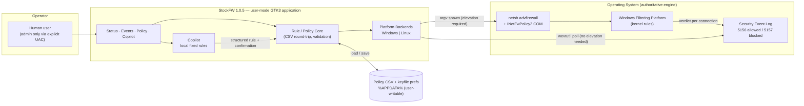
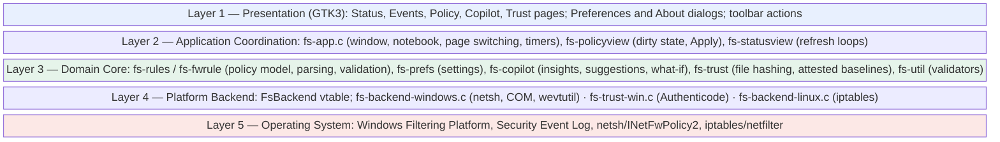
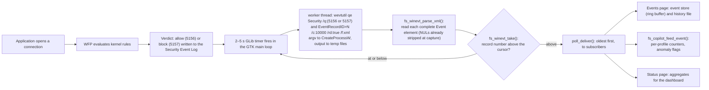
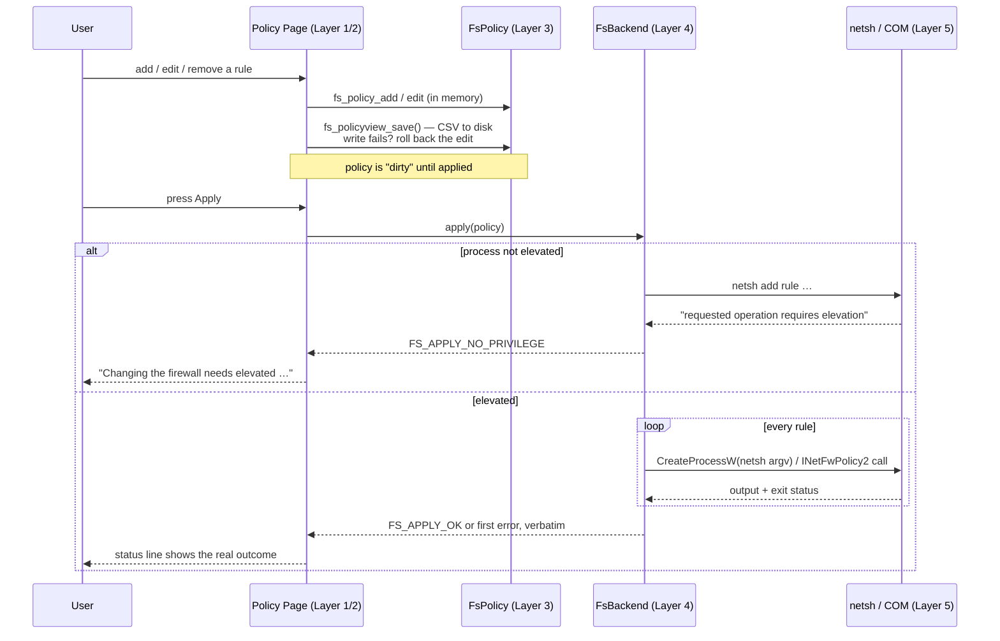
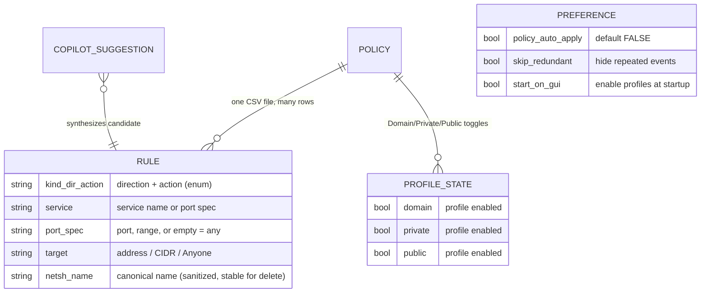
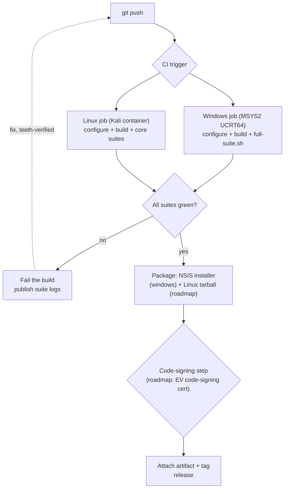

# StockFW — Technical Architecture and Security Document

**Version 1.0.7 · November 2026 · Classification: Internal / Distributable**

*Prepared by the StockFW Project. StockFW is a GTK3 port and modernization of the firewall tool originally developed by Stockfw Team; the port and this document are authored by H3xCore / the Stock Team.*

---

## Table of Contents

**Chapter 1: Executive Summary & Introduction** — 1.1 Executive Summary · 1.2 Problem Statement · 1.3 Goals and Non-Goals · 1.4 Target Audience · 1.5 Scope, Conventions, and Evidence Grading · 1.6 The System at a Glance · 1.7 System Context Diagram

**Chapter 2: System Architecture & Flow** — 2.1 Layered Architecture *(Mermaid: block diagram)* · 2.2 Event Data Flow: Connection to Screen *(Mermaid: flowchart)* · 2.3 Control Data Flow: Policy to Firewall *(Mermaid: sequence diagram)* · 2.4 The Backend Contract · 2.5 Process and Trust Boundaries

**Chapter 3: The Core Engine (How it Works)** — 3.1 User-Mode by Design · 3.2 Rule Compilation to `netsh advfirewall` · 3.3 Event Acquisition: 5156/5157 and `wevtutil` · 3.4 The Record Cursor: No Duplicates, Counted Skips · 3.5 Monitoring Bootstrap: `auditpol` · 3.6 The Linux Backend · 3.7 Spawn Mechanics and Failure Modes *(Mermaid: sequence diagram)*

**Chapter 4: The Copilot and the What-If Engine**: 4.1 What the Copilot Is · 4.2 How Events Reach It, in the Window and in the Background · 4.3 The Detections · 4.4 Sentinel: the Automatic Block and Its Gates · 4.5 The Policy Health Check · 4.6 What It Can and Cannot See: Linux and Windows · 4.7 Writes: Confirmed, Verified, Undoable

**Chapter 5: Security Model & Threat Analysis** — 5.1 Trust Boundaries and Attacker Profiles · 5.2 Privilege-Escalation Analysis *(verified evidence table)* · 5.3 Injection Surfaces: netsh, CSV, Event Log · 5.4 Tamper Resistance of the Policy Store · 5.5 Data Privacy of Logs · 5.6 STRIDE Summary

**Chapter 6: The User Interface & User Experience** — 6.1 Design Language and StockFW Fidelity · 6.2 The Tab Model · 6.3 Real-Time Event Rendering Under Load · 6.4 Filtering, Deduplication, and Row Budgets · 6.5 Preferences: WYSIWYG as Policy · 6.6 Theming, Icons, and Accessibility

**Chapter 7: Policy Management & Rule Engine** — 7.1 The CSV Schema and Round-Trip Guarantees · 7.2 Rule Lifecycle *(Mermaid: ER diagram)* · 7.3 Precedence and Conflict Semantics · 7.4 Per-Profile State: Domain, Private, Public · 7.5 Failure-Atomic Apply and Rollback · 7.6 Import, Export, and Versioning

**Chapter 8: Testing, Build, and Deployment Strategy** — 8.1 Build Matrix · 8.2 Test Architecture and Suites · 8.3 The Teeth Methodology · 8.4 Crash Reproduction Under gdb · 8.5 The NSIS Installer · 8.6 CI/CD Design and Code Signing *(Mermaid: flowchart)*

**Chapter 9: Performance & Scalability** — 9.1 Workload Model · 9.2 Bounded Data Structures · 9.3 Memory Discipline: Defects Found and Fixed · 9.4 Measured Results: The 150-Second Soak · 9.5 CPU Scheduling · 9.6 Scaling Envelope and Bottlenecks

**Chapter 10: Future Roadmap & Commercialization** — 10.1 Feature Roadmap · 10.2 Enterprise and "SaaS" Considerations · 10.3 Licensing Analysis and Open Questions · 10.4 Monetization Options · 10.5 Compliance, Signing, and Distribution

**Chapter 11: 1.0.4 Addendum** — 11.1 Event → Rule, One Click · 11.2 Events Filter Bar · 11.3 Sentinel: Detection and Auto-Block · 11.4 F-1/F-3 Hygiene · 11.5 Repairs and Version

**Chapter 12: 1.0.5 Addendum** — 12.1 Assistant Removed, What-If Developed · 12.2 Bi-Directional Direction Setting · 12.3 Runner and Version · 12.4 Application Trust Engine (Priority 1) · 12.5 Explainable Behavior Analysis (Priority 2) · 12.6 Safe Policy Enforcement (Priority 3) · 12.7 System Tray and Background Operation · 12.8 Preferences Settings Made Real on Windows · 12.9 Sentinel "No False Outages": the 2026-10-10 Incident and the P6 Hardening · 12.10 Detection Validation: the P4 Adversarial Suite · 12.11 Linux First-Run Defects: sudo's Search Path, a Leaking Probe, and a Ghost Profile Box

**Chapter 13: 1.0.6 Addendum** — 13.1 The Linux Event Pipeline Made Truthful · 13.2 Real Network and Connection Panels on Linux · 13.3 Activity Time Series · 13.4 The Activity Page · 13.5 The `stockfw` Command-Line Tool · 13.6 The Local Dashboard: Threat Model and Controls · 13.7 Desktop UI Defects Fixed · 13.8 Tests and Version · 13.9 Open Observations

**Chapter 14: 1.0.7 Addendum** · 14.1 IPv6 on Linux: One Policy, Two Families, One Rollback · 14.2 Windows Rule Translation: Protocols, Port Specs and Sides · 14.3 The What-If Engine: Two Models, Every Case, Verified Fixes · 14.4 Help, About, and the Preferences Redesign · 14.5 The Copilot: Fixed Rules, Shown Evidence, Verified Fixes · 14.6 Threat-Intel Blocklists on Linux and Windows, and Country and Network Blocking on Linux · 14.7 Events at Volume: Event Store, History on Disk, Windows Burst Capture · 14.8 Release Review: Where System Tools Come From, and the Dashboard Token · 14.9 Release Packaging: One Version, Real Documents, Runnable Installers · 14.10 Release Review: What StockFW Contacts, Credits, and One Test Runner · 14.11 Second Release Review: History While It Loads, the Dashboard's Launch Page, Credits and Packaging

**Chapter 15: After 1.0.7 (unreleased)** · 15.1 Wayland and WSL: No Tray Icon, and Words the Window App Does Not Take · 15.2 The command line made truthful · 15.3 Dashboard hardening · 15.4 Terminal control: settings and policy editing · 15.5 Terminal actions: Copilot, Sentinel, Trust, Help and About

---

## Chapter 1: Executive Summary & Introduction

### 1.1 Executive Summary

StockFW is a Windows-first, cross-platform **smart firewall configuration and monitoring tool**: a modern GTK3 desktop application that acts as a management plane over the operating system's native packet-filtering engine — the **Windows Filtering Platform (WFP)**, driven exclusively through Microsoft-supported interfaces — and an equivalent `iptables`-based backend on Linux. It provides four integrated surfaces: a **Status** dashboard with live traffic counters and per-profile toggles (Domain, Private, Public); an **Events** monitor that classifies inbound and outbound connections in real time with process identification and allow/block verdicts; a **Policy** manager for granular rule authoring over CSV storage with verified round-trip fidelity; and a rule-based **Copilot** that checks the event stream and the policy with fixed rules, shows the evidence for each finding, and simulates the effect of a proposed rule before it is applied.

The product's defining architectural decision is what it **refuses** to be. StockFW contains **no kernel driver, no packet-interception shim, and no cloud dependency**. Every firewall mutation flows through documented, supported Windows mechanisms (`netsh advfirewall` for rule CRUD, the `INetFwPolicy2` COM interface for profile state); every observation flows out of the Windows Security event log. The consequence of this conservatism is a specific and defensible security posture: the application has no driver attack surface, no custom binary parsing of untrusted network packets, and no remote component to compromise. Privilege escalation is handled by an **asInvoker** manifest plus explicit, user-initiated UAC launchers; unelevated operations fail loudly rather than silently. This posture is not aspirational — it is the subject of an auditable verification table in Chapter 5, where each security claim is tied to source-file evidence.

StockFW is a deliberate port and modernization of the GTK firewall configuration tool originally written by **Stockfw Team**, whose UI conventions — including the sectioned Preferences dialog with its tree sidebar and Help/Cancel/Accept button row — are reproduced faithfully. The port is developed by **H3xCore** under the StockFW Project. It preserves StockFW's design language while replacing its Linux/iptables-era assumptions with a dual-backend architecture whose Windows side is the primary target.

### 1.2 Problem Statement

Windows ships a competent firewall engine and almost unusable management ergonomics. The native controls are split across three surfaces with three different mental models: the per-profile toggles in Windows Security, the rule zoo of `wf.msc` (where hundreds of implicit allow rules make intent unreadable), and PowerShell's `NetSecurity` cmdlets (powerful, but a scripting barrier for exactly the users most likely to misconfigure a firewall). The result is well documented: users disable the firewall entirely, or they author rules they cannot later explain. Meanwhile the events that matter — *which process talked to which address, and was it allowed or blocked* — are buried in Event Viewer rows that require knowing event IDs 5156 and 5157 to extract.

The original tool solved this problem elegantly for Linux in the mid-2000s and is now effectively abandoned; its architecture (shell out to `iptables`, GTK2) does not survive contact with modern Windows. The gap StockFW fills is precisely this: **a single coherent application that makes a stock OS firewall legible** — policy as a readable, diffable CSV; events as a classified, searchable stream; advanced knobs (ICMP behavior, filtering options, rejection semantics) in one dialog; and a Copilot layer that answers "why is this blocked?" (analysis), "what would happen if?" (what-if simulation), and proposes concrete rules — without a shell prompt.

The security problem statement is equally sharp. A firewall configuration tool is an attractive target precisely because it is a privilege amplifier: whatever the tool can be tricked into applying, it applies **with the user's elevation**. Therefore the design constraint that shapes the whole system is: *no input path — CSV file, event record, natural-language string, or UI event — may convert user-level access into firewall-changing action without passing typed validation, an explicit human confirmation, and an elevation check, in that order.*

### 1.3 Goals and Non-Goals

**Goals:**

- **Legible firewall management** on Windows (primary) and Linux (secondary) from one codebase, with policy stored as human-readable CSV that survives load/save round trips semantically unchanged.
- **Real monitoring**: live inbound/outbound event classification with process names, verdicts, addresses, and ports — not a static dashboard.
- **WYSIWYG honesty**: every control shown does something on the running backend; settings pages the backend cannot honor are not displayed, and that guarantee is enforced by an automated test (Chapter 6).
- **A Copilot that earns the word "smart"** — anomaly insight, natural-language what-if simulation, and rule suggestions from observed traffic — with allow-only rule generation, mandatory confirmation showing the exact rule, and rollback if persistence fails.
- **Verifiable security claims**: every statement in the threat model maps to source code that can be inspected, and every regression test can be forced to fail (the "teeth" methodology, Chapter 8).

**Non-goals (equally load-bearing):**

- **No kernel component.** StockFW does not filter packets itself; it configures and observes the OS engine. "Driver vulnerabilities" are therefore out of scope by construction — the attack surface of a third-party NDIS/WFP callout simply does not exist here.
- **No replacement of the OS firewall.** StockFW never uninstalls, disables, or shadows Windows Defender Firewall; if the application crashes, existing WFP rules remain in force and connectivity is unaffected.
- **No cloud model.** There is no AI model in StockFW: the Copilot is a set of fixed rules and a closed-grammar What-If parser that run on this computer (Chapter 4, 14.5); no telemetry, no rule data, and no event content leaves the machine.
- **No database server.** Storage is a CSV policy file plus keyfile preferences — trivially backed up, diffable, and auditable.
- **No cross-user policy store.** The policy lives in the invoking user's profile; multi-user enterprise distribution is roadmap (Chapter 10), not present.

### 1.4 Target Audience

This document serves four readers. **Security reviewers and auditors**, who will read Chapters 3 and 5 first and expect every privilege-boundary claim to name files and functions; the verification table format is written for exactly this reader. **Software engineers** extending the codebase, for whom Chapters 2, 3, and 7 define the backend contract, the spawn/capture mechanics, and the rule lifecycle. **Technical end users and SOHO operators** evaluating whether StockFW is safe to run elevated — Chapters 1, 5, and 8 answer that directly. Finally, **product and business stakeholders** considering the roadmap and licensing questions in Chapter 10. The prerequisite bar is deliberately low in Chapters 1, 6, and 10, and rises through the middle chapters; no chapter assumes prior StockFW knowledge, though familiarity with firewalls generally is assumed throughout.

### 1.5 Scope, Conventions, and Evidence Grading

Every architectural claim in this document describes the code as it exists in StockFW 1.0.7 (November 2026), not an aspirational design; Chapters 1–10 carry the 1.0.3 base text, Chapter 11 records the 1.0.4 additions, Chapter 12 the 1.0.5 additions, Chapter 13 the 1.0.6 additions and Chapter 14 the 1.0.7 additions — the addendum chapters are authoritative where they differ. Claims are graded: **[Verified]** marks behavior proven by source inspection or an automated test named in Chapter 8; **[Measured]** marks behavior with numbers from an executed experiment (e.g., the 150-second soak test in Chapter 9: 45.6 MB → 44.8 MB private bytes under a continuous 300-record event flood, clean exit); **[Roadmap]** marks intent only. Diagrams are Mermaid source blocks intended for rendering. Where the original design and StockFW differ, the difference is called out explicitly rather than silently. Security claims were re-verified against source for this edition: ten privilege-boundary properties were re-read line by line and are cited with file and line references in Chapter 5.

### 1.6 The System at a Glance

| Aspect | StockFW 1.0.5 (actual) |
|---|---|
| Language / standard | C (GNU C11), GLib/GIO/GTK3 |
| UI framework | **GTK3** — native widgets, no Electron/WPF/Qt |
| Build | CMake + Ninja; MSYS2 UCRT64 (Windows), GCC (Linux/Kali) |
| Firewall control | Windows: `netsh advfirewall` (argv spawn) + `INetFwPolicy2` COM; Linux: `iptables` |
| Event acquisition | Windows Security log **5156/5157** via `wevtutil /f:xml`, every record after the last one read (5 s poll, up to 10,000 per poll; 1.0.7, Section 3.3) |
| Packet interception | **None** — user-mode management plane over WFP |
| Policy storage | CSV (round-trip tested) in user profile; GLib keyfile preferences in `%APPDATA%` |
| Copilot layer | Local deterministic parser and fixed rules; **no network calls** |
| Privilege model | `asInvoker` manifest; UAC only via user-launched elevated wrappers; fail-loud unelevated errors |
| Installer | NSIS, bundling the complete GTK3 runtime beside `StockFW.exe` |
| Test suites | Core 653, P4 adversarial 49, Winlog 56, Installer-spawn 9, Logstart 5, UI smokes, teeth-verified regressions |

### 1.7 System Context Diagram



The diagram encodes the document's central thesis in one picture: StockFW sits **beside** the trust boundary, not inside the packet path. Arrows into the enforcement plane are labelled with their preconditions (argv spawn, elevation required); arrows out of it are read-only observations. Chapters 2 and 3 unpack each arrow; Chapter 5 attacks them.

---

## Chapter 2: System Architecture & Flow

### 2.1 Layered Architecture

StockFW is organized as five strict layers. Dependencies point downward only; no layer reaches around the one beneath it, and the presentation layer never touches the operating system directly.



**Layer 1** is pure GTK3: widgets, tree stores, CSS that is compiled into the executable so an installed copy renders identically to a development build. **Layer 2** owns lifetimes and scheduling — it starts the poll timers, decides when the policy is "dirty," and routes backend errors to status lines instead of swallowing them. **Layer 3** is platform-agnostic C with no GTK and no OS calls: the same rule parser runs on both operating systems, which is what makes the round-trip guarantee testable without a GUI. **Layer 4** is the only layer that spawns processes or calls COM, behind a single vtable (Section 2.4). **Layer 5** is never modified by StockFW in place — WFP rules live in the OS store; StockFW only adds and removes entries through supported front-ends.

The layering is not decorative; it is the reason several bug classes cannot exist. A malicious CSV row can only reach Layer 4 after Layer 3 has parsed and typed it; a malicious event record can only reach Layer 1 after Layer 4 has split and deduplicated it.

### 2.2 Event Data Flow: Connection to Screen

The monitoring pipeline answers one question repeatedly: *what connections did the firewall adjudicate since the last poll?* The flow is push-free and entirely pull-based — StockFW never hooks the network stack; it reads the audit trail the OS already maintains.



Five properties of this flow are load-bearing:

1. **Bounded intake, sized for bursts.** Each poll reads every 5156/5157 record after the last one it delivered, up to **10,000** (`/c:10000`), so a burst of 4,000 connections in five seconds reaches the list whole. Until 1.0.7 each poll read the newest ten (`/c:10`) and a burst arrived as ten rows. Past 10,000 in one poll the newest 10,000 are read and the rest are counted and shown as skipped (Section 3.4). The cap still sits in the child call, before any app code.
2. **Identity by record number.** Every Security log record carries an `EventRecordID` that only grows. The reader keeps the highest one it has delivered (the cursor) and the query asks only for records above it, so there is nothing to deduplicate by text. The text form's `Event[n]` markers, which were positions and not identities (defect `e5fbad0`), are gone with the text form.
3. **Constant state.** The cursor is a few numbers. The 64-entry seen-set of earlier versions is gone.
4. **Fan-out after validation.** The UI, the Copilot, and the dashboard receive only records that survived split + dedup; none of them ever parse raw `wevtutil` output.
5. **No blocking.** The `wevtutil` spawn (`E`) runs on a worker thread with a hard timeout, and the worker strips the NUL bytes from the output as it reads it. Only the parsing, the cursor and the delivery (`F` to `H`) run on the GLib main loop. A wedged `wevtutil` is killed and the poll is skipped rather than freezing the window (Section 3.7).

### 2.3 Control Data Flow: Policy to Firewall

The control path is the privileged one, and it is deliberately more ceremonious than the read path.



Four deliberate design choices appear in this diagram. **Persistence precedes enforcement**: the CSV write happens first, with rollback on failure, so disk and memory never disagree about what the user asked for. **Elevation is detected, not assumed**: the backend classifies netsh's own output (`netsh_needs_elevation`) and returns a distinct status the UI renders as actionable text. **Apply is per-rule and fail-fast**: the first failing rule stops the loop and its error is surfaced verbatim, so a partially applied policy is *visible* rather than silent. **There is no background applier**: with `policy_auto_apply` defaulting to FALSE and no file watcher anywhere in the tree, nothing applies rules unless a human pressed a button in an elevated instance (Chapter 5).

### 2.4 The Backend Contract

Both platforms implement one vtable, `FsBackend` (`fs-backend.h`), which is how the UI avoids `#ifdef` sprawl. The contract, in plain terms:

| Operation | Meaning | Windows implementation | Linux implementation |
|---|---|---|---|
| `available()` | Can we manage the firewall at all? | Firewall service reachable via `INetFwPolicy2` | `iptables` present and loadable |
| `start()` / `stop()` | Enable/disable enforcement | `put_FirewallEnabled(VARIANT_TRUE/FALSE)` per profile | Policy load / flush to accepted state |
| `apply(policy)` | Compile and push rules | One `netsh advfirewall add rule` argv per rule | `iptables` argv per rule (script generation in `fs-script.c`) |
| `poll / hits` | Fetch new adjudicated connections | `wevtutil` on 5156/5157 after the last record number read, XML (Section 2.2); `log_skipped` reports what a full poll could not read | Netfilter log / connection listing |
| `refresh_network` / `refresh_connections` | Dashboard counters | `GetExtendedTcpTable`, interface stats (no elevation needed) | `/proc` and route queries |
| `trust_signature` | Authenticode verdict + signer for one executable (trust engine, 12.4) | `WinVerifyTrust` + `CryptQueryObject`, offline (`fs-trust-win.c`) | Slot NULL — verdict stays *not checked* |
| `fw_sections` / `fw_honors` | Which Firewall preference pages apply, and which per-control effects? | **ICMP + Advanced Options** — executed through the settings plan (12.8); Network/ToS not offered | **All four pages** — the generator compiles them; REJECT method and ICMP rate limits live |

`fw_sections` deserves special mention because it is the architectural root of the WYSIWYG guarantee: the Preferences dialog asks the backend *which* pages to render, one `FS_FWSEC_*` bit at a time (Chapter 6), so a page exists exactly when its backend reads it — and the UI smoke both fails if an unoffered page appears and pins the shipped capability set so no bit can drift unnoticed (Chapter 8). The companion `fw_honors` bits cover the finer case: a page the backend reads, with one control it still cannot reproduce (Windows has no per-rule reject — 12.8), which stays disabled with an admission instead.

Ownership rules inside the contract are explicit: callers own the lists returned by the refresh operations and free them with the provided element destructors (`fs_iface_stat_free`, `fs_connection_free`) — a discipline whose violation caused a real leak class that was fixed and is now discussed in Chapter 9.

### 2.5 Process and Trust Boundaries

StockFW runs in at most three process contexts, and the boundaries between them are enforced by the operating system, not by convention:

1. **Unelevated StockFW.exe** (manifest `asInvoker`, verified by inspecting the built binary). It can read the event log, read connections, edit and save the CSV — and it *cannot* change the firewall. Every attempt fails with a specific, actionable error.
2. **Elevated StockFW.exe**, reached only when the user deliberately runs one of the shipped launchers (`StockFW-elevated.vbs/.cmd/.ps1`), each of which resolves its target **relative to its own directory in Program Files** and triggers UAC via `Start-Process -Verb RunAs`. Windows UIPI then prevents any medium-integrity process from sending input to this window — a background malware cannot click "Apply."
3. **Child tools** (`netsh`, `wevtutil`), spawned with `CreateProcessW` under `CREATE_NO_WINDOW`, inheriting exactly three handles (stdin from `NUL`, stdout and stderr to per-invocation temp files) through an explicit process-attribute list — the child cannot inherit stray handles from the parent.

There is no IPC surface: no named pipe, no socket, no D-Bus. The only cross-process data channels are the child's stdout/stderr temp files and the shared CSV, whose consequences under tampering are analyzed in Chapter 5. The trust summary: *input trust flows from the OS (event log), content trust is never assumed (everything is parsed and typed), and privilege flows only from explicit user intent (UAC).*

---

## Chapter 3: The Core Engine (How it Works)

### 3.1 User-Mode by Design

The first thing to understand about StockFW's engine is what it deliberately does not contain: a driver. Firewalls are commonly extended with kernel components — WFP callout drivers, NDIS filter drivers, or user-space interception libraries such as WinDivert — in order to *observe or make verdicts themselves*. StockFW does neither. It **configures** the Windows Filtering Platform through interfaces Microsoft documents and supports (`netsh advfirewall`, the `INetFwPolicy2` automation interface) and **observes** adjudications by reading the audit events the OS already writes.

This decision removes an entire chapter from the threat model. A kernel callout parses attacker-controlled packet data in a context where a bug is a blue screen or a privilege escalation; it must be signed, versioned against OS builds, and updated forever. A user-mode management tool that speaks only to documented APIs inherits none of that. The trade-off is honest and accepted: StockFW cannot see packet payloads, cannot intercept connections before the kernel decides, and is bounded by whatever the audit subsystem records. For a configuration-and-monitoring product, those are the right trade-offs — the engine's own filters do the time-critical work, and StockFW's job is to make the engine's state legible.

There is a second, subtler benefit. Because every mutation is an invocation of a standard tool with a textual output, the entire write path is **observable and testable**: tests can fake `wevtutil.exe`/`netsh` in a search path, feed real-world output formats, and assert parsing behavior without root, without a VM, and without touching the host firewall. Chapter 8's 56-check Windows suite exists because of this property.

### 3.2 Rule Compilation to `netsh advfirewall`

A `FsFwRule` in memory is a typed structure: direction (in/out), action (allow/block), protocol (TCP/UDP/any), an integer local port, and an optional remote address. Compilation to a netsh invocation (`fs-backend-windows.c`, `netsh_add_rule`) is where typing pays off:

| Rule field | Compilation | Why it is safe |
|---|---|---|
| direction | `dir=in` / `dir=out` | enum → literal, two fixed strings |
| action | `action=allow` / `action=block` | enum → literal |
| protocol | `protocol=TCP` / `UDP` / `any` | enum → literal |
| local port | `localport=%d` or `localport=any` | **formatted from an int** — no string ever flows here; ports with protocol `any` are omitted because netsh rejects them |
| remote address | `remoteip=%s` | single argv token; netsh's own parser rejects anything that is not an address/keyword (fail-closed, Section 5.3) |
| name | `name=` after `netsh_safe_name()` | `: ( ) / ,` replaced with `-`; the same canonical name is used for add and delete so removal matches creation |
| scope | `profile=any`, `enable=yes` | fixed constants |

The args are collected as `char **` and handed to `spawn_capture()`, which builds one command line via `build_command_line()` → `append_spawn_arg()`. That quoting function is an exact inverse of `CommandLineToArgvW`: a token containing space, tab, quote, CR or LF is wrapped in quotes; embedded quotes become `\"`; runs of backslashes touching a quote are doubled; trailing backslashes before the closing quote are doubled. The correctness of this function is the difference between "arguments can never be smuggled" and "arguments can never be smuggled *on a good day*": because each argv element round-trips to exactly one child argument regardless of content, **no policy string can ever become a second netsh parameter**. A crafted `remoteip` value cannot add `action=allow`, a crafted rule name cannot add `localport=any`, and there is no shell in the loop — no `cmd.exe`, no `system()`, no metacharacters to interpret.

Netsh's own limitations are handled explicitly rather than discovered at runtime: rule names are sanitized because netsh rejects colons, parentheses and slashes that the UI's display names legitimately contain; port specifications are dropped for protocol `any` because netsh refuses them; profile is always `any` so the compiled rule behaves uniformly as the user toggles Domain/Private/Public.

**1.0.7:** dropping the port for protocol `any` was a security defect, not a safe limitation: most services compiled to `any`, so their rules matched all traffic in their direction. Ports are now netsh port specs, a ported rule is always TCP or UDP, and the argv is built in core by `fs_fwrule_netsh_args()`. See 14.2.

### 3.3 Event Acquisition: 5156/5157 and `wevtutil`

The monitoring side reads two Security log events: **5156** (the Windows Filtering Platform permitted a connection) and **5157** (it blocked one). Each record carries exactly the fields the Events page shows: application path (hence the process name, e.g. `brave.exe` or `svchost.exe`), source and destination addresses, ports, protocol, direction, and the verdict.

Acquisition runs as a five-second GLib timer. Each tick hands one query to a worker thread, which spawns (argv only, through `spawn_capture_max`, no console window):

```
wevtutil.exe qe Security
  /q:*[System[(EventID=5156 or EventID=5157) and EventRecordID>N]]
  /c:10000 /rd:true /f:xml
```

N is the record number of the newest event already delivered. The worker looks at the output only for its record numbers, to decide whether the clear check of Section 3.4 rule 4 is needed, and posts it back to the main loop with `g_idle_add`; only the main loop parses it and calls the Events page. Three properties of this call shape the pipeline (1.0.7):

- **XML, not text.** `/f:text` has no record number, so it cannot say which events are new. `/f:xml` carries `EventRecordID`, `EventID`, `TimeCreated SystemTime` and the event's named `Data` fields (`Application`, `Direction` as `%%14592` inbound or `%%14593` outbound, `SourceAddress`, `DestAddress`, `DestPort`, `Protocol`). `core/fs-winevt.c` reads them into the same rows the text reader made: the port is the destination port, In and Out are the local and the remote side by direction, the service is the program's file name, and a 5157 is marked `[BLOCKED]`. XML entities and numeric references are decoded and the result is made valid UTF-8. Only complete `<Event>` elements are read; one cut off at the end of the output is left out and counted.
- **Newest first, up to 10,000.** `/rd:true /c:10000` returns the newest 10,000 records above the cursor. The reader puts them in record order and delivers them oldest first. A poll of 10,000 events is about 15 MB of XML; captured output is now allowed up to 64 MB for this call (16 MB for every other child), and a longer output is cut there and counted as skipped.
- **The OS does the selection.** The XPath filter runs inside the event log service, so the child reads only 5156/5157 records newer than the cursor.

`core/fs-winevt.c` holds the parsing, the query and the cursor and is plain GLib, so `tests/test-winevt.sh` runs it on every platform against canned wevtutil output (Chapter 8). The backend keeps only the spawn and the worker thread.

Before this works at all, the audit policy must allow it: **Section 3.5** covers the `auditpol` bootstrap. Reading the Security log needs Administrator rights; without them the probe at start fails and the Events page says why, instead of showing an empty list.

### 3.4 The Record Cursor: No Duplicates, Counted Skips

`fs_winevt_take()` turns one poll's parsed events into the rows to deliver. Its rules:

1. **Start after now.** `log_start` first runs `wevtutil qe Security /c:1 /rd:true /f:xml` (no query): the newest record of any kind. The cursor starts there, so events from before this start are not delivered again on top of the history the app already saved (Section 14.7). The same probe is the Administrator check.
2. **Each record once.** Only records above the cursor are taken, sorted by record number, and a number seen twice in one batch is taken once. The cursor then moves to the highest number read, whether or not that record became a row. A record without a number is never delivered, because it could not be told apart from itself on the next poll.
3. **Skips are counted, not hidden.** When a poll comes back full (as many records as it asked for: up to 10,000, fewer after a slow read under rule 5 or in the fallback under rule 6) or cut short, the records between the cursor and the oldest one read were not read. Record numbers count every Security event, not only 5156/5157, so the gap is an upper bound. It is added to `log_skipped`, and the Events page shows it beside its count, for example "4,000 events (up to 20,020 skipped)", with a tooltip saying why.
4. **A cleared log is noticed.** A poll that finds no record above the cursor also runs the probe (`fs_winevt_needs_probe`). With the record condition that is a poll that finds nothing. In the fallback of rule 6 it is also a batch of only old records, which is what a log cleared and filled again answers there: until this was fixed, the probe ran only on an output without any `<Event`, so in the fallback a cleared log that had firewall records was never noticed and nothing was delivered until the record numbers climbed back past the old cursor. If the newest record in the log is below the cursor, the log was cleared (record numbers start again at 1), so the cursor goes back to 0 before the batch is taken. The batch in hand, all of it after the clear, is then delivered in the same poll, and with the record condition (an empty batch) the next poll reads everything since the clear. A log that rolls over keeps numbering, so rollover needs nothing. One case is not noticed: a clear followed, before the next poll, by more records than the cursor's number. With a five-second poll and a cursor in the thousands or more this needs thousands of new records in seconds after a clear.
5. **Slow reads back off.** A query killed at its 30-second budget delivers nothing and does not move the cursor. The next poll asks for half as many (never fewer than 500), and each poll that works doubles the request back towards 10,000. The halved request still reads the newest records first, so when the backlog is larger than it, the older part is skipped and counted under rule 3. For example, after one slow read a backlog of 8,000 delivers the newest 5,000 and counts up to 2,995 as skipped.
6. **A log that refuses the record condition still works.** If wevtutil rejects the query with `EventRecordID>N` (an error other than access denied or the timeout) while the cursor is above 0, the worker runs the same query once more without the record condition, for the newest 2,000 at most, still as one argv element built from numbers only. Rule 2 drops what the cursor has already seen, and rule 4 notices a cleared log from the same batch. Such a batch is often full, so a full batch counts a skip only when it did not reach back to the cursor: if any record read is at or below the cursor, nothing between was missed and nothing is counted.

The honesty rule still applies to data: a record is shown as the OS produced it (fields mapped for display, nothing invented), so what Events shows can be reconciled with `eventvwr` by record number.

### 3.5 Monitoring Bootstrap: `auditpol`

Windows does not log 5156/5157 unless the audit policy enables the *Microsoft-Windows-Windows Firewall With Advanced Security/Firewall* subcategory. StockFW's `firewalled_log_start` runs the corresponding `auditpol /set` command **idempotently** — running it twice is harmless, and it is the only place where StockFW changes a machine setting that is not a firewall rule. It surfaces its result in the UI: if policy editing is denied (audit policy requires elevation), the Events page says monitoring is not enabled and how to enable it, instead of showing an empty list and calling it "no traffic."

This distinction matters for trust: monitoring state and enforcement state are reported separately. A user can run StockFW unelevated, see their real traffic, explore policies, and simulate changes — and only pay the UAC cost when they decide to actually reconfigure the firewall.

### 3.6 The Linux Backend

The Linux side implements the same vtable against `iptables` using **argv-style execution** — each invocation is a `g_spawn_sync` of `iptables` with arguments as a vector, never a shell string, so rule content cannot inject shell syntax (`fs-backend-linux.c`). The Linux backend sets all four `FS_FWSEC_*` bits: the Network/ICMP/ToS/Advanced preference pages genuinely compile into rules there. Windows reads the same preferences through the settings plan (12.8) for the two pages it can reproduce — ICMP Filtering and Advanced Options — and leaves Network Settings (would need Internet Connection Sharing) and ToS (no marking field exists) unoffered, which is exactly the per-page rendering split Chapter 6 describes.

An additional facility exists for reviewability: `fs-script.c` can emit the equivalent ordered shell script (its header comment begins with dropping malformed packets before anything else sees them), letting a Linux user audit the complete effect of their policy as text before applying it. The same CSV policy model serves both platforms; only the compilation target differs.

**The event monitor** is the Linux twin of Chapter 3.3's Windows event acquisition. `linux_log_start()` forks a child that `dup2()`s the write end of a pipe onto its stdout and `execlp()`s a log follower; the parent keeps the read end, sets it non-blocking, and drains it from a 250 ms `G_TIMEOUT` poll rather than a blocking `GIOChannel` watch (a blocking watch and a buffered reader contend over the same data and can stall the UI). The child picks its source in order: the `STOCKFW_LOG_FILE` override, then `/var/log/kern.log` if rsyslog is present, then `journalctl -k -f` — the override being what makes the monitor testable without a live kernel log, and the journal fallback being what keeps it working on a systemd system where rsyslog is no longer the default.

Only lines the backend's own rules logged are reported: `parse_log_line()` requires a bare `STOCKFW-DROP` marker and then lifts `SRC=`/`DST=`/`PROTO=`/`SPT=`/`DPT=`/`IN=`/`OUT=` as key=value tokens. A line without the marker is dropped silently, which is what keeps unrelated kernel noise off the Events page. Fields the log does not carry are filled honestly — the raw line as the time, `in` as the direction, `Dropped` as the service, overridden by the well-known name when the source port resolves.

`log_start()` refuses (returning FALSE with an explanatory error) rather than pretending, when the process is not root: the kernel log is unreadable without privilege, and returning TRUE while reading nothing is precisely the silent-empty-list failure this backend must not have. `log_stop()` reaps the child and releases the read end.

**[Verified]** `tests/test-logstart-events.sh` drives a real rsyslog-format drop line through the whole path — fork, `tail -F`, pipe, poll, parse, callback — and asserts every field arrives correctly, that a marker-less line is not reported, and that the stop path really stops. It needs root and a POSIX `ifaddrs.h`, so it self-SKIPs elsewhere.

**The defect this test caught.** The monitor's parent side once had the pipe ends transposed: it closed `log_pipe[0]` (the read end) and then read `log_pipe[1]` (the write end). Two failures compounded. Reading a write-only descriptor returns `EBADF` on every poll, so the drain loop never executed — and because no process then held the read end open, the child's `tail` received `SIGPIPE` and died the first time it emitted a line. `log_start()` still returned TRUE and `log_active()` still read TRUE throughout: a monitor that claimed to be running while not one byte could ever reach it. It had been green under `tests/test-logstart.sh`, which asserts only that a start either succeeds or explains itself — it never asserts that a started monitor *delivers*. The fix restores POSIX ordering (parent reads `[0]`, closes its copy of `[1]`; `log_stop()` releases `[0]`), and the event test now pins delivery itself so the transposition cannot return unnoticed.

### 3.7 Spawn Mechanics and Failure Modes

Every child process on Windows goes through `spawn_capture()`, which exists because `g_spawn_sync` was unsuitable for two hard requirements: suppressing console windows for GUI sessions, and capturing output reliably with a timeout.

```mermaid
sequenceDiagram
    participant App as spawn_capture()
    participant OS as CreateProcessW
    participant Child as netsh / wevtutil
    participant T as Temp files (sfw*.tmp)

    App->>T: GetTempFileNameW ×2 (atomic unique names)
    App->>T: reopen with FILE_SHARE_READ only (write-locked)
    App->>OS: argv → build_command_line (CommandLineToArgvW-inverse)<br/>CREATE_NO_WINDOW, 3-handle inherit list
    OS->>Child: process starts, console-free
    Child->>T: stdout / stderr written directly
    App->>App: WaitForSingleObject (hard timeout)
    alt child exceeds timeout
        App->>Child: TerminateProcess
        App-->>App: report timeout error, skip this poll
    else child exits
        Child-->>App: exit status normalized to g_spawn semantics
        App->>T: rewind and read captured text
        App->>App: parse (netsh: detect elevation errors; wevtutil: split)
    end
    App->>T: delete both files (always, including error paths)
```

The failure modes are enumerated deliberately:

- **Console window suppression.** `CREATE_NO_WINDOW` keeps `wevtutil` flashes out of the user's session — a functional requirement inherited from the original GUI expectations. The downloader's `curl.exe` is started the same way (below).
- **Output via temp files, not pipes.** Pipes deadlock when a child writes more than the pipe buffer before the parent reads; file capture sidesteps this entirely. The files are created atomically by `GetTempFileNameW` and reopened with `FILE_SHARE_READ` only, so once open, no other process can modify or delete them while the parent holds the handle; an attempted pre-open plant causes a sharing violation, which takes the **error path** rather than corrupting input (Chapter 5).
- **Hard timeout with kill.** A wedged child is terminated and the poll is skipped; the main loop never blocks indefinitely.
- **Exact handle inheritance.** An explicit process attribute list passes three handles and nothing else — the child cannot inherit the parent's policy file handle or any other live object.
- **Exit-status parity.** Child exit codes are normalized to the same convention `g_spawn_sync` reported, so error handling logic written for the Linux backend behaves identically on Windows.
- **Elevation classified from output.** netsh reports elevation failures on *stderr with a non-zero code*; the classifier reads the captured text for the canonical phrase so `FS_APPLY_NO_PRIVILEGE` wins over the raw failure reason (the phrase check is a `strstr` over captured output, not a security decision — it only chooses which message the user sees).

**curl for downloads (after 1.0.7).** The threat-intel downloader (`core/fs-fetch.c`, 14.6) is the one other console program StockFW starts on Windows, and until this fix it went through GLib (`GSubprocess`). GLib cannot pass `CREATE_NO_WINDOW`, and the window app has no console of its own, so Windows gave every `curl.exe` a console window: turning on a list, "Update now" and the daily update flashed one black window per list (reported by the owner, 2026-11-03, on the Threat Intel page). On Windows `fs_fetch()` now starts curl itself (`win_run_curl`) the way `spawn_capture()` starts netsh, with three differences that the downloader needs:

- **Pipes, not temp files.** The body must never touch the disk (14.6, S2), so stdout and stderr come back over two anonymous pipes. The deadlock the temp files avoid cannot happen here: the loop never blocks on a pipe. Every 50 ms it waits on the process, then takes what each pipe holds (`PeekNamedPipe`, then `ReadFile` of at most that much), at most 16 reads a pipe a round, so a curl that writes to stderr without end still meets the deadline. stdout is read at most one byte past the cap, the byte that proves the body too large; the first 64 KiB of stderr are kept and the rest dropped, as on Linux.
- **The same limits, by the same rules.** Over the cap: `TerminateProcess`, TOO_LARGE. At `--max-time` plus 5 s: `TerminateProcess`, TIMEOUT. After curl exits, its pipes may stay open 2 s more (a write end another process inherited) before the reads stop; after a kill, the wait for curl to be gone gives up after 10 s. The outcome switch after the transfer is shared with Linux, so the messages are the same.
- **What curl gets is what it got before.** `lpApplicationName` is the full path of System32's `curl.exe` (no search, P14); the command line quotes each argument by the `CommandLineToArgvW` rules (`win_append_arg`); the environment block is exactly `fs_fetch_envp()` (`SystemRoot`, `NoDefaultCurrentDirectoryInExePath=1`), sorted by name as Windows expects; the working folder is the system folder; stdin is `NUL`; the inherit list holds only `NUL` and the two write ends; the parent closes its copies of those right after the start. The Linux path is unchanged (`GSubprocess`, `nobody`, `/` as the working folder).

`tests/test-fetch-spawn.c` checks it against `tests/fake-curl.c` in curl's place, on both platforms (8.2). On Windows it runs as the window app does, after `FreeConsole()`: the fake reports whether it has a console window and whether it is visible; the fake started by `fs_fetch()` must have none on the screen, and as the control the same fake started through `GSubprocess`, the old way, must get a visible one, so the check is known to be able to fail there. Also checked: the body exactly at and under the cap, one byte over and far over are TOO_LARGE, exit 6 and 22 with curl's stderr line in the message, a hanging curl killed at the deadline, 4 MiB on stderr, seven user agents with spaces, quotes and backslashes reaching curl unchanged (every argument compared with `fs_fetch_argv()`), the environment exactly `fs_fetch_envp()`, the working folder, a missing curl as NO_CURL, and no handle (Windows) or descriptor (Linux) left after twenty downloads. On Linux, moving curl's working folder to `/tmp` and letting the body run two bytes past the cap each failed its check (teeth). The Windows half was compiled for Windows here (MinGW-w64, `-Wall -Wextra`, no warnings) but has run only on the CI's Windows runner, never by hand on a desktop.

---

## Chapter 4: The Copilot and the What-If Engine

This chapter describes the Copilot as the 1.0.7 code builds it: `core/fs-copilot.c` (the detections and the learned baseline), `core/fs-health.c` (the policy health check), `core/fs-whatif.c` (the What-If engine), and `ui/fs-copilot.c` (the page, Sentinel's automatic blocks and their expiry). Section 14.5 records why it was reworked in 1.0.7 and how the page looks; the numbers below are the ones in the code.

### 4.1 What the Copilot Is

The Copilot is a fixed set of rules that runs on this computer. Each rule is a count compared with a written limit (the `FS_SENTINEL_*`, `FS_SCAN_*`, `FS_BRUTE_*`, `FS_NEWDEST_*` and `FS_BEHAVIOR_*` constants at the top of `core/fs-copilot.c`), so the same events always give the same findings. It does not learn a model, it has no network code, and nothing it reads or finds leaves the computer. Integer arithmetic decides the rate check and a plain mean and variance decide the timing check; there is nothing random anywhere in it.

What it reads:

- **The firewall's own event log**, one event at a time, as the Events page receives it (4.2).
- **The saved policy**, for the health check (4.5), for the What-If engine (4.7), and to know which login ports the policy opens (4.3).
- **This computer's DNS servers and default gateways** (`fs_hostnet_read`: `resolv.conf`, systemd-resolved's and NetworkManager's upstream lists behind a `127.0.0.53` stub, `/proc/net/route`; on Windows every adapter's DNS servers and gateways from `GetAdaptersAddresses`). They are read when the Copilot is made and again at most once a minute. They exist only to keep those addresses out of the timing check and out of every automatic block.
- **Its own baseline** (`behavior.csv` in the per-user config directory; `STOCKFW_BEHAVIOR_FILE` overrides it for tests): per program on Windows, per port's service name on Linux, the ports, destinations, hours of activity, the connection rate and the times of recent first contacts.

What it writes: findings in memory (at most 200), the baseline file, and, only through the paths in 4.4 and 4.7, rows in the policy.

The one free-text input is the What-If card's entry. A line typed there is parsed by a closed grammar (directions, protocols, ports and service names, addresses by their shape) and answered as a verdict. A typed line has no write path of its own: it can become a verdict and nothing else. The only rule it can lead to is the one the Details window offers as Create This Rule, which is printed in full and confirmed first (4.7).

### 4.2 How Events Reach It, in the Window and in the Background

The backend delivers each event to one callback, `on_hit` in `ui/fs-hitview.c`, on the main loop. That callback hands the event to the Copilot (`fs_copilot_feed_event`) **before** the Events page's display filters run, so "skip repeats" and "skip events not for this firewall" change what the list shows and never what the checks count: ten identical login attempts are ten attempts to the brute-force check. In the same callback Sentinel's automatic pass runs (4.4), and the page's counters are told an event arrived (the page redraws at most once a second, and only rows whose content changed).

None of this depends on the window. The Events page is built when the app starts and starts monitoring then, whether the window is shown, hidden behind the tray icon by "Minimize to the tray", or never shown at all because StockFW started with `--background` at sign-in. Hiding the window hides widgets; the monitor, the callback and the timers keep running. In particular:

- **Events still reach the Copilot**, and Sentinel still stages blocks from them.
- **Sentinel's ten-minute expiry still runs.** It is a main-loop timer re-armed for the earliest block still inside its window, not something the page does when it is drawn.
- **The baseline is still saved.** Every event marks the baseline as changed (`fs_app_note_learning`), and the app's periodic save (`ui/fs-app.c`, every five minutes; `STOCKFW_AUTOSAVE_S` shortens it for tests) writes it when it changed, together with the settings and a retry of a staged-list write that had failed. The session manager's query-end, Windows' `WM_QUERYENDSESSION`, the tray's Quit and SIGTERM, SIGINT and SIGHUP write it at once. A crash loses at most five minutes of learning.
- **The tray controls Sentinel.** The tray menu's "Pause Sentinel auto-block for 1 hour" works with the window hidden; while paused the item reads "Resume Sentinel auto-block (paused, N min left)". It is greyed, with the reason as its tooltip, when this copy may not change the firewall, when it is not watching events, or when Sentinel is in detect-only mode. The pause is not saved: a restart resumes auto-block. The tray has no findings item in 1.0.7; findings are read on the Copilot page.
- **Nothing pops up.** No detection and no automatic block opens a dialog. Questions are asked only when the user presses a button on the page.

`fs-session-smoke` (scenario `background`) proves each of these points with the window hidden; `port/tests/README.md` lists its checks and the bugs they catch.

### 4.3 The Detections

Every finding carries: a title, what was seen, a "why flagged" sentence with the measured numbers next to the limits, a "could be harmless" sentence, up to 12 evidence rows (time, direction, remote address, port, protocol, refused or not, and the rule text when the log gave one), a line for the What-If card where one makes sense, a filter for the Events page, and what Sentinel did or why it did not. A finding has a key (`type|app|subject`); a new event for an open finding updates its count and evidence instead of adding a row.

Counting is per program on Windows, where the log names the program (`Application Name`, reduced to its file name, for example `brave.exe`). On Linux the kernel log names no program, so the key is the port's service name (`https`, `ssh`) or `Unknown`; several programs on one port share one key, and the page's tile says "Services learned" instead of "Apps learned". The " [BLOCKED]" marker the backends add to refused events is removed from the key so a program's allowed and refused events build one history.

**The checks that run on every event** (no baseline needed):

| Detection | Trigger | Severity | Sentinel |
|---|---|---|---|
| Contacts at a near-fixed interval (beacon) | Outbound only. One series per program (service on Linux), destination, port and protocol (TCP and UDP are separate series). Arrival times are counted in whole seconds, so a batch of records read at once is one contact; the last 32 are kept. Judged from 6 contacts: mean interval 10 to 600 s and a standard deviation of at most 0.30 of the mean. Port 123 (time sync) is never timed, nor port 53 or 853 to one of this computer's DNS servers. Each evidence row is that contact's own time and verdict. | Warning; Critical when the event's rule text says a block list or country rule matched it | the only detection that can block automatically; see 4.4 |
| Fan-out | Outbound, per program: 60 distinct hosts, or 10 distinct refused hosts, in 60 s. When the key is a service name (Linux, or a Windows event with no program), only the 10 refused hosts count, because a busy page in any browser reaches 60 hosts. One report per episode; the episode ends when the 60-second window empties. At most 256 keys are tracked. | Warning | never: there is no single host to block |
| Inbound port scan | One source reaching 12 distinct local ports in 60 s, or 25 in 10 minutes (the last 512 events per source are kept). The addresses of one IPv6 /64 are also counted together, as a second finding that names them, when 2 or more addresses take part. ICMP, loopback, link-local, multicast, the protected ranges and this computer's own addresses are ignored. One new report per source per hour; later probes update the open finding. At most 1024 sources; past that the stalest is dropped. | Info when every probe was refused, Warning when any reached an allowed port | never: there is no inbound deny kind, and refused probes were already dropped |
| Repeated attempts on a login port | One source, 10 inbound attempts in 5 minutes across TCP 21, 22, 23, 445, 3389 and 5900 and the ports the policy's inbound allow and forward rows give to SSH, RDP, VNC, Telnet, FTP or SMB (rows of 16 ports or fewer). Attempts on different login ports add up. At most 1024 sources. | With refused attempts: Critical when the policy lets that source in on one of those ports (Warning when the source is on the LAN); Warning for a public source when some attempts were allowed and some refused; otherwise Info. With no attempt refused: Warning for a public source the policy lets in, otherwise Info. "Lets in" is a What-If ALLOWED, or a DEPENDS when the log shows connections this computer let in: the check asks What-If without the network in use, and on Windows an inbound from a private address depends on it (StockFW blocks reserved sources on Public networks), while an allowed connection in the log answers it for the network the computer was on. | never; the finding links the health check's "narrow to the local network" fix |
| Block list or country rule hit | An event whose rule text starts with `Threat intel:`: a threat-intel list's block or a country or network rule's block, which carry the same marker and are named `Threat intel: <list or rule name>` (14.6). | Warning for outbound (a program tried to reach a listed host); inbound drops roll up into one Info finding per list per hour | not needed: the list already blocks it |

**The baseline checks** run once a key has 10 recorded events, and never for a key whose stored ports or destinations hit their caps (256 ports, 1024 destinations; such a profile is marked partial and can no longer say "never seen before"):

| Signal | Trigger |
|---|---|
| First use of a port | outbound only; the first event on that port for this key |
| New destination | outbound only; a public address never seen for this key, once the key has at least 50 connections over at least 7 days, and not for a key with 20 or more first contacts in the last 7 days (a browser meets new hosts all the time). The first-contact times are saved in `behavior.csv`, so a restart does not report the same hosts again. One finding per key per hour lists the new hosts. |
| New hour | the first activity in an hour of the day, once 4 hours are known |
| Connection rate spike | the open 10-minute bucket holds at least 10 connections and more than 3 times the usual rate plus 5; the usual rate is an average over closed buckets (weight 0.25) and is judged only after 8 buckets; one report per bucket |

The signals of one event form one finding: Info for one signal, Warning for two or more. A baseline finding never carries a rule. An unusual connection is not answered with an allow, and a block is the user's decision (Ask What-If shows what one would do).

**Across checks.** Two different checks on the same subject within an hour make both findings Critical, and each says so (the four baseline signals count as one check). The list holds at most 200 findings; when it is full the oldest baseline finding goes first, and a beacon, scan, login or block-list finding goes only when nothing else is left.

**What a finding is not.** No finding means none of these checks matched; the page says "This is not a guarantee that nothing is wrong." Findings are kept in memory for the session; dismissals are not saved.

### 4.4 Sentinel: the Automatic Block and Its Gates

Sentinel has two modes, Detect only and Detect + auto-block (the default). In auto mode, after each event, `fs_copilot_sentinel_auto_pass` walks the findings and stages a block only when **every** gate below passes:

1. **The finding is a beacon with at least 8 contacts.** No other detection ever sets `auto_applicable`.
2. **The beacon's own withholds** (each shown in the finding's drawer as the reason when it applies): the destination is not loopback, link-local, multicast, broadcast, reserved, "this network" (0/8), the private ranges (10/8, 172.16/12, 192.168/16), the shared range 100.64/10, IPv6 ULA or site-local, an IPv4-mapped form of any of those, or anything that is not a literal address; it is not one of this computer's DNS servers or default gateways (on any port); for port 53 or 853, the DNS upstream is known (behind a local stub whose upstream servers could not be read, no DNS destination is blocked); the user's policy has no outbound "allow to host" row for it (the same address, or a network or range around it; an Anyone row does not count), because on Windows a block outranks an allow and a Sentinel block would silently overrule the user's own Allow; the program's own history held fewer than 3 connections to it before this run; and no other program has 3 or more recorded connections to it (the block applies to every program and every port). On Linux the key is a port's service, not a program, and these texts say so ("traffic on this port", "traffic on the https port (any program)"); the checks list on the page does the same.
   Gate 2 is judged twice: when the finding is made, and again by the pass at the moment it stages (`fs_copilot_beacon_recheck`), with the baseline, network and policy of that moment. A pass can run long after the finding: when a tray pause ends, when the mode is switched from Detect only, and on the retry after a failed write. By then another program may use the host, or the user may have allowed it on the Policy page or in an earlier session. When a gate now withholds, nothing is staged and the finding's drawer gives the new reason.
3. **`fs_insight_is_auto_safe`** checks the rule itself once more: an outbound deny kind only (the Sentinel row is "deny outbound to host"), and a target outside the classes in gate 2 and outside the resolvers and gateways. An allow is never staged, whatever a finding claims.
4. **Not paused** from the tray, **not already staged**, **not already in the policy** (a row the user added is the user's and is never expired), and **not staged and taken down before in this session** (expiry, Undo, an allow for that host, or a switch to detect mode put the rule on a session cooldown; this is the guard against the drop and re-stage loop of the 2026-10-10 incident, 12.9). The cooldown is kept in memory only, so a restart decides afresh.
5. **The write succeeds.** The row is added and saved with rollback on a failed write. A failure is audited once and retried at most once a minute.

A staged block is audited, written to the staged list (`autoblocks` next to `behavior.csv`; rows `S,<epoch>,<kind>,<rule csv>`), and pushed through `fs_policy_apply_safe`, the same gate as every apply: audit-only mode and the Policy Lock hold it, and the audit says whether it went live.

**Every automatic block lifts ten minutes after it was staged** (`FS_AUTOBLOCK_TTL_S`, 600 s). The expiry timer runs whether or not the window is shown (4.2). At start the app reads the staged list: blocks whose time ran out while StockFW was not running are taken out of the policy before the firewall starts, and the rest are re-armed with their original clock. `stockfw start` at boot does the same without the app (`core/fs-autoblock.c`), so an expired block is never installed again. Switching to Detect only lifts every staged block. Allowing that host from the Events page or from What-If lifts the blocks on it. Each block has Undo in its finding's drawer and in "Changes made by the Copilot"; an expired or undone block stays in that list, marked with how and when it ended.

What Sentinel never does: block inbound traffic, block a network rather than one address, change or remove a rule it did not stage, ask a question while nobody is looking, or keep a block past ten minutes.

### 4.5 The Policy Health Check

`core/fs-health.c` reads the saved policy and reports duplicates, shadowed rows, allows covered by a deny, outbound allows that have no effect in permissive mode, inbound allows over more than 100 ports, risky services open to anyone, and rows that reach no address family. Coverage is exact (ports through `fs_fwrule_port_spec`, addresses through `fs_range_parse`, protocols compared). A removal or a narrowing to the local network is offered only when the What-If engine, run on probes before and after the change, shows that nothing else changes. Fix asks first, writes through `fs_policy_apply_safe`, and can be undone from the Changes list. `stockfw copilot health [--json]` runs the same check from the command line and writes nothing. The full table of checks, severities and fixes is in 14.5.

### 4.6 What It Can and Cannot See: Linux and Windows

The Copilot sees only what the firewall logs, as the backend reads it. Both platforms need the rights to read that log: on Linux root, or a kernel log the user may read (`/dev/kmsg` directly, otherwise a `journalctl` or `tail` child); on Windows an elevated StockFW, which reads the Security log. Without them monitoring does not start, the Events page says why, and the Copilot sees nothing.

| | Linux (iptables and ip6tables, kernel log) | Windows (Windows Firewall, Security log) |
|---|---|---|
| Events | `STOCKFW-DROP` / `STOCKFW-REJECT` for inbound packets that reach the default rule (each is logged); `STOCKFW-DROP` for outbound packets that reach the default deny in restrictive mode (at most 20 a second, bursts of 40); `STOCKFW-ALLOW` for the first packet of each accepted new connection when "Log allowed connections" is on (the default; at most 10 a second, bursts of 20) | events 5156 (allowed) and 5157 (blocked), after StockFW turns on auditing of "Filtering Platform Connection"; read with `wevtutil` every 5 seconds |
| Who | no program: the key is the port's service name or `Unknown` | the program's file name from `Application Name` |
| Timing | the time the record is read, close to real time | the time the batch is read: a 5-second poll is one moment, so beacon intervals are known to within about 5 seconds |
| Rows that deny by rule | an explicit deny row (including a Sentinel block) drops without a log line, so contacts it blocks are no longer seen | 5157 records name no StockFW rule |
| Block-list rule text | the kernel log parser turns a `STOCKFW-TI <id>` line into the rule text `Threat intel: <name>` for a list or a country or network rule StockFW applied (14.6), and the check reads it | no event names its rule, so the check is silent |

Consequences, stated plainly:

- On Linux, two programs on one port are one key. Fan-out counts only refused hosts there, and the beacon and baseline checks follow the service, not the program.
- Without "Log allowed connections" (Linux) or with auditing turned off by policy (Windows), only refused traffic is seen: the beacon check sees only refused contacts, and the login check sees only refused attempts.
- A slow pattern, or one below the log rate limits, can stay under every limit. A beacon slower than one contact every 10 minutes is not judged.
- The scan and login tables keep at most 1024 sources each; an attacker with more addresses than that (easy with IPv6) can push out an earlier source's count. The /64 aggregate catches many addresses from one IPv6 network, not addresses spread over many networks, and IPv4 sources are not grouped.
- The DNS servers and gateways are read at most once a minute; a change in between is seen at the next read.
- No byte counts are read: the rate check counts connections.

### 4.7 Writes: Confirmed, Verified, Undoable

Apart from Sentinel (4.4), the Copilot changes the policy only when the user presses a button, and each path checks first:

- **Block outbound to this address** (a finding's drawer). Offered only when What-If says the finding's line is ALLOWED now and BLOCKED with the row; checked again just before writing, because the policy may have changed; then a dialog prints the literal row and the What-If check, and No writes nothing. The row is saved with rollback on failure, pushed through `fs_policy_apply_safe`, audited, and listed under Changes with Undo.
- **Fix** (policy health). Verified as in 4.5, asked with the before and after rows, applied through the same gate, undone from Changes by content, not by position.
- **Create This Rule** (What-If Details window). Offered only for a parsed line whose verdict is BLOCKED; re-checked against the policy as it is now; the confirmation prints the literal row; the question is asked again after the write so the window shows whether the verdict really changed.

The What-If engine itself (`core/fs-whatif.c`, 14.3) answers a line with the platform's own model (Linux first match per chain, Windows block wins), every case the line leaves open, and the firewall's state; it writes nothing.

**Input threat surface.** Free text enters only through the What-If entry and can only become a verdict. Log content (addresses, ports, service and program names, rule text) enters findings as data: it is shown in labels and evidence cells and never parsed as a command. A remote host can make findings appear (a scan, login attempts, timed contacts it answers), and through a beacon it can at most cause a ten-minute outbound block on one public address that no program on this computer has a history with and the user's policy does not allow, judged when the block is staged, never a LAN, infrastructure or resolver address, and never an allow. Every rule the Copilot writes is an ordinary policy row the Policy page shows and the user can remove.

---

## Chapter 5: Security Model & Threat Analysis

### 5.1 Trust Boundaries and Attacker Profiles

StockFW's security model is built around three boundaries:

- **B1 — Enforcement boundary**: anything that can change firewall state must pass through an elevated StockFW instance calling netsh/COM. This boundary is enforced by Windows (token elevation, UAC) and cannot be crossed by StockFW's own code, which contains no self-elevation path whatsoever.
- **B2 — Input boundary**: text from the OS (event log), from disk (CSV policy, preferences), and from the user (UI, Copilot) is untrusted until parsed and typed. No layer consumes raw bytes from below it.
- **B3 — Display boundary**: what the UI renders is derived data; the UI never interprets its own display strings as commands.

Three attacker profiles, ordered by capability:

| Profile | Capability | Realistic goals |
|---|---|---|
| **A1 — Remote unauthenticated** | Can generate network connections observed by the firewall | Induce permissive rules or misleading insights; read nothing (no network surface in StockFW at all) |
| **A2 — Local user-level malware** | Full control of the user's profile: rewrite the policy CSV, attack the unelevated UI, race temp files | Convince an elevated StockFW to install attacker rules ("confused deputy") without gaining elevation itself |
| **A3 — Interactive user (incl. admin)** | Everything, including UAC consent | Out of scope as an attacker: this is the operator. Misconfiguration protection (confirmations, simulator) applies instead |

StockFW exposes **no listening socket, no IPC endpoint, and no parser reachable from the network**; A1's only interaction with the product is the traffic it generates, which the Copilot treats as *evidence to display*, never as instructions to execute. The entire interesting fight is A2 vs. the confused-deputy problem, which is the subject of the next section.

### 5.2 Privilege-Escalation Analysis

The following table re-verifies, against source, the claim that user-level access cannot be converted into firewall-changing action. Each row was re-read for this document; file references are to StockFW 1.0.5.

| # | Property | Mechanism | Evidence |
|---|---|---|---|
| 1 | **No self-elevation code** | The tree contains no `ShellExecute`, `runas`, `WinExec`, or `system()`; the Windows backend spawns only via `CreateProcessW` | `spawn_capture`, `fs-backend-windows.c:592`; zero matches project-wide |
| 2 | **Manifest is `asInvoker`** | Elevation exists only in launchers the user deliberately runs | verified by inspecting the built `StockFW.exe`: `asInvoker` present, `requireAdministrator` absent |
| 3 | **Unelevated operations fail loud** | COM: explicit "requires administrator privileges" error; netsh: output classified as `FS_APPLY_NO_PRIVILEGE`, rendered as actionable text | `fs-backend-windows.c:175`, `:921`, `:1045`; `fs-policyview.c:424` |
| 4 | **No argument injection** | Ports compile from `int` (`%d`); direction/action/protocol are enum literals; every value is one argv token quoted by the `CommandLineToArgvW` inverse; no shell exists | `fs-backend-windows.c:763-788`, `append_spawn_arg:325` |
| 5 | **Strict CSV typing** | All-digit port fields (rejects `80abc`, `0x50`), range 0–65535 with `a ≤ b`; malformed rows skipped and counted at load; since 1.0.4 host and port fields are validated fail-closed at load before netsh sees them (F-1) | `fs-fwrule.c:47-122`, `fs_policy_load` + `rule_fields_sane` `fs-rules.c:279-381` |
| 6 | **Startup cannot push attacker rules** | `start()` only calls `put_FirewallEnabled(TRUE)`; CSV content is never applied at startup; the preference itself defaults FALSE | `fs-backend-windows.c:190-193`, `fs-app.c:255` |
| 7 | **Auto-apply chain is dead** | `policy_auto_apply` defaults FALSE; no file watcher/monitor exists anywhere | `fs-prefs.c:312`, `fs-policyview.c:469`; no `g_file_monitor` in tree |
| 8 | **Temp-file capture is race-safe** | Atomic `GetTempFileNameW` creation; reopened `FILE_SHARE_READ` only — content immutable while held; a pre-open plant causes sharing violation → error path | `fs-backend-windows.c:527-543` |
| 9 | **No environment module injection** | The app never sets `GTK_PATH`/`GTK_MODULES`/`PATH` and loads no dynamic modules | no `setenv`/`putenv`/`g_module` matches in `port/src` |
| 10 | **Elevated UI is input-protected** | UIPI blocks medium-integrity processes from sending input to the elevated window; each elevation is a fresh UAC consent | OS-enforced; launchers resolve targets only relative to their own Program Files directory |

**End-to-end confused-deputy attempt (A2), walked step by step.** The attacker rewrites the policy CSV with `remoteip=any action=allow`-style rows. Step 1: nothing happens — no watcher, auto-apply defaults off (row 7). Step 2: the attacker tries to click Apply on the unelevated window — the apply runs, netsh refuses, and the UI shows "needs elevation" (row 3); the CSV content still never reached a privileged process. Step 3: the attacker tries to drive the *elevated* window via synthetic input — UIPI drops it (row 10). Step 4: the attacker plants a fake `netsh.exe` in a searched directory — since 1.0.7 (Section 14.8) every tool is run as `<System32>\<name>` by its full path, so no search happens at all. (This step used to say the search order resolved `netsh` from System32. It did not: `CreateProcessW` looks in the program's own folder and the current folder first, which a portable copy unpacked in Downloads or an elevated shell in a user folder would have reached; the 1.0.7 release review found it.) Step 5: the attacker races the output temp files — sharing violations take the error path (row 8). The attack fails at every step without StockFW needing to "detect" anything: each step is a structural dead end.

**Elevation-launcher analysis.** The three launchers (`StockFW-elevated.vbs/.cmd/.ps1`) resolve every path **relative to their own directory** (`%~dp0` / script dir) — no `%TEMP%`, no profile paths, no registry lookup — and UAC is triggered only by `Start-Process -Verb RunAs`. The launcher's PATH handling has been hardened twice. The first fix removed an *unconditional* prepend of `C:\msys64\ucrt64\bin`; this audit found the *conditional* form still live — the wrapper added that directory to the elevated process's PATH whenever the runtime DLLs were not beside the script. A gated path widening is still a path widening: that directory is user-writable, so a planted DLL there would load into an administrator process. **[Fixed]** The launcher no longer prepends anything. It requires `libglib-2.0-0.dll` beside the resolved binary and, if absent, exits 1 with an explanation rather than falling back. The runtime is resolved against the directory actually holding `StockFW.exe`, not the script's directory, because those differ in the dev tree (binary in `build\`) and checking the script directory would refuse a healthy dev copy. **[Verified]** three layouts: installed copy proceeds, dev copy proceeds, broken copy stops without reaching `Start-Process`; teeth — deleting the guard makes the broken copy launch, so the check is pinned, and neither wrapper retains any reference to `msysBin`, `ucrt64`, or a PATH assignment.

### 5.3 Injection Surfaces: netsh, CSV, Event Log

**netsh argument injection** — closed by construction (Section 3.2): the quoting function is an exact inverse of the child's parser, so the mapping *one policy field → one netsh parameter* holds for every byte value. Netsh additionally validates its own values: a garbage `remoteip` makes netsh reject the rule, `run_netsh` returns non-zero, and Apply stops with the tool's real error — **fail-closed**, with no partial semantic effect.

**CSV injection** — the policy file accepts only the documented dialect; numeric fields must be pure digits (which defeats `strtol`'s documented forgiveness of `80abc` and hex prefixes), ranges are bounds-checked, and rows that do not parse are skipped and counted (`N malformed policy rule(s) were skipped`). The one honest gap: `address_or_null()` passes target text through **without a local syntactic check**, relying on netsh's parser as the validating point. This is fail-closed (see above) but later than ideal; **F-1** in Section 5.6 tracks wiring the already-written-but-uncalled `fs_util_is_valid_host()` into the load path.

**Event-log injection** — records are treated as data, never as markup. They flow through NUL-stripping and a bounded XML reader that takes only the named fields it needs (no DTDs, no external entities, only the five predefined entities and numeric references, output forced to valid UTF-8), then into the event store and a virtual tree model (plain text rendering; no markup interpretation of event content). The Security log itself is written by the OS firewall service; forging entries requires SeSecurityPrivilege (admin), i.e., a higher privilege than anything the forgery could achieve through StockFW. A forged record can at worst display a fake row and feed Copilot counters — bounded, session-local, and non-authoritative (the simulator always consults the *policy*, not events).

**Shell injection** — does not exist as a surface: no `system()`, no `cmd /c`, no shell string is ever constructed on Windows; Linux spawns are argv vectors.

### 5.4 Tamper Resistance of the Policy Store

The policy CSV and preferences live in the user's profile and are, by design, user-writable. This is a deliberate usability choice (backup = copy a file; audit = `git diff`; no service account needed) with a fully analyzed consequence: **file integrity is not a security boundary in StockFW** — the security boundary is the Apply button.

What tampering can and cannot buy:

| Tampering | Consequence |
|---|---|
| Rewrite rules while StockFW is closed | Nothing until the user opens the app, reviews the Policy page (the tampered rows are *visible*), and presses Apply in an elevated instance |
| Rewrite rules while StockFW is open | In-memory policy wins on save; a later load surfaces malformed rows as a count; apply still requires the button |
| Delete the file | Load reports the absence honestly; defaults can be restored; enforcement untouched (OS rules persist) |
| Replace with a huge file | Bounded by load-time row processing; malformed rows are skipped, not partially applied |
| Corrupt during write | Save is write-to-file; copilot path rolls back in-memory state on failure so UI ≠ disk divergence is never silent |

The asymmetry is the point: **a crash or corruption of StockFW can never disable the firewall** (WFP holds the rules), and **a tampered file can never apply itself**. The failure modes are all in the direction of "less convenient," never "less enforced."

### 5.5 Data Privacy of Logs

StockFW contains **no telemetry and no analytics**. Through 1.0.6 it had no network client at all; since 1.0.7 it downloads only what the user turns on and accepts — a threat-intel blocklist or the location database — through `curl` (14.6), and Section 14.10 lists every network contact and what starts it. Event data (application paths, peer addresses, ports, verdicts) is held in process memory and the on-screen list. Since 1.0.7 it is also written to disk when the user switches on Preferences > Events > Keep event history, which is off until then (Section 14.7): one file per UTC day under the account's own data folder, the folder 0700 and each file 0600 on Linux, under `%LOCALAPPDATA%` with an owner-only DACL on the folder and each file on Windows, kept 30 days or 200 MB by default and deleted from Preferences at any time. The temp capture files used for child output are deleted on all paths including errors. The policy CSV records rule intent (service, port, target), not connection history. Crash diagnosis in development uses external tools (gdb, the event log) rather than shipped reporting.

Data at rest is the user's own data in the user's own profile; the document's recommendation for enterprise deployments (Chapter 10) is standard OS-level profile encryption rather than anything application-specific. One privacy-relevant behavior deserves disclosure: enabling monitoring writes an **audit-policy change** (`auditpol`) — a machine-level setting, disclosed in the UI and reverted by the same idempotent mechanism if the user disables monitoring.

### 5.6 STRIDE Summary

| Threat | Vector | Mitigation | Residual |
|---|---|---|---|
| **S**poofing | Fake UI, forged events, rule-name error phrases | UIPI on elevated window; events = display-only text; Security log forge needs admin | Rule-name-in-output display spoof: cosmetic, logged as **F-3** |
| **T**ampering | Policy CSV rewrite; temp-file race | Apply-button boundary; share-mode-locked captures; save rollback | User-profile encryption left to OS (**F-2** doc note) |
| **R**epudiation | "The app applied it silently" | Apply is always a human click in an elevated instance; netsh output surfaced verbatim | No persistent apply-audit log — **roadmap** (Ch. 10) |
| **I**nformation disclosure | Log/CSV exfiltration | No telemetry; downloads only after opt-in, and they send nothing but the request (14.10); bounded in-memory events | Event log itself is OS-managed (admin-readable anyway) |
| **D**enial of service | Event flood; huge CSV; wedged children | `/c:10000` intake cap per poll with counted skips; 64 MB output cap; bounded event store and history; spawn timeout + kill | Sustained flood *of the OS log* is out of product scope (Ch. 9) |
| **E**levation of privilege | Confused deputy via CSV/UI/temp/launchers | Ten verified properties (5.2); allow-only Copilot; confirmation dialogs | **F-1**: wire `fs_util_is_valid_host` earlier in load; launcher fix shipped this version |

**Open findings register:** **F-1** — `fs_util_is_valid_port`/`fs_util_is_valid_host` exist in `fs-util.c` but are never called; wire or remove (validation today is already fail-closed via typed ports and netsh's parser). **F-2** — document OS-level at-rest protection recommendations for managed deployments. **F-3** — consider stripping control characters from rule names before they appear in any textual output.

---

## Chapter 6: The User Interface & User Experience

### 6.1 Design Language and StockFW Fidelity

StockFW is built in **GTK3** with one governing aesthetic rule: *the original design's look, with real artwork.* The artwork is the project's `logo.png` (since 1.0.7: the flame, gear and SF shield). Its square, transparent master is `port/resources/stockfw-logo.png`, and `port/tools/make-logo-assets.sh` regenerates every size from it: the copies **embedded in the executable** (window, task bar and tray icon at 32/64/128, the Status page, About, and the CLI dashboard's header and favicon) — so an installed copy renders the same logo as a development build, with no file-path drift — plus the Windows `.ico` (16–256, used by `StockFW.exe` and the installer) and the Linux menu icons (hicolor 48, 128 and 256). The Status page carries it at **89×89** (deliberately larger than the run/stop badge in the hero card, which sits centred — badge and status text as one group — in the space beside the Events counters); the About dialog credits the original lineage correctly — "Stockfw Team - Creator & Original Developer" first, **H3xCore** as Developer, and "Stock Team - GTK3 Port, Windows Backend, Copilot", with no full name and no e-mail address — and contains no names from upstream projects that did not contribute to this lineage.

A hard product rule inherited from earlier review: **no emoji anywhere — only real GTK stock/themed icons.** Emoji render differently per platform, fail monochrome symbolic contexts, and read as toy software; themed icons resolve from the user's icon theme and stay crisp at every scale. The same honesty extends to empty states: pages say *why* something is empty ("monitoring not enabled — enable the audit policy") instead of showing a zero-row table.

The visual layer is CSS compiled into the binary (installed via `install_css()` in the dialogs and status view), which eliminates the classic GTK deployment failure where a shipped `.css` file is missing, stale, or loaded from the wrong prefix. Window geometry is clamped to the monitor's work area so that on DPI-scaled displays the Accept button never lands off-screen — a defect class that was present and fixed.

### 6.2 The Tab Model

The application is a five-tab notebook, each tab owning a toolbar row. The notebook's own tab row is hidden; a custom band in `fs-app.c` — full width, light neutral `#F0F0F0`, five rounded flat buttons with the active tab filled `#AE0000` on white text — stands in for it and drives `gtk_notebook_set_current_page()`:

- **Status** — live dashboard: logo, firewall state, profile toggles (Domain/Private/Public), network and connection counters on 2 s / 3 s refresh timers, and the elevation status line.
- **Events** — the adjudicated-connection stream: time, process, direction, address, port, verdict, with repeated-event suppression.
- **Policy** — the rule store: list, add/edit/remove, dirty tracking, Apply, and a status line reporting the real backend outcome (including "needs elevation").
- **Copilot**: Sentinel, the findings from the event log, the policy health check, the What-If card and the list of changes the Copilot made (Chapter 4). Free text enters only through the What-If entry, which can only produce a verdict.
- **Trust** — the application trust engine's surface (12.4): inspect a file (streamed SHA-256, signature verdict, publisher), attest or forget it behind a confirmation with an audit line, a baseline list with live per-row status, and a scan of the running processes. Hashing runs on a worker thread, one task at a time, so a two-hundred-megabyte installer never freezes the window.

Page switching re-applies toolbar visibility so only the active page's buttons show; the design goal per tab is *one glance, one decision*: Status answers "is my firewall on?", Events answers "what just happened?", Policy answers "what will happen?", Copilot answers "what should I do?", Trust answers "can I trust this file?".

### 6.3 Real-Time Event Rendering Under Load

The Events page is where a firewall UI usually dies — an unbounded `GtkListStore` append loop will eventually freeze the main loop. StockFW's defenses, in order of where they act:

1. **The intake never exceeds 10,000 records per poll** (Section 3.3). The UI's input rate is capped before any UI code runs, and what the cap leaves out is counted on the page.
2. **All parsing happens off the render path**: split/dedup complete in the poll handler; the UI receives an already-validated batch.
3. **Rows land newest-first by time, once per batch, not per record re-layout**: each row is inserted in sorted order (so an out-of-order arrival still displays correctly), keeping tree-store churn proportional to new rows.
4. **A ring buffer holds the list** (1.0.7, Section 14.7): 100,000 events by default and up to 1,000,000, the oldest dropped first. The view reads it through a virtual tree model that copies no rows. With Keep event history on, the saved history is the archive; the OS log remains one too.
5. **Suppression of repeats**: "Hide repeated events" collapses bursts (a port scan becomes a few rows, not thousands), keyed on same source/port/action moments apart; "Skip events that are not for the firewall" filters non-actionable noise before render.

The main-loop discipline is absolute: no blocking spawn (Section 3.7), no synchronous disk I/O in the poll path, no per-record markup parsing. The 150-second soak in Chapter 9 exercises exactly this path under continuous flood — the process's private bytes *shrank* while the event list was actively churning.

### 6.4 Filtering, Deduplication, and Row Budgets

Deduplication happens three times, deliberately, at different layers: the **record cursor** (Section 3.4) stops the same *record* from being delivered twice, the list store's **row keys** stop the same *row* (all twelve fields joined) from being inserted twice — the UI absorbs a re-delivery after the monitor is stopped and restarted, and a Reload/Clear forgets the keys along with the rows — while **Hide repeated events** stops visually identical *connections* from flooding the list. These are not redundant: the first protects data integrity, the second survives backend forgetfulness, the third protects attention.

The host/port filter lists inherited from StockFW's design (Ignored hosts / Ignored ports) are currently rendered **disabled with an explicit note** that they are not wired in this port — the honest alternative to showing live-looking widgets that do nothing. The search/filter work is on the roadmap (Chapter 10) with the design constraint already established by the next section: *if it is shown as active, it must work.*

### 6.5 Preferences: WYSIWYG as Policy

The Preferences dialog reproduces the original design's structure: a **tree sidebar** (Interface → Events, Policy; Firewall → …) selecting notebook pages, with **Help / Cancel / Accept** at the bottom. Accept writes every bound widget back to the preference store in one pass (cancel writes nothing).

The chapter-defining rule is **WYSIWYG**: *a settings page exists only if the backend reads it.* Whether that holds is decided per page by the backend's `FS_FWSEC_*` bits. Linux compiles all four Firewall sub-pages into rules and renders all four (ToS honestly, as an admitted-dead page matching the original's layout). Windows reads two of them — **ICMP Filtering** and **Advanced Options** — through the settings plan since 1.0.5 (12.8), and renders exactly those two; **Network Settings** (its Windows equivalent would be Internet Connection Sharing, which the port does not carry) and **ToS Filtering** (Windows Firewall has no marking field at all) stay unrendered there. Earlier builds showed all four greyed on Windows with a note admitting "this page has no effect here"; that was honest but still configuration theater — the review decision was to remove rather than annotate, and later work shrank the gap by making the two pages Windows *can* honor real instead of leaving them hidden.

This is enforced by test, not by review. The UI smoke walks every sidebar row, asserts row *i* selects page *i* (through the page-index column the model now carries — per-page gating makes the offered Section enums deliberately non-contiguous, so the enum itself can no longer double as the page number), asserts the section count equals four plus one per `fw_sections` bit (8 on Linux, 6 on Windows), **pins the shipped capability set to the backend's identity** so flipping a bit cannot stay self-consistently green, and **fails if any page is offered without the bit that says the backend reads it**. Inside the offered pages it checks the honesty states directly: the ICMP master switch live with the rate-limit disclosure present exactly when the backend lacks `FS_FWHON_RATE_LIMIT`; the rejection-method radio sensitive exactly when the backend sets `FS_FWHON_REJECT_METHOD`, and disabled *with* its admission note where it is not; the reserved-source block live on both platforms. The two broadcast switches are live on Linux and absent on Windows, where since 1.0.7 the settings plan has no broadcast rule (14.4), and the smoke checks both. Controls that are known-unimplemented elsewhere (dial-out/DHCP triggers) follow the same rule — rendered **disabled with a disclosure note**, never live-and-inert. The tray switches were such controls until 1.0.5, when the tray module made them real (12.7): they are now sensitive, and the UI smoke fails if either goes insensitive again or the "not implemented" note comes back. Every other preference on the remaining pages was audited by call-site grep: if a checkbox exists, a consumer exists (`FS_PREFS_START_ON_GUI` → startup profile enable; `SKIP_REDUNDANT` → event suppression; `policy_auto_apply` → immediate apply).

### 6.6 Theming, Icons, and Accessibility

Theming rides the GTK3/Adwaita engine with embedded CSS overrides for the app's specific classes (page titles, status accents, dialog spacing) — no dependency on a system-wide theme file, no GTK theme engine of its own to maintain. The main window's light palette lives in one stylesheet, `src/ui/fs-theme.css`, which CMake compiles into the binary at configure time (`fs-theme-css.h`) — so the installed exe carries its theme and there is no data file to stage or lose. Iconography uses themed symbolic icons at multiple sizes with correct symbolic recoloring, which keeps contrast on both light and dark themes; the Status badge relies on exactly that (symbolic glyphs tinted white on the state-coloured circle). The stylesheet is under test: the UI smoke loads the compiled-in sheet with a counting log handler — GTK reports CSS parse problems as log warnings and returns `TRUE` anyway — and fails on any "Theme parsing error" or on a missing palette token (`#f0f2f5` canvas, `#f0f0f0` band, `#ae0000` accent — active tab, primary buttons and selection alike — `#8b0000` accent hover, `#ffebee`/`#b71c1c` blocked rows, `#f9f9f9` striping). A second smoke, `fs-theme-smoke`, installs that same sheet at APPLICATION priority and reads sizes and pixels back the way a user's eye would: every state × class variant of a tab button must allocate the identical height (the page-switch shake cannot come back silently), the accent faces must render `#AE0000` at rest and `#8B0000` on hover — including the checked-before-class pill beat that used to fall back to the theme — and no state may show Adwaita's 1px white inset highlight above a button face. Its teeth were verified in both directions: the pre-restyle stylesheet fails 8 checks (blue faces, the white sliver, a transparent transient pill); the current one passes. One deliberate non-rule: scrollbars are left to the theme — custom slider `min-height`/`margin` values made GTK allocate a scrollbar slider a negative height (visible as `gtk_widget_size_allocate` warnings on every window open), and the default scrollbars were fine. Text uses markup only where escaped at construction — the About authors list is pre-escaped because `GtkAboutDialog` renders authors *without* escaping, a defect that once displayed raw `<span>` tags instead of a name and is now covered by the smoke test's Pango-parse assertion.

Accessibility posture, stated honestly: GTK3 provides keyboard navigation, focus order, and screen-reader roles for the standard widgets StockFW uses (dialogs, tree views, check buttons); no custom-drawn widgets bypass that. Contrast follows the Adwaita palette. Dedicated accessibility audit and localized strings (i18n scaffolding exists but ships disabled) are roadmap items (Chapter 10), tracked as product debt rather than silently ignored.

---

## Chapter 7: Policy Management & Rule Engine

### 7.1 The CSV Schema and Round-Trip Guarantees

The policy is a **CSV file** — the single source of truth for what StockFW intends the firewall to do. Each row describes one rule in the port's fixed dialect (rule kind/direction, service, port specification, target address), parsed by `fs-rules.c` into typed `FsFwRule` structures. CSV was chosen over a database, JSON, and a binary format for reasons that matter to this product's audience: it is diffable in a code review, editable in Notepad, copyable as a backup, and diffable again after an edit round trip.

**Round-trip guarantee:** loading a policy and saving it without edits must produce a semantically identical file, and every row that loaded must save back, and vice versa. This is not an aspiration — the core suite (353 checks) includes round-trip tests that load→save→load and compare, plus negative tests asserting malformed rows are **skipped and counted**, never silently transformed. A row the parser does not fully understand cannot survive into the saved file in a mutated form; it is rejected at load, where the user can see the "N malformed policy rule(s) were skipped" report and fix it by hand.

Validation at the parse boundary (all **[Verified]**): port fields must be pure digits (defeating `strtol`'s acceptance of `80abc` and `0x50`), single ports and ranges must fall in 0–65535 with `first ≤ last`, direction and action are enums with fixed vocabularies, and target text passes through `address_or_null()` (normalizing "Anyone"/empty to *any*, with the pass-through limitation tracked as finding F-1 in Chapter 5).

### 7.2 Rule Lifecycle



The lifecycle, end to end:

1. **Create**: the Policy page's add/edit dialog produces a candidate row; the Copilot produces one from a finding's Block button, a health fix or What-If's Create This Rule, each confirmed first (Chapter 4.7). Both land in the in-memory `FsPolicy`.
2. **Persist** — `fs_policyview_save()` writes the CSV; **failure rolls back the in-memory edit**, so the visible policy never claims something the file does not contain.
3. **Mark dirty** — the policy is flagged unapplied; the UI surfaces it (the "Apply" affordance and status line).
4. **Apply** — explicit, human-initiated: the backend compiles each rule to its target representation (netsh argv on Windows, `iptables` argv on Linux) and executes them in order, fail-fast on the first error with the tool's verbatim output.
5. **Verify** — the status line reports what netsh actually said (including elevation classification). Delete uses the **same canonical name** as add (`netsh_safe_name`), so removal is symmetric with creation.
6. **Iterate** — every subsequent edit re-enters at 1; the OS ruleset only moves on Apply.

Two lifecycle invariants are load-bearing. *Disk and memory agree*: persistence happens before enforcement and rolls back on failure. *The firewall never moves without a human*: no watcher, no auto-apply (Chapter 5).

### 7.3 Precedence and Conflict Semantics

StockFW does **not** impose its own packet-walk order — that would mean implementing a firewall engine, which is a non-goal (Chapter 1). It compiles to the OS's native semantics, and documents them for the user:

- **Windows Firewall** resolves per-connection: an explicit **block** match wins over an allow match; among equals, the more specific scope (address/port) is what the OS evaluates. StockFW's job is to *make those outcomes legible* rather than re-implement them.
- **Direction matters**: inbound and outbound are separate rule spaces; a rule for one direction says nothing about the other.
- **The device is stateful**: return traffic on an already-established connection needs no explicit response rule — Windows Firewall accepts it as part of the connection, and the Linux script emits explicit `# Accept return traffic` chains (`fs-script.c`) for the same reason. Statefulness covers *responses*; a **new** connection in the opposite direction is a new decision, which is why both directions remain separate rule spaces.
- **Duplication is idempotent by name**: two saves of the same rule do not create two netsh entries, because add/delete key on the canonical name.

**Bi-directional rules.** Because the two directions are separate spaces, allowing a peer both ways would normally mean authoring two rules. The **Direction** setting does it in one step: on the pairable kinds, the Policy page's Add row and the Event → Rule confirm dialog carry a second entry, **Bi-directional**, next to the default one-direction entry (*Outbound only* — or *Inbound only* on the inbound kinds, since a direction label must tell the truth about the rule it labels). The pairing is exact: `OUTBOUND_ALLOW_TO ↔ INBOUND_ALLOW_FROM` for host rules and `OUTBOUND_ALLOW_SERVICE ↔ INBOUND_ALLOW_SERVICE` for service rules (`fs_rule_counterpart_kind`). It is deliberately closed: deny kinds have no inbound twin (the policy has no inbound-deny kind — inbound is default-deny already), a forward points one way, and `OUTBOUND_ALLOW_FROM` would need an `INBOUND_ALLOW_TO` that does not exist. For those kinds `fs_rule_counterpart_kind` returns `FS_RULE_N_KINDS` and the Direction control is simply **absent** — a choice that cannot be honored is not rendered. The pair stages as **one all-or-nothing change** (`fs_policy_add_persist_pair`): both copies enter the store, a single save writes them, and a failed write takes *both* back out — the store and the disk never keep half a pair. What statefulness means for the setting: Bi-directional is not about responses (those need no rule), it is about **new** connections in the opposite direction — a peer you reach out to should also be able to knock back.

Conflicts are surfaced where users can act on them, in two places. The **What-If simulator** evaluates a candidate against the current policy and reports shadowing — notably `would_block`, when a proposed allow is dead because a block already covers it — *before* anything is written (Chapter 4). The **Policy page** itself is the human-readable conflict view: because the policy is flat CSV, "what rules exist?" is answered by scrolling a list, not by decoding `wf.msc`'s mixed implicit/explicit zoo. Automated conflict-checking across the whole policy (e.g., "this allow is fully shadowed by that block") is roadmap (Chapter 10) — the simulator already contains the core comparison logic.

### 7.4 Per-Profile State: Domain, Private, Public

Windows classifies every network as **Domain**, **Private**, or **Public**, and firewall state is tracked per profile. StockFW's Status page toggles these directly through `INetFwPolicy2` (`set_profiles_enabled`), which is elevation-gated with a clear error — the same fail-loud principle as Apply. Compiled rules are emitted with `profile=any` (Section 3.2): a StockFW rule means the same thing on every network classification, which matches the product's "one policy, legible everywhere" stance. Per-profile *rule* scoping (different rules on Domain vs. Public) is a supported Windows feature StockFW does not yet expose in the Policy editor; it is roadmap (Chapter 10), and the data model has the room for it.

### 7.5 Failure-Atomic Apply and Rollback

"Failure-atomic" deserves precise definition, because two different guarantees exist at two different layers:

| Layer | Guarantee |
|---|---|
| **Persist** (CSV save) | **Fully atomic per edit**: write failure → in-memory rollback → memory/disk never diverge silently |
| **Enforce** (netsh apply) | **Fail-fast, not transactional**: first rule error stops the loop and is reported verbatim; earlier rules in the batch remain applied |

The enforce-layer limitation is honest and inherited: `netsh` has no multi-rule transaction, so a mid-apply failure leaves a partially-updated OS ruleset. Mitigations: (a) the status line reports the exact failing rule and error, so the state is *known*, not ambiguous; (b) because persistence already succeeded, re-pressing Apply is idempotent and completes the remaining rules; (c) the OS store itself remains readable via `wf.msc`/`netsh advfirewall show` for ground truth. A staged apply (compile all → validate all → commit) that narrows the partial window is roadmap (Chapter 10). Total-lockout is structurally impossible: StockFW does not replace the OS firewall, and default allow-outbound baseline rules (DHCP, DNS, NTP) ship with the policy.

### 7.6 Import, Export, and Versioning

Because the policy is a file, **backup and migration are file operations**: copy the CSV. Import/export in the UI (paste/share a policy) is roadmap; the format itself is already the export format. Versioning: the dialect is stable within 1.0.x; a future schema change would require a load-time version marker plus migration (roadmap), and the round-trip test suite is the safety net that would catch a migration bug. For teams, the natural workflow — treat the policy CSV as a reviewed artifact, `git diff` before apply — is fully supported today with zero additional tooling.

---

## Chapter 8: Testing, Build, and Deployment Strategy

### 8.1 Build Matrix

| Target | Toolchain | Command surface |
|---|---|---|
| **Windows** | MSYS2 **UCRT64** (GCC, `-std=gnu11`, `-Wall -Wextra`) | CMake + Ninja; GTK3/GLib from `ucrt64` |
| **Linux** | GCC on Kali/WSL2 | CMake + Ninja; GTK3/GLib system packages |

CMake targets include the application (`StockFW.exe` / `StockFW`) and **test-only executables marked `EXCLUDE_FROM_ALL`** — so no test hook is ever shipped inside a user's installed binary. `FS_VERSION` and `FS_PLATFORM_NAME` are injected at configure time (Windows builds report `windows`), keeping platform-conditional logic testable. The build is warning-clean under `-Wall -Wextra`; a warning is treated as a defect because this codebase has already had a use-after-free that a diagnostic build surfaced.

### 8.2 Test Architecture and Suites

| Suite | Checks | What it proves |
|---|---|---|
| **Core** (`test-core.sh`) | **653** | Rule parsing/round-trip, validation edge cases, Copilot suggestion apply + profile-lifetime, policy save/rollback + bi-directional pair persistence, What-If scenario parsing and verdicts (block precedence, shadowing, CIDR coverage, port/wildcard symmetry, ICMP-vs-ports, best-match naming, forward disclosure), reading shapes (`N port`, `:N`, `local:N`, service map) and the visualizer's suggestion/rule builders, the trust engine (known-digest inspect, provider verdict states, baseline NEW/UNCHANGED/CHANGED/GONE, CSV quoting round-trip **including a two-row store**, audit lines, row enumeration for the page's list), the P2 behavior analysis (direction-aware remote-host derivation, blocked-marker stripping, one correlated finding per event, established-hours guard, rate spikes against the learned rate, bounded insight list, baseline save/load round-trip with garbage-line tolerance, partial-baseline suppression, bounded profile table), the P3 apply gate (concrete-rule full-field identity with the shared-name/different-port collision, strict journal round-trip with no half-load and the save-failure error domain, impact measurement and its journal-backed preview, delta work lists including the name-collision repair, and the gate itself: hold, first apply, no-change fast path, narrow delta, failure with verified rollback, failure with failed rollback, failure with nothing to restore, missing backend, no-delta-slot fallback, preference-driven hold), and the P6 Sentinel false-outage gates (the never-auto-block destination classes — RFC1918/loopback/link-local/multicast/reserved, IPv6 loopback/ULA/link-local/site-local, the `::ffff:` unwrap, and unclassifiable strings withheld — the established-baseline thresholds, the three beacon verdicts: public stranger auto vs LAN/multicast/established report-only, the `is_auto_safe` destination choke point, and the netsh text/bare/CSV rule-name parser with its our-names-only prefix gate) |
| **P4 adversarial** (`test-adversarial.sh`) | **49** | Seven named detection scenarios on exact clocks (`feed_event_full`, no wall clock): the blocked port scan (one CRITICAL report, no rule, egress-only), the single-host port sweep (allow-shaped findings, never auto-safe, never fan-out), the C2 beacon that must still stage (the gates do not blind Sentinel), the 2026-10-10 incident replay that must stage nothing (LLMNR/SSDP/LAN/loopback + the established CDN's fresh ticking port), benign devtools (git's jitter, the npm 59/60 fan-out boundary), the exfil volume burst (6 → 60 against the EMA), and the failed-apply rollback (wire at the baseline, journal untouched, one audit trail) — every scenario asserted through the auto-pass's exact would-stage gate order (teeth verified: 8 sabotages, all biting) |
| **Winlog + spawn probe** | pass/fail | Windows only: spawn/capture behavior (no console window, timeout), the worker thread, and the Security-log reader end to end through a fake `wevtutil.exe` answering for a log of thousands of records (1.0.7) |
| **Windows event log reader** (`test-winevt.sh`) | pass/fail | Any platform: wevtutil XML parsing, the poll's argv, the cursor through bursts of 4,000 and 30,000, cut-short reads, a cleared log, rollover and slow reads (1.0.7) |
| **Downloader start** (`fs-fetch-spawn-test`) | **22** (23 on Windows) | Windows and Linux: how `fs_fetch()` starts curl and reads it, against a fake curl — on Windows no console window on the screen, with the old `GSubprocess` start as the control that gets one; the cap, the deadline, curl's exit codes, a stderr flood, arguments, environment and working folder exactly, no leaked handles (3.7). SKIP as root on Linux, where curl runs as `nobody` (`test-fetch.sh`) |
| **Installer spawn** | **9** | The installed layout spawns correctly (PATH/DLL resolution from the shipped directory) |
| **Logstart** | **5** | `auditpol` bootstrap is idempotent and reports honestly |
| **State-windows** | 1 | The real Windows backend **compiles** against the test harness (link-level canary) |
| **UAF analyze** | 1 | The copilot profile-lifetime regression stays fixed |
| **UI smokes** | pass/fail | Real dialogs open; sidebar↔notebook index alignment (row *i* → page *i* through the stored page index); WYSIWYG section gating per `FS_FWSEC_*` bit with the shipped capability set pinned (6 sections on Windows: Interface, Events, Policy, Firewall, ICMP Filtering, Advanced Options); the settings pages read back as the backend declares them — ICMP live with its rate-limit disclosure, rejection method honestly disabled-with-note on Windows and live on Linux, the reserved-source block live on both, the broadcast switches live on Linux and absent on Windows (1.0.7); About Pango markup; Accept save path; light stylesheet parses clean with zero "Theme parsing error" warnings and still carries every pinned palette token; **theme geometry/colour teeth** — tab-button height identical across all sixteen state×class combinations, accent faces render `#AE0000`/`#8B0000`, the checked-before-class pill beat stays red, and no state shows the white hover sliver (teeth verified: the old sheet fails 8 checks); Events-page reason strip; **Simulation Visualizer** — the pure timeline for all three outcomes (packet travel, firewall verdict, bounce/fade, end-state freeze) and each window variant read by what is on screen (badge, details, suggestion, Create-This-Rule present only when it could act); **Trust page** — inspect a scratch file by clicking Inspect (digest read back through the page seam), attest behind a self-answering confirm dialog (row reaches the list, audit line lands), edit the file and re-inspect (**CHANGED** on the page with the attested hash remembered), refresh, forget behind its own confirm (row gone, audit line), missing-file honesty, and a running-process scan (teeth verified: a mute attest fails 8 checks); **Tray/background** — the preference gates (icon off ⇒ nothing installed ⇒ close quits even with minimize-on; icon on ⇒ installed **and embedded** by the real shell), the hide gate's three-way truth table, a live preference flip down and back, the firewall-state tooltip read back through the shell-side getter, the Open/Quit menu contents, hide→show restore, teardown, and the Quit item routing into `fs_app_quit` (prefs save observed in a scratch dir); the Interface page's two tray switches present, sensitive, and free of the old "not implemented" note (teeth verified: ten sabotages, each fails exactly the checks that pin it); **Copilot/Sentinel state machine (P6, `fs-copilot-smoke`)** — boot restore against scratch state (stale row out of the policy with its audit line, fresh row re-armed on its *original* clock, state file rewritten to match), the session cooldown refusing a restored rule even with a live beacon asking for it again, staging a metronomic public stranger with its truthful push verdict, the dest lift (persisted Sentinel row out, staged block out of policy *and* state file, the user's own rule untouched, no-change reporting, no straight-back restage), lift-all followed by cooldown, and detect mode staging nothing (teeth verified: six sabotages plus three static wiring pins) |

The canonical runner (`full-suite.sh`) executes every suite and fails the build if any fails; the summary state is binary — **ALL SUITES PASSED** or a non-zero exit. UI smokes isolate `%APPDATA%`/`XDG_CONFIG_HOME` to a scratch directory so "pressing Accept" in a test cannot rewrite a developer's real settings.

The core program of `test-core.sh` points its temp dir (and with it `XDG_CONFIG_HOME` or `%APPDATA%` and every fixed-name test directory) at a fresh directory that only that run owns, and removes it at the end. A shared `/tmp` that a root run or another session left with root-owned copies can therefore no longer fail a later normal-user run, which is how CI runs it.

### 8.3 The Teeth Methodology

A regression test without teeth is theater: it passes whether or not the bug is present. StockFW's convention is that **every regression test must be demonstrated to fail when its bug is re-injected** — "teeth" — using a backup → re-inject → expect FAIL → restore → expect PASS runner. Verified examples:

1. **Copilot profile lifetime (UAF/double-free).** Re-injecting the original defect (inserting an existing profile key, which frees the old value through the hash table's destroy-notify) makes the test fail with `profile's counting tables are live after feed 2` and `2 feeds counted after feed 2 (got 0)`; the restored build passes. This is the test that pins the original crash-on-monitoring bug.
2. **Event dedup index shift.** Re-injecting marker-inclusive dedup keys makes `test_dedup_index_shift` fail with `got 3 deliveries` (expected 2) — exactly the duplicate-rows symptom a user screenshot showed; the fixed splitter passes.
3. **Preferences WYSIWYG.** Forcing the Network Settings row open on a backend whose bit does not set it makes the UI smoke fail with `offered but the backend does not read it` (and the section count fails beside it); the gated build passes. The 1.0.5 settings work added the mirror direction: hardcoding the rejection radio live trips `the rejection method is live but FS_FWHON_REJECT_METHOD says disabled`, and drifting the Windows capability set trips the pin (`capability set drifted`).
4. **Trust engine.** Faking the SHA-256 (a constant instead of the file's digest) and muting the change-detector (never reporting *changed*) makes the core suite fail exactly 6 checks — the digest constant, the baseline's remembered hash, both change proofs, the gone-row's hash, and the audit line; the real engine passes.
5. **Settings-plan mappings (12.8).** Swapping echo request/reply's type codes, dropping the two unconditional ICMP types, narrowing MS Traceroute to the `3,1` subset, losing the `127/8` range, emitting traceroute as ICMP, or replacing the filter-off allow-all rule each fails exactly the core checks that pin that mapping; the restored plan passed 28/28 in 1.0.5. That battery also scoped external broadcasts to the private profile. The 1.0.7 Windows plan has no broadcast rule (ACC-2, 14.4), so that sabotage can no longer be made and was retired. Its replacement puts the `remoteip=255.255.255.255` block rule back into `fs_settings_plan_new`, and the core check "broadcast switches plan no rule" fails.
6. **Sentinel false-outage hardening (12.9).** Nineteen sabotages: ten core (the multicast, LAN and loopback classes opened, the `::ffff:` unwrap removed, an unclassifiable destination allowed, the `is_auto_safe` destination defense flattened, the baseline veto flattened, the beacon's run gate skipped, the netsh label parser removed — the incident's own bug — and the our-names-only prefix gate weakened) each fail exactly the destination/parser checks that pin them; six smoke sabotages (cooldown emptied, stale rows never expired at restore, the `Sentinel:` comment match refused, the staged half of a dest lift skipped, the state save on staging removed, retirement without cooldown) each fail exactly the copilot smoke's phase that pins them; and three static pins for the wiring the smoke cannot observe (the hitview Allow hook, the mode-switch lift, the `fs-app.c` boot restore). The battery also earned its keep by exposing its own defect: the first run's single backup slot held two files named `fs-copilot.c`, so every restore wrote the core file over the UI one and six "caught" teeth were build failures rather than assertions — the collision is now a comment in the script, distinct backup names, and a hard exit on backup failure.
7. **P4 adversarial suite (12.10).** Eight sabotages, one per production behavior the scenarios pin: the fan-out host line 60 → 100 (the npm boundary fails), the blocked-host line 10 → 15 (the scan report fails), the egress-only guard (the inbound check fails), the beacon regularity gate 0.30 → 1.00 (git's jitter gets beaconned), both destination gates removed together (five incident-corpus would-stage verdicts appear), the beacon's episode-aware baseline veto (the browser's CDN becomes stageable), fan-out carrying a rule, and a failed apply journaling its failed state. The battery's first run was 7/8 — the miss was the tooth's wrong pattern (the behavior-side wrapper instead of the inline beacon veto), not a suite gap; retargeted, **8/8**.
8. **Timing checks on a shared CI machine (after 1.0.7).** `fs-hitview-smoke` checks that a scroll frame at 100,000 events costs what it costs at 1,000 (median within 1.5× + 2 ms, p95 within 1.5× + 4 ms). On the first Windows CI run of PR #32 the medians were 27.4 and 26.8 ms but the p95 was 68 against 28 ms, a burst of stalled frames on the runner, and a re-run of the same commit passed. A release should not be decided by a re-run, so the 100,000-row scroll is now measured up to three times and must fit the same bounds once; every attempt is printed as a `measure:` line, and the per-frame cell-read bound divides by every step scrolled. Noise only adds time, so a real regression misses every attempt. Re-injecting one (each cell read walks a twentieth of the rows) fails all three attempts, at medians of 38.6, 35.8 and 35.7 ms against 15.5 ms; a simulated stall that adds 50 ms to the last 50 frames of the first attempt only (p95 71.1 against 28.2 ms) passes on the second attempt, where a single measurement would have failed.

The discipline matters because each of these bugs was *shipped once*. Pinning it with a test that provably fails means it cannot ship again silently.

### 8.4 Crash Reproduction Under gdb

The original crash-on-monitoring defect was reproduced and root-caused with a deterministic rig rather than by chance:

- **A rundir** — a copy of the installed layout (exe + all GTK DLLs) so crashes reproduce in the shipped configuration, not a dev environment.
- **A fake `wevtutil.exe`** — a small C program placed in the rundir that answers the probe and emits **10 fresh records per invocation** (CreateProcess searches the application directory first, so the fake is picked up naturally), converting a quiet system into a continuous event flood.
- **`G_DEBUG=fatal-criticals` under gdb (batch)** — the *first* GLib critical aborts with a backtrace instead of being logged and ignored; the backtrace (`is_anomalous_port` ← `fs_copilot_feed_event` ← `on_hit` ← `poll_deliver` → `g_hash_table_lookup`) pointed directly at the double-insert use-after-free.
- **A WM_CLOSE launcher** — posts a real close and asserts exit code 0, distinguishing clean shutdown from `0xC0000374` (heap corruption) or hang.

Since 1.0.7 the fake (`tests/fake-wevtutil.c`) answers in XML for a log of any size and honours the query's record number, count and order, so the same rig can feed bursts of thousands. Results of the 150-second stress run after the original fix: **30+ fake invocations (~220–300 records), no crash, exit 0** — corroborated independently by the memory soak in Chapter 9. This rig is committed as the standard reproduction tool for any future event-path crash.

### 8.5 The NSIS Installer

The installer is generated by **NSIS** (`StockFW.nsi`) from a staged directory built by `build_installer.sh`:

1. Stage `StockFW.exe`, the **complete GTK3 runtime** (all DLLs, `gspawn` helpers, `share/`, `lib/`, `etc/`) so the app runs on a machine with no MSYS2 — every dependency sits beside the exe.
2. Stage the three **elevation launchers** and validate them: the script **fails the build** if any staged launcher still contains the string `stockfw` (branding guard — a regression check, not a lint).
3. Stage `LICENSE.txt` (Apache-2.0 text) and the logo/artwork; generate `StockFW-1.0.5-Setup.exe`.
4. The NSIS script installs to Program Files, creates shortcuts (including "StockFW (Elevated)" pointing at the VBS launcher), and removes all staged files on uninstall.

The installed exe's manifest is `asInvoker` (verified against the built binary in Chapter 5), so a default double-click never triggers UAC; elevation remains an explicit, separately-labeled action.

### 8.6 CI/CD Design and Code Signing



Current status, stated honestly: the **local** pipeline (build → suite → teeth → package) is executed and green on the maintainer's machine; **automated CI and code signing are roadmap, not yet in place** (Chapter 10). Consequences of unsigned binaries today: SmartScreen/Defender warnings on download, which is a real adoption cost and is treated as a launch blocker for any commercial distribution. Penetration-testing posture is covered by Chapter 5's structural analysis plus the teeth-tested regression suite; an external assessment is a commercialization step (Chapter 10), not a claim of current completeness.

**The website goes live (after 1.0.7).** The owner approved GitHub Pages and made the repository public on 2026-11-03, so the site's links into it (downloads from the GitHub release, the source, issues) work for visitors. `.github/workflows/pages.yml` publishes the committed `site/public/`. It runs only on a push to `main` that touches `site/**` or the workflow file, and by hand from the Actions tab; there is no schedule and it does not run for pull requests, so work in progress sends no mail. Its permissions are the three Pages needs and no more (`contents: read`, `pages: write`, `id-token: write`), and the concurrency group `pages` serialises deploys without cancelling a running one. The job builds nothing: `python3 site/build.py --check` fails the run when `site/public/` is not what `site/src/` produces, so what goes online is exactly what was reviewed, and `actions/upload-pages-artifact` and `actions/deploy-pages` then publish it as it is. Pages has to be switched on once in the repository settings, with GitHub Actions as the source; until then the deploy step fails and nothing is published. The site loads nothing from a third party and stores nothing in the browser (`site/README.md`), so publishing it adds no data flow to StockFW itself.

---

## Chapter 9: Performance & Scalability

### 9.1 Workload Model

Firewall tools fail under load in one of two modes: they drown in their own monitoring (event-driven UIs that append without bound) or they become the bottleneck they were meant to observe. StockFW's model separates three rates explicitly:

| Rate | Value | Bound enforced by |
|---|---|---|
| **OS event rate** | unbounded (whatever the firewall adjudicates) | the OS itself; StockFW does not control it |
| **StockFW intake rate** | ≤ **10,000 records / ~5 s poll** = 2,000 records/s sustained, bursts of 10,000 (1.0.7; 10 per poll before) | `wevtutil /c:10000`: the cap is in the child call, before any app code; the excess is counted as skipped |
| **UI render rate** | ≤ one store-prepend per poll batch | batch delivery; rows trimmed to a fixed budget |

The deliberate choke point is intake. A product that tried to render "every connection, immediately" would be lying to users on any busy machine (the *OS* cannot cheaply provide that either), whereas a capped, deduplicated window over the authoritative OS log is both honest and constant-cost. The Events page is documented as a window; the Security log remains the archive.

### 9.2 Bounded Data Structures

Every container that grows with traffic or time is bounded:

| Structure | Bound | On overflow |
|---|---|---|
| Record cursor (dedup) | a few numbers (1.0.7) | none: identity is the record number |
| Event store (Events list) | 100,000 events by default, 1,000,000 at most | oldest events dropped; window semantics |
| wevtutil batch | 10,000 records, 64 MB of output | the newest are read, the rest counted as skipped |
| History on disk | 30 days and 200 MB by default (1 to 3,650 days, 1 to 10,000 MB) | oldest files deleted |
| Copilot profile counters | bounded by distinct applications observed | grows slowly (real-app count), not per-connection |
| Insights list | session-scoped; explicit Clear | user-reset; never persisted unbounded |
| Spawn timeout | hard kill | wedged child cannot accumulate |
| Per-tick stat/connection lists | freed every tick (`g_list_free_full` + element destructors) | leak prevented by ownership rule (2.4) |

There is no structure in the monitoring path that is `O(connections over process lifetime)`; the design target is that a firewall staying up for weeks on a busy host has flat memory after warm-up — which is what the soak (9.4) measures.

### 9.3 Memory Discipline: Defects Found and Fixed

Because "it doesn't leak" must be earned, this section lists the actual memory defects found in this codebase, since all were caught by review/stress and are now pinned:

1. **Per-tick list leaks in the Status refresh** — the network/connection refresh returned caller-owned lists that the tick handler never freed; fixed by freeing with the correct element destructor (`fs_iface_stat_free`, `fs_connection_free`). Symptom class: slow growth proportional to tick count (exactly the "system slows down" failure mode).
2. **Hash-table double-insert → use-after-free** — the Copilot's `g_hash_table_insert` on an existing key frees the *old value* (the same profile, through the table's destroy-notify), producing a dangling pointer consumed on the next feed. This was the **original crash-on-monitoring bug**; fixed by insert-only-when-new (Chapter 8's gdb backtrace), pinned by the teeth-tested `test_copilot_profile_lifetime`.
3. **GTK event double-free on window close** — freeing an event GTK itself owns caused heap corruption on exit (`0xC0000374`); fixed by not freeing GTK-owned events, pinned by the WM_CLOSE A/B/C exit-code test.

The through-line: each defect had a *teeth-verified* test written after the fix, so the class (leak, UAF, double-free) is guarded, not just the instance.

### 9.4 Measured Results: The 150-Second Soak

**[Measured]** Method: current build in the installed-layout rundir, stress fake emitting 10 fresh records per invocation (~5 s), `G_DEBUG=fatal-criticals` armed (first GLib critical would abort the process), private bytes sampled at t=15 s and t=150 s, clean close via WM_CLOSE, invocation marker counted from the child's CWD.

| Metric | Result |
|---|---|
| Alive at 150 s under continuous flood | **Yes** (no crash; fatal-criticals never fired) |
| Fake invocations (≈ event batches) | **4 @15 s → 31 @150 s** (≈ 300 fresh records total) |
| Private bytes @15 s | **45.6 MB** |
| Private bytes @150 s | **44.8 MB** |
| **Delta over 135 s of flood** | **−0.8 MB (net shrink)** |
| Exit code on close | **0** |

Interpretation: under sustained event ingestion with the UI list actively churning, memory does not grow — the bound structure set (9.2) plus the leak fixes (9.3) hold in combination. The net shrink is normal allocator/trim behavior and, more importantly, is the opposite direction from a leak. CPU was not separately instrumented in this run; the architecture argument for low CPU is the small work unit (≤10 record parses + one tree-prepend per 5 s tick) — tracked as a future instrumentation item rather than claimed as measured.

### 9.5 CPU Scheduling

All background work runs on the single GTK main loop via GLib timers: **event poll ~5 s**, **network counters 2 s**, **connections 3 s**. Each timer's body is bounded (capped spawns, capped rows), so worst-case main-loop occupancy per tick is a small constant — the UI remains responsive because no tick ever performs unbounded work, and no tick blocks (spawn timeout + temp-file capture, Section 3.7). There are **no worker threads** in the monitoring path today; this is a deliberate simplification whose cost is small (bounded ticks) and whose benefit is the elimination of an entire class of threading defects (races on GTK's single-threaded widgets). If a future feature needs blocking I/O beyond the capped spawn, the design point is a worker thread posting batches to the main loop — not relaxing the main-loop discipline (roadmap, Chapter 10).

### 9.6 Scaling Envelope and Bottlenecks

Where StockFW is comfortable: sustained intake at its designed cap (≤2 records/s, bursts of 10), thousands of policy rows (flat parse), and long uptimes (flat memory). Where it would need work, honestly:

- **True high-volume ingestion (10,000+ events/s).** The bottleneck is not the UI; it is the chosen acquisition method. Polling `wevtutil` at up to 10,000 records per five seconds (1.0.7) cannot exceed 2,000 a second, and what it leaves out is counted on the page, and the *Windows Security log itself* becomes the constraint long before StockFW does (audit-log round-robin and disk churn are real OS-level concerns at that rate). Supporting that workload would mean a different acquisition path (direct EVT API subscription with bookmark-based pull, batching into a virtualized list model, possibly ring-buffer storage) — a significant architecture item, listed as roadmap rather than implied as present.
- **Policy apply at scale.** Per-rule netsh spawns are `O(n)` process launches; a 1,000-rule policy applies in seconds, not milliseconds. A staged/batched apply path is roadmap (7.5).
- **Connection-table refresh.** `GetExtendedTcpTable` is `O(open connections)` per 3 s tick; a machine with tens of thousands of connections would see this tick grow. Bound by the OS's own connection capacity, not by StockFW's data structures.
- **Event-log starvation.** If the log stops recording (policy disabled), Events shows the honest "monitoring not enabled" state instead of silently flatlining — availability of *data* is reported, not assumed.

The design's one-sentence performance contract: **StockFW's cost per second is a small constant regardless of network load; only the OS's log grows with load, and it is not ours.**

---

## Chapter 10: Future Roadmap & Commercialization

### 10.1 Feature Roadmap

Ordered by (user-visible value × security relevance) ÷ effort; each item is `[Roadmap]` unless noted:

**The copilot program (strategic direction):**
- **P1 — Application trust engine**: signed/unsigned identification, SHA-256, publisher identity, attested baselines that notice unexpected changes. **Shipped** (12.4): core engine, Authenticode provider, and the Trust page with process scans.
- **P2 — Explainable behavior analysis**: historical baselines per application; correlate process, destination, port, timing, and connection frequency into explainable findings. **Shipped** (12.5): persisted per-application baselines and correlated, sentence-level findings on the Copilot page.
- **P3 — Safe policy enforcement**: rule-impact previews (the What-If engine is the seed), audit-only testing mode, narrowly scoped apply, verified rollback. **Shipped** (12.6): the apply gate with its applied-policy journal, the narrow delta path, and holds that keep the firewall untouched while recording the change.
- **P4 — Detection validation**: a repeatable adversarial suite — port scans, suspicious outbound patterns, benign developer tools, false positives, rule rollback — run against the engine. **Shipped** (12.10): `tests/test-adversarial.sh` — seven named scenarios, 49 checks on exact clocks, the incident corpus pinned to stage nothing and the C2 beacon pinned to still stage, teeth-verified 8/8.

**Security/robustness (first):**
- **F-1**: wire the existing-but-uncalled `fs_util_is_valid_host`/`_is_valid_port` into the policy load path (defense-in-depth ahead of netsh's own parser) — small, high value, currently *fail-closed without it*.
- **Apply staging/verification**: compile-and-validate all rules before committing any, narrowing the partial-apply window (7.5). *Partially addressed by P3* (12.6): the narrow delta path touches only what changed, shrinking the window from the whole policy to the delta, and a failed apply rolls back to the journal; full pre-validation of every rule before any commit is still open.
- **Sentinel false-outage hardening**: auto-block must never lock the user out of legitimate sites — any platform, any destination class. **Shipped** (12.9) after the 2026-10-10 incident: destination gates (never-auto-block classes + the application's established baseline) at insight creation and at the `is_auto_safe` choke point, a session cooldown that ends the expiry→re-stage loop, persisted staging reconciled at boot, the event-view Allow lifting Sentinel's own blocks, a text-form netsh parser with verified clearing, and detect mode lifting everything staged.
- **Apply audit trail**: an optional local record of *what was applied, when, from which instance* — closes the repudiation row of the STRIDE table (5.6). **Shipped** by P3 (12.6): the applied-policy journal records what is live, and every apply attempt is one append-only audit line carrying the source, mode and measured impact.
- **Rule-name output hygiene (F-3)**: strip control characters before names appear in textual output.

**Functional parity (second):**
- Events **search/filter** (host, port, process) — with the WYSIWYG constraint already established: shipped active or not at all (6.4).
- **Rule enable/disable** toggle (keep a rule in the CSV without compiling it), **right-click "block this host"** from an event row, **CSV import/export UI**.
- **Tray icon** — **Shipped** (12.7): the notification-area icon with an Open/Quit menu, close/minimize-to-tray behind a gate that fails closed, and the two Preferences switches enabled and teeth-tested.
- **Per-profile rule scoping** (Domain/Private/Public rules) now that `INetFwPolicy2` access is proven (7.4).
- **Copilot persistence** (save insights/suggestions the user cares about across sessions, bounded).

**Platform (third):**
- **Linux packaging** (`.deb`/AppImage) to match the Windows installer; Linux CI job (8.6).
- **i18n**: scaffolding exists (`fs-i18n.h`); translation files and a language switch are the missing work.
- **Uninstaller cleanup**: remove firewall rules the uninstaller's own policy created (currently noted as a known gap).
- **Windows Preferences settings** — **Shipped** (12.8) for everything Windows can honestly carry: ICMP Filtering and Advanced Options are real pages on Windows now (a portable settings plan executed as profile-scoped firewall rules), with the rejection method disabled-with-note because Windows drops silently. What Windows still cannot do stays hidden rather than inert: **Network Settings** (needs Internet Connection Sharing — `hnetcfg.h` is not in the toolchain, so the COM wiring is future work) and **ToS Filtering** (no marking field exists); both remain live pages on Linux. Hiding is correct; resurrecting them without function is not (6.5).

### 10.2 Enterprise and "SaaS" Considerations

A firewall *configuration* tool has an unusual relationship with SaaS: the enforcement and the data must stay on the endpoint, so a "cloud firewall" is neither desirable nor (for this product's audience) acceptable. What a commercial/enterprise layer can legitimately offer, without moving data off endpoints:

- **Central policy distribution**: treat the CSV as the exchange format — a management console pushes reviewed policy files to endpoints; endpoints still Apply locally with the same human/UAC ceremony (or a signed-service variant, which is a genuinely different trust model and a major architecture item: a privileged service applying pre-authorized, signature-checked policies — explicitly future work, not implied here).
- **Managed deployment**: signed MSI/Intune-friendly package, pre-seeded policy, audit-policy configured by the OS's own management tooling.
- **Reporting**: aggregate *metadata* (counts, rule coverage) rather than connection contents — keeps the privacy story (5.5) intact.
- **Support/SLA**: the commercially realistic core — updates, compatibility with new Windows builds, and response time.

Honest boundary: StockFW 1.0.5 has **no service component, no IPC, and no multi-tenant anything**; every enterprise line above is architecture work with its own threat model, not packaging.

### 10.3 Licensing Analysis and Open Questions

The repository currently carries **two license texts**: root `LICENSE` (Apache-2.0) and root `COPYING` (the inherited **GPLv2** text). Because StockFW is a port and modernization of an earlier GPLv2 firewall project — reusing its UI design, concepts, and portions of its lineage — the derivative-work question is a **legal review item, not a documentation detail**:

- If the port is a derivative work of the GPLv2 StockFW, distribution must be under **GPLv2-compatible terms**, with source availability for the covered portions — which the public repository satisfies.
- Apache-2.0 and GPLv2 are **not compatible in the direction needed** for a GPLv2-derived combined work; carrying both texts without clarification creates ambiguity for downstream users and blockers for commercial licensing.
- **Action items (owner: StockFW Project, with the original author, Qusai, consulted):** (1) determine and state definitively which license governs the port; (2) if Apache-2.0 is intended for *new StockFW code only*, scope the root `LICENSE` to that and keep `COPYING` for the inherited portions; (3) ensure any dual-licensing or commercial licensing path has clean provenance — you cannot re-license what you do not solely own.

This section is analysis, not legal advice; counsel should confirm before any commercial release.

### 10.4 Monetization Options

For a local, privacy-first, open firewall tool, monetization options ranked by fit with the product's trust story:

| Model | Fit | Notes |
|---|---|---|
| **Free + sponsorship/donations** | High | Maximizes auditability (the security feature *is* public review); low revenue ceiling |
| **Paid support / priority updates** | High | Real value: OS compatibility maintenance, sign-off for businesses |
| **Commercial license + extra features** | Medium | Only viable with clean provenance (10.3); enterprise console/packaging as the paid tier |
| **Freemium pro features** | Medium | Acceptable if the *free tier remains a real firewall tool* — no dark patterns that weaken security for money |
| **Telemetry/SaaS data play** | **Reject** | Contradicts the core privacy promise (1.1, 5.5); would destroy the trust the product sells |

The strategic read: for a firewall, **trust is the brand**. Any monetization must never create an incentive to weaken the security or privacy posture — that constraint should be treated as a product invariant, not a marketing preference.

### 10.5 Compliance, Signing, and Distribution

Launch checklist for a commercial-grade 1.0 → 1.1 transition:

1. **Code signing** (EV/OV certificate) for `StockFW.exe` and the NSIS installer — removes SmartScreen friction; currently unsigned (8.6).
2. **Reproducible/documented builds** and the automated CI described in 8.6 (Windows + Linux runners, teeth-verified suites as merge gates).
3. **Distribution channels**: GitHub Releases (primary, with checksums), winget manifest, and — if enterprise is pursued — MSI plus Silent-install support.
4. **Security process**: a stated vulnerability-reporting channel, a threat-model review per release (Chapter 5 as the baseline document), and an external assessment before enterprise sales.
5. **Privacy/registry posture**: because the tool runs elevated and touches firewall state, publish a short privacy statement ("no telemetry, no network client — verify it in the source") as a *checkable* claim rather than a policy promise.
6. **Update mechanism**: signed, user-visible updates (no silent self-mutation — an auto-updater for an elevated tool is itself a privileged attack surface and needs its own threat model).

**Closing assessment.** StockFW 1.0.5 is a deliberately conservative architecture — user-mode management over the OS's own enforcement engine, a typed pipeline from untrusted text to privileged action, a human at every transition, and an evidence-based security claim set (Chapter 5) backed by teeth-tested regressions (Chapter 8). Its limits are named rather than hidden: no kernel visibility, no cloud, no enterprise plane yet, and signing/CI as honest gaps. The roadmap above is ordered so that the security findings close first, functional parity follows, and commercialization only proceeds once provenance, signing, and process are in place — because for a firewall product, shipping trust is the entire business.

---

## Chapter 11: 1.0.4 Addendum

*This chapter records what shipped in StockFW 1.0.4 (October 2026). Chapters 1–10 carry the 1.0.3 base text; where this chapter restates a base claim, it is authoritative. Every feature below is teeth-tested by the suites named in Chapter 8; the checks are listed inline as **[Verified]**.*

### 11.1 Event → Rule, One Click

Right-clicking a row on the Events page offers only what that event can express, so the menu can never promise a rule the model cannot hold:

- **Outbound events**: *Block destination (all traffic)*, *Allow destination (all traffic)*, and *Block this service to the destination* (service from the row's port, with the ` [BLOCKED]` marker never reaching the rule).
- **Inbound events**: *Trust source (inbound allow)*, or *Remove trust for this source* when one exists — there is no inbound-deny kind, so un-trusting is removing the stored allow and default-deny resumes the blocking.
- Direction/field mismatches return `NULL` from `fs_eventrule_build()` rather than inventing a rule (`fs-eventrule.c`). `fs_eventrule_find_trust()` matches the target only, case-insensitively, so a user's comment on the row cannot defeat removal.

Every action follows the ceremony already established by the Copilot's Apply button (4.7): confirm dialog showing the exact rule CSV → `fs_policy_add_persist()` (store plus disk, rolled back if the write fails) → `fs_policyview_reload()` → push at the firewall → an honest result dialog that distinguishes *live* from *staged, not live yet: Administrator privileges are required* (3.6). **[Verified]** `test_eventrule_builders`, `test_policy_persist_rollback`.

### 11.2 Events Filter Bar

A `GtkSearchEntry` filters the list live through a `GtkTreeModelFilter` over the existing list store; rows are inserted newest-first (a sorted insert, so an out-of-order arrival still lands by timestamp) and trimmed from the bottom, so the 2,000-row budget (6.4) is unchanged. (1.0.7 replaced the list store and its budget with the event store and a virtual model; see 14.7.) The matcher lives in core — `fs_util_filter_match()`: case-insensitive substring against every field except the colour column, `NULL`/empty needle matches everything, `NULL` fields never match. While a filter is active the count label reports both numbers (*"3 of 1200 events"*) so an empty result cannot be mistaken for an idle firewall. **[Verified]** `test_filter_match`; `ui-hitview-smoke` (entry present, non-matching needle hides all rows without deleting them, matching needle keeps exactly one, case-insensitive, clearing restores, label text — plus the list-behaviour checks: batch order newest-first, out-of-order arrival placed by time, a duplicate row refused, Clear resetting both rows and dedup keys, the 2,001st row dropping the oldest, and the local `HH:MM:SS` time formatting).

### 11.3 Sentinel: Detection and Auto-Block

Sentinel answers the rogue-agent case: a compromised or malicious process must be *detected* and, in auto mode, *blocked* without waiting for a human. The detectors live in core (`fs-copilot.c`) and are driven through `fs_copilot_feed_event_at()` so tests inject exact arrival times instead of racing the wall clock.

- **Beacon (covert channel)**: arrivals bucketed to whole seconds; ≥6 samples; inter-arrival mean 10–600 s; regularity proven by the coefficient of variation over a 0.09² threshold (squared comparison only — no `sqrt()`, no libm); one report per host:port; **egress only** (`sentinel_hit_is_inbound` guard — inbound regularity is not scored). Six exact 60-second contacts fire; jittered intervals (cv ≈ 0.46), same-second polled batches, 5-second chatter, and inbound traffic do not. **[Verified]** `test_sentinel_beacon`.
- **Fan-out (scan)**: ≥60 distinct destinations inside a rolling 60-second window, or ≥10 distinct *blocked* destinations in the window — refused contacts are the stronger signal, so they trip at a lower count. One report per window; the episode ends when the window drains and a later burst reports again. Sixty hosts spread over two minutes never trip it. **[Verified]** `test_sentinel_fanout`.
- **Auto-applicability is per-insight**: only the beacon carries a ready rule — `FS_RULE_OUTBOUND_DENY_TO` with the comment `Sentinel: periodic beacon` (`FsInsight.rule_kind`, defaulting to the legacy service-allow kind for old suggestions, which the Copilot's Apply button now uses instead of assuming one kind). Fan-out is detection-only: `rule_csv = NULL`, `auto_applicable = FALSE` — **auto-block never guesses**. Since P6 (12.9), `auto_applicable` means *a rule is ready*, never *block now*: two destination gates — the never-auto-block classes (protocol infrastructure, the user's own address space, anything unclassifiable) and the application's established baseline — are checked both where the insight is created and again in `fs_insight_is_auto_safe()`, the single choke point every staging path crosses.
- **Mode**: `/apps/stockfw/client/sentinel/mode` = `detect` | `auto`, default `auto`, exposed as a combo in the Copilot header. Auto-block only ever *tightens* policy: the auto gate (`fs_insight_is_auto_safe`) stages only outbound deny kinds, whatever a suggestion's own flag claims — every allow remains the user's own confirmed action. (Legacy insights set `auto_applicable = TRUE` on service-allow suggestions for the manual Apply button; the gate is what keeps those out of the automatic path.)
- **The auto path**: on each event feed (and on page refresh) an auto-applicable insight whose rule is not already in the policy is staged with the same add/save/rollback helper the tests exercise, the firewall push is attempted immediately, and the audit log records truthfully — `sentinel auto-block is live` vs `sentinel auto-block staged, not live`. Rules the *user* already put in the policy are never adopted, never expired, never undone by Sentinel. A failed save is rate-limited to one attempt per minute and one audit line per episode, so a broken disk cannot become a log-spam vector. P6 (12.9) added the session cooldown — a rule retired by expiry, Undo, user allow or mode switch is never re-staged while this session runs — and the two hooks that take blocks down: the Events page's Allow lifts Sentinel's rows for that destination before its push, and leaving auto mode lifts everything staged.
- **Time-box and Undo**: every staged block carries its staging time; the earliest-deadline timer lifts it after **10 minutes** (and the *Undo Auto-Block* button lifts the most recent one immediately), both persisted with rollback, both audited (`sentinel auto-block removed` / `... expired after 10 minutes`). The false-positive cost is therefore bounded at ten minutes of a deny — the safe direction. P6 (12.9) made the bound real: the staged list is persisted (`%APPDATA%\StockFW\autoblocks`) and reconciled at boot, expiry *retires* into the session cooldown instead of inviting an immediate re-stage, and a restart re-arms only the **remaining** TTL — never a fresh ten minutes. **[Verified]** `test_insight_apply` (stage, duplicate refusal, empty-suggestion refusal), `test_audit_log` (append-only ISO-8601 lines), `fs-copilot-smoke` (restore, cooldown, lifts).

**After 1.0.7 (15.5.1).** A block can now go live without the policy file: `fs_firewall_add_live` applies the journal (what is live) plus the new rows, so an allow that was saved and never applied does not ride along. Sentinel's push moves to it in PR 5. The Undo, the switch to detect mode and the Allow-lift have window-free twins in core, `fs_autoblock_lift_all`, `fs_autoblock_lift_for_dest` and `fs_autoblock_lift_expired`, which edit the state file and the policy file and take the rules off the firewall with `fs_firewall_lift_live`. On a stopped Linux firewall neither starts it: the journal alone changes.

### 11.4 F-1/F-3 Hygiene

- **F-1 — validation at load**: `fs_util_is_valid_host()`/`fs_util_is_valid_port()` are now called in `fs_policy_load()` (`rule_fields_sane`, `fs-rules.c`): a row whose host or port cannot name a real endpoint is rejected at load and counted as malformed, before netsh's own parser ever sees it. Empty still means *any* and survives. The validators were extended to the formats the policy files already used but they rejected: IPv6 (via `inet_pton`), CIDR (`192.168.1.0/24`, prefix ≤ 32/128, addresses only — not hostnames), and the hyphen port range the default ruleset ships (`67-68`). **[Verified]** `test_policy_load_validation_f1` plus the host/port unit checks (including the IPv6 trust rule surviving a load end-to-end).
- **F-3 — name hygiene**: `fs_fwrule_default_name()` runs both of its inputs through `fs_util_strip_controls()` (C0 and DEL bytes removed) before a name exists, so no control character can ride a rule name into `netsh` output or any listing of it. **[Verified]** `test_name_hygiene_f3`.

### 11.5 Repairs and Version

- The Events page's follow-tail scroll — which passed `NULL, NULL` to `gtk_tree_view_scroll_to_cell()`, tripping a GTK assertion on every appended row while the scroll itself never happened — was removed outright once rows landed newest-first at the top: the newest row is already visible, so chasing the tail was chasing the oldest end. **[Verified]** `ui-hitview-smoke` runs free of `Gtk-CRITICAL`.
- The Copilot's *Apply Selected Rule* parses with the insight's own `rule_kind` (11.3) instead of the hardcoded service-allow kind, and rolls the store back with the same kind on save failure.
- Version markers moved 1.0.3 → 1.0.4 in every site the build, About dialog, installer, and `.rc` read from (CMake, `main.c`, `fs-dialogs.c`, NSIS, `build_installer.sh`, `stockfw.rc.in`, `configure.in`).
- Honest gaps unchanged from Chapter 10: still unsigned, still no CI runner, no CSV import UI — the roadmap items remain roadmap items (the tray icon shipped later, in 1.0.5, 12.7).

---

## Chapter 12: 1.0.5 Addendum

*This chapter records what shipped in StockFW 1.0.5 (October 2026). Chapters 1–10 carry the 1.0.3 base text and Chapter 11 the 1.0.4 additions; where this chapter restates an earlier claim, it is authoritative. Every feature below is teeth-tested by the suites named in Chapter 8.*

### 12.1 Assistant Removed, What-If Developed

The Copilot page's assistant frame — input entry, Ask button, output pane, welcome message — is **gone**; no conversational surface exists anywhere in the application (4.1). What remains of the assistant's grammar now serves the **What-If Simulator**, which was developed from a stub into the page's centerpiece:

- **Parsing in core** (`fs_copilot_parse_scenario` → `FsScenario`): direction keywords (default **outbound**), hosts by shape only — IPv4/IPv6/CIDR, hostnames deliberately rejected so `open.code.exe` never parses as an address — a `host:port` shorthand, port clauses that beat service-name aliases, protocol keywords (`tcp`/`udp`/`icmp`/`ping`, default TCP), and the application token after "allow"/"allowing". **[Verified]** `test_whatif_simulate` (including NULL/empty → NULL).
- **Verdicts that match the OS** (`fs_copilot_simulate`): block rules win over covering allows (Windows Firewall precedence), a shadowed allow is reported *shadowed*, CIDR containment through `fs_util_addr_in_cidr` (a `/24` block covers the hosts inside it), ports mirror addresses (either side unnamed = unconstrained — a no-port line meets the rule that opens one; ICMP never meets a ported rule), the best-scoring rule is named (exact port beats any-port, policy order breaks ties), the reason carries the deciding port and a forward's destination, and with no policy loaded the verdict says so instead of inventing rules. **[Verified]** `test_whatif_simulate` (653-check suite) — teeth demonstrated: disabling block precedence fails 3 of those checks; reverting the precision round fails 7 of them (portless line missing the ported rule, ICMP joined to a port, any-port rule named instead of the exact-port one, forward hiding its destination).
- **An honest panel**: results land inline under the entry (no modal per try); the parsed reading prints next to the verdict; a line that named no port or no host carries an explicit note; an unreadable line says *nothing could be read* rather than answering in silence. Status messages from apply/undo/clear re-homed to the Policy Analysis log, where the suggestions that caused them live. **[Verified]** `fs-ui-smoke`.

### 12.2 Bi-Directional Direction Setting

- **Pairing in core** — `fs_rule_counterpart_kind()` maps exactly the four kinds with real counterparts (`OUTBOUND_ALLOW_TO ↔ INBOUND_ALLOW_FROM`, `OUTBOUND_ALLOW_SERVICE ↔ INBOUND_ALLOW_SERVICE`) and returns `FS_RULE_N_KINDS` for everything else; `fs_rule_direction_label()` yields the first Direction entry (*Outbound only* / *Inbound only*) or NULL when no twin exists (7.3). **[Verified]** `test_direction_pairing`.
- **One all-or-nothing save** — `fs_policy_add_persist_pair()` stages both copies, saves once, and takes *both* back out when the write fails; an already-stored twin completes the pair instead of failing it. **[Verified]** `test_direction_pairing`, including the rollback — teeth demonstrated: breaking the pairing map fails 8 checks.
- **Both surfaces** — the Policy page shows the Direction combo only on pairable groups' Add rows (the control is absent where it cannot be honored), and the Event → Rule confirm dialog grows the same combo only when the staged rule's kind has a twin; unpairable actions (block destination, block service) keep the plain confirm dialog unchanged.

### 12.3 Runner and Version

- `port/tests/full-suite.sh` is committed as the canonical runner Chapter 8 names: every suite in one pass, one binary verdict (653 core checks as of this writing).
- Version markers moved 1.0.4 → 1.0.5 in every site the build, About dialog, installer, and `.rc` read from (CMake, `main.c`, `fs-dialogs.c`, NSIS, `build_installer.sh`, `stockfw.rc.in`, `configure.in`); the installer's fallback changelog now carries a real 1.0.5 entry.

### 12.4 Application Trust Engine (Priority 1)

Priority 1 of the copilot program (10.1) — *identify signed versus unsigned executables, file hashes, publisher identity, and unexpected changes to previously trusted applications* — ships as a new module split along the same seam as everything else:

- **Portable core** (`fs-trust.c/h`, Layer 3): `fs_trust_inspect()` makes one pass over the file — size, mtime, a streamed **SHA-256** (GLib `GChecksum`; a hash it could not finish is an error, never a half-report), and executability from the `MZ` header. Signature verdicts arrive through a **provider callback** the app installs, so the core keeps its no-OS-headers rule and the tests decide the states themselves. **[Verified]** `test_trust_engine` — the digest constant was computed by `sha256sum` from the same bytes, not by the code under test.
- **The baseline store**: `trust.csv` beside the preferences (`$STOCKFW_TRUST_FILE` for tests), quote-aware CSV so paths and publisher names may hold commas and quotes, ASCII-case-insensitive lookup (Windows path semantics), and five honest outcomes per assessment — **new**, **unchanged**, **changed** (same path, different attested bytes: the row this engine exists for), **gone** (attested before, now missing), **unreadable**. Attest and forget both append to the append-only audit log (5.4). **[Verified]** `test_trust_engine`, teeth demonstrated: a fake digest plus a mute change-detector fail exactly 6 checks. **[Fixed with P2]**: the store writer originally prefixed every row after the first with a comma — nine fields against the parser's exact eight — so every attestation but the first was silently dropped on the next load; the writer now closes every row correctly and the suite round-trips a two-row store as a standing regression guard (teeth: restoring the old separator fails that check).
- **Platform half** (`fs-trust-win.c`, Layer 4): `WinVerifyTrust` — offline by construction (`WTD_UI_NONE`, `WTD_REVOKE_NONE`, no URL retrieval: no network, no hangs) — classifies *verified / unsigned / signed-but-invalid* (a bad digest means somebody edited the bytes under the signature), and `CryptQueryObject` names the signer. Any verdict the platform cannot reach stays *not checked*, never guessed. Exposed as `FsBackend.trust_signature`; backends without the engine (Linux) leave the slot NULL. **[Verified]** every backend-linking suite (winlog, logstart, state-windows, ui-smoke) compiles and links against the vtable on each run.
- **The Trust page** (Layer 1, fifth tab, 6.2): path entry with **Inspect** (Enter works too), the report grid — file, publisher, signature, full SHA-256 (selectable), size, mtime, baseline verdict — and gated **Attest** / **Forget** buttons that confirm first and append to the audit log through the engine. **Refresh** re-lists every baseline row with live status; **Scan processes** runs the running executables through `FsBackend.list_processes` (Toolhelp snapshot, `PROCESS_QUERY_LIMITED_INFORMATION`, case-insensitive dedup; protected processes simply do not appear, which the scan reports honestly). All hashing runs on GTask workers, one task at a time — while a task flies the write buttons are disabled, so the store is never mutated under the reader. **[Verified]** `fs-trustview-smoke` — drives the real buttons end to end (confirm dialogs answer themselves from a timeout responder, deliberately not an idle source, which spins a pump loop forever); teeth demonstrated: muting the attest write fails 8 checks.

Not yet in this priority: correlating trust verdicts with live behavior. P2 (12.5) shipped the behavior half — per-application baselines keyed by executable name — while the trust store is keyed by full path, so joining a deviation finding to a publisher's verdict is still open work.

---

### 12.5 Explainable Behavior Analysis (Priority 2)

Priority 2 of the copilot program (10.1) — *historical baselines per application; correlate process, destination, port, timing, and connection frequency into explainable findings* — ships as a deepening of the copilot engine along its existing seam. No new tab: findings surface on the Copilot page's insight list, and a double-click opens the full multi-line explanation.

- **Honest inputs first**: the per-application profile key strips the Windows backend's ` [BLOCKED]` marker — a blocked connection used to open a *second* profile for the same program, splitting the very history the baseline compares. The remote host is derived **direction-aware** (an outbound packet carries *our* address as the source; the old code took `source` unconditionally, so every outbound event taught the baseline that our own IP was a destination), the direction test is case-insensitive to match the backend's `in`/`out` spelling, and port 0 is never stored as a port. **[Verified]** `test_behavior_derivation`; teeth: forcing one direction constant fails the destination checks.
- **Correlated findings**: one event can raise new-port, new-destination, new-hour and rate signals at once; all of them are collected into **one** finding whose description lists every signal with its numbers (`- first use of port 8443 -- before this, the baseline knew 443, 80`). Two or more signals on one event escalate to CRITICAL; a lone timing finding stays informational. A correlated finding carries **no suggested rule** — a single port or destination signal keeps the legacy allow suggestion (shaped as an outbound service allow, never auto-safe, so the Sentinel auto path cannot stage it). Novelty means *count == 1 after the event was recorded* — the honest first sighting — replacing the old `< 3` check that reported the same port two or three times while its message claimed "never used before". **[Verified]** `test_behavior_signals`; teeth: else-if chaining (one signal only) fails the two-signal check.
- **Timing and rate on an injectable clock**: `fs_copilot_feed_event_full()` carries the wall-clock arrival alongside the monotonic one, so hour buckets and rate windows are deterministic under test (production passes `time(NULL)`). A timing finding fires only once the application has **established hours** — four distinct hour buckets — because a young profile has no "usual hours" to be outside of. The frequency signal compares the open 10-minute bucket against an integer EWMA of closed buckets (x1000, alpha 0.25, seeded by the first close), requires at least eight closed buckets and a floor of ten events, and is reported **at most once per bucket**. **[Verified]** `test_behavior_hour_guard`, `test_behavior_rate`; teeth: threshold sabotage fails the burst check, once-per-bucket sabotage fails the repeat check.
- **Historical baselines**: `behavior.csv` beside the trust store (`$STOCKFW_BEHAVIOR_FILE` overrides, tests), written in the trust CSV dialect through the shared `fs_util_csv_append_field`/`_split_line` pair (moved out of fs-trust.c so both stores pin one parser). One row per learned fact: totals and first/last seen, rate state, the port, destination and hour sets. The app loads it at startup and saves it on quit — a missing file is a fresh start, not an error; unknown row kinds are skipped forward-compatibly and invent no profiles. After a restart a known port is silent and a genuinely new one still fires. **[Verified]** `test_behavior_persistence`; teeth: dropping port rows on load fails the reload checks, breaking the row separator fails the profile-returns check.
- **Bounds (Chapter 9)**: 256 application profiles (least-recently-seen evicts), 256 ports and 1024 destinations per application, 200 insights in the list (oldest falls off), one rate report per bucket. Hitting a port or destination cap marks that profile **partial**: a truncated baseline never claims "never seen before", so novelty signals stay quiet for it rather than fire false alarms on everything it forgot. **[Verified]** `test_behavior_partial`, `test_behavior_app_cap`, `test_behavior_insight_cap`; teeth: removing each cap fails its check.
- **The trust store's multi-row bug, found on the way**: reusing the trust CSV helpers for the behavior baseline exposed that the trust writer prefixed rows after the first with a comma — nine fields against the parser's exact eight — so all but the first attestation vanished on reload (fixed in 12.4, with a two-row regression guard).
- **Teeth battery**: fifteen sabotages across derivation, marker stripping, correlation, baseline load, rate, all four caps (the insight list, the profile table, and both partial-suppression guards), the established-hours guard, novelty's `count == 1`, once-per-bucket rate reporting, and both stores' row separators — each fails exactly the checks that pin it, and a sabotage that fails to even apply is reported as such, never counted as weak teeth.

---

### 12.6 Safe Policy Enforcement (Priority 3)

Priority 3 of the copilot program (10.1) — *rule-impact previews, audit-only testing mode, narrowly scoped apply, verified rollback* — ships as a new core module standing between the policy and the firewall. Every path that used to call the backend's `apply_rules` directly (the Policy page's Apply button and instant-apply, the Event page's push-to-policy, the Copilot's auto-block and suggestion apply, and the What-If simulator's *Create This Rule*) now routes through one gate.

- **One gate, backend as a parameter** (`fs-apply.c/h`, Layer 3): `fs_policy_apply_safe()` takes the backend as a parameter rather than calling `fs_backend()`, so the tests drive a scripted fake through every branch — hold, first apply, no-change, narrow delta, verified rollback, failed rollback, nothing to restore, missing backend, no-delta-slot fallback — with no firewall anywhere. Nothing in the module calls `fs_backend()`. **[Verified]** `test_apply_gate` (the fake records whole-set calls, delta calls, and the work lists it was handed).
- **The applied-policy journal**: `applied.csv` beside the rules (`$STOCKFW_APPLIED_FILE` for tests) is the last policy the backend called successful — the pivot artifact that answers both *what would this change?* (impact) and *what do we restore if this fails?* (rollback). The loader is strict by design: one malformed row refuses the **whole** journal (`FS_APPLY_ERR_MALFORMED`) and leaves the policy empty, never half-loaded — an honest "nothing to restore" beats a half-truth pushed at a firewall in an emergency. The same F-1 host/port sanity gate the policy loader uses now guards the journal, and a save failure is normalised onto one `FS_APPLY_ERROR` quark so callers match one domain. A missing journal is `FS_APPLY_ERR_NO_JOURNAL`, distinct from unreadable. **[Verified]** `test_apply_journal` — round-trip with a comma-free comment, refusal of an invalid host and of an unknown kind with no half-load, the missing-file code, and the save-failure domain.
- **Impact measured against what is live** (`fs_policy_impact`, `fs_policy_impact_describe`, `fs_policy_impact_preview`): policy-row level (what the user sees on the Policy page), counting added/removed/unchanged with an allow/block split. `before == NULL` (no record of what is live) counts everything as added — nothing is claimed live that is not known to be. The English description is untranslated on purpose: it feeds audit lines, which are evidence, not UI. The preview loads the journal for you, so the Policy page's confirmation dialog shows real numbers rather than a guess. **[Verified]** `test_apply_impact`.
- **The narrow delta path** (`fs_policy_delta`, `fs_fwrule_equal`): concrete-rule work lists — *remove* (unique names going away), *add* (rules to create), *repair* (unchanged rules whose name collides with a deletion, so the backend re-creates them right after the delete instead of losing them by name). Identity is the full resolved field set, not the name: SSH on 22 and SSH on 2222 share one default name but are different rules, and telling them apart is what the repair list exists for. An empty delta means zero backend calls — a comment-only edit changes policy rows without touching the firewall — with the journal synced anyway so it never goes stale. A backend without the `apply_delta` slot falls back to whole-set `apply_rules`, which is still the honest contract. **[Verified]** `test_fwrule_equal`, `test_apply_delta`, and the gate's narrow/no-change/fallback stages.
- **Holds keep the firewall untouched**: audit-only testing mode (a core preference, toggled from the Policy page's toolbar) and the Status page's Lock both produce a hold reason; a held apply becomes `FS_APPLY_DRY_RUN` — never a success, never a failure — with the change measured, the policy file already recording it, and an audit line reading `policy held, firewall untouched`. The Policy page's Lock gate was *declared but never called* before P3: the documented "Policy page refuses to apply" behavior did not exist, and `fs_policyview_hold_reason()` now enforces it at all four apply sites. **[Verified]** `test_apply_gate`'s hold and preference-driven-hold stages; teeth: disabling the hold check fails the dry-run checks.
- **Verified rollback**: a failed apply rolls back with a **full** `apply_rules(before)` restore of the journal — the one operation whose semantics (clear-then-recreate) match a whole-policy restore — and the rollback's own verdict is *checked, never assumed*: `rollback_verified` reflects the backend's actual answer, and a failed rollback says `rollback FAILED` in the outcome and in the audit line. With no journal there is nothing to restore and the detail says so (`rollback skipped: no applied-policy journal (...)`) instead of implying a rollback happened. **[Verified]** `test_apply_gate`'s three failure stages.
- **Every attempt is one audit line**: `policy held, firewall untouched`, `policy applied`, `policy applied, journal NOT saved`, `policy apply: no change`, `policy apply failed` (with the rollback's verdict in the same line), `policy apply refused` — each carrying source, mode (`full`/`narrow`/`held`) and the measured impact. English on purpose: audit lines are evidence.
- **Quiet lies removed on the way**: (1) the Lock gate above — declared, documented, never called; (2) the Windows backend's `netsh_needs_elevation()` did not match StockFW's *own* rewritten error messages (`... requires administrator privileges`), so elevation failures were silently reported as plain FAILED instead of telling the user to run as Administrator — the matcher now includes that phrase. **[Verified]** by the teeth harness, which compiles the real Windows backend and classifies five netsh outputs.
- **Teeth battery (fourteen)**: hold ignored, journal not written, rollback verdict assumed, empty-delta bypass, repair dropped, the journal's F-1 gate skipped, impact miscount, narrow path disabled, backend-availability check removed, hold audit line removed, refusal audit line removed, save-error domain unnormalised, the elevation matcher losing our phrase, and the Lock wiring (static pin — no smoke clicks Apply, and that limit is reported rather than hidden). Each sabotage fails exactly the checks that pin it.
- **Honest limits**: the Windows delta path (`firewalled_apply_delta`: delete by name, repair the collisions, create the adds) is compile-verified and linked by every backend-linking suite, but not exercised against a live firewall here — no test in this environment holds Administrator rights over Windows Firewall. The Linux backend leaves the `apply_delta` slot NULL and takes the whole-set fallback. The Lock's hold reason is UI state; its enforcement is covered by the gate tests, the wiring by a static pin.

---

### 12.7 System Tray and Background Operation

The roadmap's *Tray icon* item (10.1) — and the requirement that StockFW keep working in the background the way a tray application does — ships as a small new UI module plus the two Preferences switches that used to be disabled with an admission note.

- **The surface** (`fs-tray.c/h`, Layer 1): GTK3's `GtkStatusIcon` — deprecated since 3.14, but the only tray API the toolkit ships, and on MSYS2 it is fully wired: the toolkit calls `Shell_NotifyIconW`. (Through 1.0.6 this section said the toolkit reports the result honestly through `gtk_status_icon_is_embedded()`; on Win32 that call answers TRUE whatever the shell did, so since 1.0.7 Windows checks for Explorer's taskbar instead — see 1.0.7 below.) The file compiles inside `G_GNUC_BEGIN_IGNORE_DEPRECATIONS` on purpose rather than hand-rolling a Win32 shim no test could trust. The icon reuses the window's logo, its tooltip carries the firewall state sentence fed from `fs_statusview_set_state()` — a glance at the tray answers the question a background firewall exists for — a left click restores the window, and the right-click menu held **Open StockFW** and **Quit StockFW** (1.0.7 extends it: see below).
- **Close/minimize to the tray, gate failing closed**: `on_delete_event` is now a `gboolean` handler (it used to be `void` on a boolean-returning signal, leaving the result as whatever a register held) and hides the window — instead of quitting — only when `fs_tray_hide_on_close()` says so: the *Minimize to the tray* preference **and** an icon object **and** an icon the shell really embedded. No icon, no hiding: a shell that rejected the icon, or a user who turned the tray off, gets the old quit behavior — the program can never end up running invisibly with no way back. The minimize button takes the same gate through `window-state-event`.
- **The switches are live**: *Show a tray icon* and *Minimize to the tray* render enabled with a note describing what they actually do, and accepting Preferences re-syncs the icon in both directions while the program runs. The old disclosure note ("Tray icon support is not implemented in this port") is gone, and the UI smoke fails if either switch goes insensitive again or that note comes back.
- **Quit paths stay real**: the tray menu's Quit and File → Quit both run `fs_app_quit()`, whose first act is `fs_tray_uninstall()` — a tray icon that outlived the process would be a dead icon that still looks clickable.
- **[Verified]** `fs-tray-smoke` (23 checks) against the **real Windows shell**: preference off ⇒ nothing installed and close quits even with minimize-on; preference on ⇒ installed **and embedded** (a real `NIM_ADD` — the integration a unit test cannot fake); the minimize switch gates independently of the icon; a live preference flip takes the icon down and brings it back; the tooltip read back through the shell-side getter, not the module's own bookkeeping; the menu's exact contents; hide→show restore; teardown; and activating the real Quit item runs `fs_app_quit` — observed as the prefs save in a scratch dir, with the smoke still standing afterwards. `ui-prefs-smoke` additionally asserts both switches are present and sensitive on the Interface page. **Runtime evidence for the app wiring** (no smoke runs `fs_app_activate`): manual `WM_CLOSE` runs against the built executable — with the tray preference on, the process survives hidden; with it off, the process quits cleanly. **Teeth battery (fifteen)**: ten sabotages — install ignoring the preference, the hide gate losing the icon or losing the preference, sync never uninstalling, the Quit item dropped, the Quit handler neutered, `set_window` ignored, uninstall a no-op, the checkbox going insensitive again, the old admission note restored — each fails exactly the checks that pin it, plus five static pins for the `fs-app.c`/`fs-statusview.c` wiring, labelled STATIC because no smoke exercises it (the manual runs are its runtime counterpart).
- **Honest limits**: the menu's interactive feel (left click, right-click positioning) rests on `GtkStatusIcon`'s documented signal contract and was not clicked through by a human here; the close-button hide was proven by posting `WM_CLOSE` to the built executable, not by clicking the title-bar X; a new tray icon may land in Windows' overflow flyout until the user drags it out — normal shell behavior.


**1.0.7: running in the background.**

- **One copy per user** (`core/fs-instance.c`; on Windows per sign-in session): a second launch asks the first to bring its window forward and exits; `StockFW --quit` asks it to quit cleanly (the uninstallers use it before any `taskkill`). On Linux the name carries the uid, not the display, so a launch on a second display of the same user raises the first copy where it is. Linux: an abstract Unix socket per desktop user, the peer checked with `SO_PEERCRED` the moment it connects — before anything is read — so another account gets "denied" and is closed at once; a trusted peer gets its own watch and a one-second deadline (at most eight at a time), so a silent connection never freezes the main loop ("quit" only from root or the instance's own user, so an unprivileged user cannot make the root copy quit). Windows: a `Local\` mutex plus two named events; the mutex's owner is read back (`GetSecurityInfo`): objects someone else created first are treated as squatted, and StockFW runs unguarded rather than obeying them or exiting; an elevated copy takes "quit" from administrators and SYSTEM only. **Takeover**: a launch with more rights than the running copy (root over the user's sign-in copy, an elevated copy over the unelevated one) asks it to quit, waits for it, and takes the lock, because the copy without rights can neither watch events nor change the firewall. A failed takeover runs unguarded rather than exiting silently. GApplication's D-Bus uniqueness was not used: `sudo` strips the session bus address, and the Windows build would need gdbus autolaunch, which the installer does not ship.
- **Hidden start**: `--background` (`--minimized`) keeps the window hidden only once the shell has really embedded the icon; with no icon after five seconds the window is shown and stderr says why. The same rule covers an icon the shell drops later. On Windows GTK's `gtk_status_icon_is_embedded()` answers TRUE whatever `Shell_NotifyIconW` did and never notifies, so there the check is whether Explorer's taskbar (`Shell_TrayWnd`) exists, on a three-second watch while the window is hidden; `TaskbarCreated` is let through UIPI (`ChangeWindowMessageFilter`) so an elevated copy gets its icon back after Explorer restarts.
- **Starting the firewall** (Start, Resume, start on program startup, the boot unit): on Linux a start installs the last policy that was actually **applied** (the journal), less Sentinel blocks that expired meanwhile; saved changes nobody applied stay off the firewall until Apply, and the Overview says so. With nothing ever applied, only an explicit start installs the policy file, and never a missing or malformed one. At launch, expired Sentinel blocks are taken out by applying the journal less those rules, never by pushing the policy file.
- **State read again**: the tray's menu and its slow timer ask the backend again, so a firewall stopped from a terminal or the system's own settings shows as Off at once.
- **Start at sign-in** (`core/fs-autostart.c`): Windows registers a per-user Task Scheduler task (logon trigger for the account that owns the desktop's shell, `InteractiveToken`, `LeastPrivilege`, not startable on demand) through the COM API. It deliberately does **not** run elevated: a prompt-free elevated GTK program loads modules, settings and pixbuf loaders named by the user's environment and profile, and DLLs from the install directory, so any unelevated process of that user could reach administrator rights at the next sign-in (a silent UAC bypass). The sign-in copy shows the state; StockFW (Elevated) takes over from it for monitoring and changes. Linux writes an XDG autostart entry, which starts the app without root; that copy cannot read iptables and shows the state as unknown, never as Off. Linux rules are put back at boot by `stockfw.service`, not by the GUI. Preferences > General carries the same setting as a switch in its Background card, saved only with Save like every other row (a failure saves nothing and keeps the window open with the reason), greyed with the reason where this copy cannot change it, and kept in step with the tray's tick both ways; the note under it reads the boot unit's state on Linux (enabled, installed but not enabled, missing).
- **The menu** shows "Firewall: On - Private network" and "Blocked today: N" as greyed information rows, the last five blocks (each opens the Events page), every page, Pause/Resume protection through the Overview's own confirmed start and stop (Cancel is the default), Pause Sentinel auto-block for an hour, Start at sign-in, Preferences, Help (1.0.7 Help window: it opens the "Running in the background" topic on its own, without bringing the hidden main window back; see 14.4), About and "Quit (firewall stays on)". A row that cannot act is greyed with the reason as its tooltip. The tooltip reads "StockFW - Firewall on, N blocked today", or says that events are not being watched rather than showing a zero.
- **Session safety** (`ui/fs-app.c`): a copy that lives in the tray is ended by a sign-out, a shutdown or a signal far more often than by its Quit item, so nothing it holds depends on that item. Every five minutes the settings and the Copilot baseline are written if they changed, and a Sentinel staged-list write that failed is retried (that list is otherwise written on every stage and retire; a run of failures is audited once, the recovery once). The session manager's `query-end` (GtkApplication `register-session`) and Windows' `WM_QUERYENDSESSION` write everything at once; neither inhibits the logout. SIGTERM, SIGINT and SIGHUP quit the way the tray's Quit does. None of these paths touches the firewall. A quit that arrives while a dialog runs its own loop writes everything and takes the icon down at once, closes the dialogs as their close buttons would, and frees the policy only once the loop has unwound; freeing it under the dialog handed its caller freed memory.
- **The Copilot in the background**: hiding the window to the tray, or starting hidden, stops nothing the Copilot does. Events still reach it through the Events page's callback, Sentinel still stages blocks and lifts them after ten minutes, the baseline is still written by the periodic save, and the tray's Pause Sentinel item works (4.2). Nothing the Copilot does opens a window or a dialog.
- **[Verified on Linux]** `fs-traymenu-smoke` drives every row against the real app with a fake backend, including a blocked event fed through the app's own monitor callback; `fs-tray-smoke` pins the layout; `fs-session-smoke` covers the periodic save, `query-end`, a quit under a running dialog, and (scenario `background`) the Copilot with the window hidden: a Sentinel block expiring, an event staging a block, the baseline written and the tray pausing Sentinel; `tests/test-instance.sh` (including the three signals), `tests/test-autostart.sh` and `tests/test-boot-start.sh` drive the real binaries. `test-instance.sh` also covers the root takeover, connections that never speak (from another account and from root), and `nohup`. The Windows halves (named objects and their owner check, the elevated takeover, Task Scheduler, the shell's tray and its taskbar check, `WM_QUERYENDSESSION`) are compile- and link-checked only.
---

### 12.8 Preferences Settings Made Real on Windows

The roadmap's Preferences item ships as two halves: the half Windows can honor became real, and the half it cannot stayed hidden — the WYSIWYG rule (6.5) applied in both directions.

**The mechanism: a portable settings plan.** `core/fs-settings-plan.{h,c}` turns the `FsSettings` the Preferences dialog edits into a platform-neutral rule plan — the same decision tree `fs-script.c` performs for the iptables generator, re-expressed as data instead of shell text. The Windows backend executes it inside `firewalled_apply_rules()` (see *Gate position* below); Linux keeps its shipped, tested script generator and simply does not call the plan. The mappings, each pinned by core tests:

| Preference | Windows rule |
|---|---|
| ICMP filtering **off** | one allow-all `protocol=icmpv4` rule (the script's rate-limited accept, without the rate limit — disclosed on the page) |
| filtering **on** | unconditional allows for time-exceeded (`11,any`) and parameter-problem (`12,any`) — path-MTU and traceroute reports — plus one `icmpv4:type,any` allow per ticked checkbox |
| Echo request / reply | `8,any` / `0,any` |
| Traceroute | **UDP 33434** — the original's quirk kept: this checkbox was never ICMP |
| MS Traceroute | destination-unreachable `3,any`; the narrower `3,1` (Unreachable) is emitted only when the broader rule is not, since it is a subset |
| Timestamping / masking | `13,any`+`14,any` / `17,any`+`18,any` |
| Redirection / source quench | `5,any` / `4,any` |
| Block external broadcasts | nothing (1.0.7): a `remoteip=255.255.255.255` block matches the sender, and no packet is sent from that address, so it blocked nothing; the switch is not offered on Windows |
| Block internal broadcasts | nothing (1.0.7), for the same reason |
| Block reserved sources | block from `10.0.0.0/8,172.16.0.0/12,192.168.0.0/16,127.0.0.0/8`, `profile=public` |

The profile scoping is the honest translation of the iptables rules' `-i ext_device`/`-i int_device` interface scoping: `ext ≈ public profile`, `int ≈ private profile`. The domain profile is covered by neither, and nothing pretends otherwise. The netsh grammar itself was verified unelevally by probe before a line was written — `icmpv4:8,any` parses (the wildcard is the literal `any`, not `*`, which netsh rejects with "A specified protocol value is not valid"), and the multi-range `remoteip` list and profile-scoped broadcast blocks parse as well; an unelevated attempt can only fail with "requires elevation", which is what distinguishes a parse failure from a policy one.

**Gate position.** The plan executes only inside `firewalled_apply_rules()`, after `firewalled_clear_rules()` has retired the previous copies — settings rules carry the `StockFW ` prefix the rule lifecycle owns, while policy rules are always `StockFW-` after `netsh_safe_name`, so the two sets cannot collide and no new lifecycle path exists. Because the apply gate (12.6) is the only way into that function, **settings reach the firewall through the same preview/audit/journal path as policy**, and a settings rule that fails to add counts exactly like a policy rule: partial is partial.

**Capability bits replace the old all-or-nothing flag.** `uses_settings` (one boolean for four pages) became `fw_sections` (one `FS_FWSEC_*` bit per page) plus `fw_honors` for per-control effects. Windows sets ICMP + Advanced only; Linux sets all four plus `REJECT_METHOD` and `RATE_LIMIT`; the null backend sets none. Two controls on offered pages follow `fw_honors`: the rejection-method radio is disabled on Windows **with an admission note** (Windows Firewall drops silently; there is no per-rule reject) and live on Linux; the ICMP page carries its rate-limit disclosure exactly when the backend lacks the rate-limit bit. Building pages only when offered exposed a latent assumption — the sidebar used the `Section` enum directly as the notebook index, which only worked while offered pages were contiguous (0–3 or 0–7); the model now stores the real page index in a third column, and the smoke asserts through it.

**What stayed hidden, and why.** Network Settings' Windows equivalent is Internet Connection Sharing, whose COM API (`hnetcfg.h`/`HNetShare`) is absent from the MSYS2 toolchain — hand-declaring that interface surface was rejected as fragile and untestable, so the page is not offered on Windows rather than showing switches nothing reads (its ICS wiring remains the documented next step). ToS Filtering has no marking field in Windows Firewall at all, so it stays unoffered on Windows while remaining the admitted-dead original-layout page on Linux. `deny_packets` is outside the plan for the same reason — there is nothing to plan when the platform has one behavior.

**Verification.** Core suite 561 → **589 checks**, the 28 new ones pinning every mapping above including the naming contract (`StockFW ` space spelling, no `:`/`,`/`"` in any planned name). The UI smoke grew the capability pin, the page-honesty assertions, and the page-index alignment check, and passes at 6 sections. The **teeth battery (thirteen)**: seven core sabotages (echo codes swapped, unconditional pair dropped, `3,any` narrowed, broadcast scope flipped, `127/8` lost, traceroute as ICMP, allow-all replaced) — each fails exactly the checks that pin it (in 1.0.7 the broadcast-scope sabotage was retired, because the Windows plan no longer has a broadcast rule to scope; its replacement puts the `255.255.255.255` rule back and the check "broadcast switches plan no rule" fails, see 8.3); four UI sabotages (Network row forced open, rejection radio hardcoded live, sidebar selecting by enum, Windows capability set drifting); and two static pins for the backend's settings pass and context store, labelled STATIC because running a `netsh` pass needs elevation these tests do not have (13/13 caught, suite green after restore). UAF analysis clean on `fs-dialogs.c`, `fs-settings-plan.c`, and the Windows backend; full suite **ALL SUITES PASSED**.

**Honest limits**: the plan's rules are all inbound (the ICMP page governs what may arrive; outbound posture on Windows is the firewall's own default); broadcast blocking cannot be interface-scoped below the profile level through `netsh` (`interfacetype=` is wired/RAS categories, not per-adapter); ICS/NAT is unimplemented, not disabled — the Network page is hidden, not greyed.

---

### 12.9 Sentinel "No False Outages": the 2026-10-10 Incident and the P6 Hardening

From 2026-10-08 to 2026-10-10 StockFW locked this machine out of legitimate sites — DeepSeek among them. The demand after the incident was explicit: *it must not happen for any platform, not just DeepSeek*. The defect never was "DeepSeek"; it was Sentinel auto-blocking destinations that are not blockable in principle, wrapped in loops that kept every mistake alive. This section records the full chain, the live repair, and the six-part hardening that closes each link.

**Root cause, five links.** Each was reproduced from evidence (firewall state, policy rows, audit lines, event-view history), not inferred:

1. **No destination gate.** The beacon detector scores *timing*, and its ready rule was staged whenever the insight said so — with no question asked about the destination. Shared CDN hosts (`3.173.21.63`), Cloudflare, Windows' own LLMNR multicast (`224.0.0.252`), SSDP discovery (`239.255.255.250`), the user's own LAN (`192.168.1.21`, `192.168.50.2`) and loopback (`127.0.0.1`) all produced metronomic traffic in normal operation, and every one of them earned a deny.
2. **The ten-minute bound was not a bound.** Expiry dropped the staged block; the very next event feed re-staged the identical rule because nothing remembered it had just been taken down. Drop after ten minutes, block again the next second — an endless block wearing the label of a ten-minute one.
3. **Staging state lived in memory only.** The staged list (what Sentinel created, *when*) died with the process while the policy rows it created persist on disk. A restart therefore produced **orphaned blocks**: live denies with no record, no expiry, and no owner.
4. **The user's Allow lost silently.** On Windows a WFP block rule outranks an allow rule. When the user pressed Allow on an event row, the allow was saved — and the staged Sentinel block for the same destination was never lifted, so the Allow changed nothing on the wire while appearing to succeed.
5. **The clear never cleared.** `firewalled_clear_rules()` parsed `netsh ... show rule name=all` **text** output as CSV. The comma-split matched zero names, so every "clear before apply" deleted nothing while every full apply stacked another copy of each rule: the incident peaked at **479 firewall rules, with 28 copies of a single name**.

**Live remediation (2026-10-10, one UAC).** The app was stopped, 12 sentinel deny-to rows were dropped from the policy (the user's own `fe80` event-view row kept), **253 firewall rules were removed (479 → 226)**, the applied-policy journal was reset so the next apply reconciles against reality, an audit line recorded the whole episode, and the app relaunched elevated. `curl` to DeepSeek returned HTTP 200/202 and the user confirmed browsing worked. Sentinel was left in `detect` mode while the hardening below was built.

**A — The destination gates, at creation *and* at the choke point.** `fs_sentinel_dest_never_auto_block()` (`core/fs-copilot.c`) refuses whole classes: `0/8`, `100.64/10`, `127/8`, `169.254/16`, `172.16/12`, `192.168/16`, `224/4`, `240/4`; IPv6 `::1`, `::`, `fe80::/10`, `ff00::/8`, `fc00::/7`, site-local; `::ffff:a.b.c.d` is unwrapped and judged as the IPv4 it stands for (the mapping cannot launder a LAN address into "public"); and anything unparseable — hostname, empty, NULL — is withheld, because a destination that cannot be classified cannot be blocked. `fs_copilot_baseline_dest_established()` is the second gate: three or more recorded connections from *this application* to *this destination* (beyond the current metronomic run — the run's own samples are the suspicion, not the history) make the destination established, and established traffic is reported, never blocked; that is the browser-to-CDN case, which had 27 recorded connections to the "beacon" host. Both gates apply where the insight is created (beacon and behavior-analyze) *and* in `fs_insight_is_auto_safe()`, the single choke point every staging path crosses. **[Verified]** `test_sentinel_auto_gates`.

**B — The session cooldown.** Every retirement — expiry, Undo, dest lift, mode switch — enters the rule (`kind|csv`) into a session cooldown table, and the auto pass refuses to stage anything cooled. The re-stage loop is structurally gone: staging the same rule again *is* the incident, replayed. The cooldown is deliberately memory-only: it protects the session from a loop and never outlives the process, so a restart makes a fresh, gated decision instead of inheriting a grudge.

**C — Persisted staging and boot restore.** Staged blocks are persisted to `%APPDATA%\StockFW\autoblocks` (`S,<epoch>,<kind>,<csv>` — CSV last, so its commas survive the split; `STOCKFW_AUTOBLOCK_FILE` overrides for tests), rewritten on every stage and every retire. `fs_copilot_autoblocks_restore()` runs from `fs-app.c` right after the Copilot page owns the shared policy, before any apply can push a stale row: rows older than the ten-minute TTL come out of the policy **with an audit line** (`expired while StockFW was not running`), fresh rows are re-staged with their **original wall-clock time** so the remaining TTL is honored — a restart grants no fresh ten minutes — a Sentinel mode that is not `auto` takes the lot down, and a row whose removal failed stays tracked so the expiry timer retries it instead of leaving a block nobody manages. **[Verified]** `fs-copilot-smoke`.

**D — The user's Allow is the last word.** `fs_copilot_lift_auto_blocks_for_dest()` retires staged blocks for the destination (cooldown included, so the next pass cannot stage them straight back) and removes Sentinel's own persisted deny rows for it — matched by destination plus the `Sentinel:` comment prefix — while the user's own rules are never touched. The Events page calls it on the success path of staging an outbound allow, before the push, so the Allow and the block's removal reach the firewall together. The refusal paths come first: if the allow cannot be saved, the message says *Nothing changed* and the lift never happened either.

**E — The netsh parser and verified clearing.** `fs_netsh_rule_names_extract()` (`core/fs-util.c`) reads what netsh actually prints: each line yields one candidate — the rest of a `Rule Name:` label (names contain spaces) or the line up to its first comma (bare name / CSV first field; names never contain commas) — and only candidates carrying the `StockFW-`/`StockFW ` prefix are kept, so a foreign rule cannot match by looking helpful. `firewalled_clear_rules()` now runs a **verified loop**: clear, re-enumerate, retry up to five passes, and report `PARTIAL` honestly if copies survive; the delta path re-verifies its removes the same way (re-enumerate, retry once, failure counts as failure). A delete of a name that does not exist remains a clean no-op. **[Verified]** `test_sentinel_auto_gates` (text/bare/CSV fixture, foreign and near-miss names excluded).

**F — Detect means detect.** Switching Sentinel out of `auto` calls `fs_copilot_lift_all_auto_blocks()` — every staged block is retired (policy, state file, cooldown, push), because detect mode means *report only*, not *whatever is still lingering*.

**Verification.** Core suite **653 checks** (the new `test_sentinel_auto_gates`: the never-block matrix including `::ffff:` mapping and unclassifiable strings, the baseline thresholds, the three beacon verdicts — public stranger auto, LAN/multicast/established report-only — the choke point, and the parser fixture; plus the auto-safe test's corrected kind/csv pairing and its new unclassifiable-destination check). The new **`fs-copilot-smoke`** drives the real Copilot page against a scratch tree in six phases: boot restore (stale out, fresh re-armed with its original clock, state file rewritten, both audited), cooldown refusal, staging with its truthful push verdict, dest lift (persisted Sentinel row out, staged block out, *user rule untouched*, no-change reporting, no straight-back restage), lift-all followed by cooldown, and the detect-mode gate. The **teeth battery (nineteen)** — ten core (multicast, LAN, loopback, `::ffff:` unwrap, unclassifiable destination, choke point, baseline, run gate, parser label, parser prefix gate), six UI (cooldown emptied, stale restore, Sentinel-comment match, staged-lift, state save on staging, retire without cooldown), three static pins for the wiring the smoke cannot observe (hitview Allow hook, mode-switch lift, `fs-app.c` boot call) — each fails exactly the checks that pin it, suite green after restore.

**Honest limits.** The netsh label match assumes English `netsh` output (the same caveat the elevation matcher carries); a deleted state file loses the tracking of what was staged — the policy rows themselves are then governed by the destination gates and the next clear, not by a phantom record; the cooldown is session-scoped by design (see B), so a restart with a still-gated, still-uncooled insight may stage again — which is now a fresh decision under gates A/C rather than a loop; hostname destinations can never auto-block (Sentinel hits carry literal IPs, so this costs nothing); and Windows' block-beats-allow precedence is platform behavior — the fix lifts the block, it does not pretend the precedence changed.

**After 1.0.7 (15.5.1).** The persisted state (C), the dest lift (D) and detect-means-detect (F) can now be done without the window: `fs_autoblock_lift_for_dest`, `fs_autoblock_lift_all` and `fs_autoblock_lift_expired` in `core/fs-autoblock.c` remove the state rows and Sentinel's policy rows and take the rules off the firewall through `fs_firewall_lift_live`, never the policy file. A rule that is still live after the lift (held by audit-only mode, or the lift failed) keeps a state row dated as already due, so the next start leaves it out and no block is left that nothing manages. The user's own rows are never touched, as in D. The session cooldown (B) is the window's own and is not kept by these helpers; the daemon (PR 7) brings it back for a Sentinel that runs without a window.

---

### 12.10 Detection Validation: the P4 Adversarial Suite

The roadmap's P4 asks for "a repeatable adversarial suite — port scans, suspicious outbound patterns, benign developer tools, false positives, rule rollback — run against the engine". `tests/test-adversarial.sh` is that suite: **49 checks** over seven named scenarios, pure core (no display, no firewall, no wall clock — every event enters through `fs_copilot_feed_event_full()` with an exact monotonic *and* unix time), registered in `tests/full-suite.sh` as **P4 ADVERSARIAL**.

| Scenario | Plays | Must |
|---|---|---|
| Blocked port scan | 12 refused hosts inside the window | one CRITICAL fan-out report that carries **no rule**; more of the same in-window changes nothing; the identical pattern inbound raises nothing (egress-only) |
| Single-host port sweep | 40 novel ports of one host after a jittered baseline | surface as first-use-of-port findings that **suggest an allow** — no deny is invented, an allow is never auto-safe — and never as fan-out (fan-out counts distinct hosts) |
| C2 beacon — the case that must fire | 6 metronomic contacts to a public stranger | one CRITICAL beacon that **stages**: auto-applicable, auto-safe, and the deny lands in the policy — the P6 gates must not blind Sentinel to the real thing |
| 2026-10-10 incident replay | the exact corpus — LLMNR, SSDP, two LAN hosts, loopback — plus the shared CDN's 27 jittered connections and a fresh ticking port | every metronome still **reported**, every one with a zero "would stage" verdict; the established CDN vetoed at creation |
| Benign developer tools | git's jittered cadence; an npm CDN fan-in of 59 → 60 distinct hosts | no beacon from jitter; 59 hosts report nothing and the 60th reports **without a rule** — a line, not a judgment |
| Exfil volume burst | 9 quiet buckets of 6 connections, then 60 in one | an UNUSUAL_VOLUME finding that carries no rule and stages nothing |
| Rule rollback | the detection stages its deny, the narrow apply fails | one failed delta + one whole-set restore, the wire ends at the baseline (the deny never live), the journal still holds only the verified baseline, one audit trail |

**"Would stage" is the suite's spine**: a helper that mirrors the UI auto-pass's exact gate order (`auto_applicable && fs_insight_is_auto_safe`), so every scenario asserts the question the product itself asks — *would anything here reach the wire unattended?* The answer must be zero everywhere except the C2 beacon.

**The suite caught itself first.** Its first two failures were the suite's own fault, honestly: the learning cadences written for the sweep and exfil scenarios (exact 10-second spacing, exact 20-second spacing) are — precisely — a beacon pattern, and the engine said so. The corpora were fixed to jitter, not the detector: metronomic contact *is* the suspicion, and that is the entire thesis of `sentinel_beacon_check`.

**Teeth (8, all biting).** Each tooth sabotages one production behavior and demands the suite go red: the fan-out host line 60 → 100 (the npm boundary), the blocked-host line 10 → 15 (the scan), the egress-only guard, the beacon regularity gate 0.30 → 1.00 (git's jitter), both destination gates removed together (the incident corpus — redundant *in pair*, which is the point of defense in depth), the beacon's episode-aware baseline veto (the browser's CDN), fan-out carrying a rule after all, and a failed apply journaling its failed state. The first run was 7/8, and the miss was a tooth defect rather than a suite hole: the sabotaged pattern sat in the behavior-side `fs_copilot_baseline_dest_established` wrapper, while the beacon's veto compares `baseline_dest_count` inline in `sentinel_dest_auto_ok_before_run` — and the wrapper's own baseline check hides behind the deny-kind gate, so a solo sabotage there is invisible by double coverage doing its job. Retargeted to the inline veto: **8 caught, 0 missed**, suite green after restore. **[Verified]** `p4-teeth` battery, `tests/full-suite.sh`.

**Honest limits.** The scenarios are synthetic corpora at exact clocks, not captures from a live wire; fan-out counts distinct hosts, so a one-host sweep is a behavior-layer finding rather than a fan-out — pinned as such, not hidden; there is no inbound scan detector — egress is Sentinel's charter by design and scenario 1 pins that inbound traffic raises nothing; and the rate-spike scenario pins one threshold shape (6 → 60 against an EMA of 6), not every cadence a real exfil could take.

### 12.11 Linux First-Run Defects: sudo's Search Path, a Leaking Probe, and a Ghost Profile Box

Running the freshly built Linux installer on real hardware surfaced three defects in one launch, plus one diagnostic that is *not* ours. All four are recorded because three are load-bearing and the fourth will otherwise cost someone a day.

**1. `sudo StockFW` reported "command not found" — and the installer's own summary printed that command.** The binary sits in `/usr/local/bin`, which is FHS-correct for locally-installed software, and the login shell finds it there. `sudo` does not search the caller's PATH: it uses `Defaults secure_path` from sudoers, which on this Kali is `/usr/sbin:/usr/bin:/sbin:/bin` — no `/usr/local/bin`. So the bare name fails for `sudo` while working everywhere else, and the app's own printed instructions were wrong.

The fix deliberately does **not** touch sudoers. Adding `/usr/local/bin` to `secure_path` would widen the search path for *every* command run under sudo on that machine — the same escalation primitive this document records being removed from the Windows launcher's elevated wrapper (5.2), relocated rather than eliminated. Instead the installer prints the absolute path, which is correct under any sudoers, and *detects* the trap: it parses `secure_path` from `/etc/sudoers` and `/etc/sudoers.d/*` (readable there because the installer already runs as root) and, when the install prefix is absent, warns in the summary that the short form will fail and why. The README carries the same explanation. **[Verified]** installer battery: the printed path is confirmed executable, the warning appears on a system that lacks the prefix, and the bare broken form is no longer advertised.

**2. iptables' stderr leaked into the user's terminal on every status refresh.** `chain_exists()` — the read-only probe behind `linux_get_state()`, which runs on each refresh — used `run_command()`, which silences stdout only. Running the app as a non-root user therefore printed `iptables v1.8.13 (nf_tables): Could not fetch rule set generation id: Permission denied (you must be root)` to the terminal, repeatedly. The probe's failure *is* the expected answer when unprivileged, so that stderr is noise, not a diagnostic; it now uses `run_command_quiet()`, whose documented rationale already covers exactly this case. The apply path is untouched: there `require_root()` guards first and each operation emits its own `g_printerr` summary, where iptables' own output is either unreachable or useful. **[Verified]** teeth: with the fix, zero leak lines on a non-root run; with the fix reverted, the line returns.

**3. Linux was offered Domain / Private / Public profile switches that could only ever answer "Linux has a single firewall state".** The `Firewall profiles` frame is built unconditionally and then hidden with `gtk_widget_hide()` — but `fs-app.c` calls `gtk_widget_show_all()` on the window *after* the page is built, and that walk re-shown the frame. A control that can only produce an error dialog is worse than no control: it invites the click, then punishes it. The frame is now marked `no_show_all` before hiding, the same remedy already used for the Events page's monitor strip (`fs-hitview.c`). **[Verified]** `tests/ui-statusview-profiles.sh` / `fs-statusview-smoke` builds the real page, calls `show_all` as `fs-app.c` does, and asserts the frame is genuinely unreachable — no visible ancestor re-showing it. Teeth: reverting the fix produces 3 failures (`frame shown -> yes`); the same test on Windows asserts the opposite — a profile-capable backend must still show the frame — so the platform split is pinned from both sides. Registered in `full-suite.sh` at the time; since 1.0.7 the hand-built object tree `ui-statusview-profiles.sh` reads no longer exists (14.9), and `fs-statusview-smoke` carries the check in `full-suite.sh`.

**4. Not ours: `gtk_widget_get_scale_factor: assertion 'GTK_IS_WIDGET (widget)' failed` at startup.** A gdb breakpoint on the call with a NULL argument gave a backtrace ending in `create_icon()` → `fs_tray_sync()`, which pointed at our tray code. A minimal reproducer — pure GTK, two `gtk_status_icon_new_from_*` calls, no StockFW code — reproduces the identical CRITICAL *and still creates the icon successfully*. It is a defect inside GTK 3.24.52's long-deprecated `GtkStatusIcon` on this display, reached from `g_object_new`. Our arguments are valid; "fixing" `create_icon()` would be cargo-culting. Recorded here so the next reader does not re-derive it. The remaining `Gdk-CRITICAL gdk_seat_get_keyboard` flood in the same log is likewise environmental: WSLg exposes no real keyboard seat.

**Also recorded: a self-inflicted test-suite failure.** Running suites as root (`wsl -u root`) left root-owned scratch directories under `/tmp` (`/tmp/stockfw-*`, all fixed-name paths the core suite reuses). Subsequent non-root runs then failed 75 checks with `Permission denied` on those paths — file-I/O failures that had nothing to do with the code under test. Removed, and worth remembering: privilege changes between test runs pollute shared scratch space, and the resulting failures look like regressions.

---

## Chapter 13: 1.0.6 Addendum

1.0.6 delivers the graphs scoped in `docs/design/1.0.6-graph-research.md`, makes the Linux backend report what actually happened, and adds a second front end on Linux: a command-line tool with a local, read-only web dashboard. Where the research note proposed pktmon/ETW for throughput, the shipped design uses the adapters' own byte counters (`GetIfTable2` on Windows, `/proc/net/dev` on Linux): they need no elevation and no trace session, and they answer the question the graph asks — how much traffic crossed each adapter — without a kernel hook.

### 13.1 The Linux Event Pipeline Made Truthful

The Linux backend parsed `STOCKFW-DROP` kernel lines into rows whose fields were wrong in ways that compounded: the service was looked up from the wrong field (an HTTPS drop rendered as a trojan's name), dropped packets never carried the `[BLOCKED]` marker that every consumer keys on — red rows, the *Serious* counters, Sentinel's blocked fan-out and now the graphs — and the time column held the arrival time rather than the kernel's stamp. Parsing moved into a GTK-free core unit, `fs-netparse.c`, which reads `DPT`, `IN`/`OUT`, the first `LEN`, `TOS` and the direction, converts RFC 3339 and syslog stamps to ISO UTC, accepts `STOCKFW-DROP` and `STOCKFW-REJECT`, and ignores any field that appears before the marker (so a hostile hostname or message prefix cannot inject `SRC=`). `fs_netparse_name_blocked` names a drop the way the Windows backend does and appends the marker. Lines split across `read()` calls are carried over (bounded at 8 KB) instead of being parsed as two halves. **[Verified]** `test-core.sh` and `test-logstart-events.sh`; teeth: the old backend fails three of the new checks, including the HTTPS-as-trojan case.

### 13.2 Real Network and Connection Panels on Linux

The Status page's *Network* and *Active connections* panels were empty on Linux. They now read `/proc/net/dev` with adapter kind, link state and address from sysfs, and `/proc/net/tcp`/`tcp6` with each socket's owning program found through `/proc/<pid>/fd` (the executable's name, else `comm`; `?` when unreadable — never a guess). Direction was guessed from port numbers alone, the Windows backend's heuristic, which is wrong whenever both ends are high ports (a local web app, a database, the dashboard itself). It now comes first from the LISTEN rows in the same table: a connection on a port something here listens on was accepted, so it is **Inbound** and named by our port; only the rest fall back to the guess. **[Verified]** two checks fail on the old code (a client on our port 22 read "51000 Unknown"; the accepted end of a listener on 8765 read "Outbound 33262").

### 13.3 Activity Time Series

`fs-activity.c` keeps named counters in 10-second slots, 8,640 per series (24 hours), at most 24 series (about 1.6 MB at the cap), so a week in the tray costs the same memory as an hour. Two rules make a graph built on it honest. A point before the series could have observed anything reports `covered = 0` — *no data* — and readers shade it rather than drawing a zero that reads as an idle firewall. The newest point is partial, and `covered` says how many of its seconds have elapsed, so a rate divides by time that has happened. `fs_activity_new_at` lets a reader that backfills from an archive (the CLI dashboard, from the kernel log) claim coverage exactly as far back as that archive is complete. A sampler turns cumulative adapter counters into deltas; a counter that goes backwards (driver reload) is a new baseline, never negative traffic. The clock is injectable, and the core suite drives a day of traffic through it in microseconds. **[Verified]** `test-core.sh` (series, coverage, ring wrap, the cap, the sampler, backfill clamping).

### 13.4 The Activity Page

A sixth tab beside Events: a range picker (15 min, 1 h, 6 h, 24 h), an adapter picker, headline tiles, and two cairo graphs — **Policy activity** (events per minute) and **Network I/O** (bytes per second). It counts exactly what the Events list shows: the hook sits after the list's filters and its duplicate check. Each event counts at its own time, because the Windows reader delivers a batch of recent history at start; events older than the app are dropped into the shaded no-data stretch rather than piled into the current minute. On Linux the allowed series is not drawn at all — the kernel log carries drops and rejects, never accepts, so a flat allowed line would claim nothing was allowed — and the card says so. Drawing follows the validated dataviz rules shared with the dashboard: 2 px lines, one y axis per graph with round gridlines, time ticks spaced for their labels, legend plus direct end labels, one crosshair and tooltip (mouse, or focus and arrow keys), and a table view of every interval; colours pass the palette validator in light mode (allowed/received `#2a78d6`, blocked `#e34948`, sent `#eb6834`). **[Verified]** `fs-activity-smoke` (12 checks; reverting event-time counting to "now" fails two).

### 13.5 The `stockfw` Command-Line Tool

A second front end over the same engine — fs-core and the platform backend, linked without GTK — so a rule added in a terminal is the rule the Policy page shows, a what-if answered there is the Copilot page's verdict, and every apply passes the same gate (`fs_policy_apply_safe`, impact preview, journal, rollback) with the same audit line, tagged `cli`. Commands: `status`, `policy list|add|remove`, `apply [--dry-run]`, `start`, `stop`, `simulate`, `events [-n N] [-f] [--blocked]`, `connections`, `interfaces [--watch]`, `dashboard`. The output contract is fixed: results on stdout, diagnostics on stderr, `--json` on every command (NDJSON for `events -f`), colour only on a terminal and never with `NO_COLOR`, and stable exit codes — 0 success, 1 failure, 2 usage, 3 needs root, 5 *simulate: blocked* — so scripts can branch on a verdict. Edits fail closed: a comma or line break inside a field is refused (the policy files are unquoted CSV, where it would silently become a field boundary), a mistyped `--option` is an error rather than an extra field, and hosts and ports are validated by the same `fs_rule_fields_sane` as the UI. Kernel-log history comes from `$STOCKFW_LOG_FILE`, `/var/log/kern.log` or `journalctl -k` (argv, no shell). Linux only: on Windows the desktop app remains the front end.

**After 1.0.7 (15.2).** The commands are now `status [-v]`, `check`, `policy list|show|add|remove|diff`, `apply [--dry-run] [--yes]`, `start [--yes]`, `stop`, `simulate [--applied]`, `copilot health`, `events` (with `--summary`, `--wide`, `--csv`, `-r`, `--utc` and a status line under `-f`), `connections`, `listening`, `interfaces [--watch]`, `audit`, `sentinel [list]`, `intel`, `dashboard`, `help` and `version`. The exit codes are 0 success, 1 failure (and `check`: problems found), 2 usage, 3 needs root, 5 *simulate: blocked* (and *intel lookup: blocked*), 6 *simulate: depends*, 7 *copilot health: findings*; there is no 4. `man stockfw` and bash and zsh completion are made from the command tables (15.2.6). Colour has one exception to the rule above: `--color=always` forces it, into a pipe too and over `NO_COLOR` (only `--json` and `--plain` turn it off then); without that option the rule holds. `tests/test-cli.sh` has 297 checks (15.2.7). After that (15.4) every write of the terminal goes through one control layer (`src/control/fs-control.c`) under the policy lock, a rule field with a comma or a line break is refused, `start` brings back the settings last applied, and the terminal writes root's copy of the preferences. The new commands follow.

**Settings (15.4.2).** `config [list] [--firewall] [--changed]`, `config get NAME`, `config set NAME VALUE... [--apply] [--yes]`, `config reset NAME... [--apply]`, `config apply [--yes]`, `config devices` and `config audit-only [on|off]`. Writes need root and change root's copy only; `set` saves and `apply` applies, under the policy last applied.

**Policy editing (15.4.3).** `policy edit REF [FIELD...] [--comment TEXT]` changes a rule in place, `policy init [--force]` saves the default rules, and `policy add`, `edit` and `remove` take `--apply [--yes]`.

**Overview, events and activity (15.4.4).** `status` starts with the Overview's verdict; `stop` asks on a terminal (`--yes`); `interfaces --no-virtual`; `events --collapse-repeats`, `--for-me`, `--prefs-filters`, `--stats` and `--clear-history [--yes]`; and the new `activity [--range 15m|1h|6h|24h] [--device DEV] [--table]`.

**Terminal actions (15.5).** The core under PR 4's commands is in 15.5.1 and adds no command itself. Each package lists its commands here:
<!-- PR4-B: copilot and sentinel commands (15.5.2) -->
<!-- PR4-C: events act and simulate --do (15.5.3) -->
`events act block-dest|block-service|allow-dest|trust-source|untrust-source [filters] [--pick N] [--both] [--no-apply] [--yes]` turns an event into a rule, and `simulate QUERY --do N [--yes]` runs the What-If fix numbered N (15.5.3).
<!-- PR4-D: trust and intel editors (15.5.4) -->
<!-- PR4-E: help topics and about (15.5.5) -->

### 13.6 The Local Dashboard: Threat Model and Controls

`stockfw dashboard` serves a single page and a read-only JSON API from the binary itself. A web server on a firewall host is attack surface, so the design starts from who can reach it and what they could do.

| Threat | Control | Evidence |
|---|---|---|
| Another machine on the network | Binds `127.0.0.1` only; there is no option to bind elsewhere | `test-cli.sh`: listener is loopback-only |
| Another local user or process | Since 15.3.2 a one-use launch code (128 bits from `/dev/urandom`, 120 s) is swapped by `POST /api/session` for a session key (256 bits), required as the `X-StockFW-Session` header and compared in constant time; never accepted in the query string; the page itself carries no code and no data. (Until 15.3.2: one 128-bit token per run, `X-StockFW-Token`.) Since 15.3.1 a connection is read only if it comes from 127.0.0.1 and its socket belongs to the account the dashboard serves (its own uid, or `SUDO_UID` under sudo, never uid 0); any other is closed at accept, unread. The owner came from the `uid` column of `/proc/net/tcp` until the review of PR 2 (15.3.4); now it comes from one `NETLINK_SOCK_DIAG` lookup of the peer's socket, and a socket with no owner (an orphan) is refused. `stockfw dashboard link` gets a new code over a UNIX socket in a 0700 directory, answered only for that uid (`SO_PEERCRED`) | 401 without, with a wrong, and with a query-string key; `test-dashboard.sh`: root, `nobody` and 127.0.0.2 get no byte back, even with a session; root gets no code from the link socket |
| A web page in the user's browser (CSRF) | Custom header requirement (a cross-origin page cannot set it without a CORS preflight, which is never granted; `OPTIONS` gets 405); GET/HEAD only for the API, which changes nothing. Since 15.3.1 any `Upgrade` header gets 400 (no WebSocket) and `Transfer-Encoding` gets 400. Since 15.3.2 the one POST (`/api/session`) needs `Origin` equal to `http://` plus the request's `Host`, `Sec-Fetch-Site: same-origin`, `Sec-Fetch-Mode` `cors` or `same-origin`, `Sec-Fetch-Dest: empty`, `Content-Type: application/json` and a `Content-Length`; an API GET that sends `Origin` or `Sec-Fetch-Site` must be same-origin | `test-dashboard.sh`: POST without or with a foreign `Origin`, with `same-site`, `cross-site` or no `Sec-Fetch-Site` gets 403, `text/plain` 415, no length 411; GET with a foreign `Origin`, `cross-site` or `same-site` gets 403 even with a session; 400 for `Upgrade: websocket` |
| DNS rebinding | `Host` must be exactly `127.0.0.1:PORT`, given once. `localhost:PORT` was accepted until 15.3.1; it is refused now, because the server binds IPv4 only and another account may listen on `[::1]:PORT`, where a browser sent to `localhost` may go first. Since 15.3.2 `--origin-port N` adds `127.0.0.1:N` (the local end of `ssh -L N:127.0.0.1:PORT`) and nothing else | 403 for a foreign Host even with a session, for `localhost:PORT`, for two `Host` headers, and for `127.0.0.1:N+1` with `--origin-port N` |
| Credential leakage | The launch code travels in the URL **fragment**, which browsers never send to servers or put in `Referer`, and in a 0600 launch file in a 0700 directory, deleted when the code is used or after 120 s; `Referrer-Policy: no-referrer`. Since 15.3.2 the link with the code is printed only when stdout is a terminal: piped or with `--json`, the launch file's path is printed instead. A code used twice gets 410 and ends every session. The session key never appears in a URL and dies with the process. Since 1.0.7 (14.8) no credential is in an argument list: `xdg-open` gets the launch file, so another account cannot read it from `/proc/<pid>/cmdline`. There is no `--token` option, and `test-core.sh` keeps it that way | `test-dashboard.sh`: piped and `--json` output hold no 32-hex string, a pty gets the link; reuse gives 410 and ends both sessions; the file is gone after use and at 121 s on the test clock; `test-cli.sh`: xdg-open's command line holds no code |
| Script injection via log content | Every DOM node built with `textContent`; JSON escapes `<`, `>`, `&`; CSP `default-src 'none'` with a per-run nonce for the one script and style block; `frame-ancestors 'none'`. Since 15.3.2 also `require-trusted-types-for 'script'; trusted-types 'none'`, `Permissions-Policy` and `Cross-Origin-Embedder-Policy: require-corp`; a source guard bans `innerHTML`, `outerHTML`, `insertAdjacentHTML`, `document.write`, `eval`, `new Function`, `WebSocket`, `EventSource`, `on*` handlers and `href`, `src` or `style` set from script in `dashboard.html`. Since 15.3.4 styles and attribute names held in a variable go through two gates in the page that check them, and the guard catches any other such write | CSP, nonce and the new headers checked; `test-core.sh` source guard |
| Resource exhaustion | 16 KB request-head cap however the bytes are split (a bug where a head ending in the read that crossed the limit slipped through was found and fixed), simulator input capped at 300 characters. Until 15.3.1: a 10 s inactivity timeout and 32 connections at most, so 32 slow senders shut the user out. Since 15.3.1: the head within 5 s of the accept, a body (at most 64 KB, by `Content-Length` only) within 5 s more, the answer written within 5 s; 16 connections per uid still sending, a new one closing the oldest; 64 in all. Since 15.3.4 the owner check at accept costs the same however many sockets the machine has (it used to read all of `/proc/net/tcp`) | 431 test fails with the fix reverted; `test-dashboard.sh`: with 32 slow senders a valid request answers within 1 s (the 1.0.7 server answered nothing); with 40,000 `TIME_WAIT` entries 20 requests answer within 2 s |
| Running a browser as root | Under `sudo` the dashboard prints the link (or, piped, the launch file) instead of launching a browser. Since 15.3.1, as root without `SUDO_UID` it does not start, since it would serve nobody. Since 15.3.2 the launch files and the link socket are made with the effective ids of the user it serves | by construction; `test-dashboard.sh`: exit 1 without `SUDO_UID` and with `SUDO_UID=0`; the file and socket belong to uid 65533 |
| A browser on the Windows side of WSL | Since 15.3.2 WSL is detected (`microsoft` in `/proc/sys/kernel/osrelease`, or `WSLInterop`). By default a peer with no socket owner, as Windows' relay is expected to be, gets a fixed 403 page naming `--allow-windows` (nothing of the request is parsed or echoed; what came in is only drained so the close does not reset the answer), and the terminal says once how to let it in. `--allow-windows` (WSL only) serves such peers, marks their sessions `via=wsl` and says so on the page; other uids, root among them, stay refused. Since 15.3.4 "no owner" means the kernel has no socket for the peer at all, and the peer has not closed its end; an orphaned socket (inode 0) is refused | `test-dashboard.sh` on a test-build WSL: 403 with the page naming `--allow-windows` and no echo of the request without the option, answered and `via=wsl` with it; `--allow-windows` off WSL exits 2; a request from another uid that closes at once is not read, with or without a `TIME_WAIT` entry. Not run on a WSL host |

After 1.0.7 the dashboard's `monitoring` field is decided by what the account can read (`fs_cli_log_readable`), not by its user id, and when it is not root the dashboard follows a readable log file itself (15.2.3). The request checks changed in 15.3.1, and the credentials (launch code, session key, the link on a terminal only, `dashboard link`) in 15.3.2, as the table says.

Changes are deliberately not possible from the browser: `stockfw policy` and `stockfw apply` remain the write path. The dashboard leaves its own sockets out of the connection list, since they exist only because someone is looking (**[Verified]** fails with the filter removed). **[Verified]** `test-cli.sh`, 52 checks, run against scratch rule and config directories and a fixture log; `apply` only ever runs with `--dry-run`. After 1.0.7 (15.2) this is no longer so: the script has 304 checks (as root, after 15.3.2), and as root it also runs real `apply`, `start` and `stop`, but only inside a private network namespace (`unshare -n`), never on the host's firewall.

### 13.7 Desktop UI Defects Fixed

A screenshot pass over every page fixed what read as broken: every Policy group's buttons printed their mnemonics literally (`_Add`, `_Remove`); the Trust page suggested `C:\Path\To\program.exe` on Linux; frame titles sat on their borders like struck-through text; an empty Events list was a blank box (it now says whether it is waiting, off, or filtered to nothing); and the window opened at 620×480, which clipped the new cards. All existing UI smokes still pass.

### 13.8 Tests and Version

Version 1.0.6 everywhere it is set (CMake, the fallback defines, the resource script, NSIS, the Linux installer). New and extended suites: `test-core.sh` 720 checks; `test-cli.sh` 52; `fs-activity-smoke` 12; `test-logstart-events.sh` extended. `tools/build-linux.sh`, the CMake-free Linux build, gained the new core units, and the Linux installer now ships and installs the CLI (staged as `cli/stockfw` so it cannot collide with `StockFW` on a case-insensitive filesystem) and removes it on uninstall.

### 13.9 Open Observations

Recorded, not fixed in 1.0.6:

- The what-if parser treats `inbound rdp` (no source) as matched by a host-specific allow rule ("Allow inbound (10.0.0.5)") and answers ALLOWED. The verdict should be conditional on the source; this belongs to the Copilot's matching and needs its own tests.
- The service table has no entry for 3389 (RDP), so those events and connections read *Unknown*.
- **Linux does not filter IPv6.** Every rule, flush and hook in `fs-backend-linux.c` is an `iptables` argv; there is no `ip6tables` call and no nftables `inet` table, so IPv6 traffic bypasses the policy while `/proc/net/tcp6` connections are still listed. This is a WYSIWYG gap (Chapter 1.3) and is the first item for 1.0.7: mirror rules to `ip6tables` with ICMPv6 neighbour discovery always allowed, and show the IPv6 state on the Firewall page and in `stockfw status`. [Verified] gap. **Fixed in 1.0.7, see 14.1.**
- Linux rule application drives `iptables`; on current distributions that is the `iptables-nft` shim, so rules land in nftables, but a native `nft` backend (atomic rule-set replacement, sets for large block lists) is [Roadmap].

---

## Chapter 14: 1.0.7 Addendum

1.0.7 closes the IPv6 gap on Linux (13.9), replaces the What-If simulator with an engine that models Linux and Windows separately (14.3), adds threat-intel blocking on Linux and Windows, and country and network-owner blocking on Linux (14.6), and lets the Events list and its saved history take events at volume (14.7). The release review's fixes close it: where system tools come from and the dashboard token (14.8), packaging (14.9), and what StockFW contacts, the credits and the test runner (14.10), and a second code and release review (14.11).

### 14.1 IPv6 on Linux: One Policy, Two Families, One Rollback

**Shape.** `fs_script_restore_plan()` (`core/fs-script.c`) renders the whole policy before the kernel is touched: an `iptables-restore` payload and an `ip6tables-restore` payload, each with a filter part and, in router mode, a nat part. The backend (`linux_apply_rules`) snapshots StockFW's chains in both families (`<tool>-save -t <table>`), loads IPv4, then IPv6, and on any failure puts back every table it changed. Each payload is applied with `-w --noflush`: only chains declared in it (`:INBOUND - [0:0]` and so on) are flushed and refilled, in one transaction, so Docker, libvirt and ufw rules in the same tables are never seen, and the `INPUT -j INBOUND` hook is never removed during a re-apply. There is no shell anywhere: every tool is an argv through `GSubprocess` or `g_spawn_sync`. [Verified] `tests/test-apply-dual.sh` (private network namespace): the nft rule handles of both INPUT hooks are identical before and after a re-apply.

**Rollback.** A refused restore is atomic and changes nothing, so a table counts as *touched* only once its restore has been accepted; rollback restores touched tables only, re-hooks restored chains, and puts the FORWARD hook back the way it was. Both families are always rolled back: the first version wrote `roll_back(v6) && roll_back(v4)`, which skipped IPv4 whenever the IPv6 side failed to restore, leaving IPv4 on the new policy while the error said nothing changed. [Verified] four teeth runs: removing the IPv4 rollback, short-circuiting it, dropping the FORWARD restore, or dropping the nat re-hook each turns specific checks red.

**Families.** `fs_util_target_families()` decides per target: an address or range goes to its own family only; *Anyone* and empty go to both; a host name is looked up once per apply (`FsScriptResolveFunc`, `GResolver` by default) and written as each family's addresses, so no name is left for iptables to resolve while it loads. Resolver answers are re-parsed and canonicalised before use; a resolver is an input like any other. A name with no address in one family gets a note; an *allow* whose name cannot be looked up is left out and reported (fails closed); a *block* whose name cannot be looked up fails the apply and changes nothing (it must not fail open). [Verified] `test_restore_plan`, `test_target_families`.

**What IPv6 needs.** Neighbour discovery is ICMPv6, not ARP, so it passes through the filter. Always on, never rate-limited, ahead of every preference: packet-too-big, time-exceeded, parameter-problem; router adverts from `fe80::/10`, neighbour solicitations and adverts, all with `--hl-eq 255`; MLD 130/131/132/143 with `--hl-eq 1`; DHCPv6 replies from link-local. OUTBOUND lets the host's own NS/NA/RS, MLD reports, packet-too-big and DHCPv6 requests out, ahead of restrictive mode's default drop. The ICMP preferences map to ICMPv6 where a counterpart exists (unreachable → `address-unreachable`, redirect → link-local, hop limit 255); timestamps, address masks and source quench stay IPv4-only. ip6tables silently accepts `-p icmp` as protocol 1, which never matches IPv6, so a test asserts no `-p icmp ` line reaches the IPv6 payload. IPv6 FORWARD is hooked only in router mode: container and VM runtimes that accept in their own nft tables would otherwise be cut by INBOUND's default drop.

**Router mode.** Port forwards and masquerading moved out of the built-in chains into `STOCKFW-DNAT` and `STOCKFW-SNAT`, which are replaced like the filter chains; 1.0.6 appended to PREROUTING and POSTROUTING on every apply and never removed anything. `legacy_cleanup()` drains exactly what earlier versions wrote. An IPv6 forward is written `[2001:db8::5]:80` (without brackets ip6tables reads the port as part of the address and exits 0); masquerading stays IPv4-only. A forward's destination must be an address, never a name. What a forward lets in is accepted after DNAT with `--ctstate DNAT`.

**Pre-existing generator bugs fixed on the way.** Outbound host rules lacked `-A OUTBOUND`, so they were never rules at all; hyphen port ranges (`67-68`), which iptables refuses; `-i lo` in OUTBOUND, which never matches; the router-mode `-o ext -j ACCEPT` placed before the deny rules, so denies were bypassed; forwards dropped after DNAT. [Verified] each by a core check.

**Defence in depth.** Interface names are validated (`fs_util_is_valid_ifname`: 1-15 of `[A-Za-z0-9._@-]`, no leading `-`), a host label may not start with `-`, and every generated line passes a character whitelist (`line_is_safe`) before it reaches a restore payload; a double quote is allowed only in `--log-prefix "STOCKFW-..."`. [Verified] hostile interface names, ports, targets and resolver answers never become rules (`test_restore_plan`).

**Unresolvable blocks depend on what is loaded.** While StockFW's rules are loaded, a block whose name cannot be looked up refuses the apply and the rules in force stay; they hold that host's addresses from the last good lookup (`FS_PLAN_STRICT_BLOCKS`). With nothing loaded (Start, or `stockfw apply` on a stopped firewall), refusing would leave every host unfiltered over one name, so the block is left out and the apply's notes start with `NOT BLOCKED:` (`FS_PLAN_LENIENT_BLOCKS`). A screenshot run in a namespace without DNS found this: the first version refused to start at all. [Verified] `test_restore_plan`; `test-apply-dual.sh` both ways; teeth: forcing either mode turns the other's checks red.

**Notes are not a partial apply.** On Windows `FS_APPLY_PARTIAL` means some netsh rules failed, and the apply gate rolls back. The first Linux version returned PARTIAL for warnings ("ip6tables is not installed", an allow left out), so on a host without ip6tables every apply would have been undone. Linux now returns OK and hands the warnings over through `FsBackend.apply_notes`; the gate stores them in `FsApplyOutcome.notes` and writes "policy applied, with notes". The Policy page's success dialog, the Start button and `stockfw apply`/`start` show them. `fs_audit_log` now flattens line breaks, so a multi-line detail can no longer read as a second, forged entry. [Verified] `test_apply_gate` (notes case) and `test-apply-dual.sh` (teeth: returning PARTIAL fails four checks).

**IPv6 forwarding.** IPv6 port forwards need `net.ipv6.conf.all.forwarding=1`, and a forwarding host ignores router advertisements, which would drop its own IPv6 default route. Before turning forwarding on, the backend sets `accept_ra=2` on the external interface, and only if it was 1: 0 means someone turned adverts off on purpose. This happens only in router mode with an IPv6 forward.

**What each rule covers, shown.** `fs_rule_coverage()` (`core/fs-rules.c`) answers per rule, following the generator: an address or range covers its own family; *Anyone* covers both; a name covers both where the backend looks names up (`FS_FWHON_HOST_NAMES`, Linux) and nothing on Windows, whose firewall takes addresses only; a forward covers its destination's family, and nothing for a name or a range, which the generator leaves out. The Policy page has a read-only **Covers** column with the reason as each row's tooltip; `stockfw policy list` prints `[IPv4 only]` and friends, and its JSON carries `covers` and `covers_why`. The Status page has a line under the state ("IPv4 and IPv6 are filtered by the same policy", or amber "IPv6 is not filtered" with the reason); `stockfw status` has an IPv6 line and an `ipv6` object; the dashboard's Firewall tile says "In force for IPv4 and IPv6" or warns "IPv4 only". The ICMP page marks Address Masking, Timestamping and Source Quenching "(IPv4 only)" and says what IPv6 always allows. [Verified] a core cross-check that, for each target, "Covers" names a family exactly when that family's payload contains the rule.

**State.** `ipv6_state` (backend vtable) answers *filtered*, *not filtered* (with the reason: tool missing, rules not loaded, loaded but unhooked, firewall stopped), *absent* (no IPv6 stack) or *unknown* (not root). The kernel in the test container has no IPv6 stack, so `STOCKFW_ASSUME_IPV6=1` makes the backend load IPv6 anyway; rule loading is real, packet behaviour is checked as rule text.

### 14.2 Windows Rule Translation: Protocols, Port Specs and Sides

**The defect.** On Windows every policy row is compiled by `core/fs-fwrule.c` into `FsFwRule`s, and `netsh_add_rule` turns each into a `netsh advfirewall firewall add rule` call. Up to 1.0.6 that translation was wrong in four ways, each reproduced by compiling policies through `fs_fwrule_from_policy`:

1. Every service not on a short TCP list (DHCP, DNS, Samba, NFS, any user-defined name, and the "TCP"/"UDP" pseudo-services the What-If Simulator's "Create This Rule" writes) compiled to protocol `any`. netsh refuses ports with `protocol=any`, so the port was dropped and the rule matched **all traffic in its direction**: "Allow DNS (inbound)" allowed every inbound connection, and an outbound block on such a service blocked all outbound traffic.
2. Port text with `-` ranges (`67-68`, the default policy's DHCP row) or lists (`137-139 445`) did not parse and silently became "any port". `:` ranges were expanded into one rule per port.
3. Outbound service rows put the service port in `localport=`. An outbound connection's service port is the remote one, so outbound service allows and blocks never matched real traffic ("Block SMTP (outbound)" blocked nothing).
4. NTP was listed as TCP; it is UDP 123.

The Linux backend never used this path (it writes iptables from the rows, `fs-script.c`, a tcp and a udp rule on `--dport` for each service row) and was not affected.

**The fix.**

- *One source of truth for protocols.* `FsService` (`core/fs-service.c`) carries `tcp_ports` and `udp_ports` per service: DHCP UDP 67-68; DNS TCP+UDP 53; NTP UDP 123; Samba UDP 137-138 and TCP 139,445; NFS TCP+UDP 111,2049; SSDP UDP 1900; HTTPS TCP+UDP 443 (HTTP/3); BitTorrent TCP+UDP; the other well-known services TCP. Names are found by `fs_service_find()` the way rows store them (case-insensitive, and the translated name). Any other name, user-defined or a back door, gets a TCP and a UDP rule on the row's ports (the Linux pair); the pseudo-services "TCP" and "UDP" mean exactly that protocol, on the row's ports. A row whose ports differ from the service's default (SSH on 2222) applies them to the service's protocols; a row with no port uses the service's own.
- *Port specs.* `FsFwRule` carries `local_ports` / `remote_ports` as netsh specs (`22`, `67-68`, `137-139,445`; NULL is any). `fs_fwrule_port_spec()` accepts `-` and `:` ranges and lists separated by commas or spaces, checks every element (1-65535, low <= high, digits only) and normalises. A rule with a port is TCP or UDP, never `any` (`fs_fwrule_is_sound()`); host rules stay `any` with no port.
- *Sides.* Inbound service rows use the local port, outbound rows the remote port, port forwards the exposed local port.
- *Refusal, not widening.* Port text that does not parse, an unknown name with no port, or a bare "TCP"/"UDP" with no port is refused: no rule, and a sentence saying why. On Windows a refused allow counts as a failed rule, so the apply is `FS_APPLY_PARTIAL` (or `FAILED`) with the refusal in the error the dialog shows, and the apply gate rolls back; it never reports success for a row it dropped. A refused *block* stops the whole-set apply before anything is cleared (`fs_fwrule_block_refusals()`): the firewall is left as it was and the verdict is `FAILED` with the reason, because clearing first would delete the block in force and put nothing in its place, the way the Linux generator refuses a whole script for a deny it cannot write. The gate also never takes the narrow path or the "no change" shortcut while a row is refused (`FsPolicyDelta.refused`).
- *The argv in core.* `fs_fwrule_netsh_args()` builds the exact argv (`name=`, `profile=any`, `dir=`, `action=`, `protocol=`, `enable=yes`, `localport=`, `remoteport=`, `remoteip=`, no quote characters) and returns NULL for an unsound rule; `netsh_add_rule` only runs it. `fs_fwrule_netsh_name()` is the one spelling of rule names for add, list and delete.
- *Names.* A row that yields both protocols names its rules "... (TCP)" and "... (UDP)", so delete-by-name removes one rule and the narrow apply's repair logic stays exact; the "StockFW" prefix the clear relies on is unchanged. The delta keys its deletes and repairs on what netsh deletes: the netsh spelling, with case folded too (a wider key only re-creates a rule that did not need it). "a/b" and "a-b", or "SSH" and "ssh", are one name to netsh, so removing one re-creates the other and the shared name is deleted once. A double quote in a name is spelled `'`, so it cannot end the name on netsh's command line. The narrow apply's delete verification now looks up the netsh spelling of each removed name; it compared the display spelling before and never found a survivor.

**Upgraded machines.** A 1.0.6 machine carries the old rules and a journal whose rows equal the policy, so a delta computed from it would find nothing to change and leave allow-everything rules in force. The journal now records the translation that wrote the live rules (`# rules translation 2`, `FS_FWRULE_TRANSLATION`); a journal without that line, or with another number, makes `fs_policy_apply_safe` take the full apply (audit mode "full (rule translation upgrade)"), which deletes every StockFW rule and writes the new set. Every path into the firewall goes through that gate (the Policy page, the What-If and Events pages, the command line), so the first apply after upgrading, whatever starts it, replaces every old rule. Until that apply the 1.0.6 rules stay in force exactly as they were, so the upgrade notes should tell Windows users to apply the policy once. The journal's rows remain the rollback target.

**What-If Simulator.** It reads the same rules: a spec covers a port inside one of its ranges, and the probe's port is matched on the side its direction makes the service port (local inbound, remote outbound). "Allow DHCP (outbound)" no longer matches outbound TCP 22, and an outbound SMTP block matches remote port 25.

**Second review.** An adversarial pass found and fixed: a bare "TCP"/"UDP" with no port (what the What-If writes for a portless probe) opened every port of that protocol, where Linux writes no rule; a refused block row let the whole-set apply clear the live block first; Samba's default ports in another order lost the TCP/UDP split; a quote in a service name reached netsh; the delta compared display names where netsh deletes by its own spelling; and the port-list parser deduplicated in quadratic time. Its sanitizer run also fixed a leak of every behaviour profile's counters in `fs-copilot.c` and several test-only faults.

**Tests.** The core suite (`tests/test-core.sh`) has golden tests for every known service, custom names, the pseudo-services, ranges and lists in both notations, refused port texts, the default policy, the netsh argv of representative rules and the upgrade path through the apply gate, with nine teeth; see "Windows rule translation" in `port/tests/README.md`. The second review's hostile inputs, block refusals, netsh-name collisions and simulator ranges are in `test_fwrule_review`, with eight more teeth; see "Windows rule translation, second review" there.

### 14.3 The What-If Engine: Two Models, Every Case, Verified Fixes

**Why it was rebuilt.** The 1.0.5 simulator answered every line with one model, Windows' block-wins, on both platforms, and only one probe per line. Measured against what the firewalls do, it was wrong in ways that all pointed the dangerous way:

- Linux is first match, in the order `fs-script.c` writes the chains. Outbound ICMP is accepted before any deny row, reserved-source and broadcast drops sit after the allows, and restrictive mode is the chain's tail. The old model knew none of this.
- A line with no port met any rule that opened one port and came back ALLOWED, called b1 here. "Can 192.168.1.50 reach me?" against an SSH-only rule said yes, for every port.
- A line with no direction was silently treated as outbound.
- The answer ignored the Firewall preferences, whether the firewall was running, which Windows profile was in use, and Sentinel's automatic blocks.
- "Create This Rule" wrote a portless "TCP" row for a portless probe, and never checked that the row it wrote did what the button said.

**Shape.** `core/fs-whatif.[ch]` is pure GLib. It does no I/O and answers the same way every time.

- `FsWhatIfQuery` is the line as read.
- `FsWhatIfContext` holds everything the answer depends on:
  - the platform model: `LINUX_FIRST_MATCH` or `WINDOWS_BLOCK_WINS`;
  - the policy and the `FsSettings`;
  - whether the firewall is running, stopped or unknown;
  - on Windows, the profiles in use, which are on, and each one's default inbound and outbound action;
  - whether the saved policy is the one in force (yes, held, failed, changed since, unknown);
  - Sentinel's automatic blocks with their expiry;
  - this computer's addresses and the clock.
- `FsWhatIfResult` holds an overall verdict (ALLOWED, BLOCKED, DEPENDS or ERROR), one answer per direction asked, notes on everything that was assumed, and a one-line summary.

The engine never reads the machine. Two helpers in `core/fs-copilot.c` fill the context:

- `fs_copilot_whatif_observe()` reads the backend.
  - Firewall state: on Linux without root every chain reads as missing, so a "stopped" reading is only trusted as root. Otherwise the state stays unknown, because "allowed, the firewall is off" for a firewall that runs would be wrong in the dangerous direction.
  - Addresses.
  - On Windows, the network profiles and, through a new optional backend slot `get_profile_defaults`, each profile's default actions. When a slot is missing or fails, Windows' own defaults (block inbound, allow outbound) are assumed, and the answer says so.
- `fs_copilot_whatif_live()` sets whether the saved policy is in force. A hold reason means held (audit-only mode, the Policy Lock). Otherwise it compares the apply journal row by row. With no journal it is unknown.

The Copilot page, `stockfw simulate` and the dashboard build the full context. The older `fs_copilot_simulate[_text]` wrappers still answer, with the native model and fresh-install preferences.

**Reading a line.** `fs_whatif_parse()` tokenises the line and records every piece it recognised with what it took it to mean, plus a confidence. The panel prints "Read as: service SSH: TCP port 22; host 192.168.1.50; inbound (confidence 90%)". It recognises:

- verbs (allow, block, deny, open, close);
- direction words, with "from X" meaning inbound and "to X" meaning outbound;
- protocol words;
- service names from the service table, with FTP read as port 21;
- ports, written as `port N`, `N port`, `:N`, `host:N`, `[v6]:N` or `local:N`;
- IPv4 and IPv6 addresses and blocks, which are canonicalised;
- ICMP words (ping, echo).

It refuses rather than guesses. A line with nothing recognisable, port 0, a port above 65535 or an address that is not one is an ERROR with the reason ("0 is not a port: ports run from 1 to 65535"), never an answer for "any". A name such as `example.com` is not a host. A line that names no direction is answered both ways.

**Two models, one pinned to the generator.**

The Linux model builds the INBOUND and OUTBOUND chains the way `fs-script.c` writes them, rule for rule, in each family:

- ICMP preference rules, conntrack and loopback;
- the reserved-source and broadcast drops on the external device;
- policy rows, including the generator's quirks listed below;
- forwards, which are reached only through the external device's DNAT;
- the default LOG plus DROP or REJECT, and restrictive outbound.

`fs_whatif_linux_chain_text()` renders that model as iptables lines. The golden test requires it to equal the generator's chains line for line. It checks both the `$IPT` text and the `iptables-restore` form the backend loads, in both families, for 5 policies × 13 settings combinations: 520 comparisons. If the model ever drifts from what is enforced, that test fails.

The Windows model is the rules `fs_fwrule_from_policy` compiles plus the rules `fs-settings-plan.c` adds, judged block-wins, per profile:

- A profile that is switched off answers "Windows Firewall is off for the Public profile".
- A rule netsh would refuse, such as a host name, is shown in the trace as "not in force" with the reason.
- The answer always notes that rules from Windows itself and from other programs are not known.

**Answering every case.** A question usually leaves dimensions open: protocol, port, ICMP type, host, a host name a rule matches through DNS, local address, interface, or Windows profile. For each open dimension the engine takes one value no rule names plus one value inside every region some rule draws. Region edges count too: a block's first and last address, a range's first port and the port after it. It then evaluates every combination of those values, up to a cap of 40,000; past the cap it says so.

If every combination agrees, that is the answer. Otherwise the answer is DEPENDS, and the combinations that differ from the common case are grouped by the rule that decided them and described in words: "Blocked for most hosts; allowed from 10.0.0.0/8 by rule 'StockFW: Allow SSH (inbound, 10.0.0.0/8) (TCP)'." b1 is now DEPENDS with the port that is open and the rest that is not. A rule naming a host name gives "allowed if the host is an address of host.example (that depends on DNS)".

Every answer also carries a trace, which records:

- each rule checked, and why it did or did not match;
- the deciding step's index;
- the deciding rule's display name, policy kind and row index;
- under block-wins, the allow that matched but lost.

The reason is one plain sentence.

If the firewall is stopped, the answer is ALLOWED ("nothing is filtered"), and a note leads with what it would be once the firewall runs. If applies are on hold, the last apply failed, or the policy changed after it was last applied, the answer still describes the saved policy, and a note says the rules in force may differ.

**Fixes, each verified by re-simulation.** Each answer offers only the actions that change it:

- CREATE_ALLOW and CREATE_BLOCK add a policy row.
- OPEN_RULE opens the policy row that decided.
- LIFT_SENTINEL lifts Sentinel's block, and says when the block would lift by itself ("at 14:05 (in 7 minutes)").
- OPEN_ICMP_SETTINGS and OPEN_SETTINGS name the preference and the value it needs.
- START_FIREWALL turns the firewall on.
- APPLY_POLICY applies the saved policy when it is not in force.

The rules, all of them enforced in core:

- **An allow is offered only where the default decided.** On Linux the drops at the chain's tail also count. An allow is never offered when a block rule, a Sentinel block, a setting or a built-in rule decided, because there a new allow either changes nothing (block-wins) or would hide a block someone put there. The fix offered then is the rule or the block itself.
- **The row is the narrowest that answers the question.** It is a service row naming exactly one protocol (TCP or UDP) and one port, from or to the asked host, or from or to anyone if the line named no host. It is never portless, never a range or a list, never a named service that opens both protocols, never "any protocol", and never a host name. A question with no port or no protocol gets no row, and a note says why. `fs_whatif_row_is_safe()` states the rule and is called again by the Create button.
- **b6 is refused.** On Linux an outbound service row's host is matched as the source address (b6, below), so an outbound row to one host is not offered there, and the note says why.
- **Every row is checked by re-simulation.** The engine adds the row and re-asks. It re-asks the question's own cases, then a fixed set of probes in both directions: the representatives of every rule, common ports, the ports either side of the asked one, private and public hosts in both families, and the addresses just outside the asked block. Every case of the question must get the verdict promised. Every probe the row does not name must keep its answer. A row that fails either check is not offered.
- **A partial fix promises DEPENDS.** Where the row works except where a setting still blocks it (Windows' reserved-source block on Public), the action promises DEPENDS and its explanation says what still blocks it.
- **Setting changes are checked the same way.** The setting is flipped, or the firewall started, and the question re-asked.
- **Unconfirmed actions are labelled.** Actions that cannot be checked in core, such as applying the saved policy, carry `verified = FALSE` and say so.

**"Create" in the UI, hardened.** The Copilot page and the Simulation window act only on the result's primary action, and `create_rule_from_whatif()` takes these steps before anything is written:

1. Checks the action is a verified CREATE whose row passes `fs_whatif_row_is_safe()`.
2. Re-verifies it against a fresh context, because the policy may have changed since the answer.
3. Checks for a duplicate.
4. Shows the confirmation dialog with the label, the literal CSV row and the explanation, and cancels on No.
5. Adds the row with `fs_policy_add_persist`, which rolls back if the write fails, and writes the audit line.
6. Reloads the Policy page.
7. Applies through `fs_policy_apply_safe`.
8. Asks the question again and reports the new answer. If that differs from what was promised, the report says so. If the apply journal does not show the firewall running the saved policy (held, failed, or no record), the report says the new answer is not in force yet, instead of a green line.

Lift Sentinel's Block confirms, lifts, applies and asks again in the same way. The visualizer gained a DEPENDS state (an amber "?" at the wall, the packet holding there), lists every offered fix, and shows the action button only for a verified primary action.

**Command line and dashboard.** `stockfw simulate "LINE"` prints the description with its first line coloured. It exits 0 for ALLOWED, 5 for BLOCKED, 6 for DEPENDS and 2 for a line it could not read. `--json` carries the reading, every answer's trace, cases and actions, and the notes. `--assume-running` answers as if the firewall ran. The dashboard's `/api/simulate` returns the same JSON; a line it cannot read gets a 400 with the parser's message.

**What the models found about the generator** (left as they are, reported):

- **b6.** On Linux an outbound service row with a host is written with `-s host`: the host is matched as the source, not the destination.
- Outbound "allow/deny from" rows likewise match this computer's own address.
- An inbound "allow from Anyone" row accepts everything on Linux and writes no rule on Windows.
- Linux opens a named service's port for TCP and UDP both, while Windows uses the service's own protocols.
- Linux leaves out rows with a port list or no port, which Windows accepts.
- Forwards are TCP only on Linux.
- Linux accepts outbound ICMP ahead of every deny row, so a deny-to row on Linux still lets ping through. The engine does not offer such a block there.

**Verified.**

- `tests/test-whatif.c`, built and run by `tests/test-core.sh` and as `ninja fs-whatif-test`, runs 325 checks:
  - the reading table (25 lines, including every refusal);
  - a 92-row golden table over both models. Each row checks the verdict, its words, the actions that must and must not be offered, that a DEPENDS answer has an allowed and a blocked case, and that every answer's trace marks its deciding step;
  - the pin to the generator (520 comparisons);
  - the fixes, including re-verification against a changed policy and the refusal table for unsafe rows;
  - a brute-force sweep. Every row offered for 35 lines × 6 policies × 3 settings × 2 platforms (542 rows) must be one TCP or UDP port, both in the rules Windows compiles for it and in each line it adds to the Linux script.
- `test-core.sh` checks the wrappers, b1 inverted, and the Windows-model checks of §14.2 run against the engine with the platform named.
- `tests/test-whatif-live.sh` is a differential test against the kernel. In a private network namespace it loads three policy and settings rounds through the real Linux backend. It sends 36 real TCP, UDP and ICMP probes from a peer namespace, which plays every remote host, and from this side. The engine's verdict must equal what the kernel did for every one. Each probe is first shown to get through with no firewall loaded.
- `tests/test-cli.sh` checks the exit codes, the JSON, the dashboard API, and a stopped firewall in a private namespace.
- `fs-simviz-smoke` checks the visualizer, using real engine results.

**Teeth.** Each bug was re-injected into `fs-whatif.c`, seen failing, and the file restored with `cmp`:

| Bug re-injected | Caught by |
|---|---|
| Windows lets a matching allow win over a block | 14 golden and detail checks |
| a portless line meeting a one-port rule answers ALLOWED (b1) | 11 golden checks and the core b1 check |
| the safety check removed and a portless allow widened to 1-65535 | the sweep (108 offered rows named), the portless and safe-row checks |
| the Create path's re-check skipped | "re-checked after a block for the host was added, it is refused" |
| created rows not re-simulated | the re-check, the Linux ICMP block, the Windows partial fix |
| the model reads b6 as a destination | 53 pin checks and the live round 2 DNS probe |
| the matcher ignores an outbound row's source address (the pin cannot see this) | the live round 2 DNS probe and the golden local-address row |

**Not verified here.**

- The Windows model has not been checked against a running Windows Firewall. It is built from the same compiled rules netsh receives, but Windows' own and other programs' rules are unknown to it, and the answer says so.
- IPv6 is pinned as rule text but not probed live, because the test kernel has no IPv6 stack.
- Threat-intel sets are not probed live, and the blocklists and country/network rules of 14.6 are not part of either model: an address on an enabled list or in a blocked country or network is answered by the policy alone (`stockfw intel lookup` answers for the lists and the rules). Forwards are probed live, since the second review (below).

#### 14.3.1 The Second Review

A second review measured the engine against the kernel and the window against a keyboard and a dark theme, and found answers that were wrong in the dangerous direction, and offered rows that opened more than the line asked for. What changed:

**The model.**

- *Interfaces.* A Linux answer now depends on the interface a packet uses: router mode accepts everything arriving on the internal interface, and a forward's DNAT happens only on the external one. The cases say so ("when it arrives on eth1").
- *Connection state.* ICMP replies and errors (echo-reply, unreachable, time-exceeded and the rest) are answers to an open connection or are unsolicited. Linux's connection tracker drops an unsolicited one as invalid, whatever the ICMP settings say; the ESTABLISHED rule lets an answer in. Both are cases of the answer now, and the live test sends an echo reply nobody asked for.
- *IP forwarding.* StockFW turns IP forwarding on only in router mode and never turns it off. A forward to another computer outside router mode reaches it only if another program turned forwarding on, so the answer depends on that, and a note names the Preferences switch. No allow row is offered for it, since a row cannot fix it.
- *Ports.* iptables reads a TCP or UDP port with base 0, so a policy port typed as `022` was enforced as port 18 while the engine said 22. The generator now writes every port in plain decimal (`fs_script_port_text`), and the engine uses the same text.
- *Windows.* StockFW sets up no forwarding on Windows, so a forward row lets traffic in to this computer and the answer says it goes no further. Traffic to this computer's own addresses goes over loopback, which Windows Firewall does not filter, and answers to open connections are let through. The "Block all incoming connections" switch of a profile is read through a new optional backend slot (`get_profile_block_all_inbound`, `INetFwPolicy2::get_BlockAllInboundTraffic`); when it is on, every inbound allow is ignored and no allow row is offered.
- *Notes.* Linux answers say that rules other programs put ahead of StockFW's are not seen. Until 1.0.7 the note also said that Sentinel's threat lists were not checked. Threat intel is not in this build and Sentinel has no lists, so that clause was removed, and `fs-whatif-test` checks that no note on either platform mentions threat lists or blocklists. A block of a host says ICMP answers to open connections still pass.

**The reading.** A line is refused, not answered for part of it, when it names a port range or list, a second port or a second host, a pattern (`192.168.1.*`), an address with a zone (`%eth0`), a bad block length or a non-ASCII host. A request with a negation in it ("don't allow", "let nobody in", "except", "but") is refused rather than guessed; a question with "not" in it is still answered. Host names ("server.example.com", "nas01") are read as the far end of the connection, so the direction is right, but are not looked up: the answer is for every host and says so. A service's name inside a host name is no longer read as the service. Numbers that are durations or counts ("for 10 minutes", "3 times") are not ports. "Expose ... to the internet", "my SSH", "the local network" and "let's" are read.

**What is offered.** An allow row never opens more than the line named:

- no row when the line names no host, unless it said "from anyone" or "to anywhere"; then the label says *every address, the internet included*, the explanation begins its warning with *Careful*, and the window's button is not the primary one;
- no row for a host the line named but that could not be read, even with "anyone" in the same line;
- no row where IP forwarding, "Block all incoming", or an ICMP reply's connection state decides;
- a settings change says how far it reaches ("from every host, not only the one asked about");
- on Linux, an inbound allow's explanation says it also applies to traffic this computer forwards;
- with the firewall off, the plain answer is ALLOWED, but what to change is judged by what the saved policy does once it runs. The result carries both (`stopped_decides`, `verdict_running`), the summary says "With the firewall off it is ALLOWED", and Start the firewall is offered with what it gives;
- applying the policy is offered when the last apply failed or the policy changed since, not when applies are on hold: a hold is the user's choice, and the Copilot page refuses to apply over one.

**The window and the card.** With the firewall off the header and the card's line say "Firewall off: ALLOWED ... With the saved policy, once it runs: BLOCKED", never that the answer describes the saved policy. Recent marks such an answer. The card's answer row keeps its own ink on its light surface in a dark theme, and the window takes its palette from the window it opens over. Folded runs of rules hide their rows, so Tab does not walk through what cannot be seen. The chips and examples wrap in a container whose narrowest is its widest chip, so the row can shrink again, and a chip takes no Tab stop. A new answer starts at the top of the window, and a status line is scrolled into view. Open rule hides the window and raises the Policy page. The Sentinel button names the clock time its block ends.

**Verified.** `test-whatif.c` runs 450 checks: 54 reading lines (refusals included), 112 golden rows, and a review section for each change above. `test-core.sh` checks the generator's plain-decimal ports. `test-whatif-live.sh` adds three rounds and a third namespace behind the computer: round 4 loads `022` and `025` and sends an echo reply nobody asked for; round 5 is router mode, with a forward reaching the machine behind; round 6 is the same forward outside router mode, with forwarding off and then turned on by hand. 46 probes, each the engine's verdict equal to the kernel's. The smokes check the folded rows, the button for everyone, a hostless allow, the stopped header and the chips. The test program runs clean under AddressSanitizer and UBSan.

**Teeth (second review).**

| Bug re-injected | Caught by |
|---|---|
| a hostless allow offered for every host | golden "allow inbound ssh" (offers no Create) |
| an unread host name allowed as "anyone" | "an unread name is never widened to anyone" |
| ports written as typed | test-core "a zero-padded port is written in plain decimal"; live round 4 (the kernel enforced port 18) |
| IP forwarding not modelled | goldens for the forward outside router mode; live round 6 |
| the ESTABLISHED rule matching unsolicited replies | live round 4's unasked echo reply |
| "Block all incoming" ignored | the Windows shields goldens and their note |
| an ICMP answer to an open connection counted against a block row | "on Windows a whole host is blocked with a deny-to row", the "still pass" note |
| folded rows left in the focus chain | "a run of non-matching rules is folded, its rows hidden" |
| the allow-for-everyone button primary | "an allow for everyone is offered, not as the primary button" |
| the stopped header saying "describes the saved policy" | "a stopped firewall and a held policy are said up front" |

**Not verified.** "Block all incoming" and the Windows loopback and return-traffic rules are compiled and linked for Windows but not run against a Windows Firewall. Rules that other programs put in INPUT or OUTPUT ahead of StockFW's jump are named in a note, not detected.

- Forwards and threat-intel sets are not probed live.

### 14.4 Help, About, and the Preferences Redesign

**The Help window** (`ui/fs-helpwindow.c`, topics in `ui/fs-helpcontent.c`). StockFW 1.0.7 has a real Help window instead of a link. It shares the Preferences window's dark sidebar (one width, `FS_SIDE_WIDTH`), with a search field and the topics grouped by section, and a light page with headings, short paragraphs, numbered steps, callouts ("Good to know", "Before you do this", "Not in this build"), key caps, commands and related-topic chips. Every string is `N_()` Pango markup rendered on GtkLabels: there is no web view and nothing is fetched, so the help works offline and has no script surface. `help:` links move between topics, Back and Forward (Alt+Left and Alt+Right) keep a history, and every other link in the topics is an `https:` link (the help smoke checks that), which GTK opens in the system browser. It opens with F1 (`app.help`) at the topic for the page shown, from the sidebar's Help item, from the Help button and F1 in the Preferences footer (the topic for the Preferences page shown), and from the tray menu's Help item (the "Running in the background" topic). There is one Help window. It is not modal and not transient for any window, and it sits in its own `GtkWindowGroup`, so it takes input while the modal Preferences window is open and stays open when Preferences closes; from the tray it opens on its own and the hidden main window stays hidden.

**What the help may say.** The rule in `fs-helpcontent.c` is that the help describes the build in front of the reader. A feature that is not in the build gets one "Not in this build" callout and no sentence that reads as present. In this build there is none: no topic keeps a callout, and `fs-help-smoke` H8 requires zero. Blocking by country or network owner (14.6) is described in the present tense on the threat-intel topic, under "Countries and networks": the switch and its consent dialog, the picker and "Block", "registered in, not where the computer using it is" (a warning callout), the anycast warning and the rule's "Anycast" mark, the database downloaded at most once a day and "Update database", signature and rollback refusals, the licence line (CC BY-SA 4.0, as IPFire confirmed), `stockfw intel geo`, and Windows not supported in this version, said as a platform limit (the help may not name a version or say "planned" or "coming"). Threat intel itself (14.6, merged from PR #18) is described in the present tense: turning a feed on behind its terms dialog and what the publisher learns, your own lists, directions, Apply and exceptions, the page's states, lookups ("would be blocked once in force" unless the rules on the system block the address), updates and the update judge, what is never blocked, the Linux table `inet stockfw_intel` and the Windows rule group "StockFW Threat Intel", no per-rule counts on Windows, `stockfw intel` (Linux only) and the dashboard's `/api/intel`. The Getting started, Overview, Events, What-If, background, CLI, Linux, Windows, troubleshooting and About topics say what the lists change for them: on Linux Events names the list behind a block (each rule logs at a limited rate, with `STOCKFW-TI <id>`) and offers Add exception, the Windows Security log names no list, What-If does not consult the lists, and while StockFW runs it checks hourly for due feeds and nothing updates them while it is closed except `stockfw intel update` from cron. What-If (the engine and window of 14.3, including DEPENDS), the tray menu with Pause protection and Pause Sentinel, start at sign-in, one copy per user, the hidden start and the Linux boot service are described in the present tense, as the code does them. A review of the first draft against the code (ACC-1 to ACC-9) corrected what it said is logged on Linux (the inbound default and Block outgoing only), the Windows broadcast and reserved-address blocks, when an expired Sentinel block leaves the firewall, the `StockFW` rule-name prefix, threat intel on Windows, the system settings StockFW changes, and the licence.

**About** (`ui/fs-aboutdialog.c`) replaces `GtkAboutDialog`. The stock dialog showed one licence and claimed GPL 3.0, which no file in the source says. The new window shows the logo, name, version, one line on what StockFW does, the credits (first and unchanged: "Stockfw Team - Creator & Original Developer"; credits carry no full name and no e-mail address), a licence summary true to the source (COPYING is the GNU GPL version 2, LICENSE is the Apache License 2.0, the ported code was released under the GPL version 2 or later, and which covers which part is still under review), both texts compiled in and one click away, the website, and Copy system info. Copy system info copies the StockFW and GTK versions, the platform and the backend, and nothing about the user, the host name or the home folder. About is a dialog transient for the main window, not modal, one at a time.

**The installers' licence text.** The NSIS and Linux installers used to ship a LICENSE.txt that said "GPL version 3 or any later version". They now carry the About window's summary, sentence for sentence, followed by COPYING and LICENSE in full; the build stops if either file is missing. `tests/test-licence-texts.sh` runs both installers' licence steps into a scratch directory and checks that the staged file claims no GPL 3, carries the summary and ends with both texts byte for byte.

**The Preferences window, redesigned.** The behaviour and the checks are those of 6.5, 12.8 and 1.0.7's Background card (12.7); the redesign changes how they are shown. The sidebar groups the pages under "StockFW" (General, Events, Policy) and "Firewall" (Firewall, Network, ICMP, Protection), each with an icon. Each page opens with an icon tile, its title and a line on what it is for, and its settings come in titled groups of rows in a column of at most 720 pixels, centred on a wide window. What is about to change is shown where it is: a changed row has a bar on its left, its page has a dot in the sidebar, and the footer counts the changes Save will write. Start at sign-in is not a `stockfw.conf` row, but a move of its switch is marked the same way and counts as one change. The footer has Help on the left (it and F1 open the topic for the page shown), then Cancel and Save.

**The Windows broadcast blocks removed.** Through 1.0.6, Block external broadcasts and Block internal broadcasts became Windows Firewall block rules with `remoteip=255.255.255.255` on the Public and Private profiles. On an inbound rule the remote address is the sender, and no packet is sent from the limited broadcast address, so those rules blocked nothing while Preferences said they dropped broadcasts. `fs-settings-plan.c` plans no rule for them any more (a stored "on" plans nothing, and the table in 12.8 says so), Preferences offers the two switches only where a device scopes them (Linux), and the What-If Windows model, which reads the same settings plan, no longer counts them. The reserved-source block stays, scoped to the Public profile, and the Protection page and the help now say that on a public network it blocks inbound connections from private ranges even when an allow rule of yours lets them in, because a Windows block wins over an allow.

**What-If's settings fixes open the page that decides.** A fix that changes a Preferences switch (Open ICMP settings, Open Protection settings) opens Preferences at the page that holds the switch, through `fs_dialogs_preferences_at (parent, page)` with the fix's page id (`icmp` or `protection`); a page the platform does not offer falls back to General, as `fs_dialogs_preferences` always opens. The fix text names the switch and the page as the redesigned window does ("Turn off 'Filter ICMP messages' on Preferences > ICMP"). Before this, the engine still used the old page and switch names (ICMP Filtering, Advanced Options, "Enable ICMP filtering") and the button opened General. `fs_whatif_setting_nth` lists every switch a fix may name, so a test can hold each label and page to the dialog.

**The Copilot's block-list findings (1.0.7 release review).** The Copilot topic's *Block list* item now says that these findings, and a timed-contacts finding for an address a list or rule blocks, offer neither Ask What-If nor a block, because What-If does not consult the lists or the country and network rules and the address is blocked already (14.5). This matches the What-If topic's note that its answer does not consult them.

**What Help says StockFW downloads.** *Your data* (About) and the Threat Intel topic name the location database next to the blocklists as the only downloads, each behind its own consent, and *Your data* adds the DNS lookups of host names in Linux rules and links opened in the browser (14.10).

**Help text that matches the window.** The Events topic names only the columns Events shows (Length and ToS are hidden and nothing shows them), and says what In and Out hold on each platform: the network adapters on Linux, this computer's address and the other side's on Windows. A topic title too long for the 240-pixel sidebar wraps onto a second line instead of ending in an ellipsis, because the row's tooltip is the summary and a cut title could not be read anywhere else.

**[Verified on Linux]** `fs-help-smoke` builds the real main window and checks opening (F1, the sidebar, Preferences' Help and F1 while Preferences is modal), every topic and block, markup, links and related ids, search, Back and Forward, one window, the claims the review corrected (H7) and the 1.0.7 merge (H8: threat intel and blocking by country or network owner are described as present, pinned to the words above, including "registered", the anycast mark, the licence line, the daily download and Windows as a platform limit; no topic has a "Not in this build" callout and the shown threat-intel topic has no such heading), F1 on every main-window page including Threat Intel (H1), About and Copy system info, the keyboard, layout at 640 pixels and on a wide window, and 4.5:1 contrast under a dark theme. Its H9 group opens Preferences at `icmp` and at `protection` through `fs_dialogs_preferences_at` and checks that each page is the one shown and that every switch label and page title `fs_whatif_setting_nth` lists is in the dialog as written. Its L1 group checks that at Help's own size (980 by 680) no sidebar topic title is ellipsized. `fs-copilot-smoke` asks a question that an ICMP switch decides, presses Open ICMP settings in the What-If window and checks that Preferences opens at ICMP. `ui-prefs-smoke` checks the grouped sidebar, the page head, the centred column and the change marks on both platforms, including the sign-in switch's marks. `fs-traymenu-smoke` checks that the tray menu's Help sits between Preferences and About and opens the "Running in the background" topic with the main window left hidden. `test-core.sh` checks that the settings plan has no broadcast rule. Each check was seen failing with its bug put back (8.3). The Windows halves are compile- and link-checked only.

### 14.5 The Copilot: Fixed Rules, Shown Evidence, Verified Fixes

**What it is.** There is no AI model in StockFW: the Copilot is a set of fixed rules that run on this computer, over the event log and the saved policy. It sends nothing anywhere and keeps no telemetry. Every finding names the rule that raised it, the numbers it measured next to the limits, and the events behind it. The 1.0.6 code comments, About box and a confirm dialog claimed more than that; that wording is gone, and `tests/test-core.sh` now fails if it comes back (the wording guard below).

**Why it was reworked.** A review of the 1.0.6 page found:

- The "Policy rules" tile always read 0, and the "Events analyzed" tile repeated the Events page.
- The Copilot was fed after the Events page's display filters, so "skip repeats" hid repeated events from the detections as well as from the list.
- Anomaly rows offered "Allow brave.exe on port 443 for 203.0.113.7". Rules are not tied to a program, so that row opened the port to that host for every program. Allow rows were also marked as automatic.
- Beacons and fan-out were counted per destination or per host, not per app, so two apps polling one server looked like one beacon, and a browser tripped the fan-out limit. Counting per app did not fix this on Linux, where the log names the port's service ("https"), not the program, so every browser was one key; for such a key only refused hosts count now.
- The text styling used fixed light-theme colours, Details was a modal dialog with no evidence, and Undo covered Sentinel's blocks only.

**Detections** (`core/fs-copilot.c`). Section 4.3 lists every detection with its limits and severity, 4.4 Sentinel's gates, and 4.6 what each platform's log lets the checks see. Only outbound deny rows that pass `fs_insight_is_auto_safe` and the 1.0.4 P6 gates can ever be applied automatically; the "more than 20 ports" and "more than 50 hosts" profile lines and every "Allow X" suggestion on an anomaly were removed. The baseline is saved by the app's periodic save (every five minutes when it changed, 4.2) as well as on quit and at the end of the session, so a crash loses at most five minutes of learning.

**Policy health check** (`core/fs-health.[ch]`). Pure core. It reads the saved policy and reports:

| Check | Rule | Severity | Fix offered |
|---|---|---|---|
| Duplicate | the same kind, with equal fields after normalising (case of the service, the port spec, the address) | Info | remove the later copy |
| Shadowed | an earlier row in the same chain with the same action covers this one (Linux: first match; Windows: any covering row) | Info | remove the shadowed row |
| Unreachable | an allow covered by a deny | Warning | none: the owner meant one of the two, so both rows are shown |
| No effect | outbound allows while outbound traffic is allowed by default | Info | none |
| Broad | an inbound allow from anyone over more than 100 ports | Warning | narrow to the local network |
| Risky service open | an inbound allow from anyone on 21, 23, 135, 139, 445, 1433, 2375, 3306, 3389, 5432, 5900, 6379, 9200 or 27017 (22 is Info); a forward to one of them is a Warning | Critical | narrow to the local network |
| Reaches no family | `fs_rule_coverage()` is none: a host name on Windows, a forward to a name or a range | Warning for a deny (it silently blocks nothing) | none |

Coverage is exact: ports through `fs_fwrule_port_spec`, addresses through `fs_range_parse`. "A covers B" means the same direction, every protocol and port of B inside A, and every address of B inside A. A row that names a host by name never covers anything and is never covered.

Every fix is checked by the What-If engine (14.3) before it is offered. The engine answers a set of probes (the row's lowest and highest port, its first and last address, or 203.0.113.10 and a LAN address for anyone, TCP and UDP where the row allows either; the LAN addresses are one inside the local network and one beside each private IPv4 address of this computer, so a computer on two private networks keeps both) against the policy as it is and with the fix made. A removal is offered only if no verdict changes. A narrowing is offered only if every LAN probe keeps its answer and the outside probe goes from ALLOWED to BLOCKED. Otherwise the finding says "not offered" and why. The local network comes from the first adapter with a private IPv4 address (`fs_health_lan_prefix_auto`); `STOCKFW_LAN_PREFIX` overrides it, for tests. This computer's addresses come from its adapters (`fs_copilot_whatif_observe`); `STOCKFW_LOCAL_ADDRESSES` (comma separated, empty for none) replaces them, for tests. A suite fixes both: with a real adapter on a second private network (a CI runner's 10.1.0.x beside the fixed 192.168.1.0/24) the narrowing would rightly cut that network off, and no fix would be offered. The check does not judge whether a host should be reachable: it reports rules that overlap, cancel each other, or are wider than a risky service needs.

**The page.** A segmented Sentinel control (Detect only, Detect + auto-block) with one sentence on what auto-block can do; four tiles (Needs attention, which counts the Critical and Warning findings from the events and the policy; Policy health, which leaves out the expected "no effect in this mode" notes and says how many are listed below; Auto-blocks active, Apps learned, or Services learned on Linux, where the log names no program); a findings list where each row has a severity pill with an icon and a word, and opens an evidence drawer (What we saw, In full, Why flagged, Could be harmless, Auto-block; its text can be selected and copied, and a click inside it does not close it) with its actions: Block outbound to this address (offered only when What-If says the block changes ALLOWED to BLOCKED, and checked again before writing), Ask What-If, Show in Events, Dismiss; the Policy health card with Fix, which re-runs the check, shows the before and after rows and the checks, and goes through `fs_policy_apply_safe`; the What-If card, unchanged; and "Changes made by the Copilot", newest first, where Undo removes a block by its content (not its index) or puts the health fix's row back, applies, and writes an audit line; an undone change, and an auto-block that lifted, stay in the list marked with how and when they ended (the last 100 are kept). The findings list follows the events once a second and is updated in place: a row is rebuilt only when what it shows changed, and the keyboard focus goes back to the same control in the new row. Empty states say why: no events yet, monitoring off (with the reason the Events page gives), or "No findings from N events ... This is not a guarantee that nothing is wrong." with the list of what is checked. The page is light like the rest of the app, also under a dark desktop theme; every colour comes from theme classes, and there are no hex colours in the page's code.

**Command line.** `stockfw copilot health [--json]` runs the same check on the saved policy and writes nothing. It exits 0 with no findings, 7 with findings and 2 when the policy cannot be read in full. The JSON has `version`, `policy_rules`, `platform` and `findings`, each with `kind`, `severity`, `title`, `rule` (`kind`, `index` from 0, `csv`), `other`, `why`, `evidence`, `whatif`, and `fix` (`label`, `before`, `after`, `verified`, `checks`) or `null` with `no_fix_reason` and, when a fix was tried and failed its checks, `tried` (`before`, `after`, `checks`). The text output prints those checks under "no fix offered", which the reason points to.

**Block-list findings and What-If (1.0.7 release review, CORRECTNESS-2).** An outbound *Block list* finding said "The connection was blocked" and offered Ask What-If, and What-If, which answers from the policy alone (14.3), said Allowed with no caveat, as if the country or network rule did not work. A timed-contacts (beacon) finding whose latest contact a list or a country or network rule dropped also offered "Block outbound to this address": What-If said the block turned Allowed into Blocked, so the redundant rule was offered and, if accepted, saved and applied. Now:

- an outbound Block list finding carries no What-If line, so the card has no Ask What-If button; its auto-block text says "Nothing to stage: a blocklist or a country or network rule already blocks it";
- a beacon finding to such an address carries no What-If line and no block rule, is never auto-applicable, and says the same; it stays Critical with "the destination is also on a block list" in Why flagged;
- a beacon first reported while allowed and then blocked by a list or rule drops the block and the What-If line it had (the update of an open finding keeps fields only when the new report has them, so it clears these three explicitly).

`test-core.sh` (`test_threat_intel`, `test_sentinel_beacon`) checks all three; each was seen failing with its fix taken out.

**Known limits.**

- The Linux kernel log names no program, so "per app" means per service on Linux, and the tile says "Services learned".
- Allowed traffic is seen only when allowed-event logging is on (Linux "log allowed", Windows auditing). Without it, the brute-force check sees only blocked attempts.
- The detections see only what the firewall logs. On Linux accepted connections are logged at most 10 a second (bursts of 20) and outbound default-deny drops at most 20 a second (bursts of 40), and an explicit deny row is not logged at all; Windows is read every 5 seconds (4.6). A slow or low-volume pattern can stay below every threshold.
- No finding means none of the checks matched, not that the computer is safe. The page says so.
- The scan and login checks keep state for at most 1024 sources each; past that the stalest source is dropped, so an attacker who sends from more addresses than that (easy with IPv6) can push out an earlier source's count. The /64 aggregate catches many addresses from one IPv6 network, but not addresses spread over many /64 networks. IPv4 sources are not grouped by network, so a scan spread over many IPv4 addresses, each below the limits, is not reported.
- The DNS servers and default gateway are read when the Copilot starts and again at most every 60 seconds; a change in between is seen at the next read.
- The block-list check reads the rule text an event carries. On Linux a threat-intel drop carries "Threat intel: <list name>", and a country or network rule's drop "Threat intel: <rule name>" (14.6), so the check sees those events; on Windows no event names its rule yet, so the check is silent there.
- Not done in this version: listening-socket exposure, per-rule hit counters, the IPv4/IPv6 gap check, a `copilot findings` replay, a dashboard endpoint, persisted dismissals and byte-volume spikes.

**Verified.** `tests/test-health.c` (built by `test-core.sh`, and as `fs-health-test`): exact coverage, a golden table on both platform models, the fix verifications and refusals, and apply and undo proved on the rules file's bytes. `test-core.sh` adds the detection checks (scan, brute force, threat intel, dedup, beacon per app, NTP, fan-out per app, auto-safe gates) and the wording guard. `fs-copilot-smoke` section 8 drives the page (tiles, pills, drawer by click and by Enter, an unverified fix with no button, Fix then Undo with `cmp` of the rules files and the undone change kept and marked, the tiles against the rows they count, the focus kept across a refresh, selectable drawer text and a click inside the drawer, the screen-reader names of the health buttons, the empty states, a dark-theme run where the page stays light). `test_copilot_review_fixes` in `test-core.sh` covers DNS and gateway exemptions, the other-program withhold, scan and login table eviction, the /64 aggregate, login ports from the policy, the saved new-destination times, updates to an open finding, per-contact evidence, the protocol in the beacon key and the service-name fan-out, and the gates judged again at stage time (another program's later use, the user's allow row, also for a network around the host) and the withheld texts for a Linux service key. `fs-copilot-smoke` section 5b and the end of section 6 drive the same through the page: a tray pause, then another program's use, then resume; a user allow saved while paused; a new beacon to an allowed host; and Detect only, then another program's use, then the switch to auto-block. `fs-hitview-smoke` checks the feed order: with skip-repeats on, 10 identical log lines give the Copilot 10 events and the list 1 row. `test-cli.sh` checks `copilot health`, with the local network and this computer's addresses fixed, and the refusal on a computer with a second private network, its failed check printed. The teeth are listed in `port/tests/README.md`.

### 14.6 Threat-Intel Blocklists on Linux and Windows, and Country and Network Blocking on Linux

**What it is.** The user turns on public blocklists ("feeds") or imports lists of their own; StockFW downloads each feed from its publisher, checks it, stores it, and blocks the addresses it names, inbound, outbound or both. It blocks IP addresses and nothing else: no domains, no URLs, no inspection. On Linux the lists become one nftables table of StockFW's own; on Windows they become Windows Firewall rules in a rule group of StockFW's own. The engine, the store's file formats, the build of the rule set and every safety subtraction are one piece of code (`core/fs-intel.c`) on both platforms. The full design, with every review finding and its answer, is `docs/design/1.0.7-threat-intel-design.md`; this section is the architecture and the security argument. Country and network-owner (ASN) blocking works on Linux, from the page's "Countries and networks" card and `stockfw intel geo` (see "Country and network owner" below); on Windows it is not supported in 1.0.7, a platform limit every surface states.

**Modules.**

| module | role |
|---|---|
| `core/fs-iprange` | address ranges, the special-purpose ranges that are never blocked |
| `core/fs-feed` | the catalog (licence, non-commercial flag, credit line per feed), parsers, parse guards, the URL rule, the update judge |
| `core/fs-fetch` | downloads: curl by absolute path, argv only, with caps and timeouts |
| `core/fs-hostnet` | what a list must never cut: own addresses and prefixes, gateways, DNS servers, SSH and RDP sessions, the feed hosts and the proxy |
| `core/fs-intel` | the store, configuration, consent, local lists, location rules, the build, the apply gate, the engine lock, the honest state, updates, lookups, event attribution |
| `core/fs-geodb` | the location database: signature check with the pinned IPFire key, structure check, xz decoding with a memory limit, the anti-rollback install, lookups, enumeration of a country's or AS's networks, AS search (Linux use only; compiled but never called on Windows) |
| `core/fs-intelset` | Linux: the nft script, digest, counters and live read |
| `core/fs-intelwin` | Windows: the rule plan, the read-back verdict, the "not in force" sentence (pure, tested on Linux) |
| `core/fs-winstore` | Windows: the store's directory, DACLs, pinning, file operations, the engine lock |
| backend slots | `intel_apply`, `intel_clear`, `intel_counters` (Linux only), `intel_live`, `intel_live_error` (Linux), `intel_not_in_force` (Windows) |
| surfaces | the Threat Intel page (`ui/fs-intelview.c`, with its "Countries and networks" card), Events attribution, the Overview's verdict and the tray tooltip (`fs_intelview_summary`), `stockfw intel` and `stockfw intel geo` (`cli/fs-cli-intel.c`, built on Linux only), the dashboard's read-only `/api/intel` (with a read-only `location` object) |

**Consent and the network.** StockFW makes no network request for threat intel until the user turns a feed or the location database on (the database is updated with the lists, at once and then daily, even with no feed on; Help says so since the release review, 14.10), and a catalog feed is turned on only after its terms are accepted: the page shows a dialog naming the host contacted, how often, what that host learns (the public address and "StockFW/<version>"), the licence and terms, and that lists contain mistakes; `stockfw intel enable` refuses without `--accept-terms` and prints the same text. Downloads use HTTPS only, from the publisher and no mirror, through curl spawned by absolute path with an argv and a clean environment (on Linux as `nobody`; on Windows the system's curl.exe with the administrator's rights, a known gap). A proxy with a user name or password is refused, and a query string in a custom feed's URL is never printed. No feed publishes signatures; integrity rests on HTTPS and on the update judge, which refuses a list that shrinks or empties suddenly, grows in coverage suddenly, is older than the copy held, names entries wider than a /10 (IPv4) or /29 (IPv6), or is not a list. A refused copy is never used, the previous one stays, and the user can take it with one named override.

**The store.** Linux: `/var/lib/stockfw/intel`, root only, 0700 with 0600 files; every file operation goes through a directory descriptor (`openat`, `O_NOFOLLOW`), files are read with a size cap and written to a fresh name, fsynced and renamed. Windows: `%ProgramData%\StockFW\intel` from `SHGetFolderPathW` (never the environment), with protected DACLs (Administrators and SYSTEM only), refusing or moving aside a folder another account made first, pinned by a handle without delete sharing while in use, with files opened without following links. Each folder StockFW makes is created in one `CreateDirectoryW` with its whole security descriptor (`fs_winstore_sddl`): owner BUILTIN\Administrators (`O:BA`) and a protected DACL (`D:P`, nothing inherited from the parent) granting SYSTEM and Administrators full control, plus Users read on `%ProgramData%\StockFW` only. Naming the owner matters: Windows otherwise makes the creating account the owner, an elevated administrator included ("Default owner for objects created by members of the Administrators group" is "Object creator" by default), and the check, which trusts only Administrators, SYSTEM and TrustedInstaller as owners of the default store, would refuse StockFW's own folder; it is not widened for that. Both: `STOCKFW_INTEL_DIR` overrides only a directory that passes the same ownership checks, with the current user trusted too, under a parent that passes them already (a folder inheriting a drive root's "Users may create folders" does not). A stored list is re-checked when it is loaded (syntax, entry count, coverage caps), so a tampered file is an error, not a block. Read-only questions (the state, the counters, the page opening, `stockfw intel status`, every log line's attribution) never create the store.

**The build and the gate.** `fs_intel_build` makes one set per list that is on and has a copy, and subtracts from each the special-purpose ranges, the user's exceptions, this computer's own addresses and connected prefixes, gateways, DNS servers, the SSH (and on Windows RDP) peers, the feed hosts and the proxy, listing every subtraction in the apply's notes; outbound sets also cover NAT64 (`64:ff9b::/96`). At most 300,000 intervals and 2^26 IPv4 addresses in all. `fs_intel_apply_safe` is the only way the rules change: audit-only mode and the Overview's Lock hold it exactly as they hold a policy apply, every attempt is one audit line, and success is decided by reading the live rules back and comparing the digest (the first 32 hex digits of the SHA-256 of the canonical rule set), never by the tool's exit status. `applied.state` records the digest, the sets, which sets have rules, each set's direction and the digest of the stored list it was built from, and the exceptions as applied.

**One operation at a time.** An apply, a Stop, a clear and a Start each hold an exclusive lock on `<store>/engine.lock`, so the CLI, cron, the app and the app's worker threads never interleave them. Linux: `flock` on a descriptor opened through the store's directory descriptor. Windows: `LockFileEx` on a handle to the same file in the pinned store (`fs_winstore_lock`), refused when a link stands in its place. Both belong to the open file, so two threads of one process exclude each other as two processes do. A Stop that arrives during an apply waits and then takes the lists down; an apply that waited for a Stop is held rather than loading the lists behind it. A Start holds the lock across the apply it makes (it asks `engine_held`, which on Windows tests the handle: the Linux descriptor is always -1 there). Where the lock file cannot be opened the operation goes ahead unlocked and its writes say what failed.

**Linux enforcement.** One table, `inet stockfw_intel`, replaced in one `nft -f -` transaction, so it applies whole or not at all. Three base chains at `priority filter - 10`, before the iptables policy, with loopback always accepted; per list a set per family; inbound blocks drop with `ct direction original` (stateful, the same meaning as Windows), outbound blocks reject with `admin-prohibited` so programs fail at once. Every blocking rule logs (rate-limited) with the prefix `STOCKFW-TI <id>` and counts. The policy never touches this table: the policy's apply, reload and clear never run nft. The table carries `comment "sfw:<digest>"`; the live read uses `nft -j list chains` (no elements) and checks that every applied list still has its counter rules, so a flushed table reads "differs", not enforced. Nothing survives a reboot until the firewall is started; `stockfw start` (and so `stockfw.service` at boot) resumes the lists after the start gate succeeds.

**Windows enforcement.** Rules are written and read in-process through `INetFwPolicy2` and `INetFwRules` (no netsh, no PowerShell), with every vtable slot used pinned at compile time. All rules are in the group `StockFW Threat Intel`; the policy's rules are named `StockFW-...` outside it, so neither apply nor clear touches the other. Each rule blocks one direction and family for at most 1000 addresses and 32,000 characters, on every profile, protocol, port and interface type; a disabled manifest rule per generation carries the digest and a hash of the whole plan. An apply writes the new generation first and its manifest last, removes the old generation after (renaming any rule whose name another rule shares, so a removal can never take a user's rule), and is judged by what it reads back. The read-back (`fs_intelwin_read`) is PRESENT with the digest only when the manifest, the count, the plan hash and every rule's properties all match; anything edited, disabled, narrowed, added or missing is PARTIAL. When the rules are there but the firewall does not enforce them on a network in use (off for that profile, adapters excluded, Group Policy overriding local rules, the service stopped) the live value is INACTIVE and `intel_not_in_force` gives the sentence why; what cannot be read is never taken as on. Windows keeps its rules across a restart, and counts nothing per rule.

**The honest state.** `fs_intel_state` compares the live rules with `applied.state` and says one of: off, enforced, not-loaded, differs, suspended (the user stopped the firewall), not-in-force, unsupported, needs-root, unknown, each with a sentence. Enforced requires the digest StockFW last applied, PRESENT (never INACTIVE or PARTIAL), and on Linux every applied list's rules. Not-in-force wins over enforced. With no store at all, rules of ours on the system read differs, never off. The sentences name "the kernel" on Linux and "Windows Firewall" on Windows. Every surface shows this state, never the configuration alone.

**Lookup truth.** `fs_intel_lookup` gives the configuration's answer for one address (which lists and location rules hold it, its country, AS and network while the location database is on, whether it is protected, an exception or kept reachable). `fs_intel_lookup_live` adds what the system does: "in force" only when the state is enforced and a set the system was given (by `applied.state`'s inputs, checked against the stored list's digest) holds the address minus the exceptions applied with it. A change saved but not applied is "pending"; a list updated but not applied is "uncertain", never "not blocked". A location rule's set is asked through the copy of the location database in use, and only while `applied.state` records for it the same digest of that copy (its signed creation time and size) and of the rule's values; a newer copy or edited values make it "uncertain" too. On Windows this means in force only when the live value is PRESENT with the digest last applied. `stockfw intel lookup` exits 5 only then; the page says "is blocked" only then, and otherwise "would be blocked once in force" with the state's sentence.

**Counts.** On Linux the live counters are read before a replacement and carried into each list's state once the replacement is proven, so "blocked N since <date>" survives updates and is never counted twice. Windows Firewall keeps no per-rule count, so `fs_intel_counts_unavailable()` gives the sentence "Windows Firewall does not count what each rule blocks, so StockFW cannot show blocked counts here." and every surface shows it (the page per list, "n/a" on its tile, "n/a" in the CLI's BLOCKED column, null in the JSON, "n/a" on the dashboard) instead of a number that would read as "blocked nothing".

**Events.** On Linux a kernel log line with `STOCKFW-TI <id>` becomes a blocked event whose rule is "Threat intel: <list name>" (`fs_intel_rule_text`) only when `<id>` is a set in the applied rule set (`fs_intel_applied_has`, cached by `applied.state`'s identity, never creating the store), so text in the kernel log cannot forge an attribution; the Events page offers "Add exception" on such a row. The Windows firewall log does not name the rule that dropped a packet, so Events on Windows cannot say which list blocked an address; there `fs_intel_applied_has` serves only the page's "in force" per list.

**Surfaces.** The Threat Intel page runs every job (refresh, update, apply, a switch, a save, a lookup) in one worker under one lock and shows a snapshot; it refreshes every 30 s, also while hidden, and its last state reaches the Overview's verdict and the tray's tooltip as one sentence (`fs_intelview_summary`: in force, or in force except the lists that are turned on but not applied yet (held, or not applied); not in force with the platform's reason; for differs the engine's own sentence, which says whether rules were changed by another program or the lists were turned off here while rules still block; not loaded; nothing for off or paused). Both show it only while the firewall runs, and the Status page's Stop and Start read the state again as soon as the lists followed, so neither claims a list in force after a Stop. An apply whose rules the firewall does not enforce (Windows: off for the profile in use) succeeds and carries the reason (`FsIntelOutcome.not_in_force`): the page says the rules are in place but not in force, and a Start says so in a dialog. The page asks for rights it lacks rather than failing: root on Linux, an elevated StockFW on Windows. The Overview's Pause and Resume, the tray's, `stockfw stop`/`start` and start on launch suspend and resume the lists after the firewall itself did what was asked. The Help window's "Threat intel" topic (`ui/fs-helpcontent.c`, listed after Policy as the page is in the sidebar) describes all of this in the present tense, and F1 on the Threat Intel page opens it (`fs_help_topic_for_page` maps `FS_PAGE_INTEL` to `threat-intel`; see 14.4). `stockfw intel` and the dashboard are described in the design doc, section 8; the CLI is built on Linux only, and its text (the intel commands, and Stop and Start's blocklist error and root hint) names the kernel and sudo only there, from one set of words in `fs-cli.h`.

**Country and network owner (Linux).** The user's location rules name countries (ISO codes) or ASes; the engine turns each into an nftables interval set per family (`s_country_<slug>_4`/`_6`, `s_asn_<slug>_4`/`_6`) in the same table and the same transaction as the lists, built from IPFire's location database. Nothing about it is on by default, and no lookup of a single address ever goes to the network: the engine reads its local copy.

- *Consent and the network.* The database is downloaded only after the user accepts its terms: the page's switch opens a dialog (`intel-geo-consent-dialog`, "Accept and turn on") and `stockfw intel geo on` refuses without `--accept-terms`, exit 2, printing the same text (`fs_intel_geo_consent_text`): the host (`location.ipfire.org`), how often (at most once a day, about 6 MB), what that host learns (the public address and "StockFW/<version>"), the licence line, "registered in, not located in", anycast, and that exceptions win. A refusal saves nothing and never creates the store. The download is `https://location.ipfire.org/databases/1/location.db.xz` through the same `fs_fetch` as the feeds (curl by absolute path, as `nobody`, size and time caps, the proxy if set). `fs_intel_update` downloads it with the lists only when 24 hours have passed since the last attempt; "Update database" and `stockfw intel geo update` pass `FS_INTEL_UPDATE_NOW`. The page's switch also downloads it at once when it is turned on and no copy is in the store (`job_geo_switch`, after the consent dialog was accepted, through the same update path), so a rule has something to read; `stockfw intel geo on` never downloads, and says to run `geo update`.
- *Signature and anti-rollback.* The reader (`core/fs-geodb.c`) is StockFW's own and is fuzzed. It decodes xz with a 96 MB memory limit and a 256 MB output cap, then verifies the file's ECDSA P-521 signature with the IPFire public key compiled into StockFW before it parses a single structure, then checks the whole file's structure (bounds, tree depth, string lengths, network order). A downloaded copy replaces the copy in use only when it verifies and its signed creation time is newer than the newest copy ever accepted, which `geodb.state` keeps as `created-at`, a floor that never goes down. A stored copy is verified again (signature and structure) every time it is opened, so a file changed in the store is an error, not a rule. The argument: an attacker who controls the network or the server can serve any file but cannot sign one, so the worst they can serve is an old genuine copy, and the floor refuses that, also after the copy in use is damaged or deleted, since the floor is not taken from the file. A copy dated more than a day in the future is refused too. A refused or failed copy is never used: the previous one stays and the page and `geo status` say "refused" with the reason.
- *The store files.* In the intel store (root only, 0700, files 0600, every operation through the directory descriptor): `location.db`, the verified, decompressed copy in use, written to `.location.db.<random>.tmp`, fsynced and renamed; `geodb.state` (`[geodb]` `attempted-at`, `fetched-at`, `created-at` floor, `last-error`, `refused`); and in `intel.conf` the switch `[geo] enabled`, `accepted-at` and one `[location <id>]` group per rule (name, kind, values, direction, enabled). `applied.state` records, per location set, the digest of the copy it was built from (its signed creation time and size) and of the rule's values.
- *The sets.* Each rule's networks are enumerated from the copy in use, NAT64 (`64:ff9b::/96`) is added for outbound IPv4 as for the lists, and the same subtractions apply: protected ranges, exceptions, this computer, its gateways and DNS servers, SSH and RDP peers, the feed hosts, the proxy and `location.ipfire.org` itself. Location sets have their own limit of 500,000 intervals; a rule names at most 1000 values. A copy that stops verifying fails the build closed: the kernel keeps what it had, and lookups say "may be blocked", never "not blocked". The live state reads the digest from the chains (`nft -j list chains inet`), because `nft -j list tables` fetches every set element and a large country would time it out. A rule whose networks include ones the database flags anycast is applied whole: `apply` names how many anycast prefixes and IPv4 addresses it includes, and the page marks the rule's row with an "Anycast" chip whose tooltip gives the count (`fs_intel_location_stats`), because anycast addresses answer from many places and the rule may also block services outside what the user chose.
- *The surfaces.* The page's "Countries and networks" card (`build_geo_card`): the switch with the consent dialog; the database's date and state (out of date after 30 days, and "still used" only while the database is in use; refused; cannot be used) with "Update database"; a picker (a `GtkEntry` with a `GtkEntryCompletion` over a `GtkListStore` of the database's countries and of AS search results, searched on the page's worker 250 ms after typing stops; the rows' keys and the typed text are compared after `g_utf8_normalize (G_NORMALIZE_ALL)` and `g_utf8_casefold`, as GTK hands the key to the match function, so accented names complete in any case, and a name typed in full is found the same way), a direction (both, in, out) and "Block" on a line under the entry so the card fits a 640 px window; Enter in the entry adds nothing while "Block" is greyed out (busy, or threat intel off); the rules, each with "Registered in" and its countries (or its networks), the direction, the number of networks and, where it applies, how many are anycast in words (for the keyboard and screen readers) as well as the "Anycast" chip whose tooltip has the full sentence, a switch named after the rule and a "Remove" button whose accessible name is "Remove <rule>". A rule's status reads "In force." only while the overall state is enforced. Every job (switch, update, add, search, the per-rule statistics) runs on the page's one worker. The attribution line ("Location data: IPFire location database (https://location.ipfire.org/), licensed CC BY-SA 4.0, as IPFire has confirmed: credit IPFire and share any changed copy under the same licence.") is on the card, in the consent text, in `geo status`, `geo search` and every lookup that shows location data, on the page and in the CLI. The lookup says "Registered in" with the country, the network and its AS, anycast, a NAT64 address answered for the IPv4 address it carries, and "unknown" when the copy in use cannot be read. `stockfw intel geo` has `status`, `terms`, `on [--accept-terms]`, `off`, `update [--no-apply]`, `search TEXT [--max N]`, `add country|asn VALUE... [--dir in|out|both] [--name NAME]`, `remove ID` and `list`, each with `--json`; exit 0 success, 1 a failed or refused download or no database to search, 2 usage or terms not accepted, 3 needs root, and `intel lookup` 5 when the kernel blocks the address now. `intel enable`/`disable` take a location rule's id. A rule's status word (`geo list`, `geo status`, their `--json` and `/api/intel`'s `location.rules[].status`) is off, database-off, no-database, not-applied, in-force or not-in-force: in-force needs the rule in the last applied rule set and the overall state (`fs_intel_state`, which reads the live rules) to be enforced, so a table deleted or changed by hand, or live rules that cannot be read, read not-in-force, never in-force from StockFW's own record alone. `geo status` says a copy older than 30 days is "still used by the rules" only while the database is in use (threat intel on, the switch on, the terms accepted). `geo search` and `intel lookup` read the root-only store, so they need `sudo` like the rest (exit 3 otherwise). `/api/intel` and `intel status --json` carry a read-only `location` object (switch, terms time, URL, the database's date, state, licence and counts, the attribution, the rules with their status); the dashboard cannot change any of it. Events gain nothing: a block by a location set is attributed like a list's by its set id, and no event triggers a database lookup.
- *Windows.* `fs_intel_geo_supported()` is FALSE: every call that would turn it on fails with `FS_INTEL_ERR_UNSUPPORTED` and `fs_intel_geo_unsupported_text()`, "Blocking by country or network owner is not supported on Windows in this version. Blocklists are.", which the card shows in place of every control (the smoke checks no control that acts is shown). The Windows build compiles the reader (with xz and OpenSSL) and never calls it. Help's Threat intel topic describes the feature in the present tense and states Windows as a platform limit; no topic keeps a "Not in this build" callout. Design sections 12 and 13.

**Trust boundaries.**

| boundary | what crosses | control |
|---|---|---|
| feed publisher to StockFW | list bodies | HTTPS only, caps on size and time, parse guards, the update judge, coverage caps re-checked on load |
| user (unprivileged) to the store | nothing | root-only (Linux) or Administrators-only (Windows) store; squatting refused or moved aside; links refused |
| other local users to the downloads | the feed URL (curl's argv) | documented: never put a secret in a custom feed's URL; proxies with credentials refused |
| kernel log to Events | `STOCKFW-TI <id>` text | attributed only for an id in the applied rule set |
| policy to blocklists | nothing | separate nft table and Windows rule group, never touched by the policy's apply or clear |
| two StockFW processes, or threads | engine operations | `engine.lock` (`flock` on Linux, `LockFileEx` on Windows) |
| the system to the surfaces | the live rules | the digest and the read-back decide; not-in-force, differs and unknown are said, never folded into "protected" |
| `location.ipfire.org` (and the network to it) to StockFW | the location database, xz | only after consent; HTTPS, size, time and xz memory caps; the ECDSA P-521 signature checked with the pinned IPFire key before parsing; the anti-rollback floor in `geodb.state`; a refused copy never used |
| StockFW to `location.ipfire.org` | the public address, "StockFW/<version>", at most once a day (or when the user asks) | stated in the consent text; no address the user looks up is ever sent |
| the database file in the store to the engine | `location.db` | root-only store, opened through the directory descriptor; signature and structure checked again on every open; a copy that fails is an error that fails the build closed ("may be blocked"), never an empty set |
| the database's contents to the user | countries, ASes, anycast flags | "registered in", never "located in"; anycast counted and shown per rule; the licence line where location data appears; exceptions always win |

**The Copilot and What-If on blocked addresses.** What-If does not consult the lists or the country and network rules, so the Copilot offers no Ask What-If and no block for traffic they dropped (14.5, 1.0.7 release review).

**Not verified for country and network blocking.** No test downloads from the real `location.ipfire.org`: the CLI test and the smoke use the signed test databases in `port/tests/geodb` (signed with a test key that a testing-only build reads from `STOCKFW_TEST_GEODB_KEY` or `fs_geodb_set_key`; the release build has no such hook) through a stand-in curl or fetcher. The licence, CC BY-SA 4.0, was confirmed by IPFire to the project owner on 2026-11-03; that answer is the owner's record, not something a test can check. The page was run offscreen under Xvfb, not on a desktop with a screen reader; the per-rule statistics for a large country on IPFire's full database were not timed in the page. The country data's accuracy is IPFire's and is not checked. The Windows card (the unsupported sentence and no controls) is checked on Linux through a Windows-like backend; it was not run on Windows.

**Not verified on a real Windows computer.** The development container compiles and links every Windows source (`StockFW.exe` and `fs-intel-windows-test.exe`) with mingw against the Windows headers and runs none of it. Not run anywhere yet: the COM calls that write, read back, rename and remove rules; the reads of the firewall service, Group Policy and the profiles behind "not in force"; the store's DACLs, pinning and squatting defence; `LockFileEx` excluding a second holder; the Windows curl download; `fs_hostnet_read` on Windows; the page, the Overview and the tray on Windows. `fs-intel-windows-test` checks the firewall, store and lock parts on the CI's Windows runner, where `STOCKFW_REQUIRE_WINDOWS_INTEL=1` turns every skip into a failure, and the engine's use of the lock and its applied record there through a fake backend (Stop then Start returns within a deadline, a Stop during an apply waits, an apply that waited for a Stop is held, `fs_intel_applied_has` after each); the same checks (`port/tests/intel-engine-checks.h`) run the Linux branches in `fs-intel-test`. The engine's update under the lock on Windows is not run by any test. Everything Windows-specific that is pure (the plan, the read-back verdict, the not-in-force sentence, the engine's handling of PARTIAL, INACTIVE and missing counters) is tested on Linux.

**Tests.** [Verified] `tests/test-core.sh` (feeds, ranges, the nft and Windows plans and verdicts), `fs-intel-test` (the engine against a fake backend, Windows live values included), `fs-intelset-test` and `tests/test-intelset.sh` (nft, live in namespaces), `tests/test-intel-backend.sh` and `tests/test-intel-e2e.sh` (the Linux backend and the whole engine against a real kernel, including Stop and Start through `stockfw`), `tests/test-intel-cli.sh` and `tests/test-cli.sh` (every `stockfw intel` command), `fs-geodb-test` and `tests/test-geodb.sh` (the location database reader against libloc and IPFire's file, fuzzed), `fs-intel-geo-test` (location rules in the engine, the live lookup of a location set included), `tests/test-intel-cli.sh` section 10 (`stockfw intel geo` against the signed test databases: consent, update, refusal of an older copy, search, add, apply into the kernel's sets with the anycast note, lookups with "registered in", NAT64, a damaged copy, off and nobody), `fs-intelview-smoke` (the page, Events attribution, the "Countries and networks" card from consent to removal with the anycast tooltip, and a Windows-like backend), `fs-help-smoke` H8 (no "Not in this build" callout; the country text), `fs-intel-windows-test` (Windows only). Every check named in `port/tests/README.md` has a re-injected bug that turns it red.

### 14.7 Events at Volume: Event Store, History on Disk, Windows Burst Capture

The owner's ask was a list that handles more than 2,000 events, 4,000 for a start, on both platforms. Three pieces do it: a store that holds far more than the list ever did, a history on disk that survives a restart, and a Windows reader that can take in a burst at all.

**Event store** (`core/fs-eventstore.c`). The Events list held 2,000 rows in a `GtkListStore`. It now sits on a GTK-free ring buffer of 100,000 events by default and up to 1,000,000 (Preferences > Events > Events kept in the list). Appending is O(1) and the oldest event goes first. Each string is interned once, so an event costs about 75 bytes; 100,000 is about 7 MB. The time is kept as a number (100 ns ticks since 1970, UTC). The same row twice in a row is one event: the store remembers the last 64 rows it accepted. Filters (text over the columns the list shows, including the rule a blocked row names after its service, such as "Threat intel: <list>", or a country or network rule's "Threat intel: <rule name>" (14.6), direction, verdict, protocol, port or range, address or CIDR block, From and To) are decided once per distinct string and cached. The view reads the store through a virtual `GtkTreeModel` (`ui/fs-eventmodel.c`) that copies no rows, sorts every column, keeps the row colors, the right-click actions (Add exception on a threat-intel row included) and the rule a block names, and keeps sorted rows in chunks of at most 2,048, so a live event under any sort moves at most one chunk. The filtered rows export to CSV (mode 0600, an owner-only DACL on Windows, RFC 4180, cells that a spreadsheet would read as a formula are written as text).

**History on disk** (`core/fs-eventlog.c`). With Preferences > Events > Keep event history switched on (it is off until the user turns it on), every event the list accepts is also appended to a file:

- Location: `~/.local/share/stockfw/events` on Linux (the XDG user data folder), `%LOCALAPPDATA%\stockfw\events` on Windows. `STOCKFW_EVENTS_DIR` overrides both and the tests use it.
- Permissions: on Linux the folder is created 0700 (an existing one is set to 0700) and each file 0600, opened with `O_NOFOLLOW`. On Windows `chmod` only sets the read-only flag, so `fs_util_make_private` (`core/fs-util.c`) gives the folder a protected DACL (nothing inherited from `%LOCALAPPDATA%` or from a folder `STOCKFW_EVENTS_DIR` names) with one entry, full control for the account StockFW runs as, inherited by the lock and the files created inside; each file gets the same owner-only DACL of its own every time it is opened for writing, so a file loosened by hand or written by an older version is tightened again, as `fchmod` does on Linux. A file system without ACLs (FAT) has nothing to set. SYSTEM and Administrators keep what Windows gives them anyway (Administrators can take ownership), as root does on Linux.
- Format: one file per UTC day, `events-YYYY-MM-DD-NNN.log`, split into parts of at most a twentieth of the size cap (16 KB to 32 MB). One event per line, tab-separated, text fields escaped, an FNV-1a checksum at the end. A line cut short by a crash, or damaged, fails its checksum and is skipped; the next writer starts a fresh line.
- Writing: buffered and flushed every second by the Events page, and at once when the session ends (`save_state(TRUE)`: quit, the session manager's query-end, Windows' `WM_QUERYENDSESSION`), so a crash loses at most the last second. The history is flushed and closed in `on_shutdown`, after the run loop and before `main.c` releases the instance name. A failed write (disk full, a quota) is retried after a back-off of 1 s doubling to 60 s; queued events are kept up to 64 KB and the rest counted as lost, and the Events page strip says so until writing works again.
- Rotation: files from days older than the day limit (30 by default, 1 to 3,650) are deleted, then the oldest files until the rest fit the size cap (200 MB by default, 1 to 10,000 MB), when the history opens, when it moves to a new file and when the cap is passed. A file counts as of the day it was last written when that is earlier than its name's day, so a clock that jumped ahead cannot keep a file forever. Preferences > Events shows what the folder holds and has Delete history, which asks first and deletes only history files.
- Start: the newest events, up to the list size, are read back into the list, counting back from the end of the newest files so only their bytes are read (1,000 events from a 515 MB file in about 1 ms). Since the 1.0.7 release review (CORRECTNESS-1) the open (which prunes) and the read happen on a worker thread (`history_load_thread` in `ui/fs-hitview.c`), never on the GTK main thread: `fs_app_activate` builds the Events page before it shows the window, and with history on the read held the window back. The worker reads into a store of its own; the main loop then puts the live events that arrived meanwhile on top of it (they are written to the history now, those newer than the newest saved event, so a replayed kernel-log window is not saved twice), and the list switches to it. Delete history, switching history off and quitting wait for the worker first, and a Clear while it runs keeps its rows out. Since the second code review of the release (14.11) every event that arrives while the worker runs is also kept aside for the history file (up to 1,000,000), so a burst bigger than the list, which drops the oldest of them before the worker lands, still reaches the file whole; and when Delete history or the sign-out flush finishes the load early, the limits saved meanwhile are applied and the strip is brought up to date there too, as the main loop does when it installs the load. Measured on Linux under Xvfb, from `exec` to the window mapped (`xdotool`, 5 runs each, a RelWithDebInfo build): with history on and 500,000 saved events (list size 500,000), 989 to 1,038 ms before and 266 to 302 ms after; with history off, 272 to 328 ms before and 296 to 355 ms after. The history folder's privacy is still re-asserted at every open (`fs_util_make_private`); on Windows that walks the folder's DACL, which now happens on the worker.
- Taking the history over (CORRECTNESS-3): a copy that found the history held by another copy at start loads nothing and retries every five seconds. The retry used to open the writer only, so the saved history never appeared in that session and `fs_hitview_history_loaded` stayed 0. The retry now runs the same worker: it reads the history back and lists only the events older than the oldest one the list already holds, so an event both copies saw is not listed twice.
- One writer: opening the history takes a lock on `<folder>/.lock` (Linux `flock()` on a 0600 file, Windows a handle on the file opened with no sharing, so a second open fails with a sharing violation, which means "in use"; the file inherits the folder's owner-only DACL) for as long as it is open. The system drops it when the process ends, so it is never stale. A second copy of StockFW on the same folder gets "another copy of StockFW is saving the history" in the strip and in Preferences, writes nothing, and tries again every five seconds, so it takes over once the first copy is gone. This matters even with one copy per user (Section 12.7): a squatted instance name, or a privileged copy that could not make the running one quit, runs unguarded beside it, and two writers would interleave lines and save every event twice. Reading (the command line) needs no lock. Delete history in a copy that is not the writer takes the same lock while it deletes (`fs_eventlog_clear_dir`), so while another copy holds the history it deletes nothing and says "another copy of StockFW is saving the history ... nothing was deleted". Before this, that copy deleted the writer's open file: on Linux the writer went on appending to the deleted file, its flush reported success, and every event saved after the Delete was lost without a word (and its disk space was outside the usage and the size cap) until the writer moved to a new part or a new day. As a second guard, each flush on Linux checks with `fstat()` that the file being written still has a name, and starts a new file when it does not, so a history file deleted by hand loses nothing either. Windows does not delete a file that is open without delete sharing, so it needs neither. A lock file that cannot be opened at all (a folder that belongs to someone else) is not a reason to refuse; writing then says what is wrong.

**Background mode, tray and one copy per user.** The Events page and its history are built in `fs_app_activate` whether or not the window is shown, and the monitor, the one-second flush and the store run on the main loop with no tie to the window. A copy started with `--background` and hidden in the notification area therefore lists and saves events exactly as a visible one does. A second launch that hands over to the running copy (`FS_INSTANCE_SHOW`, or nothing at all for a second `--background`) exits in `main()` before the settings are loaded, so it never opens the history; the running copy is the only process holding the lock. A copy taking over (root over the user's copy, an elevated copy over an unelevated one) waits for the old copy to be gone, which is after its `on_shutdown` closed the history.

**Command line.** `stockfw events --history` reads the saved history instead of the kernel log, so it needs no root (under `sudo` it reads root's folder; `--history-dir DIR` reads another). The filters are the Events page's: `--since` and `--until` (15m, 2h, 3d, 1w, now, a date, a date and time, or ISO with Z; `--until` with a date takes the whole day), `--grep TEXT` (any column the list shows, any case), `--dir in|out`, `--proto`, `--port` (single, `a-b` or `a:b`), `--addr` (an address, a CIDR block or `a-b`), `--blocked` or `--allowed`, with `-n N` up to 1,000,000 and `--json`. Files of days wholly outside `--since`/`--until` are not opened.

**Windows capture** (`core/fs-winevt.c`, Sections 3.3 and 3.4). The store could hold a million events, but on Windows the list could never receive a burst: each five-second poll read the newest ten 5156/5157 records (`/c:10`). Every poll now reads every record after the last `EventRecordID` it delivered, up to 10,000 a poll (2,000 a second), newest first and delivered oldest first. The query is one argv element (`/q:*[System[(EventID=5156 or EventID=5157) and EventRecordID>N]]`), built from numbers only, spawned through `CreateProcessW` with `CREATE_NO_WINDOW` on the existing worker thread, so there is no shell and no console window. Past the cap the newest 10,000 are read and the gap below them is counted, as an upper bound, through the new `FsBackend.log_skipped` slot; the Events page shows it beside its count ("(up to N skipped)") with a tooltip. The reader starts after the newest record at start (no duplicates on top of the saved history), notices a cleared log and reads it from the start (also when the event log refuses the record condition), needs nothing for rollover, asks for half as many after a read that timed out, and reads the newest 2,000 without the record condition if the event log refuses it (Section 3.4). The Linux backend reads the kernel log as it streams and never skips, so it leaves the slot empty.

**Help.** The Events topic says what the page now has (the search box, the filters, Export CSV, Clear keeping the history, 100,000 events kept and up to 1,000,000, the history and `stockfw events --history`, up to 10,000 Windows records a read and the "(up to N skipped)" count), the Events settings topic covers the list size, the history switch, its limits and Delete history, and the command-line topic names `stockfw events --history`. The old "keeps the newest 2,000 events" is gone.

**Verified.** `tests/test-eventstore.sh` (the store, the history, the one-writer lock across processes, Delete history from another process refused while a writer holds the history, the file being written deleted from outside), `tests/test-winevt.sh` (the Windows reader on any platform: XML parsing, the argv, a burst of 4,000 delivered whole and in order into an event store, 10,000 of 30,000 with the skip counted, cut-short reads, a cleared log, rollover, slow reads and the skip they cause, a log that refuses the record condition, and a cleared log while it refuses it), `fs-session-smoke history` (the real app started hidden: 4,000 events in the list and in the history file with the window hidden, a second writer refused, the skip text and tooltip, the events queued at the quit written and the lock let go), `tests/test-instance.sh` (the real binary: only the running copy holds the history lock, after a handoff and while hidden, and none after `--quit`), and `fs-hitview-smoke` (100,000 rows, 1,000,000 under sorts, a full disk mid-session; since the release review also: the page is back before the history is read, the 500 saved events and one that arrived meanwhile are listed and that one is saved once, and the retry after another copy let go lists the 50 older saved events and not the one newer than the list). Each new check was seen failing with its bug put back. On Windows `tests/test-winlog.sh` drives the reader end to end through a fake `wevtutil.exe` answering for a log of thousands of records. On Windows `test-eventstore` also checks the owner-only DACL of the history folder, a history file (and that one loosened by hand is tightened at the next write), the lock and a CSV export. The fake log's record times rise one second a record across hours and days; they used to wrap back to 10:00 at record 3600, and the end-to-end "oldest first" check failed in the Windows job on a reader that delivered every record in order. `tests/test-eventstore.sh` and `tests/test-winevt.sh` compile `src/core/*.c` by hand, so on Windows they link every library a core source calls (COM, IP Helper, the security API), as `test-core.sh` does.

**Not verified.** The XML reader is checked against output written to wevtutil's documented raw-XML shape, not against a capture from a live Windows machine in this change, and the Windows-only test (`test-winlog.sh`) runs only in the Windows CI job. The three Windows test programs were also cross-compiled and run under Wine, which does not keep file ACLs, so the DACL checks are confirmed only by the Windows job. The skip count is an upper bound by design. A clear followed, within one poll, by more new records than the cursor's number is not noticed (Section 3.4).

### 14.8 Release Review: Where System Tools Come From, and the Dashboard Token

The 1.0.7 release review found three ways a local attacker could choose what a privileged StockFW ran or read. Each is fixed in code and pinned by a test that fails with the fix taken out.

**Windows: tools by full path from System32 (SECURITY-1).** `spawn_capture` called `CreateProcessW(NULL, "netsh.exe ...")`, so Windows found `netsh.exe`, `wevtutil.exe` and `auditpol.exe` through its search order: the program's own folder, then the current folder, then System32. A `netsh.exe` planted in the folder a portable copy was unpacked to, or in the current folder of an elevated shell, ran as Administrator at the first apply, the first event poll or the start of monitoring, and could report a fake firewall state. `fs-toolpath.c` now maps a bare name to `<GetSystemDirectoryW()>\<name>` (`fs_toolpath_windows`, pure, tested on Linux); `spawn_capture_max` passes that path as both `lpApplicationName` and the first word of the command line, and fails with "it is not in the Windows system folder" when the file is missing, never looking elsewhere. A name with a folder in it, `C:name` or an empty name is refused. As a second guard `main()` calls `SetDefaultDllDirectories(LOAD_LIBRARY_SEARCH_DEFAULT_DIRS)` (DLLs from StockFW's own folder, where the runtime is staged, and System32; never the current folder or `PATH`) and sets `NoDefaultCurrentDirectoryInExePath=1` before anything else runs. curl was already run from System32 by full path (`fs_fetch_curl_path`, P14). The test build of the Windows event-log test (`test-winlog.sh`, `FS_TOOLPATH_TESTING`) may run a tool from `STOCKFW_TEST_TOOL_DIR` for its fake `wevtutil.exe`; the release build has no such hook.

**Linux: root never runs a tool from its PATH (SECURITY-2).** The backend started `iptables`, `ip6tables`, their `-save` and `-restore` tools, `nft` (`core/fs-nftset.c`) and, in the CLI, `journalctl` through a `PATH` search, with the `PATH` of whoever started the root process. Under `sudo -E`, a sudoers without `secure_path`, or `sudo env PATH=$PATH`, a script planted in a user-writable directory early on that `PATH` (`~/.local/bin`) ran as root at the next apply, received the whole ruleset on stdin, and could report success without loading anything. `fs_toolpath_find` now takes these tools, when the process is root or set-user-ID, from `/usr/sbin`, `/usr/bin`, `/sbin` or `/bin` only (`FS_TOOLPATH_SYSTEM_DIRS`), and every spawn uses that absolute path with no `G_SPAWN_SEARCH_PATH`; a tool missing there is reported as "not found in /usr/sbin, /usr/bin, /sbin or /bin". Not root, `PATH` is used as before: such a process cannot change the firewall, and a user's own `PATH` is theirs. By design, root therefore no longer finds a tool that exists only in `/usr/local/sbin`, `/usr/local/bin` or a NixOS profile; such a system needs the tool in one of the four folders (a link will do). The test drivers that put a fake `nft` or `ip6tables-restore` first on `PATH` (`fs-nftset-load`, `fs-intelset-driver`, `fs-intel-backend-driver`, `fs-intel-e2e-driver`, `stockfw-intel-test`, and `test-apply-dual.sh`'s harness) compile their own copy of `fs-toolpath.c` with `FS_TOOLPATH_TESTING`, the only build in which root searches `PATH`, as `FS_FETCH_TESTING` and `FS_BACKEND_TESTING` gate the other test hooks.

**The dashboard token out of argv (SECURITY-3).** `stockfw dashboard` started `xdg-open http://127.0.0.1:PORT/#token=...`, so the 128-bit token, the only thing keeping another local account out of the API (13.6), was readable from `/proc/<pid>/cmdline` of `xdg-open` and of the browser it started. It now writes a redirect page, `open.html`, 0600, opened with `O_EXCL | O_NOFOLLOW` in a fresh 0700 directory made by `g_mkdtemp_full` under `$XDG_RUNTIME_DIR` (GLib falls back to the cache directory without one), and hands `xdg-open` that file's path. The page sends the browser on to the URL with the token in the fragment (`location.replace`, a meta refresh, and a link). The page and its directory are removed when the first API request with the token arrives, and when the dashboard stops. `xdg-open` itself is found through `fs_toolpath_find`. The terminal still prints the whole URL, also with `--no-open` and under `sudo`, where no browser is started. A browser that cannot read files under `$XDG_RUNTIME_DIR` (a snap or Flatpak browser, Firefox on a default Ubuntu desktop among them) shows an error instead of the dashboard; the printed URL works in it, and since 14.11 the terminal says so whenever a browser was started on the page.

**Verified.** `test-core.sh` `test_toolpath`: the Windows mapping (System32, a trailing backslash, a full path and a UNC path kept, seven refused names, no System32), the fixed-directory search (first absolute directory, a non-executable file skipped, relative and empty entries never searched), and, as root with a fake `iptables-restore` first on `PATH`, that the tool comes from the system directories. A source guard in `test-core.sh` fails on `G_SPAWN_SEARCH_PATH` or `g_find_program_in_path` in the Linux backend, `fs-nftset.c`, `fs-cli-cmds.c` or `fs-dashboard.c`, and when `spawn_capture` stops mapping `argv[0]`. `test-apply-linux.sh` (live, in a network namespace) applies with fake `iptables*`, `ip6tables*`, `nft` and `journalctl` first on `PATH` and checks that none of them ran and that the real `iptables-restore` loaded the rules. `test-cli.sh` runs the dashboard as `nobody` with a fake `xdg-open` and checks that the token is in none of its arguments, that the page is 0600 in a 0700 directory and redirects to the printed URL, and that the page and its directory are gone once the token is used and nothing is left when the dashboard stops. Each check was seen failing with its fix taken out (`port/tests/README.md`).

**Not verified.** The Windows changes were compiled and linked with mingw against the Windows headers (`StockFW.exe`); no Windows computer ran them here. `test-winlog.sh`, which runs the spawn path with the fake `wevtutil.exe`, runs only in the Windows CI job. The effect of `SetDefaultDllDirectories` on GTK's runtime-loaded modules (pixbuf loaders, input methods) in the installed layout is expected to be none, since their dependencies sit in StockFW's own folder, but was not observed on Windows. A build run from its build folder found its runtime through `PATH`, which the call takes away; 14.11 adds back the folder GTK was loaded from. The Events page on Windows still runs `wevtutil.exe` and `auditpol.exe` once on the main thread when monitoring starts (`firewalled_log_start`); the history read moved off the main thread (14.7), that probe did not.

### 14.9 Release Packaging: One Version, Real Documents, Runnable Installers

The 1.0.7 deploy review (DEPLOY-01 to DEPLOY-10) found that the release would not have said what it is or run as documented. What changed, and what pins each:

**One version.** `project(stockfw VERSION 1.0.7)` in `port/CMakeLists.txt` is the only source. `stockfw.rc.in` takes FILEVERSION, PRODUCTVERSION, FileVersion and ProductVersion from `@PROJECT_VERSION_MAJOR@`, `_MINOR@`, `_PATCH@` and `@PROJECT_VERSION@` (it said 1,0,5,0 and "1.0.6"). `StockFW.nsi` no longer defines APP_VERSION and stops with `!error` when it is not passed; `installer/build_installer.sh` reads the version from `CMakeLists.txt`, refuses a build directory configured for another version (`CMAKE_PROJECT_VERSION` in its cache) and passes `-DAPP_VERSION=<version>` (with `-`, which an MSYS2 shell does not rewrite as a path). The Linux packager reads the version from the built `StockFW --version` and refuses a binary whose version is not the source's. The Linux `LICENSE.txt` carries `@VERSION@`, filled in by the packager; the Windows one is written with the version from the same variable. The fallback `FS_VERSION` defines (`main.c`, `fs-aboutdialog.c`, `fs-helpwindow.c`, `fs-cli.h`, `ui-help-smoke.c`) are 1.0.7. The legacy `configure.in` (not built) is left as it was.

**Real documents in both installers.** The Windows installer copied `port/README.md`, which does not exist, and shipped a one-line stub (the Start menu's Documentation shortcut opened it), plus a changelog kept in a heredoc a release behind that misdescribed the rule-based Copilot (14.5). It now copies the root `README.md` and the new root `CHANGELOG.md`, stops if either is missing or the changelog has no section for the version, and installs `LICENSE.txt` beside the program (removed by the uninstaller). The Linux tarball carries `CHANGELOG.md`, and `install.sh` installs it into `share/doc/stockfw/`.

**Third-party licences.** Both licence lists name liblzma (XZ Utils, 0BSD; public domain before 5.6) and OpenSSL libcrypto 3 (Apache License 2.0). The Windows installer bundles both DLLs; the Apache License 2.0 text that OpenSSL's terms require is the `LICENSE` text already appended in full, and the installed `LICENSE.txt` now puts it in `$INSTDIR` as well, not only on the licence page. The Linux list also names nftables and curl as external programs.

**Runnable as documented.** The shell entry points are mode 100755 in git (`install.sh`, both packagers, `tools/build-linux.sh`, `tools/stage-runtime-dlls.sh` and the test scripts), and the Linux packager stages `install.sh` and both binaries with `install -m755`, whatever mode the checkout gave them; it then reads the finished archive with `tar -tv` and stops unless `install.sh`, `StockFW` and `cli/stockfw` are `-rwxr-xr-x`. `sudo ./install.sh`, the command the README gives, failed on a 0644 file.

**Smaller, release builds.** The packager strips both binaries as it stages them (`strip --strip-unneeded`; a missing `strip` stops it), and `tools/build-linux.sh` builds `Release`. The Windows packager strips the staged `StockFW.exe` (the build directory keeps its symbols), and since 14.11 stops, as the Linux one does, when `strip` is missing; it used to warn and stage the exe unstripped. The measured tarball: 1.1 MB, with `StockFW` 1.4 MB and `cli/stockfw` 0.96 MB (the review's RelWithDebInfo tarball was 5.5 MB, with 15.5 MB and 14.7 MB binaries).

**`tools/build-linux.sh` builds again.** It compiled a hand-kept list of 16 core units, which fell behind (`fs-whatif`, `fs-intel`, `fs-geodb` and more were missing; no liblzma or libcrypto), so the link failed while every packager hint and the Linux README pointed at it. It now runs CMake (`cmake -S port -B build-linux -DCMAKE_BUILD_TYPE=Release`, then the `StockFW` and `stockfw` targets) on Linux only, so `CMakeLists.txt` is the one list of sources, libraries and version. `tests/test-statusview-profiles.sh`, which needed the old object tree, now skips and names the CMake target `fs-statusview-smoke` that replaces it.

**What the Linux installer checks.** The binaries link `liblzma.so.5` and `libcrypto.so.3`; `install.sh` now requires both by soname with the GTK libraries, so a distribution with only OpenSSL 1.1 (Debian 11, Ubuntu 20.04) is refused before anything is installed, instead of installing a program and a boot service that cannot start. It warns, without failing, when `iptables` or `nft` is not in `/usr/sbin`, `/usr/bin`, `/sbin` or `/bin`, or `curl` is not in `/usr/bin` or `/bin`: the places StockFW running as root uses (14.8), not the installing shell's `PATH`.

**Build instructions.** The apt lines in `README.md`, `docs/PORTING.md` and the Linux README add `pkg-config`, `liblzma-dev` and `libssl-dev`; the MSYS2 lines add `xz` and `openssl`. CMake has required them since 14.6. The README's two links to the threat-intel section used an anchor that no longer existed.

**CI.** The Linux job builds a separate Release build with `tools/build-linux.sh`, packages it, runs `tests/test-release.sh` against it with `STOCKFW_REQUIRE_PACKAGE=1`, and keeps the tarball and its `.sha256` as the artifact `StockFW-<version>-linux-x86_64`. The Windows installer artifact is unchanged. `SHA256SUMS.txt` over the two assets is written at release time, as `RELEASING.md` describes.

**Release job (owner approved, 2026-11-03).** `ci.yml` also runs for tags `vX.Y.Z`. On a tag, both jobs build and test the tagged commit, and then a third job, `release`, runs only if both passed. It is the one job with `contents: write` (the workflow's default stays `contents: read`). It refuses a tag that is not `v` plus the version in `port/CMakeLists.txt` and a version whose `CHANGELOG.md` section has no date. It downloads that run's two artifacts, checks the tarball against its `.sha256`, writes and re-checks `SHA256SUMS.txt`, takes the notes from the version's `CHANGELOG.md` section, and creates a **draft** release with exactly the three assets through `gh release create --draft --verify-tag`, using the run's own `GITHUB_TOKEN`; no other secret is involved. A person publishes the draft. It can also be started without git: "Run workflow" on `main` with the `draft_release` box ticked builds the commit and drafts the release with `--target` that commit; GitHub creates tag `v<version>` only when the draft is published. If the tag already exists, that route first checks that `main` and the tag hold the same files the packages are built from (everything but `.github`, `site`, `docs` and `RELEASING.md`) and refuses otherwise. A release that already exists but lacks some of the three assets (one made by hand on the website) gets all three uploaded together, so `SHA256SUMS.txt` always matches the files beside it, and empty notes or title filled in; its published or draft state is left alone. A release with all three assets is not touched, so the run the published tag starts changes nothing. Pull requests, forks included, never get the write permission: the job runs only on a pushed tag or a run started by hand on `main`, which takes write access to the repository. The run's concurrency group includes the event, so a push to `main` does not cancel a release run started by hand on `main`. The Windows job also retries MSYS2 setup once after 60 s into a fresh directory when the mirror stalls (`continue-on-error` on the first attempt only), so a stalled `mirror.msys2.org` no longer fails a run before any StockFW code is built; a second failure still fails the job, and its timeout is 55 minutes to leave room for the retry.

**Verified.** `tests/test-release.sh`: every literal version against `CMakeLists.txt`; the resource script configured as CMake does and compiled with windres; `StockFW.nsi` compiled by makensis with `-DAPP_VERSION` into `StockFW-<version>-Setup.exe` whose file properties say `<version>.0`, refused without it and refused without `CHANGELOG.md`; the Windows documentation and licence steps run on their own; `CHANGELOG.md`, `RELEASING.md`'s asset names and every in-page README link; modes in git and on disk; and, with a Linux build, the real packager into a scratch directory and the archive itself (modes, no `.symtab` or `.debug_info`, both `--version` outputs, the shipped README, changelog and licence, `./install.sh` run directly as a non-root user). `tests/test-linux-install.sh` adds a system without `libcrypto.so.3` (a stand-in `ldconfig`): `install.sh` fails, names the library and installs nothing. `tests/test-licence-texts.sh` checks the version line in both licence files. Teeth, each in a copy restored with `cp` and checked with `cmp`: a 1.0.6 fallback in `main.c`, a literal APP_VERSION in the `.nsi`, FILEVERSION 1,0,5,0, the stub README step, makensis without `-DAPP_VERSION`, OpenSSL or liblzma missing from a licence list, `cp` of a 0644 `install.sh`, the strip line removed, the old README anchor, no 1.0.7 changelog section, and `libcrypto.so.3` dropped from `install.sh`'s list each fail their check.

**Not verified.** No Windows machine built the installer: `build_installer.sh`'s strip and documentation steps run only in the Windows CI job, and makensis ran here on Linux against stand-in stage files. `install.sh` was run in a private mount namespace, not on a clean Debian 11 or Ubuntu 20.04.

### 14.10 Release Review: What StockFW Contacts, Credits, and One Test Runner

The documentation and test review of the release (DOCS-HELP and TESTS-CI findings) found text that did not match the code and suites that no runner ran.

**What StockFW contacts, and when (DOCS-HELP-07).** Help > About > *Your data* said StockFW "downloads nothing unless you turn on a threat-intel blocklist", and the Threat Intel topic said no list on meant no network request. Both left out the location database: `job_update_all()` (`ui/fs-intelview.c`) updates it whenever `geo_on()` is true, with no blocklist on, so turning on only Countries and networks downloads from `location.ipfire.org` at once and then daily. The download is behind consent (`geo_accepted_at`, set only by *Accept and turn on* or `--accept-terms`), so the code was right and the text was not. Every path that leaves the computer, read from the source:

| Contact | Started by | Sent |
|---|---|---|
| Blocklist feeds over HTTPS (`core/fs-fetch.c`, curl) | a feed the user turned on and accepted (14.6) | the request: public address, `StockFW/<version>` |
| `location.ipfire.org` over HTTPS | the location database turned on and accepted | the same |
| DNS lookups of the feed and database hosts (`core/fs-hostnet.c`) | the same lists, to keep their hosts reachable | the host names |
| DNS lookups of host names in rules (`core/fs-script.c`, Linux) | applying a policy whose row names a host | the names the user wrote |
| A browser opening a link | a click on a link in Help, About or the Threat Intel page | whatever the browser sends |
| The dashboard (`stockfw dashboard`) | the user | nothing: it listens on 127.0.0.1 only (13.6) |

The Windows trust engine verifies signatures with `WTD_REVOKE_NONE` and `WTD_CACHE_ONLY_URL_RETRIEVAL` (`platform/windows/fs-trust-win.c`), so it fetches no revocation list. `fs_util_lookup_ip` (reverse DNS) has no caller. The Help texts now name the location database next to the blocklists, say that each download asks first, and add the rule-name lookups and links; Section 5.5 and the STRIDE row no longer say "no network client". **[Verified]** a guard in `test-core.sh` fails if either Help sentence goes back to naming only the blocklists.

**Credits (DOCS-HELP-02, 03, 12).** The creator is credited as "Stockfw Team - Creator & Original Developer", as in About, in `AUTHORS`, `CREDITS`, the README and this document (Section 6.1, the title page, Chapter 1 and 10.3); no file in the repository carries the creator's full name or e-mail address, the legacy tree included. **[Verified]** a guard in `test-core.sh` fails on either anywhere in the repository (`git grep`), and when `AUTHORS`, `CREDITS`, the README or the About source stops naming "Stockfw Team". The Copilot wording guard (14.5) now also reads `port/installer`, `port/docs`, `CHANGELOG.md`, `RELEASING.md`, `AUTHORS` and `CREDITS` (the Windows installer once shipped a changelog that described the rule-based Copilot as a learning model); the website's tree has its own checks.

**README (DOCS-HELP-08, 09, 11, 13).** The first page is called Overview, as in the sidebar. The README's "It does not" list and its Countries and networks section say that What-If, the Copilot and `stockfw simulate` judge the policy alone and consult neither the blocklists nor the country and network rules (14.3 and 14.6 say the same). The Tests section describes `full-suite.sh` as it now is.

**CI runs the 1.0.7 suites (TESTS-CI-1).** The Linux job ran six of the threat-intel and country suites. It now also builds and runs `fs-feed-test`, `fs-intelset-test`, `fs-fetch-test golden`, `fs-hostnet-test` (as the runner's user, and as root for its live part in private namespaces) and `test-uaf-analyze.sh`, adds `fs-intelview-smoke` to the virtual-display smokes, and runs `test-logstart-events.sh`, `test-logstart-kmsg.sh`, `test-intelset.sh`, `test-intel-backend.sh`, `test-intel-e2e.sh`, `test-intel-cli.sh` and `test-fetch.sh` as root with a skip counted as a failure. The drivers run some checks as `nobody`, so the step gives every directory above the checkout search permission (ubuntu-24.04 home directories are 0750). The Windows job runs `full-suite.sh`, which now builds and runs `fs-netplace-test`, `fs-feed-test`, `fs-intelset-test` and `fs-hostnet-test` (the IP Helper reader) and the `fs-overview-place-smoke` and `fs-intelview-smoke` smokes there too. No trigger was added.

**What the first CI runs of those suites found (TESTS-CI-8).** Each was a test that assumed the development machine, not a product fault. On Linux: `fs-intelview-smoke` expected the root-only kernel state as non-root (it now expects "Needs administrator rights" there); `test-logstart-kmsg.sh` skipped wherever `/var/log/kern.log` exists, though the backend opens `/dev/kmsg` first; `test-fetch.sh`'s "no account nobody" control failed under `nss-systemd`, which makes up `nobody` (its private mounts now carry an `nsswitch.conf` that reads files only); and windres, installed as binutils alone, had no preprocessor or `<windows.h>` (CI installs the MinGW compiler, and the check skips without it). On Windows: the Stock Team credit check read a CRLF checkout (it now drops `\r`); `test-autostart.sh`, an XDG entry test, runs through `linux_only`; and `fs-intelview-smoke` found no store parent it could use, because a folder under `D:\a` inherits an ACL that lets Users create files, which the engine refuses (design 11.5). It now gives its scratch folder a protected ACL (SYSTEM, Administrators, the current account), as `fs-intel-windows-test` does. Country and network blocking is Linux-only in 1.0.7, so on Windows the smoke checks that the card shows its unsupported sentence and no control, and checks the full card on Linux.

**One runner, one build (TESTS-CI-3, 4).** `tests/full-suite.sh` used `build/` for its UI smokes while the Linux suites read `build-linux/`, ran `test-state-windows.sh` (which compiles the Windows backend) on Linux, and built `fs-tray-smoke`, which cannot pass without a notification area; it could not be green on Linux. It now picks one directory — `build/` on MSYS2, `build-linux/` on Linux, `$STOCKFW_BUILD` on either — configures it when missing, builds every target the suites run into it first, and exports `STOCKFW_BUILD`; every script that reads a build (`test-fetch`, `test-geodb`, the intel drivers, `test-nftset`, the apply tests, `test-linux-install`, `test-release`, `test-uaf-analyze`, `test-state-windows`) reads that variable. `test-linux-install.sh` stages `install.sh` with the tested build's binaries, as the tarball lays them out, instead of letting it fall back to `../../build-linux`. `test-state-windows.sh` prints SKIP off Windows. A suite of the other platform prints SKIP, `fs-tray-smoke` runs on Windows (or with `STOCKFW_TRAY_SMOKE=1`), and the summary lists PASS, FAIL or SKIP for every suite. `fs-intel-test` and `fs-fetch-test` are written for Linux (POSIX modes on the store; the Linux curl argv, environment and account), and `test-release.sh` and `test-uaf-all.sh` have run on Linux only, so the runner gives them to Linux.

**Build hygiene (TESTS-CI-6, 7).** `fs-backend-probe`, an executable of the backend alone, could never link (the backend has no `main`); it is an object library now, still a compile check, and `full-suite.sh` and CI build it. `ui-intelview-smoke.c` passed a summary that may be NULL to `%s` in 20 failure messages (GCC: `-Wformat-overflow`); they print "(null)" instead. The use-after-free sweep (`test-uaf-all.sh`), now part of `full-suite.sh`, flagged `fs_instance_release` (`core/fs-instance.c`): the analyser cannot tell one slot of the client array from the next and read the loop that removed index 0 and freed it as freeing one client twice. The list is now detached first and each client freed once through `g_ptr_array_foreach`; the behaviour is the same, and `test-instance.sh` and the sweep pass.

**Not verified.** The Windows side of `full-suite.sh` (the four unit binaries and the two smokes newly run there) was compiled against the Windows headers but not run on Windows; the first Windows CI run is the first run. The CI changes were checked as YAML and by running the same commands here as root, not on GitHub's runners.

### 14.11 Second Release Review: History While It Loads, the Dashboard's Launch Page, Credits and Packaging

A code review and a release review of the branch with 14.8 to 14.10 in it found no security regression and ten smaller problems. Each was checked against the code first; all ten were real.

**History events that arrive while it loads (code review, finding 3).** While the history worker (14.7) opened and read the history there was no writer, and the live events were written only when it landed, from the list. The list can be as small as 1,000 events (`FS_EVENTSTORE_MIN_CAPACITY`): a burst bigger than that during a slow prune and read lost its oldest events from the file, which the old synchronous open never did. `fs_hitview_append` now keeps every event it accepts while a load is pending (a copy of the event and its time, at most 1,000,000) on the job, and the install writes the events the list held before the load started and every kept one, each when newer than the newest saved event, so the list dropping an event no longer drops it from the file. **[Verified]** `fs-hitview-smoke` `check_history_pending`: with a list of 1,000 and the load held, 1,500 events arrive; all 1,500 are in the history file afterwards (with the old install, 1,000).

**Settings saved while it loads (finding 2).** `fs_hitview_apply_settings` cannot apply new history limits while a load is pending (there is no log yet), and only the main loop's install applied them afterwards. Delete history and the sign-out flush finish the load early through `history_load_finish_now`, after which the main loop only freed the job, so the limits waited for the next save and the strip was not refreshed. `history_load_finish_now` now does what the main loop does after an install (`history_load_settle`: the limits, history off, the strip), except while closing at quit, where the page may already be gone. **[Verified]** the same check saves 7 days while a load with 30 is pending and then flushes: a history file of twenty days ago is pruned (with the old code, its three events were still there).

**The dashboard's launch page in a confined browser (finding 1).** The launch page (14.8) is under `$XDG_RUNTIME_DIR`, which a snap or Flatpak browser is usually not allowed to read (Firefox is a snap on a default Ubuntu desktop). `xdg-open` still starts, so `stockfw dashboard` printed nothing more and the user saw an error page. The page stays where it is, private to the user and out of argv, and the terminal now says, whenever a browser was started on it: "A browser was started. If it shows an error and not the dashboard (a snap or Flatpak browser may not read the page it was given), open the URL above in it." A loopback redirect with a one-time code in the URL was not taken: the code would be in `xdg-open`'s argv again, and whoever read it first would get the token. **[Verified]** `test-cli.sh` with the fake `xdg-open`: the hint is printed. The page is still removed at the first request with the token or at the end, not on a timer.

**Windows: a development build's runtime (finding 4).** `SetDefaultDllDirectories(LOAD_LIBRARY_SEARCH_DEFAULT_DIRS)` (14.8) takes `PATH` out of the search for DLLs loaded later, so `StockFW.exe` run from its build folder, its GTK runtime reached through MSYS2's `/ucrt64/bin` on `PATH`, could not load a pixbuf loader whose dependency was not loaded yet (SVG through librsvg). `main()` now adds, with `AddDllDirectory`, the folder that `libgtk-3-0.dll` (or GLib's DLL) was loaded from, when that is not StockFW's own folder. That code is already running, so trusting its folder adds nothing; `PATH` and the current folder stay out. The installed layout, every DLL beside the exe, is unchanged. **[Not verified]** compiled and linked with mingw against the Windows headers only; no Windows computer ran it.

**Credits (release review, problem 1).** The third credit in About and in Help read "StockFW Project - GTK3 Port, Windows Backend, Copilot"; it is "Stock Team - GTK3 Port, Windows Backend, Copilot", as in the README. The first is still exactly "Stockfw Team - Creator & Original Developer". **[Verified]** the credits guard in `test-core.sh` now also fails when either file names "StockFW Project" or loses the Stock Team line.

**Credits (owner's choice, 2026-11-03).** The project owner changed the README's creator credit to "Stockfw Team" on main and chose that credit for every place. About, Help, `AUTHORS`, `CREDITS`, the README and this document now read "Stockfw Team - Creator & Original Developer"; the credits guard in `tests/test-core.sh` and the About and Help smokes require it, and the guard still refuses the creator's full name and e-mail address anywhere in the repository.

**One copyright line (problem 2).** The Windows file properties said "(C) 2000-2026 StockFW Project", the installer's "(C) 04-10-2026 StockFW Project" and both licence files "Copyright (C) 2024-2026 StockFW Project". All four now carry the licence files' line, `Copyright (C) 2024-2026 StockFW Project`. "StockFW Project" stays as the publisher and company name in the installer and the file properties: that names who publishes the files and holds the copyright, not a credit; credits read "Stock Team". This document's 6.1 claimed About shows a copyright line; it shows none, and the text now says so. **[Verified]** `test-release.sh` fails when any of the four differs.

**Packaging (problems 3, 5, 6).** `install.sh` now also requires `libatk-1.0.so.0`, which `StockFW` names in its NEEDED entries; `test-release.sh` compares the list with `readelf -d` of both packaged binaries (the C library and sanitizer runtimes aside), so a library added to the link is not left out again; a build linked without `--as-needed` also names `libcairo-gobject.so.2`, `libharfbuzz.so.0` and `libz.so.1`, which GTK3 brings, and the list has them too. The project README travels alone in both packages (`README-project.md` in the tarball, `README.md` in the Windows installer), where its relative links led nowhere: `tools/readme-for-package.sh` rewrites each relative link to the same file on GitHub at the release tag, `https://github.com/Cazo-Net/StockFW/blob/v<version>/...` (the tag `RELEASING.md` creates), and leaves anchors and full addresses alone. The Windows packager stops without `strip`, as the Linux one does. **[Verified]** `test-release.sh`: no relative link in the packaged README and, with the tag's address taken out, the README's own text; the Windows packager's first step, run alone with no `strip` on `PATH`, stops; the NEEDED comparison runs on the packaged tarball.

**`sudo` and `/usr/local/bin` (problem 4).** The Linux README says to use the full path under `sudo` where sudo's `secure_path` leaves out `/usr/local/bin`, yet gave `sudo stockfw-uninstall` and `sudo stockfw stop`; both are now full paths, as is `install.sh`'s no-systemd hint. The root README keeps the short `sudo stockfw intel ...` forms and says once, before them, to write `sudo /usr/local/bin/stockfw` where the short form says *command not found*.

**For the website.** `site/` now links `docs/design/1.0.7-threat-intel-design.md`, the moved path.

**Not verified.** No Windows computer ran the DLL-folder change or the strip step. Whether a given snap or Flatpak browser opens the launch page was not tried on a desktop; the hint covers both outcomes.

---

## Chapter 15: After 1.0.7 (unreleased)

Changes on `main` after the v1.0.7 tag. They are not in the 1.0.7 packages; `CHANGELOG.md` lists them under *Unreleased*.

### 15.1 Wayland and WSL: No Tray Icon, and Words the Window App Does Not Take

The owner ran the 1.0.7 Linux tarball under WSL (Kali, WSLg) on 2026-11-03 and reported two messages. An independent review of the first fix (five reviewers, each finding checked by a second one) found eleven further problems, all fixed here; they are folded into the paragraphs below.

**The tray icon on a desktop with no tray.** Every start printed `Gtk-CRITICAL: gtk_widget_get_scale_factor: assertion 'GTK_IS_WIDGET (widget)' failed`. Reproduced here on a Broadway display (another GDK backend that is not X11) with `G_DEBUG=fatal-criticals` under gdb: the critical comes from `gtk_status_icon_new_from_pixbuf` in `create_icon` (`ui/fs-tray.c`), called by `fs_tray_sync` from `fs_app_activate`. GtkStatusIcon has a notification area only on X11 (XEmbed) and Windows; on Wayland (GNOME and KDE Plasma by default, and WSLg) it has no tray widget, and setting the icon's image asks that missing widget for its scale. The icon could never show there. `fs_tray_supported()` now answers whether GTK can have an icon at all (Windows: yes; an X11 build: only when the default display is an X11 display; otherwise no), and `create_icon` makes none where it cannot, with a debug line saying why. Without an icon `fs_tray_hide_on_close` already fails closed (closing quits), and a background start (`--background`, start at sign-in) already shows the window when there is no icon to hide behind. Preferences greys "Show a tray icon" and "Close and minimize to the tray" there, with the reason under the first; the stored values are kept for the next X11 session.

**The slow re-read, which had hidden behind the icon (review).** The once-a-minute timer that asks the backend for the firewall's state again (`on_refresh_timer` → `fs_statusview_reread_state`, how `stockfw stop` in a terminal reaches the Overview and the sidebar, `fs-statusview.h`) was started in `create_icon`. On a Wayland desktop 1.0.7 still made its useless icon, so the timer ran; the first version of this fix made none and so lost the re-read there, and on X11 with "Show a tray icon" off it had never run. The timer now starts in `fs_tray_sync` whenever the window is known, icon or not, and only `fs_tray_uninstall` (the quit path) stops it; the tooltip and menu refreshes it calls already return early without an icon or a menu. **[Verified]** `tests/test-notray.sh` runs the Broadway start with `STOCKFW_TRAY_REFRESH_S=1` and wants the timer's debug line "(no tray icon)"; `fs-traymenu-smoke` (icon up) still sees the timer move the tooltip.

**Under `sudo`, XWayland (review).** `sudo` keeps `DISPLAY` and `XAUTHORITY` but drops `WAYLAND_DISPLAY` and `XDG_RUNTIME_DIR`, so `sudo ./StockFW` on a Wayland desktop opens the desktop's X11 side (XWayland), and `fs_tray_supported()` is TRUE there: the icon is made (no critical: that is the X11 path) and the tray switches stay on offer. It docks only where the desktop shows X11 tray icons, which WSLg and a plain GNOME do not; `fs_tray_active` then reads FALSE and closing quits, as on any X11 desktop without a system tray (GNOME on Xorg without an extension). The Linux README, Help and the changelog say this rather than "an X11 session has the tray"; Preferences does not try to guess whether a tray manager is running, since one can start later.

**`StockFW dashboard`.** The window app takes options only; a word left after option parsing went on to `g_application_run`, and GApplication, which was not created to open files, printed "This application can not open files". The dashboard belongs to the command-line tool `stockfw` (13.5, 13.6). `main.c` now stops on any leftover word before anything else runs: it exits 2, names the word, and on Linux gives `sudo /usr/local/bin/stockfw dashboard` (installed) and `sudo ./cli/stockfw dashboard` (unpacked folder). The installed form uses the full path because `sudo`'s `secure_path` leaves out `/usr/local/bin` on some systems (12.11). No instance name is claimed and no display is opened. No StockFW launcher passes a word: the desktop entry runs `StockFW`, start at sign-in `StockFW --background`, and the Windows installer and task use options only. **[Verified]** `tests/test-notray.sh`: exit 2 and the message with no display and with one; a word after an option refused the same way; `--version` unaffected; with a copy of StockFW running, `StockFW dashboard` still exits 2 (1.0.7 handed over to it and exited 0); and with the instance name held by a stand-in listener, nothing connects to it (1.0.7 did). The first version checked "no instance claimed" by looking for the name after the process had exited, which an abstract socket never shows (review); that check is gone.

**`install.sh` and `secure_path` (review).** The installer's summary warns when `sudo StockFW` will say "command not found" (12.11), but its reader matched only `secure_path="..."`. RHEL and Fedora write `Defaults secure_path = /sbin:/bin:/usr/sbin:/usr/bin`, unquoted with spaces, so the reader found nothing and the warning never appeared there. It now takes both spellings. **[Verified]** `tests/test-release.sh` runs the function itself on six sudoers texts (Debian/Ubuntu quoted with `/usr/local/bin`, quoted without, RHEL unquoted without, unquoted with, none, commented out); teeth: the 1.0.7 reader fails the RHEL case.

**The READMEs.** The Linux README gains "Before installing, from the unpacked folder" (`./StockFW`, `sudo ./StockFW`, `sudo ./cli/stockfw dashboard`: `sudo` never searches the current folder) and "Wayland desktops and WSL" (the two cases above; the `dconf-WARNING ... /etc/dconf/db/local` line under WSL comes from WSL's settings setup and is harmless), both after the paragraph on root and polkit rather than above it (review). It and the project README no longer say Debian's `secure_path` leaves out `/usr/local/bin`: Ubuntu's default includes it (checked in the Ubuntu 24.04 `sudo` package, whose Debian changelog adds only `/snap/bin`), Fedora and RHEL leave it out, and so did the Kali of 12.11.

**Tests and CI.** `tests/test-notray.sh` runs in `full-suite.sh` (Linux) and as its own CI step, which installs `libgtk-3-bin` for `broadwayd` and sets `STOCKFW_NOTRAY_REQUIRE=1` so a missing `broadwayd` fails instead of skipping. As root the script runs in a private network namespace; as a user the backend cannot touch the firewall. Its Broadway display binds HTTP to 127.0.0.1 only, and counts as up only once broadwayd's own socket is listening and broadwayd still runs: broadwayd prints "Listening on" before it binds its HTTP port and exits when that port is taken, so the first version took a dead display for a live one when two runs met (review). **[Verified]** Teeth: against the 1.0.7 binary the test fails 16 checks (the word reaches GApplication or a running copy; the critical kills the background start, exit 133; the Preferences switches stay live).

**Not verified.** No real Wayland compositor or WSLg session ran the fixed build here; Broadway exercises the same GTK code path (a GDK display that is not X11), and the `sudo` case rests on sudo's documented `env_keep` list and a GTK probe run with that environment. The Windows build of the changed files was compiled (`-fsyntax-only` against the MSYS2 headers), not run; the Windows CI job runs it.

### 15.2 The command line made truthful

The `stockfw` tool (13.5) said things that were not so: a value that started with a dash was read as an option, a mistyped option became part of a question, a hint told you to run `sudo stockfw` where `sudo` would not find it, and text from a log or a comment went to the terminal raw. The work came in six packages, one per subsection; the subsection titles keep the package names (WP-A to WP-F) that the tests use for their blocks.

#### 15.2.1 Foundations (WP-A)

**One table per file.** Each command file (`fs-cli-policy.c`, `fs-cli-status.c`, `fs-cli-events.c`, `fs-cli-intel.c`, `fs-dashboard.c`, and the empty `fs-cli-views.c` for 15.2.3) has its own NULL-ended table of commands: name, function, help text, and the options it takes, each marked "takes a value" or not. `fs-cli-main.c` joins the tables for lookup, `help` and did-you-mean. `fs-cli-cmds.c` keeps only shared helpers, and the output helpers moved to the new `fs-cli-out.c`. All new files are in `CMakeLists.txt` from the start, so the later packages only add code. `fs-cli-status.c` has the `FsCliStatusSnapshot` struct and a stub `fs_cli_status_snapshot()` that 15.2.3 fills.

**The parser.** Global flags (`--json`, `--plain`/`-H`, `--full`/`-l`, `--color[=WHEN]`, `--no-color`, `-q`, `-h`, `-V`) are read anywhere on the line, with three exceptions. The word after an option that takes a value is that value, so `policy add ... --comment -h` saves the comment `-h` and `--comment --json` saves `--json`. Everything after `--` is a plain word: `policy add outbound-deny-to -- -x` gives "not a valid address", not "unknown option". A dash word before the command is an unknown option (`--frob status`), not an unknown command. A command's own option is taken with `fs_cli_take_opt`, which also reads `--opt=value` and says "`--kind needs a value`" when the value is missing. An option a command does not know is refused with exit 2; `simulate --assume-runing ...` used to fold the typo into the question and now says "did you mean --assume-running?". Unknown commands and options get one suggestion when exactly one name is within two edits (Damerau-Levenshtein): `stauts` → "did you mean `stockfw status'?". `help help`, `help version` and `help intel geo` work.

**Output.** Text from outside (log fields, comments, device names, rule summaries) goes through `fs_cli_out_safe`: C0 controls, DEL and bytes that are not UTF-8 become `\xNN`, C1 controls and bidi controls (U+200E/F, U+202A–U+202E, U+2066–U+2069) become `\uNNNN`. A backslash is left as it is, so escaping twice changes nothing. Tables fit the terminal only when stdout is a terminal (`TIOCGWINSZ`, then `COLUMNS`); a pipe or a file gets every character. The flexible column shrinks first, then the widest, never below its header. `--plain` prints tab-separated rows with no header and no colour, for `cut` and `awk`. `--full` turns cutting off. Colour on stdout follows stdout alone (`events 2>/dev/null` on a terminal is coloured); colour in messages on stderr follows stderr. Symbols (●, ↓, →, …, ·) fall back to ASCII when the locale is not UTF-8. `-q` leaves out hints, notes and legends; `-q simulate` prints only the verdict word, for `if [ "$(stockfw -q simulate ...)" = BLOCKED ]`. IPv6 addresses in event rows are shown in short form. `stockfw version` prints one line: `stockfw 1.0.7 · Linux (nftables)`.

**Hints that work.** A hint that needs root now names this program by its full path (from `/proc/self/exe`) and repeats the words you typed: `sudo /home/me/StockFW/cli/stockfw apply`, not `sudo stockfw apply`, which `sudo`'s `secure_path` may not find (12.11). As root the hint leaves out `sudo`. The intel help and legends are wrapped to 80 columns.

**Where the source and the plan differ.** (1) The plan has `fs_cli_term_width` fall back to `$COLUMNS` when stdout is not a terminal; its own test wants a pipe never cut, so a pipe gets width 0 (no fitting) and `COLUMNS` counts only on a terminal. (2) The plan has `fs_cli_sudo_hint` return an empty string as root; it returns the full path without `sudo`, which is still a command you can run. (3) Sentinel rows in the what-if helper are left to 15.2.3. (4) `fs_cli.utc` exists but `--utc` is not yet a flag; 15.2.3 and 15.2.4 add it. (5) An option's `sub` field is not used to decide whether it takes a value: within one command an option name always takes one or never does. (6) Guidance printed on stdout by `intel` (not hints) still reads `sudo stockfw ...`.

**[Verified]** `tests/test-cli.sh` (the WP-A block: 24 new checks, 153 in all, as root with checks that drop to uid 65534) and `tests/test-core.sh` (three new guards: no bare `` `sudo stockfw `` hint in `src/cli`, only `fs-cli-main.c` handles `--`, and every `fs_cli_take_opt` option literal is in its file's table). Teeth: 22 controls were each taken out one at a time, the tool rebuilt and the suite run; every one made its check fail. They were: the value-option rule, `--` making the rest plain words, `simulate` refusing unknown options, did-you-mean, `help help`, "needs a value", no width for a pipe, the terminal width on a terminal, the ASCII symbols, the C0 and the bidi escaping, the full-path hint, `-q simulate`, colour following stdout, `--color=always`, `--plain`, short IPv6, an unknown option before the command, the version line, and the three guards.

#### 15.2.2 Policy (WP-B)

**Apply after stop (A1, a core fix).** The apply gate in `fs-apply.c` compared the saved policy with the journal (12.9). After `stop`, the journal still held the last apply, so a second `apply` found "no change" and left the firewall stopped. Now the gate reads the backend's state first, when the backend can (`start_applies_policy` and `get_state`). If the firewall is not running, or its state cannot be read, the whole policy goes out, which starts it. The audit line says `full (firewall was stopped)` or `full (firewall state unknown)`, and `FsApplyOutcome.firewall_was` carries the state. A running firewall keeps the narrow path. The desktop app uses the same gate, so its Apply gets the fix too.

**Lines that are not rules.** `fs_policy_load_report()` loads the policy and returns one `FsPolicyProblem` per bad line: file, line number, the text, and a reason in words. It prints nothing. The reasons come from `fs_rule_problem()`: a port out of range (1-65535), a port that is not a port or a range, a host that is not an address, network or name, too many fields, a service or forward line with no commas, and a service row with no port whose name is not a known service. `SSH,,Anyone` still loads, because SSH is known. `fs_policy_load()` keeps its old signature and message. In the CLI, `stockfw check` lists the problems (exit 1). `apply` refuses them, the dry run too (exit 2), and prints each one once, as an error. `status` counts them and `policy list` leaves them out.

**The journal keeps the old check (Q6).** The journal is checked with `fs_rule_addresses_sane()`, the F-1 host and port check, not with the new rules. A journal that 1.0.7 wrote with a portless row still loads, so the boot start does not refuse. With a journal, `start` only warns about bad lines in the saved files; with no journal it refuses, as before.

**References.** A rule is `KIND:N`, 1-based; `KIND#N` and `KIND N` also work. `policy list` prefixes each row with it and takes a positional kind, `in` or `out`, `--grep` and `--status` (live or pending). `policy show REF` prints one rule; its JSON is the rule object with `rule_ref`, `status`, `covers` and `covers_why`. `policy add` and `remove` echo the reference and a What-If check of the row's own traffic on the saved policy. As a user whose rules are in `~/.stockfw`, a note says that `sudo` applies `/etc/stockfw`. `simulate --json` adds `rule_ref` at the top, per answer, per case and per trace step, and the text says "Decided by REF". `copilot health --json` adds `rule_ref` next to `kind` and `index`, which stays 0-based.

**`policy diff` and the dry run.** `policy diff` compares the saved policy with the applied one. Its JSON has `added`, `removed` and `unchanged`, `live` (`same`, `pending`, `stopped` or `unknown`), `firewall_state`, `settings_pending`, the journal time and `notes`. When the firewall is stopped, nothing is live, so every saved row is "added". `apply --dry-run` lists the same rows (`added_rules`, `removed_rules`), and `-v` adds the chain text. A forward with no external interface set is a note ("will be left out"), not an added row. An unreadable journal is exit 3.

**The lockout guard.** `fs_lockout_check()` (core, new file `fs-lockout.c`) asks the What-If engine one question per SSH peer and port: "inbound tcp port P from PEER", with the firewall running. `fs_lockout_sessions()` takes the peers from `fs_hostnet_read()` (the kernel's TCP table, so it works under `sudo`, where `SSH_CONNECTION` is gone) and the ports from `fs_hostnet_ssh_listen_ports()` (22 when it finds none) plus the server port of `SSH_CONNECTION`. At most 64 peers are checked. `apply`, and `start` on the journal, run the check unless the apply is held. If a peer would be cut off, a warning names the peer, the port, the verdict and the SSH rows that allow only other addresses. On a terminal it asks `[y/N]`; without one it refuses (exit 1) unless `--yes` is given. The dry run only warns. The JSON has a `lockout` object (`checked`, `client`, `port`, `verdict`, `rule_ref`, `peers`, `confirmed`, or `checked: false` with a reason).

**`start` and `stop`.** As root, the state is read first. "Already running (N rules live).  Nothing changed." and "Already stopped." exit 0 and write no audit line; the JSON has `was` and `changed`. A stop when the firewall is already stopped still runs the backend's stop (unlogged) and takes the blocklists down, because their table can outlive the chains. `start` with saved changes says "Started with the last applied policy; N saved changes are not live yet (stockfw policy diff)."

**Other.** `simulate --applied` asks the journal instead of the saved files (exit 1 if nothing was applied, 3 if the journal cannot be read). `copilot health --severity info|warning|critical` sets the level that gives exit 7; the default stays `info`.

**Where the source and the plan differ.** (1) The journal keeps the F-1 check only, so 1.0.7 journals load (Q6). (2) `fs_hostnet_ssh_listen_ports()` belongs to WP-D. It lives in `fs-hostnet.c` (the plan said `fs-netparse`), and `fs-lockout.c` now calls it; the stand-in that returned port 22 was removed when the packages were joined. On Windows the ports stay 22 and 3389. (3) `policy remove` as root does not prompt, and `stop` has no prompt. (4) WP-B changed code in three files it does not own: `fs-cli-cmds.c` (`rule_ref` in the simulate JSON, and a silent policy load), in `fs-cli-main.c` (help lines for `policy` and `check`) and in `CMakeLists.txt` (the new core file). (5) Two older tests pinned text that the plan replaces: a WP-A check expected `policy add` to print `+ `, and `test-boot-start.sh` expected "not applied". Both now expect the new text.

**[Verified]** `tests/test-cli.sh` (the WP-B block: 24 checks, and 13 more as root in a private network namespace: A1, the narrow path, start/stop, the lockout refusal with an `iptables-save` hash, `--yes`, a LAN peer, no session, and a peer found only in the TCP table) and `tests/test-core.sh` (three new tests: the problem report, the gate with a fake backend that reports its state, and `fs_lockout_check`). `test-boot-start.sh`, `test-apply-linux.sh` and `test-intel-cli.sh` pass as well. Teeth: 13 controls were each put back one at a time, the tool rebuilt and the test run; every one made its check fail. They were: the A1 `!stopped` guard, the no-commas rule, `apply` refusing problems, the bound on a rule number, `rule_ref` in the simulate JSON, `rule_ref` and `--severity` in `copilot health`, `simulate --applied`, the diff against the journal, the lockout refusal, peers from the TCP table, `fs_lockout_check` itself, and the "Already" short cut of `start` and `stop`. When the packages were joined, one more live check was added: under `sudo`, with sshd (a listener the kernel names `sshd`) on port 2222 and a peer from outside the LAN, `apply` is refused and names port 2222. It fails when the guard takes only port 22. The WP-C audit check now looks for the newest `policy` line, because an apply that starts a stopped firewall also brings the blocklists back and writes an `intel-apply` line after it, and it expects the mode `full (firewall was stopped)`.

#### 15.2.3 Status, audit and Sentinel (WP-C)

**`status` says whether what you saved is live.** The Policy line compares the saved rules with the apply journal (`fs_cli_policy_state`): "12 rules, live", "1 change not applied (stockfw policy diff)", "never applied", "firewall stopped" (root only) or "unknown (needs root)", plus "settings changed since the last apply" when the saved firewall settings are not the ones that went out. New lines: **Last apply** (the newest apply, start or stop in the audit log, with `cli` or `gui`), **Blocked** (blocked events since local midnight and the last one, from the saved event history while it is kept, otherwise from the kernel log, read up to 20,000 lines; "unknown" when neither can be read), **Monitoring** and **At boot** (`stockfw.service` enabled, installed but not enabled, or absent). The header names the host. `status -q` prints one line, such as `running, live` or `unknown, 1 change pending`. `status -v` adds the rules directory with a count per kind, the firewall settings in words (inbound, outbound mode, DROP or REJECT, the allowed ICMP types, logging, interfaces, NAT, the extra blocks), the event history (kept or not, size, files), Sentinel (mode, staged blocks, next lift) and the line "Desktop app Policy Lock is not enforced by the CLI". The JSON only gains fields: `live`, `pending` (`added`, `removed`, `settings`), `last_apply`, `monitoring` (`readable`, `source`, `problem`), `blocked_today`, `blocked_source`, `last_block` (an events row), `boot_unit`, `host`, and under `-v` `settings` (each firewall key and its value), `sentinel` (`mode`, `staged`, `next_lift_epoch`), `history` (`enabled`, `dir`, `bytes`, `files`) and `policy_lock`. Every 1.0.7 key is still there.

**Monitoring is decided by what the account can read, not by its user id.** 1.0.7 set `monitoring_available` to "are we root". It now comes from `fs_cli_log_readable`, which tries to open `STOCKFW_LOG_FILE` or `/var/log/kern.log`, and counts the journal as readable for root and the `systemd-journal` and `adm` groups. A user in `adm` now sees "reading /var/log/kern.log". The dashboard uses the same probe: when the backend's live reader refuses (it needs root), a log file this account can read is followed by the dashboard itself, every half second, and `/api/summary` reports `monitoring: true` with the note "Live from ... (readable without root)". New lines are parsed the same way `fs_cli_log_history` parses them, so a threat-intel line counts only for a set StockFW applied.

**`stockfw audit` reads the audit log.** Options: `-n N` (`--limit`; default 20, 0 for all), `--since T` and `--until T` (the same time words as `events`), `--action apply|start|stop|intel|sentinel|health|trust|policy` (a word of the action, so `start` also matches "firewall started" and "firewall start refused"; a typo gets "did you mean"), `--grep TEXT` (any case), `-r` (newest first), `-f` (follow; NDJSON with `--json`), `--utc` and `--file PATH`. The table has TIME, ACTION, FROM and DETAIL, under a header with the file, its line count and its date range. The layout of the gate's lines was pinned from a real apply, start and stop in a private network namespace: `<time> | <action> | <caller> | <mode> | <what>[ | ...]`. FROM is `cli` when the caller is `cli` and `gui` for the desktop app's callers (`policy page`, `event menu`, `window` ...); threat-intel lines give it as `source=`. Every other line has no origin (`null`), never a guess. A damaged line is counted on stderr ("1 damaged line skipped") and in `bad_lines`. JSON: `{"file","lines_total","bad_lines","entries":[{"time","epoch","action","origin","detail","raw"}]}`. No root is needed: the log is the account's own (`fs_audit_path`, `STOCKFW_AUDIT_FILE`). Under `sudo`, when the invoking user has a log of their own, a hint names it; it is read only when asked with `--file`, and `--file` takes only a regular file (`lstat`, so not a link or a device). No log at all is exit 1, "nothing recorded yet", with the path.

**`stockfw sentinel [list]` lists Sentinel's staged blocks, read-only.** It parses the state file (`fs_autoblock_state_path`, rows `S,<epoch>,<kind>,<csv>`) itself and never calls `fs_autoblock_expire`, which rewrites the file. Columns: TARGET, KIND (the `KIND:N` reference when the rule is still in the policy), STAGED, LIFTS ("due since ..." once the ten minutes have passed) and WHY (the `Sentinel:` comment). JSON: `{"mode","file","ttl_seconds","blocks":[{"target","kind","rule_ref","staged","epoch","expires","expires_epoch","expired","why","rule"}]}`. A damaged row is counted on stderr. `sentinel lift` is refused (exit 2): lifting is for a later version. The same reader gives the What-If helper (`fs_cli_whatif_policy`) Sentinel's staged outbound blocks that are still in the policy, so `simulate` says when such a block lifts, as the desktop app's What-If does; it also fills `blocked_today` and `sentinel_staged` of `fs_cli_status_snapshot()` for the live event line (15.2.5).

**Where the source and the plan differ.** (1) The plan's own example `--since 2026-11-02T23:30Z` was refused: `fs_event_parse_time_spec` (core) needed seconds once a zone followed. It now adds `:00` when the seconds are missing, so `events --since` gains this too; `tests/test-eventstore.c` checks both `...T14:30Z` and `...T15:30+01:00`. (2) Blocked today reads the saved history only while it is being kept (the Preferences switch, or `STOCKFW_EVENTS_DIR` set), not whenever its folder exists: a folder left from an earlier time would count nothing new. (3) The plan names an "inbound default"; there is no such setting. Inbound traffic is blocked unless a rule allows it (the generator ends the inbound chain with a drop), and `-v` says so. (4) The dashboard test went into the WP-C block of `test-cli.sh`, not the old dashboard block, so packages do not share lines. (5) `events -f` as a non-root user still goes through the backend's reader, which needs root; that reader is 15.2.4's. (6) 13.5 and 13.6 are not changed here; their refresh is 15.2.6's.

**[Verified]** `tests/test-cli.sh`, the WP-C block: 27 new checks (180 in all), as root with the checks that matter run as uid 65534, plus one real apply in a private network namespace; `tests/test-eventstore.sh` (two new time checks); `tests/test-core.sh`. Teeth: 12 controls were each put back to the old behaviour, the tool rebuilt and the block run, and each made its check fail: monitoring by user id in `monitoring_available` and in the `monitoring` object, the dashboard without its file reader, audit stamps read as local time (caught with `TZ=Asia/Kolkata`), `sentinel list` through `fs_autoblock_expire` (the file's hash changes), blocked today without the midnight bound, damaged audit lines dropped without a word, `--since` without seconds, an origin guessed for every line, What-If without Sentinel rows, pending changes counted against nothing, and the last apply taken from the oldest line.

#### 15.2.4 Events, sockets and interfaces (WP-D)

**`events` options.** `--blocked` with `--allowed` is refused (exit 2); before, the last one won. `--proto` takes tcp, udp, icmp or icmpv6 and suggests the nearest for a typo. `--dir` takes `both` (no filter), and `inbound`, `outbound` and `--direction` are aliases. `--port` takes a list (`22,443,8000:8100`): the command runs one Events-page query per range and keeps an event any of them lets through. `--limit` is `-n`. `--utc` prints ISO-8601 UTC times, `-r` puts the newest first, `--wide` adds the IN and OUT devices, LEN and TOS (the only extra fields `FsHit` has; a source port, TTL or DROP vs REJECT need parser work), and `--csv` writes `fs_event_csv_row`, the desktop app's export with its formula guard, under a header row. The RULE column names what an event names (`Threat intel: <list>`) and never the log marker `STOCKFW-DROP` that the saved history keeps in that field. JSON only gains fields: `length` (an integer), `tos`, `epoch` and `rule_name` (the list, or null). A note on stderr says how far the log reaches (the journal holds the current boot only; kern.log has rotated files).

**`events --summary`.** Every matching event in a window (`--since 24h` unless one is given; `-n` does not apply) is counted per key: `--by src,dst,port,service,dir,rule,hour` (default `src,port`), `--top N` rows each (default 10). A source row has blocked and allowed counts, distinct ports, the top port with its name, and the first and last time. A bar line shows the window in buckets of the dashboard's step (`fs_activity_step_for (range, 24)`); a window longer than a day takes whole hours or days so the line stays short. Bars are `.:-=#` outside a UTF-8 locale. `--history` is streamed through `fs_eventlog_foreach`, so a long history is never held in memory. The JSON is `{from, to, source, total, blocked, allowed, step, buckets[], by{key: [...]}}`.

**`events -f`.** Live rows are built by the same `fs_cli_hit_row` as the table and printed at the table's widths: the widths are frozen from the backlog (or from sample cells when there is none: an IPv4 address is 15 wide), and a wider cell is cut on a terminal only (`fs_cli_table_widths`, `fs_cli_table_header`, `fs_cli_table_row` in `fs-cli-out.c`). Every cell goes through `fs_cli_out_safe`. stderr names the source at the start. A 2 s timer asks the backend whether its reader still runs (`log_active`, with `log_problem` as the reason); for a file named by `STOCKFW_LOG_FILE`, which `tail -F` would wait for forever, it also checks that the file can still be opened. When either fails: `stockfw: error: the event reader stopped: <why>` and exit 1. Ctrl-C or SIGTERM prints "N events (M blocked) in T" on stderr (not with `-q`) and exits 0. `status_line_hook()` in `fs-cli-events.c` marks where the live status line of 15.2.5 redraws: before and after each row, on the 2 s tick, and when following stops.

**Port names.** The live parser named a port from the Policy page's service table only, so 3389 and 161 read "Unknown". The plan expected `fs_service_user_list` and `fs_service_misc_list` to hold Remote Desktop; they do not. `fs_netparse_port_name()` asks that table first and then a short list of well-known single ports (3389 Remote Desktop, 161 SNMP, 5432 PostgreSQL, 3306 MySQL, 5900 VNC and others, with the names the What-If reader uses). The kernel-log parser and the connection list both use it, so the desktop app's Events page and Status page show the names too.

**`stockfw listening`.** The CLI reads `/proc/net/{tcp,tcp6,udp,udp6}` (or `$STOCKFW_PROC_NET_DIR`, a test override only the CLI reads) through `fs_netparse_proc_tcp` and the new `fs_netparse_proc_udp`, and keeps TCP LISTEN rows and UDP rows with no peer (`fs_netparse_socket_is_listening`). The program comes from a new backend slot, `socket_owners`: socket inode to program name, Linux only (NULL on Windows, where the column shows `?`). For each socket not bound to loopback, the What-If engine is asked twice, "inbound PROTO port N from" a LAN address (the tenth host of `fs_health_lan_prefix_auto` or `STOCKFW_LAN_PREFIX`) and from 203.0.113.10, against the applied policy when the apply journal can be read, else the saved one; the first line says which, and which addresses were asked. DECIDED BY is the `KIND:N` reference of the policy row, or "default inbound block". Loopback sockets are "this computer only": counted, and shown with `--all`. `-q` prints only what the internet reaches. The JSON lists every socket with `scope` `local` or `all`. The exit status is always 0.

**`connections`.** `FsConnection` gains `local_port`, `remote_port` and `state` (the Windows backend leaves them 0 and NULL). On Linux the CLI reads the socket tables itself, so `--udp` can add connected UDP sockets and a fixture can stand in. Filters: `--addr` (either end, through the Events-page address matcher), `--port`, `--program`, `--dir`, `--state` (checked against the kernel's state names) and `--no-local`; `--by remote|program|port` prints one row per key with a COUNT. The `"?"` legend moved to stderr.

**`interfaces`.** A rate is the bytes over the real time between the two samples (`g_get_monotonic_time`); the first `--watch` frame was measured over one second and divided by two. SIGTERM stops `--watch` like Ctrl-C. The screen is cleared on any terminal, never in a pipe, whatever the colour. The banner goes to stderr (once in a pipe). `--watch=SECS`, `-c COUNT` and `--all` are new; adapters that are down are hidden unless `--all` is given. With `--json --watch` each frame is one line.

**SSH sessions on sshd's ports.** `fs_hostnet_read()` kept the peers of established connections to local port 22. It now also keeps them on every port sshd listens on: `fs_hostnet_ssh_listen_ports()` (a `GArray` of `guint16`) reads the TCP LISTEN rows and their owners, and keeps the ports of a process whose executable or kernel name is `sshd`; `fs_hostnet_parse_tcp_peers_on()` takes that list. The inode-to-owner walk moved from the Linux backend into `fs_hostnet_socket_owners()` in core, so the connection list, `listening` and this check use one map. Everything that reads the sessions of `fs_hostnet_read()` gets them: the never-cut set of the blocklists today, and the lockout guard of 15.2.2.

**Where the source and the plan differ.** (1) `events -f` needs root: the backend's `log_start` refuses other users, so the reader-death checks run as root and delete the file (root reads a file with mode 000). (2) The service lists do not hold Remote Desktop or SNMP, so the names come from the new list in `fs-netparse.c`. (3) `fs_netparse_proc_udp` keeps every row, because `connections --udp` needs the connected ones; the listening test is a separate function. (4) `listening` asks What-If as if the firewall ran and says once, in amber, when it is stopped; asking about the stopped firewall would show every port as ALLOWED with no rule. (5) The RULE column keeps the text the log gives (`Threat intel: <list>`); `rule_name` in JSON is the list alone. (6) The owner walk moved into core (above) instead of staying private to the backend. (7) There is no sysfs override for the adapters' counters, so the rate fix is held by a source check in `test-core.sh`, as the plan allows. (8) `fs_lockout_check()` itself is not in this package; only the sshd ports it reads are. (9) The main help gains a `listening` line in `fs-cli-main.c`, and the row-at-a-time table helpers sit in a marked block of `fs-cli-out.c`.

**[Verified]** `tests/test-cli.sh` (the WP-D block: 29 new checks, 182 in all, as root, with the `connections` legend checked as uid 65534) and `tests/test-core.sh` (the WP-D block: `tests/test-sockets.c` with 24 checks of the UDP parser, IPv6 and v4-mapped addresses, `::1`, the listening test, port names, the new connection fields and the sshd-port peers; a live check with `tests/fake-sshd.py`, a listener the kernel names `sshd` on a free port with a session from 127.0.0.3; and a source check on the interfaces rate). The `-f` checks run under `script` with `COLUMNS=200`, append an IPv6 event and compare the column offsets of the live row with the header's. Teeth: 16 controls were each put back one at a time, the tool rebuilt and the suite run, and each made its check fail; every file was restored with `cp` and checked with `cmp`. They were: the RULE column hiding the log marker, `--blocked` with `--allowed`, the `--port` list as a union, `-f` rows at the table's widths, the deleted-file check, the reader check, the summary honouring the filters, `listening` asking the policy, the `?` legend on stderr, the interfaces banner on stderr, `connections --by remote`, the port-name list (in the CLI and in the unit test), the UDP flag of the parser, the sshd-port widening and the measured interfaces rate. Not run here: Windows (the touched core files and the Windows backend were compiled with mingw only), IPv6 on a live link, and journald-only coverage.

#### 15.2.5 The live event line (WP-F)

**`events -f` on a terminal has a status line.** When stdout and stderr are both terminals, `stockfw events -f` keeps one line on stderr under the rows. It shows the firewall state, whether the saved policy is live (or "changes pending", "never applied"), "settings pending", **HELD (audit-only)** while audit-only mode holds applies back, blocked today, the Sentinel mode and how many blocks it has staged, and where the events come from (or why the log cannot be read). Example: `running · live · blocked today 42 · Sentinel auto, 1 staged · from /var/log/kern.log`.

**How it is drawn.** `status_line_hook()` in `fs-cli-events.c` clears the line with `\r\033[K` before each row and draws it again after the row. The 2 s reader check redraws it, and the facts are read again with `fs_cli_status_snapshot()` (WP-C) every 5 s. The line is cleared before the Ctrl-C count and before the "event reader stopped" error, so it is never left behind. It is cut to the terminal's width minus one column, with an ellipsis, so it never wraps: a wrapped line cannot be cleared with `\r`. A wide character counts as two columns. The width comes from `fs_cli_term_width()`, which uses `$COLUMNS` when the terminal reports a width of 0 (`ws_col == 0`); with neither, the line is cut at 79 columns.

**Blocked today never counts a line twice.** The count is the snapshot's `blocked_today` when following begins, plus every blocked event seen since, whatever the filters let through. The 5 s refresh does not read the count again, because the log it reads already holds the events counted live. After local midnight the count starts again at 0. When nothing could be read at the start, the line says "blocked today unknown, N since start".

**Escaping.** The event source (a file name can hold anything), the Sentinel mode and the log problem go through `fs_cli_out_safe()`, as every cell of the rows already does (15.2.4).

**When it is not shown.** Never with `--json` (NDJSON stays one event object per line on stdout and nothing else), `--csv`, `-q`, `--no-status-line`, `TERM=dumb`, or when stdout or stderr is not a terminal (a pipe or a file).

**Where the source and the plan differ.** (1) The plan names `verdict` as the key of each NDJSON object; the event objects have no such key, so the check asks for `blocked` and `source`. (2) The plan's escaping fixture is a `comm` (a program name), but kernel-log lines carry no program name. The test puts ESC and U+202E in the `IN=` device of the log lines (shown with `--wide`) and in the name of the followed file (shown on the status line). (3) `--csv` also hides the line, as a format for machines. (4) The `COLUMNS` fallback was already in `fs_cli_term_width()` (WP-A); this package tests it.

**[Verified]** `tests/test-cli.sh`, the WP-F block: 12 checks, as root (`events -f` needs root, see 15.2.4). They run `events -f` under `script`, set `stty rows 20 cols 100` inside it, append two blocked lines and one allowed line while it follows, and read the raw terminal bytes. They check that the status line follows each of the three rows; that blocked today rises by exactly 2; that the line fits 99 columns and is cleared before the count; that ESC and U+202E appear escaped in the rows and on the line, never raw; that audit-only shows `HELD (audit-only)`; that `stty cols 0` with `COLUMNS=60` cuts the line at 59 columns; that `events -f --json | head` gets only event objects; and that there is no status line with `--json` on a terminal, `--no-status-line`, `-q`, `TERM=dumb` or a pipe. Teeth: 11 controls were each put back one at a time, the tool rebuilt and the block run, and each made its check fail; every file was restored with `cp` and checked with `cmp`. They were: the blocked counter, `fs_cli_out_safe` on the status line, `fs_cli_out_safe` itself (it returning its input unchanged), the HELD word, the `--json`, `-q`, `--no-status-line`, pipe and `TERM=dumb` guards, the redraw after a row, and the `COLUMNS` fallback. Skipping `fs_cli_out_safe` for the `IN` cell alone is caught by the table helper, which escapes every cell again, so that one has no check of its own. Not run here: a real terminal emulator (only `script`'s pty), and journald as the event source.

#### 15.2.6 Completion, man page and the no-GTK build (WP-E)

**Made from the tables.** Two hidden commands in the new `fs-cli-complete.c` read the command tables of 15.2.1 and print what the shell and `man` need. `fs-cli-main.c` runs them before it parses anything, and they are in no table, so `help`, the command list and did-you-mean never show them. A new option, command or help line reaches completion and the page with no other change.

- `stockfw __complete WORD...` prints one candidate per line for the last word (which may be empty): the commands (with `help` and `version`), then a command's options (only those of the subcommand already typed, as the table's `sub` field says) and the global flags, the subcommands of `policy`, `copilot`, `sentinel` and `intel` (and `intel list` and `intel geo`), and the values of options: the `--by` keys of `events` and `connections`, `--dir`, `--proto`, `--severity`, `--kind`, the `audit --action` words, `--format`, the TCP states of `connections --state` and `--color`. `policy show` and `policy remove` get the `KIND:N` references of the saved policy (`fs_cli_load_policy`). Threat-intel ids come from the catalog, and custom feeds, local lists and location rules only when the store exists and can be read; nothing is printed on an error. `--opt=VALUE` is completed as one word. A word after `--` is a plain word. `--json` is ignored.
- `stockfw __man` writes `stockfw(1)` in roff: NAME, SYNOPSIS, DESCRIPTION (the main help), one `.SH` section per command with its help text and its options from the table, `help` and `version`, GLOBAL OPTIONS, EXIT STATUS (0 1 2 3 5 6 7), ENVIRONMENT (the `STOCKFW_*` variables a user may set, `NO_COLOR`, `TERM`, `COLUMNS`, `SSH_CONNECTION`, `SUDO_USER`), FILES, EXAMPLES and SEE ALSO. A backslash is written `\e`, a dash `\-` (so an option copied from the page is the option the parser knows), a line that starts with a dot is guarded, and any character outside ASCII becomes `\[uXXXX]`. The page has no date, so two builds of one tree write the same file.
- `contrib/completion/stockfw.bash` and `contrib/completion/_stockfw` (zsh) are thin wrappers that ask `stockfw __complete`. The bash script splits the line up to the cursor itself and, because readline replaces only the part of a word after its last `=` or `:`, strips that much from each candidate, so `--by=s` and `inbound-allow-service:` complete. With no candidate, bash falls back to file names (`complete -o default`) and zsh to `_files`.

**Build and install.** CMake writes `stockfw.1` in the build directory with `stockfw __man` (a custom command, part of the default build), and `cmake --install` puts it in `share/man/man1`, the bash script in `share/bash-completion/completions/stockfw` and the zsh one in `share/zsh/site-functions/_stockfw`. `build_installer_linux.sh` stages `cli/stockfw.1` (written by the staged tool), `cli/stockfw.bash` and `cli/_stockfw` beside `cli/stockfw`, refuses an empty one, and checks they are `-rw-r--r--` in the archive. `install.sh` installs them under `$PREFIX/share` after the tool, only when they are there (from a repository checkout it takes the build's page and `contrib/completion`), and the `stockfw-uninstall` it writes removes the three files and then tries `rmdir` on the completion folders. The installer README says where they go, and how to load them on a system whose shell does not.

**`FS_BUILD_GUI` (master plan PR 1, adjustment 5).** A CMake option, ON by default on every platform. With it OFF, CMake does not look for GTK at all; `fs-core` links GLib and GIO instead, and the desktop app and every UI smoke target are left out. `stockfw` already linked the GLib-only copy of the core (`fs-core-nogui`), so nothing changes for it, and the default build is the same as before. The point is a guard for the PRs that follow: GTK must not creep into the core or the command line. `tests/test-nogui-build.sh` gives pkg-config a folder with every `.pc` file of the system except GTK's and GDK's (`PKG_CONFIG_LIBDIR`), so it runs on a machine that has GTK; it configures with `-DFS_BUILD_GUI=OFF`, builds, and checks that the log never mentions GTK, that `stockfw` and its page are built and the desktop app is not, that there is no compiler warning, and that `readelf -d stockfw` names no GTK, GDK, Pango or cairo library. It also checks that the default (ON) refuses to configure without GTK. The Linux CI job runs it as its own step after the normal build, and `full-suite.sh` runs it on Linux.

**Where the source and the plan differ.** (1) The plan puts the completion scripts in `contrib/completion` at the top of the tree; they are in `port/contrib/completion`, next to the CMake file that installs them, and the wording guard of `test-core.sh` now reads `contrib` too. (2) The plan lists adapter names as completion values; no command takes an adapter name as an option or a word yet, so none are offered. (3) `__man` uses `.SH "STOCKFW NAME"` for each command (not `.SS`), so `grep -c '^\.SH'` counts the commands as the plan's test asks. (4) The no-GTK CI build is a step of the existing Linux job, not a new workflow file. (5) The man page lists the user-facing `STOCKFW_*` variables only; the ones that exist only for the test suites (`STOCKFW_TEST_*`, `STOCKFW_INSTANCE_NAME`, `STOCKFW_ASSUME_IPV6` and others) are left out. A test checks that every `STOCKFW_*` variable `src/cli` reads is on the page. (6) `fs-cli-main.c` (WP-A's file) gained the two early calls and `fs_cli_global_flags()`, which completion and the page share with the parser.

**[Verified]** `tests/test-cli.sh`, the WP-E block: 31 checks (289 in all, as root). The commands and their options are read from the tables in `src/cli/*.c` with python, not through the tool, and every one must appear in `__complete ''` and `__complete CMD -`. `policy remove ''` prints exactly the two references of a scratch policy, and three once a third rule is saved. The bash script is run as bash runs it (`COMP_LINE`, `COMP_POINT`, `COMPREPLY`), for a command, a reference after its colon and `--by=s`; `bash -n` reads it, and `zsh -n` when zsh is there (it was not here). The page must have a section per command, the six standard sections, the exit codes 0 1 2 3 5 6 7, every `STOCKFW_*` variable `src/cli` reads, and be the file the build wrote; `groff -man -Tutf8 -ww` reads it without a warning and prints options with ASCII dashes. `cmake --install` into a scratch prefix puts the three files in place. The wording guard runs over everything `__man` and `__complete` print, here and in `test-core.sh` when a build is at hand, and `readelf -d stockfw` names no GTK library. `tests/test-linux-install.sh` (as root, in a private mount namespace) checks that the three files are installed, that the page is the tool's own, and that the uninstaller removes them and the completion folders it made. `tests/test-release.sh` checks that the tarball holds them with mode `-rw-r--r--`, that the completion files are the repository's and that the page is what the unpacked tool prints. `tests/test-nogui-build.sh`: 12 checks. Teeth: 20 controls were each put back one at a time, the tool rebuilt and the test run, and each made its check fail: the command list from the table, the hidden commands staying hidden, every option of a table, the options of the subcommand only, the `connections --by` keys, a word after `--` staying plain, every reference of the policy, the bash script's strip before the colon, a section per command on the page, exit code 6 on the page, a `STOCKFW_*` variable on the page, the ASCII dash, the wording guard over the generated text, the CMake install of the zsh script, no GTK lookup with `FS_BUILD_GUI=OFF` (`test-nogui-build.sh`), a GTK library linked into `stockfw` (caught by `test-nogui-build.sh` and by `test-cli.sh`), `install.sh` installing the page, the uninstaller removing the bash script (`test-linux-install.sh`), and the packager staging the zsh script (`test-release.sh`). Every file was restored with `cp` and checked with `cmp`.

**Not run here.** zsh is not installed in this container, so the zsh script was only written, not run; CI may or may not have zsh. A real `man` was not run (the container has no man-db); `groff` formatted the page.

#### 15.2.7 Review notes

A review of the six packages, once joined, found the following. Each one is fixed.

- **`policy add` and `policy remove` deleted bad lines.** They rewrite every rule file from the policy in memory, and a line that is not a rule (15.2.2) is not in memory, so the next add or remove deleted it with no message, in any rule file. They now refuse with exit 2, name the lines with their file and number, and leave the files alone. The help of `policy` says so. Refusing was chosen over keeping the lines through a save: it needs no change to the core's save, and the user fixes a line they typed.
- **One bad line read "these line is not rules".** The hint and the `apply`, `start` and `copilot health` messages now say "this line is not a rule" and "1 line of the policy is not a rule".
- **`copilot health` printed rule text raw.** The rule's name and comment (from the rule file), the reason, the fix and the probe text now go through `fs_cli_out_safe`, like every other command that shows a rule.
- **The lockout guard missed SSH peers next to each other.** `fs_hostnet_read()` merges the peers into ranges, and the guard asked only about the first address of each, so with peers 10.0.0.5 and 10.0.0.6 the second was never checked. `peer_texts()` in `fs-lockout.c` now asks about every address of every range, up to 64 (`FS_LOCKOUT_MAX_PEERS`), for IPv4 and IPv6.
- **The status line lost the first blocked event after midnight.** The event was counted, then the redraw saw the new day and set the count to 0. The day is now checked before an event is counted as well as before a draw.
- **The tests.** `test-cli.sh` built only the `stockfw` target, so in a fresh build directory the page check and `cmake --install` failed; it now builds the whole tree first. The `events -f` checks slept 2 s before they appended lines; they now wait until the reader (`tail -n 0 -F`) has the file open, read from `/proc`, and send Ctrl-C themselves when the lines are in. The checks of the "blocked today" count wait while local midnight is less than a minute away. The "no status line" checks now also need the appended rows and no error, so a run that failed at once no longer passes them. The header of `test-cli.sh` says what it runs as root. `test-intel-e2e.sh` expected `stockfw stop` to print "Firewall stopped." in a namespace whose firewall has no StockFW chains; since 15.2.2 it says "Already stopped." there, and still takes the lists down, so the check takes either line.
- **CI.** The Linux job ran `test-cli.sh` only as the runner's user, where every root-only part (the live event line, `events -f`, the lockout guard under `sudo`, real `apply`, `start` and `stop` in a private network namespace) printed a lower-case `skip:` and passed. The root step now runs it under `sudo` too, and fails when one of those parts says `skip:`. The parts that had no skip line got one.
- **Words.** The help of `stop`, so the man page, and the CHANGELOG said a stop on a stopped firewall does nothing and writes no audit line; it still takes threat-intel blocklists down, and that writes an `intel-suspend` line. They now say so. The page's SEE ALSO named a `StockFW(1)` page that does not exist; it now names `nft(8)` and `iptables(8)`. `apply -n` was on the page and offered by completion; it is now left out of the option table, so it stays an undocumented alias of `--dry-run` (cli-plan.md section 3) that the parser still takes. The README said these commands came "since 1.0.7"; they come after it. 13.5 now says that `--color=always` overrides `NO_COLOR` and a pipe, and 13.6 says that `test-cli.sh` now runs real applies, only in a private network namespace.

**[Verified]** `tests/full-suite.sh` as root under `xvfb-run`, on a clean build: every Linux suite passed (the Windows-only ones skip) except two. `test-intel-e2e.sh` failed on the "Already stopped." line above; with its check fixed it passed when run again on its own. `test-instance.sh` failed once there ("--quit returns only once the instance is gone", while another build ran beside it) and passed three runs out of three on its own; it tests the desktop app, which this work does not touch. `tests/test-cli.sh`: 297 checks, as root (eight new), on the default build and on a `-DFS_BUILD_GUI=OFF` build. `tests/test-core.sh`: two new lockout checks (adjacent IPv4 peers, adjacent IPv6 peers). The midnight check uses `tests/fake-clock.c`, an `LD_PRELOAD` shim that moves the wall clock of `stockfw` (not its timers) to 23:59:55 UTC; it appends a DROP after midnight and before the next 2 s redraw, and runs again one second later when the redraw falls too close. Teeth: 9 controls were each put back one at a time, the tool rebuilt and the test run, and each made its check fail: the refusal of `policy add` and `remove` (three checks fail, and `diff -r` shows the files rewritten), the singular hint, `fs_cli_out_safe` in `copilot health`, every address of a peer range (both lockout checks), the day check before counting (the line shows "blocked today 0"), the `--no-status-line` option (the old "no status line" check passed without it), the whole-tree build in `test-cli.sh` (on a fresh build directory the old setup gives the two failures), the SEE ALSO line, and `-n` in the option table. Every file was restored with `cp` and checked with `cmp`.

A security review of the joined PR then found seven more. Each was reproduced or confirmed from the source, and each is fixed.

- **`events --csv` wrote log fields raw.** `csv_line()` printed the core's `fs_event_csv_row()` as it was, and that writer only quotes and adds the formula guard. A kernel-log field such as `IN=` (an interface name may hold ESC; the kernel refuses only `/`, `:` and blanks) or `PROTO=`, or a threat-intel list name in the rule column, reached the terminal: on a pty `events --csv`, `events -f --csv` and `events --history --csv` rewrote the window title and cleared the screen. The row now goes through `fs_cli_out_safe`, like every other event row, piped or not, so the file is safe to `cat` later too; a line break in a field is escaped as well, so a row is one line. The formula guard is unchanged.
- **`simulate` printed rule labels raw.** `fs_whatif_result_describe()` names rules after the policy's rows (`Rule 'StockFW: Allow <service> (inbound) (TCP)' allows it`). The engine strips C0 characters, but a bidi control such as U+202E in a service name (from the GUI, an imported policy or a hand-edited `/etc/stockfw`) passed, and the line showed reversed. The description now goes through `fs_cli_out_safe_lines()` (new in `fs-cli-out.c`: `fs_cli_out_safe` line by line, the breaks kept), and so does the reason on the lockout guard's warning line.
- **Threat-intel names were printed raw.** The engine accepts any list name without a Cc character (`name_is_acceptable()`), so U+202E passes, and the desktop app names an import after its file. The state detail (`1 list is enforced: NAME.`) in `stockfw status`, `intel status` and the `Now` line of `intel apply`, the engine's notes, the confirmation lines of `intel import`, `intel add-feed`, `intel enable`/`disable` and `intel list remove`, the labels of `intel apply --dry-run`, the per-feed message of `intel update` and the consent text of a custom feed now go through `fs_cli_out_safe`. The table under them already did.
- **A held `start` skipped the lockout guard.** `start` ran the guard only when `fs_apply_hold_reason()` was NULL, a condition copied from `apply`, where a hold leaves the firewall alone. A held start with a journal does not: `fs_firewall_start_lifting()` still installs the journal policy (`outcome->held`, "Started with the last applied policy"). So in audit-only mode `sudo stockfw start </dev/null` put live, unasked, a journal that cut the admin's session. The guard now runs on every start that installs the journal, held or not; only a held start with no journal, which changes nothing, skips it.
- **Socket-activated sshd was not found.** `inode_pids()` placed each listening socket on the first process holding it (the lowest pid) and `fs_hostnet_ssh_listen_ports()` asked `is_sshd()` about that one. With `ssh.socket` (the default from Ubuntu 22.10; on 24.04 a generator moves `Port` into `ListenStream`), systemd, pid 1, holds the listener too and always came first, so a port such as 2222 was dropped, peers were read on 22 only, and under `sudo` the guard said "not an SSH session". `inode_pids()` now takes an `accept` test: for the listen ports a socket is sshd's when any process holding it is sshd. `fs_hostnet_socket_owners()` keeps the first holder, as before.
- **The 64-peer cap could leave out the admin's own session.** `fs_lockout_check()` asked about the peers in sorted order (all IPv4, then IPv6) and stopped at `FS_LOCKOUT_MAX_PEERS`; `$SSH_CONNECTION`'s peer had no priority, and under `sudo` it is not there at all. On a jump host with 64 or more ALLOWED sessions sorting lower, the admin's address was never asked about and the report said ALLOWED. New `fs_hostnet_own_ssh_peers()` finds the session this command runs in: `$SSH_CONNECTION`/`$SSH_CLIENT`, and on Linux the established connections to one of sshd's ports held by an `sshd` or `sshd-session` among the process's ancestors (`/proc/PID/stat`, then its fd table), so it works under `sudo` (which also gives the root needed to read sshd's fds). A forward that sshd opened has another local port and is not taken. `fs_lockout_sessions()` now returns these as `own`, and new `fs_lockout_check_own()` asks about them first, outside the cap; the others fill the cap, the own ones not twice. The report counts the peers it did not ask about (`skipped`, also in the `lockout` object of `apply --json` and `start --json`); `FsLockoutPair` says which pair is the session's own.
- **`events --summary` over a very long window died of SIGFPE.** `bucket_step()` grew a `guint` step by a day at a time until the window fitted in 48 bars. A window of more than about 6,500 years (`--until 9999-12-30` with no `--since`, which starts at 1970) cannot, so the step wrapped round to 0 after about 2^25 turns and the next division trapped. The step is now worked out in 64 bits, as few whole days as fit in 48 bars (the same answer as the loop where it ended), and capped at the most whole days a `guint` holds, so such a window gets up to 75 bars. The bars' start is also rounded down before 1970, where C's `%` is negative and moved it later than `--since`.

**[Verified]** One check (or a few) per finding, each made to fail with its fix taken out: the file was copied to a scratch folder, the bug put back with a script that asserted the fixed text, the tree rebuilt and the test run, then the file restored with `cp` and checked with `cmp`. `test-cli.sh`: a kernel-log line with OSC, BEL and `ESC[2J` in `IN=` and `PROTO=`; `events --csv` piped and under `script` (a pty) has no raw ESC or BEL and the fields read back escaped (failed with the raw `printf`). A service name with U+202E; `simulate --assume-running` prints `Allow web‮nimda` and no raw U+202E (failed). `events --summary --until 9999-12-30` and `--since 0001-01-01 --until 9999-12-31` exit 0 with a step of whole days within a `guint` and at most 75 bars (with the old loop: killed by SIGFPE, return code -8). In the private network namespace: audit-only on, the firewall stopped, a journal that lets SSH in from the LAN only and `SSH_CONNECTION` from 10.0.0.5: `start </dev/null` is refused (exit 1, "pass --yes to start") and the ruleset is unchanged, and `start --yes` starts it, held (the first check failed with the old condition: exit 0, the journal installed). `test-intel-cli.sh` (private namespaces): a list imported as `abc<U+202E>txt.exe`; the import line, the apply's `Now` line, `intel status`, `stockfw status` and `intel list remove` print `abc‮txt.exe` and no raw U+202E (all five failed with the escaping taken out). `test-core.sh`: 70 ALLOWED LAN peers and the session's own peer 203.0.113.5, which the SSH row does not let in; `fs_lockout_check()` stops at 64 and counts 7 not asked, `fs_lockout_check_own()` asks about 203.0.113.5 first and reports it BLOCKED, 65 pairs, 6 skipped (failed when the own peers were not put first: ALLOWED, worst 192.168.1.1). `tests/fake-sshd.py --activated` opens the listener in a process that is not sshd and hands it to a child named sshd, as systemd does; its port is among `fs_hostnet_ssh_listen_ports()` and its session is kept (failed with the first holder only: no port). `tests/fake-sshd.py --exec` runs `test-sockets --own PORT` as a child of the fake sshd with no SSH variables; it reads its own peer, 127.0.0.3, from the ancestor (failed without the ancestor walk: empty). `src/core` still builds with `__linux__` undefined (`gcc -fsyntax-only -U__linux__` on `fs-hostnet.c` and `fs-lockout.c`, no warning): the new Linux code is behind its guard. As root, on a build in a world-readable folder: `tests/test-cli.sh` 302 checks, no failure; `tests/test-core.sh` passed; `tests/test-intel-cli.sh` 157 checks, no failure; `xvfb-run -a bash tests/full-suite.sh` on that build: every Linux suite passed (5 skipped: the Windows-only ones and `fs-tray-smoke`, which needs a notification area). Not run on Windows: the Windows build was not compiled here.

### 15.3 Dashboard hardening

`stockfw dashboard` (13.6) stays read-only and stays on 127.0.0.1. This work fixes the server it already had, in three packages: 2A the HTTP server, 2B authentication, 2C the page. Each package fills its own subsection, written when it was done; a later package or the review (15.3.4) changed some of what an earlier one describes, and each such place says so.

#### 15.3.1 The HTTP server (2A)

**The split.** The server is now `src/cli/fs-dash-http.c` (with `fs-dash-http.h`). It owns the listening socket, the checks made at accept, the connection slots, the deadlines, request parsing and the checks every request crosses. `fs-dashboard.c` keeps the data, the routes and the launch page (and, at 2A, the token, which 15.3.2 replaced with launch codes and sessions), and gives the server one handler. Both are Linux command-line code; nothing in `src/core` changed.

**Who is served.** The dashboard reads connections from one account only:
- not root: its own uid;
- as root: the uid in `SUDO_UID`, which `sudo` sets. As root without `SUDO_UID`, or with `SUDO_UID=0`, it refuses to start (exit 1) and says why. A browser does not run as root, so a root-owned client is some other process.

The terminal shows that uid under sudo ("Serves uid N only"). There is still no privilege drop: that needs the root daemon (PR 7).

**At accept, before a byte is read.** `on_incoming` closes the connection at once, unread, unless:
1. the peer address is exactly 127.0.0.1 (not another address in 127/8);
2. the kernel has a socket with the peer's address and port as its local end and ours as its remote end, that socket has an owner (inode not 0), and the owner is the served uid. That uid is never 0.

`SO_PEERCRED` does not work on TCP, so the owner comes from the kernel. The lookup is `fs_dash_peer_uid()`. At 2A it read `/proc/net/tcp` (and `tcp6`); the review replaced that with one `NETLINK_SOCK_DIAG` query (15.3.4). A peer with no socket owner is closed. At 2A WSL was not detected; 15.3.2 added detection and `--allow-windows`. Refusals are not logged yet: the plan sends them to the daemon (PR 7).

**Slots (T2).** At most 16 connections per uid may be sending a request (`FS_DASH_SLOTS_OPEN`). One more closes the oldest of them. A connection leaves its slot once its request is in and it is being answered. At most 64 connections are open at all (`FS_DASH_MAX_ALL`). The 1.0.7 server closed the 33rd connection at once, so 32 slow senders shut the user out for as long as they liked. Now a slow sender can delay the user's request, never block it. The plan's 16 further slots for sessions come with sessions and streams (2B and later); no connection is held open after its answer yet.

**Deadlines (T2).** The 10 s inactivity timeout is gone; one byte every 6 s kept a connection open for ever. Now:
- the request head must be complete within 5 s of the accept (`FS_DASH_DEADLINE_S`);
- a body (`Content-Length`) within 5 s of the end of the head;
- the answer must be written within 5 s.

A connection past its deadline is closed without an answer. The timer cancels the read or write in flight, and its callback frees the connection, so a connection is freed in one place only.

**Every request, before the handler:**
- request line with three parts and `HTTP/1.x`, else 400;
- head at most 16 KB however it is split, else 431 (kept);
- exactly one `Host`, equal to `127.0.0.1:PORT`, else 403. `localhost:PORT` is no longer accepted (G4, T5): the server binds IPv4 only, another account may listen on `[::1]:PORT`, and a browser sent to `localhost` may go there first. `fs_dash_http_allow_host()` is the hook for `--origin-port` (2B);
- any `Upgrade` header gets 400, so no WebSocket or other protocol switch (T7);
- any `Transfer-Encoding` gets 400; bodies are sized by `Content-Length` only;
- `Content-Length` must be digits, appear once, and be at most 64 KB (`FS_DASH_MAX_BODY`), else 400 or 413. The body is read before the handler runs. Nothing uses it yet.

At 2A the handler then did what it did before: GET and HEAD only (405), the token, the routes, with the same answers and security headers. 15.3.2 replaced the token with sessions, allowed POST for `/api/session`, and added three headers.

**[Verified]** `tests/test-dashboard.sh` (new; in `full-suite.sh` and in CI's Linux job, as the runner's user and as root): 15 checks as root. The dashboard runs as `sudo` runs it, with `SUDO_UID=65533`; the user's requests are made as uid 65533.
- With 32 connections held open by sending a byte every 0.3 s, from the user's own uid, a valid request is answered with 200 within 1 s. The same test against the 1.0.7 server (bc77b84) gets nothing back: curl's `000`.
- A head sent a byte at a time is cut off between 4.5 and 7 s; a promised body that does not come is cut off in the same window, unanswered; with the body it gets 200.
- `Host: localhost:PORT` and `Host: 127.0.0.1:1` get 403, two `Host` headers get 403, `Upgrade: websocket` gets 400 with a credential (the token at 2A, a session since 15.3.2) and from a foreign `Origin`, `Transfer-Encoding` gets 400, `Content-Length: 70000` gets 413.
- With a valid credential, a connection from uid 0 and one from uid `nobody` get no byte back (curl `000`); one from 127.0.0.2 gets none either; the user's own still gets 200.
- As root without `SUDO_UID`, and with `SUDO_UID=0`, it exits 1 and prints no credential.

Each check was made to fail with its control taken out (copy the file to a scratch folder, put the bug back with a script that asserts the fixed text, rebuild, run, restore with `cp`, check with `cmp`): `localhost` accepted again: its check fails. The `Upgrade` check removed: both `Upgrade` checks fail. A full slot group refusing the new connection instead of closing the oldest (the 1.0.7 behaviour): the 32-sender check fails. No deadline at accept: the trickled-head check fails. The deadline cleared, not restarted, after the head: the body check fails. The accept check skipped: the root, `nobody`, 127.0.0.2 and no-byte checks fail. Only the uid comparison skipped: the root, `nobody` and no-byte checks fail. Root accepted as the served user: the refusal checks fail (and, since root then is the user, every request made as uid 65533 fails too). With every file restored, all 15 pass.

`tests/test-cli.sh` keeps its dashboard checks and now runs them the same way: as root, the dashboard gets `SUDO_UID=65533`, and a `curl` first on `PATH` makes every request as that uid. Its `localhost` check now expects 403. The launch-page check (dashboard as `nobody`) and the WP-C check make their requests as `nobody`.

#### 15.3.2 Authentication (2B)

**The new file.** `src/cli/fs-dash-auth.c` (with `fs-dash-auth.h`) holds the launch codes, the session keys, the launch files, the link socket, the start fingerprint and WSL detection. It prints nothing. `fs-dashboard.c` keeps the routes and the terminal output. The per-run token of 1.0.7 (`X-StockFW-Token`) is gone. Nothing in `src/core` changed.

**Launch code (T9, T12).** 128 bits from `/dev/urandom`, 32 hex characters, good for one use within 120 s. It travels only in the URL fragment (`#code=`), which the browser never sends, and in a launch file: a 0600 `open.html` in a new 0700 directory under the user's runtime directory, which sends the browser on to the link. The file is deleted when its code is used, after 120 s (a 1 s timer, with no request needed), and when the dashboard stops. At most 8 codes wait at once; one more ends the oldest.

**Session key (E7).** The page swaps the code for a key with `POST /api/session` and the body `{"code":"..."}`. The key is 256 bits (64 hex characters) and goes with every API request as `X-StockFW-Session`. There are no cookies. Keys live in the process's memory only, so a restart ends them all. At most 4 sessions at once; a fifth ends the oldest.
- Reads work for 12 h after the code was used, so a monitor tab lasts the day.
- Writes need a write, or the code, in the last 15 minutes; after that they need a fresh link. The dashboard has no write yet, so this rule is in place for PR 10 and is checked by the unit test only (until 15.3.4 that test did not prove that a write restarts the 15 minutes).
- `POST /api/session/end` ends a session.

**Reuse (T9).** A code presented a second time gets 410, every session ends (not only the one it opened), and the terminal prints an alert. A code past 120 s gets 410 and ends nothing. A code never issued gets 401. Refusals are not sent to a refusal log yet; that needs the daemon (PR 7).

**The link on a terminal only (T11).** The link with the code is printed only when stdout is a terminal. Piped, or with `--json`, the dashboard prints the launch file's path instead (`--json` gives `link_file`), so no hex string of 32 characters or more is printed. If no launch file can be written and stdout is not a terminal, the link has nowhere to go and the dashboard does not start (exit 1). When a browser is started, it gets the launch file, as in 1.0.7 (14.8), so the code is never in an argument list. The launch file now sends the browser on one way only, a meta refresh plus a link to click: the 1.0.7 file also ran `location.replace`, and two navigations would present the code twice, which ends every session.

**`stockfw dashboard link`.** It gets a new code from the running dashboard over a UNIX socket, `$XDG_RUNTIME_DIR/stockfw/dash-<port>.sock`. The directory is 0700 and must belong to the served uid; the socket is made with a 077 umask. A connection is checked with `SO_PEERCRED` before anything is sent: only the served uid gets an answer, and nothing is ever read from the socket. The answer is the port, the code, the launch file and the fingerprint, and with `--origin-port N` that port too (15.3.4). On a terminal the command prints the link, and the link on port N; piped, only the launch file's path. With more than one dashboard running it asks for `--port N` (exit 2); a socket left by a dashboard that is gone is skipped and removed (15.3.4). As root it refuses (exit 1): run it as the account the dashboard serves. The subcommand is in the command table's help, completion (`dashboard link`) and the man page.

**Under sudo.** The process is root and the user it serves owns the files. The runtime directory is `$XDG_RUNTIME_DIR` if sudo kept it, else `/run/user/<uid>`, and only if it belongs to that uid. Every file operation there (the launch files, the socket directory, the socket, their removal) is made with the effective uid and gid switched to the user and no supplementary groups, then switched back. A symlink the user puts there leads nowhere the user could not go. The gid is `SUDO_GID`, else the passwd entry's. There is still no privilege drop: that is PR 10, with the daemon.

**Start fingerprint (T13).** 48 random bits, shown as `XXXX-XXXX-XXXX` in the terminal, in the answer to `POST /api/session` and in `/api/summary`. The page shows it at the top and asks the user to compare it with the terminal. A page from another server cannot know it.

**Order of the request checks (D3).** After fs-dash-http.c (peer, Host, Upgrade, sizes, deadlines):
1. The method for the path: `GET` or `HEAD` for the page, the logo and the API; `POST` for `/api/session` and `/api/session/end`; anything else (`OPTIONS` too) gets 405, with no CORS header ever.
2. For `POST`: `Origin` must appear once and equal `http://` plus the request's `Host`; `Sec-Fetch-Site: same-origin`, `Sec-Fetch-Mode` `cors` or `same-origin`, and `Sec-Fetch-Dest: empty` must each appear once (403 otherwise); `Content-Type: application/json` exactly (415); a `Content-Length` (411). A form on another site cannot send JSON, and `fetch` from another site sends its own `Origin` and `Sec-Fetch-Site`.
3. For an API `GET`: if `Origin` or `Sec-Fetch-Site` is there, it must be same-origin (403). A request with neither, such as curl, goes on.
4. The session (401).

**`--origin-port N` (T22).** It adds `127.0.0.1:N` to the accepted `Host` values (through 2A's `fs_dash_http_allow_host()`), so `ssh -L N:127.0.0.1:PORT host` works with another port number on the local end. `Origin` must then be `http://127.0.0.1:N` too, since it must match the `Host`. Sessions opened that way are marked `via=ssh`. The terminal prints the recipe. sshd's forwarded connection belongs to the SSH user, so it passes the peer check when that user is the one served; this was not tried with a real sshd here.

**WSL (T21).** WSL is detected from `microsoft` in `/proc/sys/kernel/osrelease`, or from `/proc/sys/fs/binfmt_misc/WSLInterop`. The default is fail-closed: a peer with no socket owner, as Windows' localhost relay is expected to be, is closed at accept, as 2A does, and on WSL the terminal says once how to let it in. `--allow-windows` (on WSL only; elsewhere exit 2) serves peers with no socket on this machine (15.3.4 narrowed this), in a slot group of their own, marks their sessions `via=wsl`, and says so in the terminal and on the page. Peers of another uid, root among them, stay refused. They still need a code. How the relay really looks on a WSL host was not measured here.

**Headers (D4).** Every answer adds `require-trusted-types-for 'script'; trusted-types 'none'` to the CSP, `Permissions-Policy: camera=(), microphone=(), geolocation=(), clipboard-read=()` (`clipboard-write` stays allowed) and `Cross-Origin-Embedder-Policy: require-corp`.

**Source guard (T10, T14).** `test-core.sh` fails if `src/cli` gets a `--token` option or the old token header back, or if `dashboard.html` uses `innerHTML`, `outerHTML`, `insertAdjacentHTML`, `document.write`, `eval`, `new Function`, a string `setTimeout`, `WebSocket`, `EventSource`, `DOMParser`, `srcdoc`, an `on*` attribute or property, or sets `href`, `src`, `style` or `action` from script. At 2B it caught only literal names and `.style.cssText`; 15.3.4 closed the gaps.

**Test build.** `stockfw-dash-test` is the same sources compiled with `FS_DASH_TESTING`, the only build that reads `STOCKFW_TEST_CLOCK_FILE` (seconds added to the session clock), `STOCKFW_TEST_WSL` and `STOCKFW_TEST_OWNERLESS_UID` (that uid's sockets count as having no owner). A check makes sure the release `stockfw` holds none of these names. `fs-dash-auth-test` (`tests/dash-auth-test.c`) runs the session rules on a clock of its own.

**[Verified]** `tests/test-dashboard.sh`, as root (85 checks, one of them the unit test with 27 checks of its own) and as a plain user. New here:
- piped and `--json` output hold no 32-hex string; on a pty the link is printed; the launch file is 0600 in a 0700 directory of the user;
- an unknown code gets 401; POST without `Origin`, with a foreign one or with another port's, with `Sec-Fetch-Site` `same-site`, `cross-site` or missing gets 403, `text/plain` 415, no `Content-Length` 411, and the code still works afterwards; `OPTIONS` gets 405 with no `Access-Control` header;
- the page's POST gets a 64-hex key and the terminal's fingerprint; the launch file and its directory are gone; a wrong key, the key in the query string and the old token header get 401;
- with a session, a GET with a foreign `Origin` or with `Sec-Fetch-Site` `cross-site` or `same-site` gets 403; from the page itself, 200;
- `dashboard link` piped prints a path only, on a pty the link; a code used twice gets 410 and both open sessions get 401 afterwards; the terminal prints the alert;
- the three new headers are sent; the page sends `X-StockFW-Session`;
- as root: the link socket and its directory belong to the user, root gets no code from it, and `dashboard link` as root exits 1;
- after a restart on the same port, the old key gets 401; when the dashboard stops, the socket and launch files are gone;
- `--origin-port N`: `Host` and `Origin` `127.0.0.1:N` open a session marked `ssh`, and a GET with that `Host` gets 200; `127.0.0.1:N+1` gets 403; `Origin` `:N` with `Host` `:PORT` gets 403; without the option `Host` `:N` gets 403;
- on the test clock: a launch file is there before 120 s and gone at 121 s with no request; its code then gets 410 and ends no session; a session reads 12 h less 30 s after its code and gets 401 at 12 h 5 s;
- `--allow-windows` off WSL exits 2; on a test-build WSL, a peer with no socket owner (uid 65534 standing in) is closed without the option and the terminal names it; with it, that peer gets the page, needs a session, and its session is marked `wsl`, while root is still closed;
- under sudo with no runtime directory of the user and stdout piped, the dashboard does not start.

The unit test checks the code lifetime and the file's removal at 121 s, the 15 minute write rule (a write at 15 min passes, at 15 min 1 s it does not, reads go on, a fresh link or a write starts the 15 minutes again), the 12 h read lifetime, reuse ending every session, at most 4 sessions and 8 waiting codes, and nothing left in the runtime directory at the end.

`tests/test-cli.sh` reads the code from the launch file and swaps it as the page does; its launch-page check (as `nobody`, with a fake `xdg-open`) now checks the code is in no argument, the file has no script, and the file stays until the code is used and goes then. Its man-page check leaves out the `STOCKFW_TEST_*` names, which only the test build reads.

Each new check was made to fail with its control taken out (copy the file to a scratch folder, put the bug back with a script that asserts the fixed text, rebuild, run, restore with `cp`, check with `cmp`); 28 cases, every one bit:
- the link printed whatever stdout is: the piped-output check fails; `dashboard link` printing the link on a pipe: its check fails;
- a used code accepted again: the 410 check fails; reuse not ending the sessions: "every session ends" fails;
- no 1 s expiry timer: "gone at 121 s" fails; the launch file kept when its code is used: "the launch file is gone" fails;
- reads for 24 h instead of 12: the 12 h check fails; no 15 minute write rule, or no cap of 4 sessions: the unit test fails;
- the POST `Origin` check removed, or made optional: the missing (and foreign, other-port) `Origin` checks fail; the `Sec-Fetch-*` refusal removed: the `same-site`, `cross-site` and missing checks fail; the 415 and 411 refusals removed: their checks fail; the GET checks skipped: the three GET checks fail;
- the session check skipped: the 401 checks fail; every key the same: the restart check fails (it opens a new session first, so a repeated key would be found);
- `--origin-port` not added to the hosts: its 200 check fails; peers with no owner always let in: the fail-closed check fails; `--allow-windows` ignored: the "answered" check fails; `--allow-windows` allowed off WSL: the exit 2 check fails;
- the COEP header dropped: the header check fails; the link socket answering any uid: the root check fails; the test clock compiled into the release build: the "no test hooks" check fails; the page sending the old token header: the page check fails;
- `innerHTML` in the page, an `onclick` attribute, or a `--token` option: the `test-core.sh` source guard fails.

One layer has no tooth of its own: `fs_dash_auth_redeem` also checks a code's age, so a code is refused between two ticks of the timer; with the timer in place, removing that check changes no test.

**[Verified] in a real browser,** by hand (not in CI): headless Chrome as uid 65533, driven over the DevTools protocol, opened the link of a dashboard running with `SUDO_UID=65533`. The page swapped the code (so Chrome's `Origin` and `Sec-Fetch-*` passed the POST checks), removed the fragment from the address, stored a 64-character key, showed the terminal's fingerprint, filled its tables and said "Live", with no console error and no CSP or Trusted Types report. The same link in a second tab got 410, the page said the link was used, and the terminal printed the alert.

#### 15.3.3 The page (2C)

`dashboard.html` reads the code from the fragment (`#code=`), removes the fragment from the address bar at once with `history.replaceState`, and swaps the code with `POST /api/session` (`Content-Type: application/json`, `credentials: "omit"`). The browser adds `Origin` and the `Sec-Fetch-*` headers itself. The key goes to `sessionStorage` (`stockfw.session`) and is sent with every request as `X-StockFW-Session`. On 401 or 410 the page forgets the key, stops polling and says to run `stockfw dashboard link` for a new link. It shows the start fingerprint at the top and, with `--allow-windows`, a line saying Windows browsers are let in. A key read back from `sessionStorage` or a fingerprint from the server that does not have the expected form is not used.

It still builds every node with `textContent` or `createElement`. The two chart handlers that were set as `onkeydown`, `onfocus` and `onblur` properties now go through `addEventListener`, through a small helper that replaces the listener on each redraw. So the source guard can ban `on*` handlers outright. No `innerHTML` or other HTML parser was in the page before; the guard keeps it that way. Trusted Types with `trusted-types 'none'` would also make such a call throw in a browser that supports it.

**Not verified here:** there is no browser test in the suite yet (the plan's Playwright XSS fixtures and attacker pages come later); the browser run in 15.3.2 was by hand. The suite's checks are on the HTTP level and on the page's text.

#### 15.3.4 Review notes

A review of PR 2 (2A to 2C) confirmed ten findings. Each is fixed here, and each fix has a test that fails with the fix taken out (copy the file to a scratch folder, put the bug back with a script that asserts the fixed text, rebuild, run, restore with `cp`, check with `cmp`).

1. **Another account could pass the accept check under `--allow-windows`.** A peer whose socket was "not listed" in `/proc/net/tcp` counted as Windows' relay, and a row with inode 0 counted as not listed. A client of another uid that sent a request and closed at once left an orphaned socket (inode 0), so its request was read and run. A row missed while the file was read in pieces had the same effect. Now the owner comes from one netlink lookup (below), a socket with inode 0 is refused, and a peer the kernel has no socket for is let in only while it has not closed its end (`TCP_INFO` says `ESTABLISHED`). That last part matters because a full `TIME_WAIT` table makes the kernel drop a closed socket at once, so it is absent, not orphaned. Tests (as root, on a test-build WSL with `--allow-windows`): the dashboard is stopped with `SIGSTOP`, uid 65532 sends a POST with a fresh code and closes, the dashboard goes on with `SIGCONT`, and the code must still work. Run once normally (the orphan case) and once in a network namespace with `tcp_max_tw_buckets=0` (the absent case). Teeth: the 2B lookup put back: both pass, since the `ESTABLISHED` check alone also stops both; the `ESTABLISHED` check taken out: the namespace check fails; that check taken out and inode 0 counted as absent: both fail. So the two layers each stop the attack, and the tests show each one.
2. **Every accept read the whole socket table (T2).** `owner_in()` read and split all of `/proc/net/tcp` on the main loop for every connection, refused ones too. Another account could fill the table with `TIME_WAIT` entries, which hold no file descriptor, and slow every request down. Now `fs_dash_peer_uid()` sends one `SOCK_DIAG_BY_FAMILY` request for the exact four values (`NLM_F_REQUEST`, no dump), which the kernel answers from its hash table; `ENOENT` means absent, any other failure refuses. Test (as root, in a network namespace of its own so nothing else slows down): uid `nobody` makes 40,000 `TIME_WAIT` entries, then 20 requests of the user must answer within 2 s (they take a few ms). Teeth: the `/proc` scan put back: the check fails.
3. **A request that began with an empty line passed NULL to `g_strsplit`.** For `"\r\n\r\n"` the head had length 0, the same value that meant "no head yet", and the first line was NULL. GLib's checks turned it into a 400 with a critical warning; with `G_DEBUG=fatal-criticals` the dashboard died. Now empty lines before the request line are skipped (RFC 9112 2.2), a flag says the head was seen, and an empty first line is refused. Tests (dashboard under `G_DEBUG=fatal-criticals`): `"\r\n\r\nGET /logo.png ..."` gets 200; `"\r\n\r\n"` then a close leaves the dashboard answering; no `CRITICAL` in its output. Teeth: the fix taken out: all three fail.
4. **`dashboard link` counted sockets of dead dashboards.** Only SIGINT and SIGTERM stopped the dashboard cleanly; closing the terminal (SIGHUP), SIGKILL or a crash left its socket, and `dashboard link` then said "2 dashboards are running". Now SIGHUP is handled like SIGTERM, and `link_socket()` skips a socket that `/proc/net/unix` does not list as listening and whose `connect()` gets `ECONNREFUSED`, and removes it. It asks `/proc/net/unix` first because a connect makes a live dashboard issue a code. Tests: after SIGHUP the socket and launch files are gone; after SIGKILL the socket is still there, and with a second dashboard running `dashboard link` works (exit 0) and the dead socket is removed. Teeth: no SIGHUP handler: the SIGHUP check fails; dead sockets counted: both `dashboard link` checks fail. A SIGKILL still leaves the launch directory; nothing removes it (not fixed here).
5. **`dashboard link` printed only the server's port with `--origin-port`.** The link socket's answer now has `origin_port=N`; on a terminal `dashboard link` also prints `Over SSH: http://127.0.0.1:N/#code=...`, and `--json` gives `origin_port`. Tests: on a pty the link on port N is printed; `--json` names `origin_port`. Teeth: no `origin_port` line: both fail.
6. **The unit test did not prove that a write restarts the 15 minutes.** It wrote at once and checked 14 minutes later, still inside the first 15. Now the write comes at 10 minutes, the check at 20 minutes (past the first 15) must pass, and 15 min 1 s after the write must refuse. Teeth: `fs_dash_auth_note_write()` made a no-op: the unit test fails (as 2B shipped it, the old check passed).
7. **CHANGELOG said the Windows browser "may be refused for now"** next to the entry for `--allow-windows`. Fixed.
8. **15.3.1 described 2A as current** (the token, "WSL is not detected yet"). It now says what changed and where.
9. **The source guard missed `.style.<prop> =` and `setAttribute(k, v)` with a variable name** (the page's `svg()` helper). The page now sets styles only through `setStyle()`, which allows `background`, `display`, `left` and `top` and refuses values with `url`, `image`, `expression` or `; : { } \ < > " ' @`, and sets attributes by a variable name only in `svg()`, which refuses `on*`, `href`, `src`, `style`, `action`, `formaction` and `xlink:*`. The guard bans any other `.style`, `style[...]`, `setProperty(`, `setAttribute(` with a non-literal name and `svg(...)` with an `href`, `src`, `style` or `on*` key; each gate must be on exactly one line (`gate:style`, `gate:attr`) and keep its check. Teeth (each line added to the page, then the page restored): `el.style.backgroundImage = 'url(' + d + ')'`, `svg('a', {href: item.url})` and `n.setAttribute(k, v)`: the guard fails, while the 2B guard passed them; the name check taken out of `svg()`: the guard fails.
10. **CI did not catch test-dashboard.sh's own "skip:".** Without root and `setpriv` the script skips its root-only checks, prints a lower-case `skip:` line and passes. `strict()` in `ci.yml` now takes `parts`, which also fails the job on `^skip:`, and the dashboard step uses it. Teeth: the script run as a plain user (as with no `setpriv`): the 2B `strict` passed (exit 0), the new one fails.

`tests/test-dashboard.sh` now has 98 checks as root (85 before), one of them the unit test with 28 of its own. The page was also loaded in headless Chrome as the served uid after the `setStyle()` change: the session opened, the page said "Live", the legend colours were set, and there was no console error. The chart tooltips were not shown in that run (the fresh dashboard had no data points to hover), the same as with the 2B page.

**Not verified here:** how WSL's localhost relay looks on a real WSL host (still assumed to have no socket on the Linux side); the lookup on a kernel without `inet_diag` (the dashboard then refuses every connection, closed side); the chart tooltip's `setStyle()` calls in a browser.

### 15.4 Terminal control: settings and policy editing

The terminal gets the rest of the desktop app's controls: settings, policy editing and the Overview's verdict (the master plan's PR 3). The work comes in five packages. 3A (core and control) and 3B (boot settings) are in 15.4.1; 3C, 3D and 3E have a subsection each. As in 15.2, `tests/test-cli.sh` has one block per package (`# === PR3-A ===` and so on). **[Verified]** With the five packages merged, as root, on a build in a world-readable folder: `test-cli.sh` 392 checks, no failure; `test-core.sh` passed (`test-pr3-core` 94 checks). After the review fixes (15.4.5), on a clean build with every target, as root, `xvfb-run -a bash tests/full-suite.sh` passed every suite (52 passed, 5 skipped as Windows-only or needing a tray), with `test-cli.sh` at 399 checks, `test-pr3-core` at 111 and `test-intel-cli.sh` at 157; `test-intel-cli.sh` 157 checks, no failure; `fs-verdict-smoke`, `fs-prefs-fake-smoke`, `fs-statusview-smoke` and `fs-hitview-smoke` passed under `xvfb-run`. Nothing was run on Windows.

#### 15.4.1 Core and control (3A, 3B)

**One control layer.** Every write from the terminal now goes through `fs_control_do (actor, op, params)` in the new `src/control/fs-control.c`. The ops are `policy.add`, `policy.remove`, `policy.replace`, `apply`, `firewall.start`, `firewall.stop`, `settings.set` and `settings.apply`. Params are a GVariant dictionary (`a{sv}`), so the same op can come as JSON over a socket later (PR 8); the result has typed parts for a caller in the same process and `fs_control_result_json()` for any other. The bodies of PR 1's `policy add`, `policy remove`, `apply`, `start` and `stop` moved there. `fs-cli-policy.c` now only parses, asks and prints, and its output did not change: the 302 checks of `test-cli.sh` from before pass unchanged, except one that compares a rules folder byte for byte and now leaves out the lock file. The layer is outside `src/core` because it is Linux-only (`flock`, uids); it is linked into `stockfw` only. The kind names (`inbound-allow-service` ...) moved there too, and `fs_cli_kind_name` reads them from it.

**Ops never prompt and never print.** The lockout guard (15.2.2) runs in the op. When the op would cut an SSH session it changes nothing and answers `FS_CONTROL_CONFIRM` with the report; the terminal prints the warning, asks on a terminal (or takes `--yes`), and sends the op again with `"yes": true`. `policy.remove` and `policy.replace` take the row as it was read (`csv`) with its number. When the row there is another one now, the answer is `FS_CONTROL_CONFLICT` and nothing changes, so a remove never takes out a row the user did not see.

**The policy lock.** `fs_policy_lock()` (core) takes `flock` on `<run>/apply.lock` and then on `<rules_dir>/.lock`, always in that order. `<run>` is `/run/stockfw`, made 0750 when it is missing, or `$STOCKFW_RUN_DIR`. The lock is re-entrant within a process (a recursive mutex and a depth count), because a second `flock` through a second descriptor would wait for itself. `fs_policy_save()` takes it, and every op that writes holds it from its read to its save: the op reads the policy and the preferences again under the lock, so a write that another process made a moment ago is the base of this one and is never lost. An account that may not create a lock file (not root, `/run/stockfw` root's) goes on without it; it cannot write what the lock guards either. On Windows only the mutex is taken; the `flock` code is behind `#ifndef G_OS_WIN32`. The gate takes it too (`fs_policy_apply_safe`, `fs_settings_apply_safe`, start, `fs_firewall_lift_live` and `fs_firewall_stop_logged` in `fs-apply.c`), so the desktop app's applies, starts and stops wait for a terminal's write, and the other way round (15.4.5).

**No row that changes shape on disk (T15).** The rule files are CSV with no quoting. `fs_rule_validate()` (core) refuses a comma or a line break in any field, and names the field, and a first field (the service, or the address) that starts with `#`, which the loader would skip as a comment line (15.4.5). The apply gate checks every row before the backend is touched, so a row the journal would refuse never goes live. `fs_policy_save()` checks every row first and writes nothing when one fails; the apply journal does the same, since it is the restore point. The terminal's own comma check is gone: the control layer builds the rule from its fields one by one, never through a CSV line, so the comma reaches the validator instead of splitting the row. A field that is not UTF-8 is refused by the terminal before it reaches the layer.

**Edit in place.** `fs_policy_replace_persist (policy, old, rule)` puts `rule` where `old` was, so the row keeps its number, and saves once. `fs_policy_replace_nth_persist` names the row by its number as well, so in a file that holds the same row twice, `policy edit KIND:N` changes row N, not the first identical one (15.4.5). It refuses a change of kind, a row that fails the validator or `fs_rule_problem`, an `old` that is gone, and a `rule` that is already another row. `policy edit` (3D) uses it through `policy.replace`.

**Preferences: some keys only.** `fs_prefs_set_persist (keys, values, n)` takes `flock` on `<prefs file>.lock`, reads the file again, changes only the keys given (a NULL value removes the key, so it reads as the default) and saves. Two writers of different keys both keep theirs. A file that cannot be read is kept as `.bad` (A12), the defaults are written with the keys, and the caller is told. `settings.set` uses it, as root only: the terminal writes root's copy of the preferences.

**What the Preferences window allows.** `fs_prefs_validate (keys, values, n, fw_sections, fw_honors, devices)` (core, `fs-prefs-check.c`) decides a set of changes the way the window does. It refuses a key that is not a setting, a key given twice, a key the backend does not act on (its `FS_FWSEC_*` and `FS_FWHON_*` bits), "apply the policy on every edit" (J12), a value a switch does not take, a number outside the window's range and a device name that is not one. It then checks the set as a whole: connection sharing on without both devices, a Protection row whose devices are missing, an ICMP type while ICMP filtering is off, and a history limit while history is off. NAT with both devices in one call is fine. Refusals carry the window's own reason text and the Help topic of its page; warnings are the window's notes (blocking outgoing traffic, a device that is not present). `fs-prefs-fake-smoke` checks the two against each other for every device and sharing combination.

**The Overview without the window.** `fs_verdict_compute()` gives the Overview's verdict (level, a stable key, the sidebar word, title and body) from the same inputs as `ui/fs-statusview.c`, plus the terminal's hold ("Policy changes are held: audit-only mode."). `fs_intel_summary()` gives the blocklist sentence of the Threat Intel page. `fs_netif_is_virtual()` says whether an adapter is a bridge, tunnel or loopback. 3E uses them.

**The Events filters in core.** "Hide repeated events" and "Skip events not addressed to this computer" moved from `ui/fs-hitview.c` into `core/fs-eventfilter.c` (`FsHitFilter`), unchanged in what they decide. The Events page calls them at its one call site; `events` (3E) and the daemon will too.

**Settings apply.** `fs_settings_apply_saved (backend, set_context, under, settings, saved_before, ...)` puts the saved settings in force under the policy that is live, through `fs_settings_apply_safe` (holds, rollback, the audit line). The rollback runs under the settings the journal records, or else the ones saved before. `settings.apply` uses it under the journal's policy, so a policy edit nobody applied stays off.

**Boot uses the settings last applied (3B).** `stockfw start` (the boot unit) used to give the backend the saved preferences, so a settings change that was saved and never applied went live at the next boot. It now builds them from the journal (`fs_settings_from_journal`, from `fs_apply_journal_settings`) when the journal records them, and from the preferences only for an older journal. The journal that the start writes records the settings that went out (`fs_firewall_start_recorded`), not the saved ones, so it stays true.

**Where the source and the plan differ.** (1) The plan has `fs_control_do` return JSON; it returns the typed result, and `fs_control_do_json()` gives the JSON. (2) `FsEventFilter` was taken by the event store, so the filter is `FsHitFilter`. (3) The desktop app's Sentinel state writer does not take the lock yet: that is `ui/` code, outside this package. Its applies do, through the gate (15.4.5).

**[Verified]** `tests/test-pr3-core.c` (run by `test-core.sh`), 89 checks: the validator and both writers (file and journal byte for byte), edit in place (number kept; NOT_FOUND, DUPLICATE, INVALID, kind), the lock (taken twice by one process; a second writer waits while a test descriptor holds `apply.lock`), `fs_prefs_set_persist` (another writer's key kept; refusals touch nothing; `.bad`), `fs_prefs_validate` (NAT with both devices in one call; NAT alone with the window's text; `-j ACCEPT`; absent device; broadcast; ICMP; outbound; duplicate; unknown; J12; range; honoured keys), a verdict table, the blocklist sentence, `fs_netif_is_virtual`, the Events filters, and boot and apply settings on a fake backend. Addresses are documentation ranges. `test-cli.sh`, PR3-A: a comma, a line break and a comma inside a field are refused (exit 2, sha256 unchanged); two `policy add` calls started while a test holds `apply.lock` wait and both rows land; and, in a private network namespace, `start` after a saved, unapplied ICMP change installs exactly what was applied (iptables-save compared) and the journal still says so, while an older journal takes the saved settings. Teeth: each control was taken out in turn and its check failed (validator in the save, in the journal and in the op; the `flock`; the re-read under the prefs lock; the combined NAT check; the hold sentence; the start's record; the gate's swap back; the outbound case of the filter; edit in place; read under the lock in `policy.add`; journal settings at start; the internal-broadcast rule in the smoke). An older check in `test-core.sh` wrote a journal with a comma row and expected the load to refuse it; it now expects the write to be refused and the journal on disk to stay. As root, on a build in a world-readable folder: `test-cli.sh` 313 checks, no failure; `test-core.sh` passed; `test-intel-cli.sh` passed; `fs-prefs-fake-smoke`, `fs-hitview-smoke` and `fs-statusview-smoke` passed under `xvfb-run`. Core, the desktop app and the Windows backend were compiled and linked for Windows with mingw and the Windows GLib and GTK headers, with no warning; they were not run on Windows.

#### 15.4.2 config (3C)

**The command.** `stockfw config [list] [--firewall] [--changed]`, `get NAME`, `set NAME VALUE [NAME VALUE]... [--apply] [--yes]`, `reset NAME... [--apply]`, `apply [--yes]`, `devices` and `audit-only [on|off]` are in `src/cli/fs-cli-config.c`, in its own command table, so the man page and completion list them. The settings are the rows of `fs_prefs_specs`. Each has a dotted name (`firewall.icmp.echo_request`, `filter.redundant`); the key (`/apps/stockfw/firewall/nat` or `firewall/nat`) and the last part of the key, when no other row ends the same way (`nat`, `ext_if`), are taken too, and `-` reads as `_`. `audit-only` and `icmp` are extra names. `list` shows what this firewall acts on (`fs_prefs_key_honoured`, the rows the Preferences window shows), less "apply the policy on every edit" (J12). Its columns are the value, the default and, for a firewall setting, the value the apply journal records (APPLIED). `devices` lists the backend's devices and marks a chosen one that is not there "(not present)".

**Root's copy only.** `set`, `reset`, `audit-only on|off` and `apply` need root (exit 3, with the user's own command again with `sudo` and a line that says the firewall reads root's copy). They go through `settings.set` and `settings.apply` of the control layer. `settings.set` now also takes `reset` (keys that go back to the default): they are checked as their default value and removed from the file. All values given are checked in one `fs_prefs_validate` call, so `set nat true ext_if X int_if Y` is fine while `set nat true` alone is refused. A refusal prints the window's own reason with the setting's name, then the Help topic of its page (`prefs-network` ...), exits 2 and writes nothing. Warnings (a device not present, blocking outgoing traffic) are printed and the change is saved. Only the keys named are written (`fs_prefs_set_persist`). A file that cannot be read is kept as `stockfw.conf.bad` and the defaults are written with the change (A12); `set` says so, and `list` says that it shows the defaults. Turning audit-only mode on or off writes an `audit-only mode | cli | on` line to the audit log. The Overview's Lock (B2) has no terminal form: audit-only mode stands in for it (Q2).

**Saved is not applied.** A firewall setting that `set` saves is not in force: the firewall keeps the settings last applied, and so does a boot, because `start` takes them from the journal (3B). The next apply of either kind sends it: `config apply`, and also a policy apply (`stockfw apply`, `--apply` on a policy edit), which builds its settings from the saved preferences, as the desktop app's apply does. `set` and the `config list` footer say so, and a policy apply that sent saved settings says "The saved firewall settings went out with it" (`"settings": true` in `--json`) (15.4.5). `config apply` (and `set --apply`) first prints which firewall settings change (journal to saved), how many generated firewall rules that adds and removes (the INBOUND and OUTBOUND chains of both families, under the journal's policy, old settings against new), whether saved policy changes stay off, and whether the firewall is stopped (the apply then starts it). Then it sends `settings.apply`: the lockout guard runs on the new settings (`CONFIRM`, then a question on a terminal or `--yes`), and the settings go out under the journal's policy, so a policy edit that was saved and not applied does not go live. With no journal the saved policy goes out with them. With nothing to change it says "Nothing to apply". Audit-only mode holds it (exit 0, "Held").

**A window running as root.** The desktop app keeps the settings in memory and writes them all back when it saves, so a change made from the terminal while a StockFW window runs as root could be undone, and the window would not show it. `set` looks for one: an abstract socket `@stockfw-gui-*` in `/proc/net/unix` (or `$STOCKFW_INSTANCE_NAME`) whose owner (`SO_PEERCRED`) is root, and warns when it finds one.

**Where the source and the plan differ.** (1) `audit-only on|off` is both `config set audit-only on` and its own `config audit-only on`. (2) The impact of a settings apply is a count of generated rules, not a list. (3) The values are checked against the file as read before the lock, and written under it; a change by another writer in between to a key the check depends on (a device for NAT) is not seen by the check. (4) The lockout warning is printed by `fs-cli-config.c` itself, with the peer, port and reason; `fs-cli-policy.c` has its own, which also lists the policy rows for the port.

**[Verified]** `test-cli.sh`, PR3-C, as root: `set firewall/nat true` exits 2 with "Needs both devices: choose an Internet device and a local network device above." and the topic, and writes no file, and so does `nat on ext_if X`; `set nat true ext_if X int_if Y` saves all three (with the "not present" warning); `get` and `--json get`; an ICMP type while ICMP filtering goes off is refused; an unknown name gets a suggestion; `reset` removes the key; as uid 65534 `set` exits 3 with the `sudo` hint and the file's sha256 is unchanged; two `set` calls on different keys, both started while the test holds `stockfw.conf.lock`, keep both keys and the one already there; an unreadable file is kept byte for byte as `.bad` and the defaults are written with the key; `audit-only on` and `off` write their audit lines; `list --changed` and `list --firewall` as JSON; `devices` shows "(not present)"; completion offers the actions, the names and on/off; with a stand-in root listener on the instance name `set` warns, and with no listener it does not. In a private network namespace: after an apply, `config set echo_request off` changes nothing live; `config apply` prints the setting, the impact and that saved policy changes stay off; echo requests are then no longer allowed, a saved and unapplied `outbound-deny-to 198.51.100.77` is not live (iptables-save), and the journal records the setting; a second `config apply` has nothing to do; `stop` and `start` after a `set` without `--apply` install exactly what was applied; `set timestamping on --apply` applies and the journal records it, while the policy row is still not live; with audit-only on, `set --apply` is held and the ruleset is unchanged. `fs-prefs-fake-smoke`: a table of five cases (devices, ICMP filtering, history), from two stored states, where each change to sharing, to the nine ICMP types and to the two history limits is refused by `fs_prefs_validate` exactly when the window shows its row disabled (10/10), and, for the Linux and the Windows backend, the window has a row for exactly the firewall settings `fs_prefs_key_honoured` offers. Teeth: each control was taken out in turn and its check failed: the re-read under the prefs lock (the race check: a key lost), the NAT refusal, the set checked as a whole (one call), apply under the journal (the saved policy: the row went live), the `.bad` copy, the audit line, the root window probe, journal settings at start, the root check of `set`, the ICMP master rule (the smoke table, 6/10) and the device condition of the broadcast rows (the Windows row check). As root, on a build in a world-readable folder: `test-cli.sh` 341 checks (28 of them PR3-C), no failure; `test-core.sh` passed; `test-intel-cli.sh` 157 checks, no failure; `fs-prefs-fake-smoke` passed under `xvfb-run`. Nothing here was run on Windows; `src/core` is unchanged by this package.

#### 15.4.3 Policy editing (3D)

**`policy edit REF [FIELD...] [--comment TEXT]` (E4).** It changes one rule in place: same kind, same number, one save. It sends `policy.replace` with the row as it was read, so a row that another writer changed in the meantime is refused (`FS_CONTROL_CONFLICT`) and not overwritten. The fields are given all together, in the order `policy add` takes them, and `-` keeps a field as it is (`policy edit inbound-allow-service:1 - 2222 -`). With no field, only the comment changes. The comment is kept unless `--comment` is given; `--comment ''` clears it. The new row goes through the same checks as `policy add`: `fs_rule_validate` (no comma, no line break) and `fs_rule_problem` (a host such as `203.0.113.5 -j ACCEPT` is not an address). The output shows the new row, what it was, and the What-If check of its own traffic; `--json` has `rule` and `was`.

**`policy init [--force]` (A19).** It saves the default rules that the desktop app starts from on a first run (`fs_policy_install_defaults`: DHCP and DNS out). It replaces the hint "open the desktop app once to seed the defaults" that `policy list` printed for an empty policy, which did not help on a computer without the desktop app. It is the new op `policy.init`. Under the lock it reads the policy again, and it refuses (exit 2, nothing written) when the saved policy has a rule or a line that is not a rule, unless `--force` is given. `--json` says how many rules it replaced.

**`--apply` on `policy add`, `edit` and `remove` (E9).** This is the window's "Save and apply". The op gets `"apply": true` and, after it saves, applies the saved policy through the gate, as `stockfw apply` does: the same audit line, rollback and holds (audit-only mode holds it). It all happens under the same lock, so no other write can land between the save and the apply. Two things come before anything is saved. First, root is checked: as another user the command answers "needs root" (exit 3) and the files stay as they were. Second, the lockout guard (15.2.2) runs on the policy that the edit would give. When that policy would cut an SSH session, the op answers `FS_CONTROL_CONFIRM` and has changed nothing. The terminal then shows the warning and asks on a terminal, or takes `--yes`, and sends the op again with `"yes": true`. With no terminal and no `--yes` it says that nothing was saved, and exits 1. When the save worked and the apply did not, the output says both: the row is saved, the apply error follows, and the exit status is the apply's. The apply's own text (and in `--json` an `apply` object with the members of `apply --json`) comes from the same code as `stockfw apply`: `apply_json_members` and `apply_print` were taken out of `fs_cli_cmd_apply`, and its output did not change.

**The control layer.** `policy.add`, `policy.remove` and `policy.replace` take `apply` and `yes`. `policy.init` takes `force`. The result has `saved` (the edit was written; an apply after it may still have failed) and `dropped` (the rows `policy.init` replaced). `apply_now` is the gate call that `apply` and the edits share.

**[Verified]** `tests/test-cli.sh`, PR3-D, 23 checks. Edit: the row keeps its place and its comment (three rows; the middle one changed). `--comment` alone changes only the comment, `-` keeps a field, and `--json` gives `rule` and `was`. With `strace`, the rule file is replaced once; without `strace` the block prints a `skip:` line, and CI installs `strace` and fails on that line (15.4.5). Refused, with the files' sha256 unchanged: a comma in the comment, a line break in the comment (no forged row `203.0.113.66`), the host `203.0.113.5 -j ACCEPT`, the wrong number of fields, and a number the kind does not have. Two `policy add` calls and a `policy edit`, started while the test holds `apply.lock` with `flock`, write nothing until it is released, and then all three land. An edit that read row 1 and waits for the lock, while the holder changes row 1, is refused (CONFLICT, exit 1) and the holder's row stays; this also covers the CONFLICT path that 15.4.1 could not reach from the terminal. `policy init`: an empty policy's list points at it, the defaults are saved, a second init is refused with the files unchanged, and `--force` replaces three rules. `policy add --apply` as uid 65534 exits 3 and saves nothing. In a private network namespace, `add`, `edit` and `remove` with `--apply` make the change live (iptables-save) and the journal follows. An edit that narrows the SSH row while `SSH_CONNECTION` names 203.0.113.50 is refused without a terminal: exit 1, and the rule files and iptables-save are both unchanged. With `--yes` it is saved and applied, and the JSON says it was confirmed. Teeth: each control was taken out in turn, and its check failed. The controls were: `fs_rule_validate` (the comma and line-break checks fail); `fs_rule_problem` in the op and in `fs_policy_replace_persist` (`-j ACCEPT`); the `flock` (the race); the edit done as a remove and an add (place, one save); the edit that drops the comment; the check of the row as read (CONFLICT); `--apply` without the guard; the guard moved after the save; `policy init` without the `--force` check; and the root check of `--apply` (both the terminal's and the op's).

**Not done here.** The plan also names an interface `-j ACCEPT` for the validator test. An interface is a setting, not a rule field, so it belongs to `config set` (15.4.2); `fs_prefs_validate` refuses it, and `test-pr3-core.c` checks that (15.4.1). `--apply` is not on `policy init`; run `stockfw apply` after it.

#### 15.4.4 Overview, events and activity (3E)

**The verdict is line 1 of `status` (A24, B3).** `stockfw status` now starts with the Overview's verdict: a dot, the card's title ("This computer is protected", "IPv6 is not protected", "This computer is not protected", "The firewall's state is unknown") and its sentences under it, wrapped to the terminal. It is `fs_verdict_compute()` (15.4.1) fed from what `status` already reads: the state (unknown without root), the backend's IPv6 answer (no IPv6 slot means not judged apart, as the window does), the network place and profiles where the backend has them, the audit-only hold ("Policy changes are held: audit-only mode.", the terminal's form of the Lock, B2) and the blocklist sentence of `fs_intel_summary()`. `--json` adds `"verdict": {level, key, word, title, body}`; no field was removed or renamed, and `-q` keeps its one line ("running, live") for scripts. The old first line (version, backend, host) follows after a blank line.

**One golden table for both front ends.** The rows moved into `tests/verdict-golden.h`. `test-pr3-core.c` checks `fs_verdict_compute` against every row; the new `fs-verdict-smoke` builds the real Overview page against a fake Linux-shaped backend (and one with no IPv6 slot), sets each state and IPv6 answer the window can be given (11 of the 13 rows; the two audit-only rows are the terminal's), and checks the card's title, body, sidebar word and level against the row and against `fs_verdict_compute` for the same inputs, byte for byte. So while `ui/fs-statusview.c` keeps its own `update_overview`, a sentence changed in one copy fails the smoke. The smoke is in the CI job's list of UI smokes and in `full-suite.sh`.

**`stop` asks on a terminal (B5, K2).** As "Pause protection?" does in the window, `stop` with a terminal on stdin prints what stopping takes away (StockFW's rules come out, what the policy blocks is no longer blocked, the blocklists come down until the next start) and asks `Stop the firewall? [y/N]`. Enter, `n` or anything but `y`/`yes` leaves the firewall as it was, with exit 1 and "not stopped". `--yes` (`-y`) skips the question. With no terminal on stdin (a script, a unit, `</dev/null`) it stops without asking, as before, so nothing that calls it breaks. A firewall that is stopped already is not asked about. The question is `fs_cli_stop_confirm()` in `fs-cli-status.c`; `fs-cli-policy.c` only calls it, so the stop body stays the control layer's `firewall.stop`.

**`interfaces --no-virtual` (B12).** Leaves out the adapters `fs_netif_is_virtual()` calls virtual (bridges, veth, tun, Docker's, tunnels, loopback), as the Overview hides them behind "Show them", and says on stderr how many it hid; when only virtual ones are left, the one line says so.

**The Events page's filters in `events` (C18, J5, J6).** `--collapse-repeats` hides an event with the same port, protocol, source and destination as the last one let through; `--for-me` hides inbound events to an address that is none of this computer's (broadcast, multicast, a neighbour's), and keeps what it sent; `--prefs-filters` takes both from Preferences > Events, as the window does (under sudo, root's copy). They are `FsHitFilter` (`core/fs-eventfilter.c`) and run where the window runs them: on the stream as it comes, before the list's own filters (`--port`, `--since` ...), before the newest N are kept, and before `--summary` counts. That is the same in the backlog, under `-f` and in the summary. A repeat is judged against the last event let through, so `--collapse-repeats --port 22` can show two port-22 rows with another event between them. A line on stderr says how many each hid.

**`events --stats`.** How many events were read from the source and how many were shown; inbound and outbound, blocked and allowed (the Overview's totals, B10, over those events); how many were hidden as repeats, as not for this computer, and by the list's filters; then the history: "X in N files, in DIR." or "No saved history in DIR.", and "Not being written: reason" (J11). A command that is not the writer cannot read `fs_eventlog_problem()`, so the reason is what it can tell: nothing when a copy of StockFW holds the folder's writer lock (`flock` on `<dir>/.lock`, probed with a shared lock that is let go at once and creates nothing), "Keep event history is off" when the preference is off, and otherwise that no copy of StockFW is running to write it. When the kernel log cannot be read, the history part is still printed and the exit is 3 (not root) or 1.

**`events --clear-history` (J11).** Shows the same usage and reason first, then asks `[y/N]` on a terminal (No by default). `--yes` skips the question; without a terminal and without `--yes` it is refused (exit 1) and nothing is deleted. The delete is `fs_eventlog_clear_dir()`, which deletes nothing while another copy of StockFW is writing the folder (exit 1, its message). It takes `--history-dir`; under sudo the default is root's folder, and the refusal says so. It cannot be combined with `-f`, `--summary`, `--stats` or `--csv`, and `--yes` without it is a usage error.

**`activity` (D1-D7).** A new command (`src/cli/fs-cli-activity.c`) for the Activity page. There is no resident process yet to keep the series (the daemon of PR 7 will), so it rebuilds them each run as the dashboard does: from the saved history while it is kept and a copy of StockFW writes it (or with `--history`, `--history-dir`), else from the kernel log, with a note that the history is not being written. A history that nobody writes now ends at its last event: later points are no data and the totals are unknown (`null` in `--json`) (15.4.5). Each event is counted into a fresh `FsActivity` at its own time and read back with `fs_activity_window`, so a point the source could not have seen is no data (`·`, `null` in `--json`), not a zero. Coverage starts at the first stamped kernel-log line read (`complete_from`), or at the first history event of the last day. `--range 15m|1h|6h|24h` (D1, default 1h) with the page's steps (`fs_activity_step_for`, at most 60 points, fewer on a narrow terminal); `--device` (D2) picks the adapter of the throughput tile and must exist; `--table` (D3) prints one row a point; the tiles (D4) are blocked in the last hour and in 24 h with "counting since", allowed likewise, and the throughput now over one second (`--no-rate` leaves it out); the sparklines (D5) are blocked and, when the firewall logs them, allowed; the notes (D7) go to stderr: where the counts come from, and that the Linux kernel log carries only dropped packets unless "Log allowed" is on. It counts every event: the window's display filters are not applied, as in the dashboard. The network chart's history (D6) is not rebuilt: interface counters are totals since boot, so only "now" is known until the daemon samples them.

**Where the source and the plan differ.** (1) The plan has the golden table "run by the Linux GUI smoke". It is run by a new smoke on a fake backend rather than by `fs-statusview-smoke`, which uses the real backend and cannot be given every IPv6 answer; the new one is platform-independent. (2) `events --stats` was not specified beyond its name; it is the totals and the history's usage and reason, as above. (3) `activity --device` filters the throughput, not the event series: the kernel log and the history do not record per-adapter traffic. (4) The window's intel sentence is not in the smoke's rows: the window's copy needs the Threat Intel page's snapshot; `fs_intel_summary_text` is checked against the page's sentences in `test-pr3-core.c` (15.4.1).

**[Verified]** `tests/test-cli.sh`, block PR3-E (28 checks): line 1 of `status` is the verdict title of `--json`, and as uid 65534 it is "The firewall's state is unknown"; on a fixture history of nine events (one file per UTC day, written with the FNV-1a checksum), `--collapse-repeats` gives 9 -> 6 and runs before `--port`; `--prefs-filters` follows `filter/redundant` both ways; `--stats` gives read 9, shown 5, hidden 3 repeats and 1 by the filters, and the history's size, folder and "Keep event history is off"; with a test process holding the folder's lock, `being_written` is true and the problem is null; `--clear-history` without a terminal is refused and deletes nothing, on a pty Enter and `n` keep it and `y` deletes every file, with the lock held it deletes nothing (exit 1); usage errors exit 2; `activity --range 1h` gives the fixture's series point by point (computed from the reply's own start and step) and the tiles 4, 8, 1, 1; `--range 24h` has `null` exactly for the points before the history begins; `--table` has one row a point equal to the JSON; `--range 2h` and an unknown `--device` exit 2; with no history, a fixture kernel log is the source and coverage starts at its first line. In a private network and mount namespace, as root: `--for-me` keeps the event to 198.51.100.1 (the namespace's own address) and the outbound one and hides the broadcast and multicast ones; a veth reads Virtual and `--no-virtual` leaves it out; `stop` on a pty shows "Pause protection?" and `[y/N]`, Enter and `n` leave the INBOUND chain present (exit 1), `y` stops it, `</dev/null` without `--yes` stops it as before, and `--yes` on a pty does not ask. `fs-verdict-smoke`: 11 rows, card and core equal. Addresses are documentation ranges. Teeth, 18, each seen failing with its control taken out (file copied to a scratch folder, the bug put back by a script that asserted the text, rebuilt, run, restored with `cp`, checked with `cmp`): the verdict line not printed; `stop` not asking, taking Enter as yes, and asking without a terminal; the `--no-virtual` filter; the repeat check, the filters run after the list's own, the for-me check and the preferences not read; the writer-lock probe; `--clear-history` going on without `--yes` and taking Enter as yes; `activity` counting from now instead of the log's first line, counting allowed as blocked, and printing no data as 0; a sentence and the IPv6 branch changed in `fs-verdict.c` (the core table and the smoke's parity check both fail), and a sentence changed in `fs-statusview.c` (the smoke fails). As root, on a build in a world-readable folder: `test-cli.sh` 341 checks, no failure; `test-core.sh` passed (`test-pr3-core` 94 checks); `test-intel-cli.sh` 157 checks, no failure; `fs-verdict-smoke` passed under `xvfb-run`. Core and the desktop app are not changed by this package; nothing was run on Windows.

#### 15.4.5 Review notes

A review of the merged packages found the following. Each is fixed, and each fix has a test that fails with the fix taken out again (the file copied aside, the old code patched back in, rebuilt and run, then the copy put back and checked with `cmp`).

- **A policy apply sends the saved settings.** `op_apply` and the edits' `--apply` build their settings from the saved preferences (`fs_settings_load_prefs`), as the desktop app's apply does, so a firewall setting saved with `config set` goes live at the next policy apply, not only at `config apply`. The terminal said it waited for `config apply`. Now `config set`, the `config list` footer and `config --help` name both kinds of apply, and a policy apply that sent saved settings says "The saved firewall settings went out with it" (`"settings"` in `--json`, from `FsApplyOutcome.settings`). The behaviour itself is kept: it is the window's ("Later keeps the previous settings until the policy is next applied"). Test: `test-cli.sh` PR3-C live, in a private network namespace (`config set` names a policy apply; `policy add --apply` says the settings went out and the journal records them; an apply with nothing pending does not say it). Teeth: without the line, or with the old `config set` text, the check fails.
- **`policy edit KIND:N` with two identical rows.** `fs_policy_replace_persist` found the row to change by its text, so in a file that holds the same row twice (hand-edited; the loader keeps both) it changed the first one. The control layer now calls `fs_policy_replace_nth_persist` with the row's number, and the number must still hold the row that was read. The `--apply` check and the save now see the same policy. A remove takes the first identical row, which leaves the same file. Tests: `test-pr3-core` (row 3 of two identical rows; a number that does not hold `old` is NOT_FOUND) and `test-cli.sh` PR3-D. Teeth: the old call in `fs-control.c`, or the number ignored in `fs-rules.c`, fails both.
- **`activity` and a history nobody writes.** It took the saved history whenever the folder existed and the history was kept, and counted it as complete up to now, so the hours after the desktop app was closed read as zeros. Now the history is taken without `--history` only while a copy of StockFW holds its writer lock (`fs_cli_history_writer_active`, the check of `events --stats`); else the kernel log is read, with a note. With `--history` or `--history-dir` and no writer, the points after the last event are no data and the totals are unknown (`null`). Tests: `test-cli.sh` PR3-E (the fixture checks run with a stand-in writer holding the lock; two new checks without one). Teeth: both new checks fail with the old code. Not changed: before its first event in the range, a history still reads as no data even when it was being kept, because the files do not say when keeping began.
- **A first field that starts with `#`.** The loader skips a line that starts with `#`, so `policy add outbound-deny-service '#evil' 443 any` saved a row that read back as a comment, and the rule was gone. `fs_rule_validate` now refuses a first field (the service, or the address) that starts with `#` after blanks. Tests: `test-pr3-core` and `test-cli.sh` PR3-D (exit 2, nothing written). Teeth: both fail without the check.
- **The desktop app's applies and the lock.** Only the control layer took the policy lock, so a root window (or a Sentinel block) could apply at the same moment as `stockfw config apply` and the journal could stop matching the firewall. The gate now takes the lock itself: `fs_policy_apply_safe`, `fs_settings_apply_safe`, `fs_firewall_start_lifting` (and the starts built on it), `fs_firewall_lift_live` and `fs_firewall_stop_logged`. It is re-entrant, so the control layer, which already holds it, does not wait for itself. When root cannot take it, the change is refused with the reason in the audit log. With no rules folder the lock takes only `apply.lock` and does not make the folder: the first full run made one at `stockfw start`, and `test-boot-start.sh` caught it. Test: `test-pr3-core`, with a test descriptor holding `apply.lock`, an apply, a start and a stop each wait until it is let go. Teeth: without the lock in the gate, all three fail. On Windows the lock is the in-process mutex, as before.
- **T15 before the backend.** The row check ran only when the journal was saved, after the backend had applied, so a row the journal refused went live while the journal stayed at the apply before; a later narrow apply then worked from that stale journal and could leave a removed rule live. The gate now checks every row before it touches the firewall and refuses the apply (FAILED, audit line "a row would not read back as itself"). Test: `test-pr3-core` (an apply and a start with a comma row never reach the fake backend). Teeth: without the check, both fail.
- **The one-save check on CI.** The `strace` check of `policy edit` printed nothing when `strace` was missing, and CI did not install it. It now prints a `skip:` line, CI installs `strace`, and CI's guard fails the job on that line. Teeth: with `strace` hidden, the `skip:` line is printed and the guard's pattern matches it.
- **The two `config set` race check.** It checked only that both keys were kept at the end, which a missing prefs lock often passes too. It now also checks that the file is unchanged while the test holds the lock. Teeth: with the `flock` in `fs_prefs_set_persist` removed, it fails.
- **Words.** 15.4.1 named the Events filters by the wrong labels; they are "Hide repeated events" and "Skip events not addressed to this computer", as in the window. A sentence in 13.5 had a capital letter after a semicolon.

**Not verified.** Nothing here was run on Windows; the core, the app, the Windows backend and `test-pr3-core.c` were compiled and linked here against Windows headers with MinGW, with no warning. The race between a window and a terminal was not run end to end; the core test holds the lock with a test descriptor instead.

### 15.5 Terminal actions: Copilot, Sentinel, Trust, Help and About

The terminal gets the desktop app's actions: blocking and allowing from an event, the Copilot's findings and fixes, lifting Sentinel's blocks, the Trust page, the blocklist editors, Help and About (the master plan's PR 4). The work comes in five packages, one subsection each. 4A puts the live add and the lift helpers in core; 4B to 4E build the commands on them. As in 15.4, `tests/test-cli.sh` has one block per package (`# === PR4-A ===` and so on).

#### 15.5.1 Live add and lift (4A)

**Add live.** `fs_firewall_add_live (backend, rows, source, hold, error)` (`core/fs-apply.c`) is the mirror of `fs_firewall_lift_live`. The journal, which is what is live, plus the rows goes through `fs_policy_apply_safe`, so on a running firewall the narrow path adds those rules and nothing else. The policy file is never applied here: a saved allow that nobody applied stays off the firewall. Nor is it written: the caller saves the rows itself (`fs_policy_add_persist_pair`). It returns NULL, with nothing touched and nothing audited, when the rows are empty, when there is no journal (nothing is on record as live; the saved rows go out with the next apply, or with the first start, which installs the file) and when every row is already live. Every row is checked by `fs_rule_validate` before the backend is called, as in every gate (15.4.1). `copilot block` (4B) and `events act block-*` (4C) use it, and from PR 5 so does Sentinel's push.

**A stopped firewall is not started.** On Linux an apply is a start. So on a backend whose start installs the policy, when the backend reads the firewall as stopped and nothing holds changes, both live edits change only the journal, which is the policy the next start installs. The settings the journal records are kept as they are, so a boot still brings back the settings last applied (15.4.1). The outcome is `FS_APPLY_DRY_RUN` with `applied` and `held` FALSE and `firewall_was` `FS_FW_STOPPED`, and the audit line is "firewall stopped, change recorded for the next start, firewall untouched". Without this, a block added while the firewall was stopped would not be live after the next start, because the start installs the journal, and a block lifted while it was stopped would come back with it. `fs_firewall_lift_live` used to apply here, and so start the firewall. Its one caller, the desktop app's launch, already checks that the firewall runs before calling it, so the app's behaviour does not change. A hold (audit-only mode, the Policy Lock) leaves the journal as it is: the outcome is the gate's held `FS_APPLY_DRY_RUN`.

**Lift helpers.** `fs_autoblock_lift_all`, `fs_autoblock_lift_for_dest` and `fs_autoblock_lift_expired` (`core/fs-autoblock.c`) take Sentinel's blocks down the way the app's Undo, its switch to "Detect only" and an Allow from the Events page do, without a window. Under the policy lock:

1. the rows chosen leave the state file, and their rules leave the policy file (each removal audited, "sentinel auto-block removed", with the reason);
2. `fs_firewall_lift_live` takes the rules off the firewall: the journal less those rules, never the policy file;
3. a rule that is still live afterwards (the lift was held or failed) keeps a row in the state file, dated so that it is already due (now less ten minutes). `stockfw start`, the app's restore and the next `lift_expired` then leave it out or take it off, so no block stays live that nothing manages.

`lift_for_dest` also takes out the outbound-deny-to rows that Sentinel wrote for the address in an earlier session (a comment starting `Sentinel:`), as `fs_copilot_lift_auto_blocks_for_dest` does. The user's own rows for the address are never touched. It takes a reason, so `sentinel lift TARGET` is not recorded as an allow. Each call writes one summary line, "sentinel auto-blocks lifted", with the source, the reason, the counts and what happened on the firewall. `lift_expired` keeps a stamp from the future, as the start does. The helpers never prompt, never print and never start a stopped firewall. `fs_autoblock_expire`, the start's own pass, now reads the rows with the same code; what it does and the lines it writes are unchanged.

**The allow-list text.** `fs_intel_exceptions_from_text()` (`core/fs-intel.c`) reads the whole text of the allow list as the Threat Intel page's editor does: each line is cut at its first `#`, so `203.0.113.6 # mail` is the address alone, and then `fs_range_set_from_text` reads it strictly. A line that is not an address, a CIDR or a range refuses the whole text and is named by its number. Empty text is no exceptions. The window is unchanged. `intel exceptions --set FILE|-` (4D) uses it.

**Prepared for the other packages.** `src/cli/fs-cli-copilot.c` (4B), `fs-cli-trust.c` (4D) and `fs-cli-help.c` (4E) exist with empty command tables, already joined in `fs-cli-main.c` and built by CMake, so completion and the man page follow each command as it is added. `src/control/fs-control.c` and `.h` have a marked place per package for its ops, its result fields, their JSON and their freeing. `test-cli.sh` and `CHANGELOG.md` have a marked block per package.

**Where the source and the plan differ.** (1) The plan says add_live is "the journal plus the rows". That is so on a running firewall; on a stopped Linux firewall the journal alone changes (above), and `fs_firewall_lift_live` now does the same. (2) `lift_for_dest` takes a reason. (3) The desktop app keeps its list of staged blocks in memory while it runs and writes the state file from it, and it holds its own copy of the policy. A lift from the terminal while a window runs can be undone by the window's next save of either file. Until the daemon (PR 7) is the only writer, the commands of 4B and 4C should warn when a StockFW window runs as root, as `config set` does (15.4.2).

**[Verified]** `tests/test-pr4-core.c` (run by `test-core.sh`), 33 checks with a scripted backend: add_live with no journal, on a running firewall (journal plus the block live, the saved inbound allow not, the journal records the block), with the row already live, held, on a stopped firewall (not started, the journal has the block and keeps the settings it records, the audit line), a row with a comma refused before the backend; lift_live on a stopped firewall; `lift_expired` (only the expired row, out of the file and the state, the journal less it applied, not the allow), `lift_for_dest` (Sentinel's row from an earlier session lifted, the user's own row for the same address kept), `lift_all` held (one row kept as due, and the next start's pass leaves the rule out), `lift_all` live, `lift_for_dest` on a stopped firewall, no state file, the audit lines; the allow-list text (comments, CRLF, IPv6, a bad line named by number, empty and NULL). `test-cli.sh` block PR4-A, 12 checks against the real backend in a private network namespace (`tests/pr4-live-driver.c`): a saved, unapplied inbound allow and an add_live block, so the block is live and the allow is not, nor is the policy file written; add_live on a stopped firewall does not start it, and the next start brings the block and not the allow; as a control, `apply` of the saved file does put the allow live; `lift_for_dest` and `lift_expired` take the right Sentinel blocks off the firewall, the policy file and the state file. Every check above fails with its control removed (the file copied aside, the old code patched in, rebuilt and run, then put back and checked with `cmp`): add_live loading the saved file instead of the journal (the unit and the live allow checks fail, the plan's own teeth), no stopped-firewall branch (both "not started" checks), the settings record not kept, no due row for a rule still live, no earlier-session rows in `lift_for_dest`, the lift never reaching the firewall (unit and live), `lift_expired` taking fresh rows (unit and live) and the comment not cut from the allow-list text. The unit test runs clean under AddressSanitizer and UBSan.

**Not verified.** Nothing here was run on Windows. `fs-apply.c`, `fs-autoblock.c`, `fs-intel.c` and `test-pr4-core.c` were compiled here with MinGW against Windows GLib headers, with no new warning; Windows CI runs `test-core.sh`, which runs the unit test there.

#### 15.5.2 Copilot and Sentinel (4B)

(filled by its package)

#### 15.5.3 Event and What-If actions (4C)

**`events act ACTION`.** The Events page's buttons in a terminal. The actions are `block-dest` and `block-service` (outbound deny rows), `allow-dest` and `trust-source` (allow rows) and `untrust-source` (it removes an inbound-allow-from row). The event filters choose the events (`--addr`, `--blocked`, `-n` and the rest), and each event gives one rule through `fs_eventrule_build`, the app's own builder. The candidates are newest first, with duplicate rules dropped. With more than one, the command prints them numbered and exits 2 with nothing changed; `--pick N` picks one. Then it shows the event and the rule, shows what will happen, and asks. `--both` adds the bi-directional twin of an allow (`fs_rule_counterpart`), and `--no-apply` only saves. Each action is one control op under the policy lock:

- `rule.block`: the row is saved (or found already there) and goes live alone through `fs_firewall_add_live` (15.5.1). A saved allow that nobody applied stays off the firewall. On a stopped firewall the row is recorded for the next start. The lockout guard runs on the journal plus the row.
- `rule.allow`: an allow widens what gets through, so the CLI shows the full apply preview of the saved policy with the row in (the rows added and removed, the notes and the lockout guard, from `fs-cli-policy.c`), and the op applies the saved policy through `fs_policy_apply_safe`. For `allow-dest` the op first lifts Sentinel's blocks of the address (`fs_autoblock_lift_for_dest`, the Events page's rule, P6): the state row, Sentinel's policy row and the live rule all go. The preview says so and shows those rows among the removed ones.
- `rule.untrust`: the row leaves the policy file and comes off the firewall alone (`fs_firewall_lift_live`).

Every save writes an audit line ("event rule added | cli | ROW", "event trust removed").

**`simulate QUERY --do N`.** `simulate` now numbers its fixes (`  1 [create-allow] ...`), and `--do N` runs fix N on the saved policy:

- A rule fix (create-allow, create-block) must be one the engine verified. The row must pass `fs_whatif_row_is_safe` (one address or block, one port, one protocol), or the command exits 2 and writes nothing. After the question the fix is verified again on a fresh policy, then it goes through `rule.allow` or `rule.block` with the source `what-if`, which runs the same check again.
- A start (`START_FIREWALL`) runs `stockfw start` (with `--yes` when it was given), which is the start gate: `op_start` and `fs_firewall_start_recorded`, the start_safe family. Audit-only mode holds it and the gate writes "firewall start held, firewall untouched". An apply fix runs `stockfw apply` the same way, so its own preview and lockout guard apply. A Sentinel lift fix uses the new op `whatif.lift`.
- Fixes that open a rule or change a setting print the command to run (`stockfw policy show REF`, `stockfw config set NAME on --apply`). They do not run it.

**Asking.** A command asks only when stdin is a terminal (`[y/N]` on stderr; Enter is no). With no terminal and no `--yes` it refuses at once, says that nothing was changed, and names `--yes`; it never reads stdin. A write as non-root exits 3 before the question, except with `--no-apply`, which writes only the policy file. When a StockFW window runs as root, the command warns first: the window keeps its own copy of the policy and the Sentinel list (15.5.1).

**Where the source and the plan differ.** (1) The start in `--do` runs `stockfw start` itself rather than calling `fs_firewall_start_safe` directly. The plan's point is that it passes the start gate, and `op_start` is that gate: `fs_firewall_start_recorded` is the start_safe family with the journal and the audit line. (2) The CLI draws the allow preview itself from the saved policy with the row in; the op then runs the real apply, and the lockout guard runs in both. (3) `--no-apply` with `allow-dest` saves the allow and lifts nothing: a lift is a live change. (4) The ops are `rule.block`, `rule.allow`, `rule.untrust` and `whatif.lift`; `copilot block` (4B) can use `rule.block`. (5) The engine offers only rule fixes that pass its own check, so the refused-fix test uses a test build, `stockfw-act-test` (`FS_ACT_TESTING`, not installed), where `STOCKFW_TEST_FIX_PORT` replaces the fix's port before the checks.

**[Verified]** `test-cli.sh` block PR4-C, 22 checks. Without a firewall: usage errors (no action, a misspelt action, `--pick` and `--both` without `act`); two events with two rules are listed by number and nothing is written; with stdin an open pipe (`sleep 20 |`, under `timeout 10`) both `events act` and `simulate --do` refuse at once and write nothing; on a pseudo-terminal Enter and `n` keep the policy and `y` saves it with an audit line; the same rule again is "already in the policy"; the `--do` usage errors; the numbering; completion. As root in a private network namespace, against the real backend: `--do` on the start fix with audit-only on is held (exit 1), the firewall stays stopped and the gate's audit line is written; `--do` on a fix the safety check refuses exits 2 with the policy files and the journal unchanged; the same fix unwidened is saved, applied and live; `block-dest` is live alone while a saved allow stays off; `allow-dest` on an address Sentinel blocks takes the block off the firewall, the state file and the policy file and puts the allow live; `untrust-source` takes the trust row off the firewall. Every check fails with its control removed (the file copied aside, the bug patched in, rebuilt and run, then put back with `cp` and checked with `cmp`): no lift in `rule.allow`; no `fs_whatif_row_is_safe` in the CLI (the op still refuses it, exit 1, so the exit-2 check fails); `--do` start calling the backend's start directly (started, no audit line); no terminal check before the question (both pipe checks time out); no numbering; several candidates not listed; `--pick` taken without `act`; the block applied as a full apply (the saved allow goes live); the untrust row not lifted; no audit line; no "already" check; no completion of the actions.

**Not verified.** Nothing here was run on Windows; the code is in `src/cli` and `src/control`, which are not built there. The race with a running root window is only warned about, not tested.

#### 15.5.4 Trust and intel (4D)

(filled by its package)

#### 15.5.5 Help and About (4E)

(filled by its package)

---

*End of document. StockFW 1.0.7 — Technical Architecture and Security Document. Claims marked [Verified] correspond to source in this repository; [Measured] values come from the executed experiments cited in Chapters 8 and 9; [Roadmap] items are intent, not current capability.*
